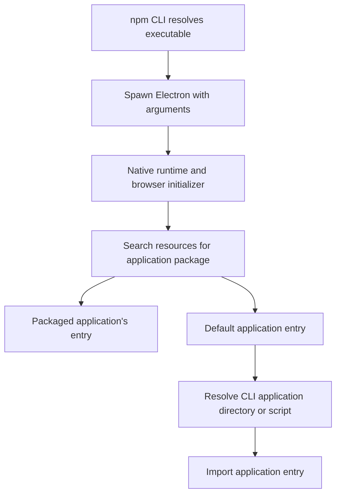

## Overview

Electron startup spans two environments. Under ordinary Node.js, the npm package exports an executable path and its CLI spawns that executable. Inside Electron, runtime initialization installs Electron module aliases, discovers an application package, and transfers control to its main script. The application setup in [[Quickstart]] enters through the CLI, while a packaged application is discovered beneath the executable's resources directory.

Sources: [npm/index.js:1-21](repo://npm/index.js#L1-L21), [npm/cli.js:3-14](repo://npm/cli.js#L3-L14), [lib/common/init.ts:78-119](repo://lib/common/init.ts#L78-L119), [lib/browser/init.ts:82-114](repo://lib/browser/init.ts#L82-L114), [default_app/main.ts:77-137](repo://default_app/main.ts#L77-L137)

## Install the executable

The npm manifest runs `install.js` after installation. The installer first honors `ELECTRON_SKIP_BINARY_DOWNLOAD`, then checks whether the existing version, platform path metadata, and executable are present. A successful check avoids another download. The version comparison strips a leading `v` from the installed version file, while the `path.txt` comparison must match the platform's expected executable path.

Sources: [npm/package.json:1-13](repo://npm/package.json#L1-L13), [npm/install.js:12-22](repo://npm/install.js#L12-L22), [npm/install.js:55-71](repo://npm/install.js#L55-L71)

Platform and architecture normally come from the running process, with npm configuration overrides taking precedence. On macOS, an apparent x64 process without an explicit architecture override checks whether it is translated by Rosetta and selects arm64 when appropriate. A failed translation check is ignored. Downloading delegates to `downloadArtifact`; successful extraction writes the executable-relative `path.txt` and moves bundled type declarations to the package root when present.

Sources: [npm/install.js:24-53](repo://npm/install.js#L24-L53), [npm/install.js:73-90](repo://npm/install.js#L73-L90)

| Setting | Effect in this installer |
| --- | --- |
| `ELECTRON_SKIP_BINARY_DOWNLOAD` | Exits before checking or downloading the binary |
| `npm_config_platform`, `npm_config_arch` | Override the download platform and architecture |
| `force_no_cache=true` | Sets the download's force option |
| `electron_config_cache` | Supplies the artifact cache root |
| `electron_use_remote_checksums`, falling back to `npm_config_electron_use_remote_checksums` | A truthy selected value omits the bundled checksum map |
| `ELECTRON_OVERRIDE_DIST_PATH` | Changes executable resolution and selected installer lookup paths |

Sources: [npm/install.js:14-50](repo://npm/install.js#L14-L50), [npm/install.js:68-89](repo://npm/install.js#L68-L89), [npm/index.js:6-18](repo://npm/index.js#L6-L18)

The override is not a general extraction destination: extraction still targets the package's `dist` directory, while type-definition lookup uses the override when set. Executable resolution joins the override directory with `path.txt`, or with `electron` if that metadata is absent. Unsupported platform names throw during platform-path selection; download or extraction rejection prints a stack and exits with status 1.

Sources: [npm/install.js:50-53](repo://npm/install.js#L50-L53), [npm/install.js:73-109](repo://npm/install.js#L73-L109), [npm/index.js:6-18](repo://npm/index.js#L6-L18)

## Cross the launcher boundary

The CLI resolves the package's exported path, spawns it with all arguments after the Node script name, and inherits standard streams. A normal child exit becomes the CLI's exit code; termination without an exit code prints the signal and returns 1. SIGINT and SIGTERM are forwarded while the child has not already been killed. The Linux native entry initializes command-line state and either enters Node mode when its fuse and environment flag allow it, or starts Chromium with Electron's main delegate.

Sources: [npm/cli.js:3-25](repo://npm/cli.js#L3-L25), [shell/app/electron_main_linux.cc:29-43](repo://shell/app/electron_main_linux.cc#L29-L43)

Sources: [npm/cli.js:3-14](repo://npm/cli.js#L3-L14), [shell/common/node_bindings.cc:653-704](repo://shell/common/node_bindings.cc#L653-L704), [lib/browser/init.ts:82-114](repo://lib/browser/init.ts#L82-L114), [lib/browser/init.ts:201-222](repo://lib/browser/init.ts#L201-L222), [default_app/main.ts:126-137](repo://default_app/main.ts#L126-L137), [default_app/main.ts:260-266](repo://default_app/main.ts#L260-L266)

## Discover and configure the application

Native Node bindings place `app.asar`, `app`, and `default_app.asar` into the browser context's application search list, in that order. The only-load-app-from-ASAR fuse narrows the list to `app.asar` and requires archive validation. Browser initialization joins each candidate to `process.resourcesPath`, attempts to load its package, and continues after failed candidates. If none succeeds, it schedules exit 1 and throws `Unable to find a valid app`; archive lookup itself is explained in [[ASAR File Access]].

Sources: [shell/common/node_bindings.cc:680-699](repo://shell/common/node_bindings.cc#L680-L699), [lib/browser/init.ts:82-114](repo://lib/browser/init.ts#L82-L114)

Once a package is found, its version, product name or name, desktop name, and optional V8 flags configure the application. Product name takes precedence over name; absent desktop name falls back to the application name plus `.desktop`. The initializer sets the application path and loads protocol, service-worker, frame, web-contents, and view support before user code. View inheritance must exist before BrowserWindow construction, connecting startup ordering to [[Windows and Web Contents]].

Sources: [lib/browser/init.ts:116-160](repo://lib/browser/init.ts#L116-L160)

## Load CommonJS or ESM

The startup script is `packageJson.main` or `index.js`. A `.mjs` entry, or a non-`.cjs` entry in a package whose type is `module`, uses the ESM loader. Electron imports its file URL and signals `appCodeLoaded` after completion. On ESM failure it still signals completion, then emits `uncaughtException`. The CommonJS branch signals first and calls `Module._load` synchronously, with the source comment identifying that ordering as a safety measure.

Sources: [lib/browser/init.ts:162-163](repo://lib/browser/init.ts#L162-L163), [lib/browser/init.ts:201-222](repo://lib/browser/init.ts#L201-L222)

For development launches, the default application resolves the supplied directory or script separately. It marks `process.defaultApp`, reads package metadata if present, resolves the entry with Node's module resolver, sets the app path, and imports the resulting file URL. Invalid package JSON and unresolvable application paths produce an error dialog and exit 1. URL and HTML arguments take separate default-app loading branches rather than this package flow.

Sources: [default_app/main.ts:77-148](repo://default_app/main.ts#L77-L148), [default_app/main.ts:260-266](repo://default_app/main.ts#L260-L266)

## Startup events and failures

Browser initialization restores the original argument list, connects native emitters to EventEmitter, and installs a fallback uncaught-exception dialog. The fallback does nothing when another uncaught-exception listener exists. Application quit emits the Node `exit` event, and `process.exit` is mapped to `app.exit`. These hooks are installed before application discovery, so they also govern errors encountered while loading the entry script.

Sources: [lib/browser/init.ts:12-45](repo://lib/browser/init.ts#L12-L45), [lib/browser/init.ts:73-83](repo://lib/browser/init.ts#L73-L83)

The default window-all-closed listener quits only when it is the sole listener. Application code can therefore own that lifecycle policy, as the first-app example does. The default menu is scheduled on `will-finish-launching` so it exists before user windows; [[Native Desktop Integration]] follows how an explicitly supplied application menu suppresses that default.

Sources: [lib/browser/init.ts:186-199](repo://lib/browser/init.ts#L186-L199), [docs/fiddles/tutorial-first-app/main.js:22-26](repo://docs/fiddles/tutorial-first-app/main.js#L22-L26), [lib/browser/default-menu.ts:6-13](repo://lib/browser/default-menu.ts#L6-L13)
