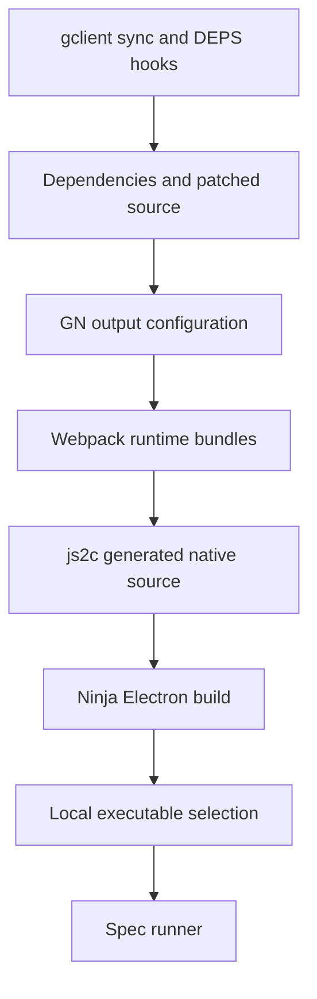

## Overview

Contributing to Electron means building the framework with Chromium and Node dependencies, then running its specs with that executable. GN generates the build and Ninja compiles it. The repository's npm scripts provide linting, definition generation, launch, and test entry points, but do not replace the native build. For an application using a prebuilt binary, the separate workflow is [[Quickstart]].

Sources: [docs/development/build-instructions-gn.md:3-30](repo://docs/development/build-instructions-gn.md#L3-L30), [package.json:65-94](repo://package.json#L65-L94), [script/start.js:1-8](repo://script/start.js#L1-L8)

## Prepare the checkout environment

The checked-in platform instructions specify Node.js 22.12.0 or later on Linux, macOS, and Windows. Linux and macOS also list Python 3.9 or later. Linux needs its native compiler and desktop-library development headers; macOS needs Xcode appropriate to the branch; Windows needs Visual Studio's compiler toolchain and applicable SDK components even though builds run through command-line scripts. These requirements describe this checkout's build documentation.

Sources: [docs/development/build-instructions-linux.md:7-23](repo://docs/development/build-instructions-linux.md#L7-L23), [docs/development/build-instructions-macos.md:7-14](repo://docs/development/build-instructions-macos.md#L7-L14), [docs/development/build-instructions-windows.md:7-44](repo://docs/development/build-instructions-windows.md#L7-L44)

Install depot_tools for dependency checkout. On Windows, the build guide sets `DEPOT_TOOLS_WIN_TOOLCHAIN=0` so depot_tools uses the locally installed Visual Studio toolchain. The manual checkout below places this repository under `src/electron`, alongside Chromium dependencies. Run it in a parent directory intended to contain the full build checkout, rather than inside an existing application project.

Sources: [docs/development/build-instructions-gn.md:32-42](repo://docs/development/build-instructions-gn.md#L32-L42), [docs/development/build-instructions-gn.md:59-89](repo://docs/development/build-instructions-gn.md#L59-L89)

```sh
mkdir electron && cd electron
gclient config --name "src/electron" --unmanaged https://github.com/electron/electron
gclient sync --with_branch_heads --with_tags
```

Sources: [docs/development/build-instructions-gn.md:61-66](repo://docs/development/build-instructions-gn.md#L61-L66)

DEPS controls the dependency checkout. Its hooks apply the repository's configured patches when enabled and install repository JavaScript dependencies with the configured Yarn version and a frozen lockfile. After updating Electron source, the build guide uses `gclient sync -f` to bring dependencies back into agreement with DEPS. A plain repository clone does not by itself provide the surrounding build tree expected by these commands.

Sources: [DEPS:129-159](repo://DEPS#L129-L159), [docs/development/build-instructions-gn.md:86-97](repo://docs/development/build-instructions-gn.md#L86-L97)

## Generate and compile a configuration

Run GN and Ninja from the checkout's `src` directory. Set CHROMIUM_BUILDTOOLS_PATH to that directory's buildtools subdirectory; the guide provides shell-specific forms for Unix, Windows cmd, and PowerShell. The following Testing commands are the Unix form. Testing enables DCHECKs, uses symbol level 1, and is neither a debug nor an official build; the configuration name alone does not imply `is_debug=true`.

Sources: [docs/development/build-instructions-gn.md:99-137](repo://docs/development/build-instructions-gn.md#L99-L137), [build/args/testing.gn:1-7](repo://build/args/testing.gn#L1-L7)

```sh
cd src
export CHROMIUM_BUILDTOOLS_PATH=`pwd`/buildtools
gn gen out/Testing --args="import(\"//electron/build/args/testing.gn\")"
ninja -C out/Testing electron
```

Sources: [docs/development/build-instructions-gn.md:105-108](repo://docs/development/build-instructions-gn.md#L105-L108), [docs/development/build-instructions-gn.md:124-128](repo://docs/development/build-instructions-gn.md#L124-L128), [docs/development/build-instructions-gn.md:163-170](repo://docs/development/build-instructions-gn.md#L163-L170)

Release imports the release configuration and sets official-build mode. Keep it in a separate output directory. Both configurations use shared FFmpeg; the release file explains that this supports applications that choose different codec or library-distribution arrangements. `gn args out/Testing` edits an existing configuration, and its `--list` form displays available build arguments.

Sources: [build/args/testing.gn:1-7](repo://build/args/testing.gn#L1-L7), [build/args/release.gn:1-9](repo://build/args/release.gn#L1-L9), [docs/development/build-instructions-gn.md:140-175](repo://docs/development/build-instructions-gn.md#L140-L175)

```sh
gn gen out/Release --args="import(\"//electron/build/args/release.gn\")"
ninja -C out/Release electron
```

Sources: [docs/development/build-instructions-gn.md:142-146](repo://docs/development/build-instructions-gn.md#L142-L146), [docs/development/build-instructions-gn.md:172-176](repo://docs/development/build-instructions-gn.md#L172-L176)

## Understand generated runtime code

The GN build creates separate browser, renderer, worker, sandboxed-renderer, isolated-renderer, Node, utility, and preload-realm bundles. The shared webpack configuration chooses each target's initializer and Electron API exports, resolves internal aliases, supplies required globals, and compiles TypeScript. The GN webpack template passes generated build flags and chooses production mode for official builds. The js2c action then turns the runtime bundles into generated `electron_natives.cc` for the native build.

Sources: [BUILD.gn:165-272](repo://BUILD.gn#L165-L272), [build/webpack/webpack.config.base.js:21-34](repo://build/webpack/webpack.config.base.js#L21-L34), [build/webpack/webpack.config.base.js:63-81](repo://build/webpack/webpack.config.base.js#L63-L81), [build/webpack/webpack.config.base.js:117-152](repo://build/webpack/webpack.config.base.js#L117-L152), [build/webpack/webpack.gni:25-44](repo://build/webpack/webpack.gni#L25-L44)



Sources: [DEPS:129-159](repo://DEPS#L129-L159), [docs/development/build-instructions-gn.md:122-175](repo://docs/development/build-instructions-gn.md#L122-L175), [BUILD.gn:237-272](repo://BUILD.gn#L237-L272), [BUILD.gn:423-437](repo://BUILD.gn#L423-L437), [script/lib/utils.js:15-61](repo://script/lib/utils.js#L15-L61), [script/spec-runner.js:194-207](repo://script/spec-runner.js#L194-L207)

## Select and launch the built executable

From the Electron repository directory, `npm start` invokes the local start script. The shared utility selects an explicit output-directory option or ELECTRON_OUT_DIR first, verifying that it exists. Otherwise it searches Testing, Release, Default, then Debug. It throws when none exists, and maps the chosen directory to the platform executable. The launcher forwards arguments and standard streams, propagates the child exit code, and forwards termination signals.

Sources: [package.json:90-92](repo://package.json#L90-L92), [script/lib/utils.js:15-61](repo://script/lib/utils.js#L15-L61), [script/start.js:1-19](repo://script/start.js#L1-L19)

For a distributable framework archive, the documented release target is electron_dist_zip. This packages the Electron build, rather than packaging an application's own source files.

Sources: [docs/development/build-instructions-gn.md:3-5](repo://docs/development/build-instructions-gn.md#L3-L5), [docs/development/build-instructions-gn.md:192-198](repo://docs/development/build-instructions-gn.md#L192-L198)

```sh
ninja -C out/Release electron:electron_dist_zip
```

Sources: [docs/development/build-instructions-gn.md:194-198](repo://docs/development/build-instructions-gn.md#L194-L198)

## Run framework specs

Run tests from the Electron repository directory. `npm run test` first generates TypeScript definitions through its pretest script, then launches spec-runner. Tests themselves are an Electron application with separate dependencies. The checked-in testing guide provides the following filtered invocation for IPC tests; remove the filter to run the full suite.

Sources: [package.json:79-92](repo://package.json#L79-L92), [docs/development/testing.md:24-38](repo://docs/development/testing.md#L24-L38)

```sh
npm run test -- -g ipc
```

Sources: [docs/development/testing.md:35-38](repo://docs/development/testing.md#L35-L38)

The runner hashes the spec manifest, lockfile, runner source, and installed dependency contents. Changed hashes trigger dependency installation and saved-hash updates. Local builds supply generated Node headers; version-targeted runs instead obtain release headers. Installation removes existing spec node_modules before running frozen-lockfile Yarn. Missing type definitions are generated, the main-process runner launches the selected executable, and Linux execution adds the DBus mock wrapper. Failed status or signal exits the runner with status 1.

Sources: [script/spec-runner.js:92-107](repo://script/spec-runner.js#L92-L107), [script/spec-runner.js:194-262](repo://script/spec-runner.js#L194-L262), [script/spec-runner.js:265-286](repo://script/spec-runner.js#L265-L286)

## Validate the changed surface

The package exposes language-specific lint scripts for JavaScript, C++, Objective-C, Python, and GN. Its documentation lint pipeline also checks examples, relative links, API history, and generated types. Definition generation parses repository docs into electron-api.json, generates declarations, and runs the TypeScript smoke runner. Since the docs command starts with remark's fix flag and generation writes files, inspect resulting changes after using that pipeline.

Sources: [package.json:65-84](repo://package.json#L65-L84), [script/create-api-json.mjs:8-17](repo://script/create-api-json.mjs#L8-L17)

For changes affecting Node embedding, the Node spec runner invokes the dependency's Python test driver with Electron as its shell. It runs inside the Electron Node source directory with ELECTRON_RUN_AS_NODE and the eager ASAR testing hook enabled. The testing guide shows both a complete run and selection of a single Node test by its source-tree path, allowing this integration check to match the changed runtime area.

Sources: [script/node-spec-runner.js:15-19](repo://script/node-spec-runner.js#L15-L19), [script/node-spec-runner.js:41-56](repo://script/node-spec-runner.js#L41-L56), [script/node-spec-runner.js:80-90](repo://script/node-spec-runner.js#L80-L90), [docs/development/testing.md:40-59](repo://docs/development/testing.md#L40-L59)
