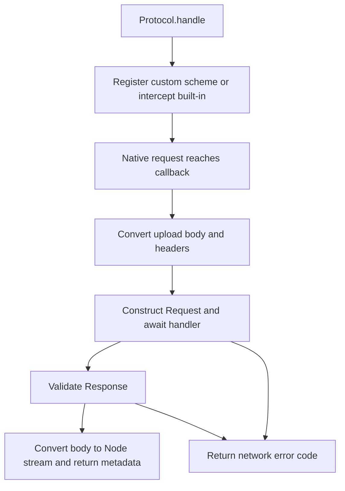

## Overview

Electron protocol handlers adapt Chromium requests into web Request objects and adapt returned Responses back into native protocol data. The modern `handle` wrapper accepts a synchronous or asynchronous handler, performs the conversion, and reports transport errors when conversion fails. The top-level protocol object forwards handler operations to the default session; a specific session's protocol object keeps registration associated with the context described in [[Sessions and Networking]].

Sources: [lib/browser/api/protocol.ts:111-147](repo://lib/browser/api/protocol.ts#L111-L147), [lib/browser/api/protocol.ts:159-180](repo://lib/browser/api/protocol.ts#L159-L180), [shell/browser/protocol_registry.cc:15-17](repo://shell/browser/protocol_registry.cc#L15-L17)

## Scheme privileges and lifecycle

`registerSchemesAsPrivileged` is global initialization, separate from installing a response handler. Its native entry rejects calls after application readiness. Input must convert to an array of custom schemes, each with a scheme name and optional privileges. Every privilege defaults to false. The implementation validates the entire list's code-cache requirement before adding schemes: code caching requires the same scheme to be marked standard.

Sources: [shell/browser/api/electron_api_protocol.cc:40-82](repo://shell/browser/api/electron_api_protocol.cc#L40-L82), [shell/browser/api/electron_api_protocol.cc:110-125](repo://shell/browser/api/electron_api_protocol.cc#L110-L125), [shell/browser/api/electron_api_protocol.cc:348-357](repo://shell/browser/api/electron_api_protocol.cc#L348-L357)

| Privilege | Registration performed |
| --- | --- |
| `standard` | Adds a standard host-bearing scheme and marks it web-safe |
| `secure` | Adds the scheme to secure schemes |
| `bypassCSP` | Adds the scheme to CSP-bypassing schemes |
| `corsEnabled` | Adds the scheme to CORS-enabled schemes |
| `supportFetchAPI` | Collects the scheme for fetch support in child processes |
| `allowServiceWorkers` | Adds service-worker scheme support |
| `stream` | Records a streaming scheme |
| `codeCache` | Records and registers a code-cache scheme, requiring standard |

Sources: [shell/browser/api/electron_api_protocol.cc:127-188](repo://shell/browser/api/electron_api_protocol.cc#L127-L188)

The privileged scheme lists are also appended to command-line switches so child processes can register them. Actual request handlers live in ProtocolRegistry maps. Registered schemes can be converted into Electron URL-loader factories, while interception uses a separate map. This separation explains why setting a scheme's privileges does not by itself provide response content.

Sources: [shell/browser/api/electron_api_protocol.cc:166-188](repo://shell/browser/api/electron_api_protocol.cc#L166-L188), [shell/browser/protocol_registry.cc:43-46](repo://shell/browser/protocol_registry.cc#L43-L46), [shell/browser/protocol_registry.cc:66-98](repo://shell/browser/protocol_registry.cc#L66-L98)

## Register or intercept a handler

The JavaScript wrapper treats `http`, `https`, and `file` as built-in schemes and uses interception for them. Other schemes use registration. The native registry inserts rather than replaces existing entries, so duplicate registration fails and `handle` throws `Failed to register protocol` with the scheme. The handler is attached to the Protocol instance on which handle was called; the top-level convenience wrapper explicitly chooses the default session's instance.

Sources: [lib/browser/api/protocol.ts:13-13](repo://lib/browser/api/protocol.ts#L13-L13), [lib/browser/api/protocol.ts:111-147](repo://lib/browser/api/protocol.ts#L111-L147), [lib/browser/api/protocol.ts:178-180](repo://lib/browser/api/protocol.ts#L178-L180), [shell/browser/protocol_registry.cc:66-86](repo://shell/browser/protocol_registry.cc#L66-L86)

Sources: [lib/browser/api/protocol.ts:48-109](repo://lib/browser/api/protocol.ts#L48-L109), [lib/browser/api/protocol.ts:111-147](repo://lib/browser/api/protocol.ts#L111-L147)

## Convert incoming upload data

No upload data produces a null body. A single raw-data chunk uses its bytes directly, avoiding a stream allocation. All other upload lists become a ReadableStream that consumes a copied chunk list in order. A current file or pipe reader is drained before the converter advances to the next chunk, and the stream closes once no chunks remain. Unsupported chunk types throw an error that names the type.

Sources: [lib/browser/api/protocol.ts:48-89](repo://lib/browser/api/protocol.ts#L48-L89)

| Upload chunk | Conversion |
| --- | --- |
| Raw data | Enqueues its byte buffer |
| File | Opens a Node file stream with offset and optional end, then converts it to a web stream |
| Stream | Pulls from a native pipe into a one-megabyte buffer and enqueues copied slices |
| Blob | Retrieves the blob bytes through defaultSession's blob-data API |

Sources: [lib/browser/api/protocol.ts:15-89](repo://lib/browser/api/protocol.ts#L15-L89)

The blob path deliberately uses the default session even when the request belongs elsewhere. The source explains that this blob-data implementation relies on global state rather than its Session context, so it does not require discovering the request's owning session. File conversion defaults to offset zero and unspecified length; when length is supplied, the wrapper passes offset plus length as the Node stream's end option. Pipe read failures error their web stream.

Sources: [lib/browser/api/protocol.ts:15-45](repo://lib/browser/api/protocol.ts#L15-L45), [lib/browser/api/protocol.ts:77-85](repo://lib/browser/api/protocol.ts#L77-L85)

## Construct the web Request

The callback creates Headers from the native request and removes an origin header whose value is the literal string `null`. It builds Request with URL, method, referrer, converted headers, and body. A streaming body receives duplex mode `half`. The application handler then runs under `await`, so both a returned Response and a promised Response enter the same validation branch.

Sources: [lib/browser/api/protocol.ts:111-127](repo://lib/browser/api/protocol.ts#L111-L127)

This handler can return a response obtained through Electron fetch. The outbound fetch adapter accepts the `bypassCustomProtocolHandlers` option and writes it into the native URL-loader options. That provides an explicit transport setting when a handler needs outbound work without re-entering custom handlers; request construction, session selection, and cancellation remain owned by [[Sessions and Networking]].

Sources: [docs/api/protocol.md:170-176](repo://docs/api/protocol.md#L170-L176), [lib/browser/api/net-fetch.ts:79-99](repo://lib/browser/api/net-fetch.ts#L79-L99)

## Return a response or an error

Response validation rejects absent and non-object results, accepts error-type responses for separate handling, and checks the types of own status, statusText, headers, and body properties when present. A non-null body property must be a web ReadableStream. This is a structural check, not an unconditional `instanceof Response` test; the callback still needs to successfully convert the accepted result afterward.

Sources: [lib/browser/api/protocol.ts:92-109](repo://lib/browser/api/protocol.ts#L92-L109), [lib/browser/api/protocol.ts:127-144](repo://lib/browser/api/protocol.ts#L127-L144)

For successful responses, a body becomes a Node readable via `Readable.fromWeb`, headers become a plain object, and status code and status text pass to the native callback. When the response came from Electron fetch, its attached original response can supply the original MIME type. Invalid structures return `ERR_UNEXPECTED` (-9), an error-type response returns `ERR_FAILED` (-2), and exceptions during construction, handling, or conversion are logged and return `ERR_UNEXPECTED`.

Sources: [lib/browser/api/protocol.ts:10-11](repo://lib/browser/api/protocol.ts#L10-L11), [lib/browser/api/protocol.ts:127-144](repo://lib/browser/api/protocol.ts#L127-L144), [lib/browser/api/net-fetch.ts:109-115](repo://lib/browser/api/net-fetch.ts#L109-L115)

## Remove and inspect handlers

`unhandle` mirrors registration: built-ins use uninterception and other schemes use unregistration. Removing an absent entry returns false in the registry, which the JavaScript wrapper turns into an exception. The JavaScript `isProtocolHandled` wrapper likewise selects the matching registered or intercepted lookup and returns that lookup result. Both operations inspect the same Protocol instance, so choose the session whose handler you intend to manage.

Sources: [lib/browser/api/protocol.ts:149-180](repo://lib/browser/api/protocol.ts#L149-L180), [shell/browser/protocol_registry.cc:72-98](repo://shell/browser/protocol_registry.cc#L72-L98)
