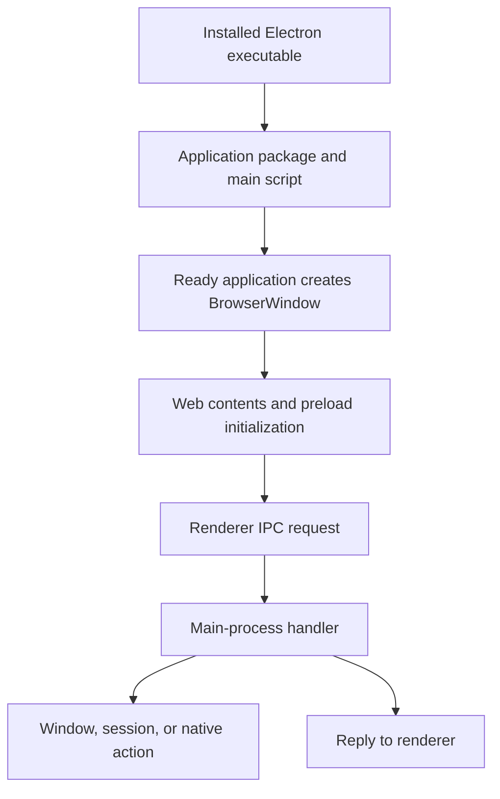

## Overview

Electron is a framework for building desktop applications with JavaScript, HTML, and CSS on top of Chromium and Node.js. This repository contains the framework, its runtime wrappers, application examples, and the tooling used to build Electron itself. An application can use a prebuilt Electron package; a contributor changing the framework instead builds its Chromium-linked native executable. Those are separate entry points into the same runtime.

Sources: [README.md:9-12](repo://README.md#L9-L12), [README.md:22-34](repo://README.md#L22-L34), [docs/development/build-instructions-gn.md:3-30](repo://docs/development/build-instructions-gn.md#L3-L30)

The main process loads the application's package and startup script, while BrowserWindow connects a native window to web content. Renderer preload scripts provide a place to expose selected capabilities to the page. Cross-process messages then reach main-process handlers that can act on windows or other native APIs. The small application in [[Quickstart]] demonstrates the first part of this path without requiring a source build.

Sources: [lib/browser/init.ts:92-141](repo://lib/browser/init.ts#L92-L141), [lib/browser/init.ts:201-222](repo://lib/browser/init.ts#L201-L222), [lib/browser/api/browser-window.ts:131-150](repo://lib/browser/api/browser-window.ts#L131-L150), [lib/sandboxed_renderer/init.ts:16-71](repo://lib/sandboxed_renderer/init.ts#L16-L71), [lib/browser/ipc-dispatch.ts:58-108](repo://lib/browser/ipc-dispatch.ts#L58-L108), [docs/fiddles/tutorial-first-app/main.js:1-26](repo://docs/fiddles/tutorial-first-app/main.js#L1-L26)

## Runtime areas

| Area | What it does | Page |
| --- | --- | --- |
| First application | Creates a window after readiness and loads local HTML | [[Quickstart]] |
| Executable and startup | Downloads the binary, resolves its path, and loads application code | [[Binary Installation and Application Startup]] |
| Window ownership | Connects native window events to web content and navigation | [[Windows and Web Contents]] |
| Renderer capabilities | Runs preloads and exposes APIs across isolated worlds | [[Preloads and Context Isolation]] |
| Messages | Dispatches events and request/reply calls to main-process handlers | [[Interprocess Communication]] |
| Browser state and requests | Supplies session objects and session-bound fetch operations | [[Sessions and Networking]] |
| URL handlers | Converts custom protocol requests and responses | [[Custom Protocols]] |
| Packaged files | Resolves paths inside ASAR archives through filesystem wrappers | [[ASAR File Access]] |
| Background children | Forks utility scripts with messages and optional output pipes | [[Utility Processes]] |
| Native user actions | Builds application menus and routes actions to desktop APIs | [[Native Desktop Integration]] |
| Framework development | Generates builds and runs framework specs | [[Building and Testing Electron]] |

Sources: [docs/fiddles/tutorial-first-app/main.js:1-26](repo://docs/fiddles/tutorial-first-app/main.js#L1-L26), [npm/install.js:41-90](repo://npm/install.js#L41-L90), [lib/browser/init.ts:201-222](repo://lib/browser/init.ts#L201-L222), [lib/browser/api/browser-window.ts:8-98](repo://lib/browser/api/browser-window.ts#L8-L98), [lib/renderer/api/context-bridge.ts:1-20](repo://lib/renderer/api/context-bridge.ts#L1-L20), [lib/browser/ipc-dispatch.ts:58-108](repo://lib/browser/ipc-dispatch.ts#L58-L108), [lib/browser/api/session.ts:44-46](repo://lib/browser/api/session.ts#L44-L46), [lib/browser/api/protocol.ts:111-147](repo://lib/browser/api/protocol.ts#L111-L147), [lib/node/asar-fs-wrapper.ts:29-87](repo://lib/node/asar-fs-wrapper.ts#L29-L87), [lib/browser/api/utility-process.ts:93-151](repo://lib/browser/api/utility-process.ts#L93-L151), [lib/browser/default-menu.ts:48-60](repo://lib/browser/default-menu.ts#L48-L60), [docs/development/build-instructions-gn.md:122-175](repo://docs/development/build-instructions-gn.md#L122-L175), [script/spec-runner.js:92-107](repo://script/spec-runner.js#L92-L107)

## Main application flow

Sources: [npm/index.js:4-21](repo://npm/index.js#L4-L21), [lib/browser/init.ts:201-222](repo://lib/browser/init.ts#L201-L222), [docs/fiddles/tutorial-first-app/main.js:1-20](repo://docs/fiddles/tutorial-first-app/main.js#L1-L20), [lib/sandboxed_renderer/init.ts:16-71](repo://lib/sandboxed_renderer/init.ts#L16-L71), [lib/browser/ipc-dispatch.ts:76-108](repo://lib/browser/ipc-dispatch.ts#L76-L108), [lib/browser/api/module-list.ts:4-42](repo://lib/browser/api/module-list.ts#L4-L42)

1. [[Binary Installation and Application Startup]] follows executable resolution and the main-script handoff, including the different completion paths for CommonJS and ESM.
2. [[Windows and Web Contents]] follows the window that the ready application creates and the content-loading methods it forwards.
3. [[Preloads and Context Isolation]] follows preload initialization and the bridge used to expose APIs to a different world.
4. [[Interprocess Communication]] follows a renderer invocation through handler selection, asynchronous completion, and the returned result or error.
5. [[Sessions and Networking]] and [[Native Desktop Integration]] describe the browser-owned services available to main-process code once application startup has established its runtime.

Sources: [lib/browser/init.ts:201-222](repo://lib/browser/init.ts#L201-L222), [lib/browser/api/browser-window.ts:131-150](repo://lib/browser/api/browser-window.ts#L131-L150), [lib/renderer/api/context-bridge.ts:7-20](repo://lib/renderer/api/context-bridge.ts#L7-L20), [lib/browser/ipc-dispatch.ts:76-108](repo://lib/browser/ipc-dispatch.ts#L76-L108), [lib/browser/api/module-list.ts:4-42](repo://lib/browser/api/module-list.ts#L4-L42)

## Design decisions across systems

Electron actively wakes Node's event loop when scheduling work. The shared initializer wraps next-tick, immediate, and timer functions because Chromium's event loop can otherwise leave Node callbacks waiting or prevent its polling timeout from being recalculated. This is an explicit integration constraint, and explains why apparently ordinary timer calls participate in runtime bootstrap.

Sources: [lib/common/init.ts:8-62](repo://lib/common/init.ts#L8-L62)

API availability is assembled for each runtime target. The build resolves Electron imports to a target-specific export file and supplies globals differently depending on whether that target always has Node. At runtime, property descriptors load individual API modules through getters. Consequently, an API wrapper belongs to a process context rather than to one universal bundle with identical capabilities everywhere.

Sources: [build/webpack/webpack.config.base.js:21-34](repo://build/webpack/webpack.config.base.js#L21-L34), [build/webpack/webpack.config.base.js:63-81](repo://build/webpack/webpack.config.base.js#L63-L81), [build/webpack/webpack.config.base.js:109-126](repo://build/webpack/webpack.config.base.js#L109-L126), [lib/common/define-properties.ts:1-17](repo://lib/common/define-properties.ts#L1-L17)

Isolation is enforced at API boundaries. The public context bridge checks that context isolation is enabled before invoking its native binding, and sandboxed preload initialization offers a defined module set. These are observable runtime checks and capabilities; the detailed loading rules belong to [[Preloads and Context Isolation]].

Sources: [lib/renderer/api/context-bridge.ts:1-20](repo://lib/renderer/api/context-bridge.ts#L1-L20), [lib/sandboxed_renderer/init.ts:24-39](repo://lib/sandboxed_renderer/init.ts#L24-L39)

Ordering also carries correctness guarantees. Window-view inheritance is initialized before application code can create BrowserWindow instances. IPC resolves frames by frame-tree node ID so messages sent during frame replacement can still be received, then gives frame handlers priority over web-contents and global handlers. These decisions explain why moving initialization or dispatch logic can affect behavior beyond one API.

Sources: [lib/browser/init.ts:146-160](repo://lib/browser/init.ts#L146-L160), [lib/browser/ipc-dispatch.ts:33-53](repo://lib/browser/ipc-dispatch.ts#L33-L53), [lib/browser/ipc-dispatch.ts:85-107](repo://lib/browser/ipc-dispatch.ts#L85-L107)
