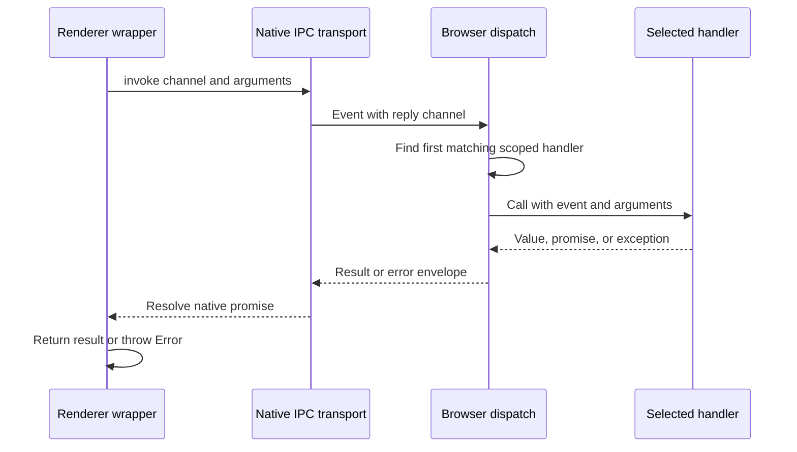

## Overview

Electron IPC carries renderer events, asynchronous requests, synchronous requests, and transferable message ports to browser-owned handlers. The renderer wrapper delegates transport to a native binding; browser dispatch decides which emitter or invoke handler receives the channel. A function exposed as described in [[Preloads and Context Isolation]] can use this transport while keeping the page-facing interface specific to an application operation.

Sources: [lib/renderer/api/ipc-renderer.ts:1-34](repo://lib/renderer/api/ipc-renderer.ts#L1-L34), [lib/browser/ipc-dispatch.ts:58-108](repo://lib/browser/ipc-dispatch.ts#L58-L108), [docs/fiddles/ipc/pattern-2/preload.js:1-5](repo://docs/fiddles/ipc/pattern-2/preload.js#L1-L5)

## Choose the message contract

| Renderer operation | Browser-side contract | Completion |
| --- | --- | --- |
| `send` | Emit the channel to relevant listeners | No result envelope |
| `invoke` | Find one registered invoke handler | Promise yielding a result or throwing a remote error |
| `sendSync` | Emit with a writable `event.returnValue` | Native synchronous reply is deserialized |
| `postMessage` | Emit the message with wrapped ports on the event | Transferable message delivery |
| `sendToHost` | Emit the internal host-message event on the sender | Host-directed delivery |

Sources: [lib/renderer/api/ipc-renderer.ts:8-31](repo://lib/renderer/api/ipc-renderer.ts#L8-L31), [lib/browser/ipc-dispatch.ts:10-21](repo://lib/browser/ipc-dispatch.ts#L10-L21), [lib/browser/ipc-dispatch.ts:58-150](repo://lib/browser/ipc-dispatch.ts#L58-L150), [shell/renderer/api/electron_api_ipc_renderer.cc:164-181](repo://shell/renderer/api/electron_api_ipc_renderer.cc#L164-L181)

The public renderer singleton always passes `internal = false`. The browser reads an internal marker from the event and routes marked messages exclusively to Electron's internal emitter. This separates application channels from runtime support channels. A channel named `error` is valid for IpcMainImpl: its constructor installs an empty error listener so EventEmitter's special unhandled-error behavior does not make that name unusable.

Sources: [lib/renderer/api/ipc-renderer.ts:5-23](repo://lib/renderer/api/ipc-renderer.ts#L5-L23), [lib/browser/ipc-dispatch.ts:58-73](repo://lib/browser/ipc-dispatch.ts#L58-L73), [lib/browser/ipc-main-impl.ts:5-13](repo://lib/browser/ipc-main-impl.ts#L5-L13)

## Follow an invocation

Native renderer `Invoke` first checks that its IPC connection still exists, then serializes arguments into a cloneable message. Serialization failure stops the call. It creates a promise, sends the message through the remote endpoint, and resolves the native promise when the callback supplies a reply. The browser endpoint locates the frame's session, constructs an event carrying sender and reply-channel information, and passes the invocation into that session.

Sources: [shell/renderer/api/electron_api_ipc_renderer.cc:82-106](repo://shell/renderer/api/electron_api_ipc_renderer.cc#L82-L106), [shell/browser/electron_api_ipc_handler_impl.cc:57-70](repo://shell/browser/electron_api_ipc_handler_impl.cc#L57-L70), [shell/browser/electron_api_ipc_handler_impl.cc:121-178](repo://shell/browser/electron_api_ipc_handler_impl.cc#L121-L178)

Sources: [lib/renderer/api/ipc-renderer.ts:21-27](repo://lib/renderer/api/ipc-renderer.ts#L21-L27), [shell/renderer/api/electron_api_ipc_renderer.cc:82-106](repo://shell/renderer/api/electron_api_ipc_renderer.cc#L82-L106), [lib/browser/ipc-dispatch.ts:76-108](repo://lib/browser/ipc-dispatch.ts#L76-L108)

Browser dispatch awaits `Promise.resolve(handler(event, ...args))`, so synchronous values and promises share the same completion path. A successful value is returned in a result envelope. A thrown or rejected error is logged and converted to its string representation in an error envelope. The renderer wrapper then creates a new Error containing the channel and remote error text; it does not receive the original Error instance through this path.

Sources: [lib/browser/ipc-dispatch.ts:79-107](repo://lib/browser/ipc-dispatch.ts#L79-L107), [lib/renderer/api/ipc-renderer.ts:21-27](repo://lib/renderer/api/ipc-renderer.ts#L21-L27)

## Handler registration and dispatch order

`handle` requires a function and rejects a second handler for the same channel on the same emitter. `handleOnce` wraps the function, removes its registration before calling it, and returns its result. Removal before execution means a later invocation cannot select that one-shot handler even if the first invocation is still awaiting asynchronous work. `removeHandler` deletes the registration from the map.

Sources: [lib/browser/ipc-main-impl.ts:15-34](repo://lib/browser/ipc-main-impl.ts#L15-L34)

Frame dispatch checks the frame's IPC emitter, the sender WebContents' IPC emitter, then global ipcMain. Invoke selects the first emitter with a registered handler, while ordinary send emits to all available emitters in that order after the sender's general `ipc-message` event. Frame lookup uses frame-tree node ID so messages sent during frame replacement can still reach the appropriate scope; the emitter array is cached to avoid frequent allocation.

Sources: [lib/browser/ipc-dispatch.ts:33-73](repo://lib/browser/ipc-dispatch.ts#L33-L73), [lib/browser/ipc-dispatch.ts:85-107](repo://lib/browser/ipc-dispatch.ts#L85-L107)

Service-worker events take a separate route. Dispatch attaches a lazy `serviceWorker` property and finds the worker by version ID within the event's session. Worker messages and invocations target that worker's IPC emitter; they do not use the frame/WebContents/global target sequence. Missing invoke handlers in either route produce the explicit `No handler registered` error reply.

Sources: [lib/browser/ipc-dispatch.ts:24-31](repo://lib/browser/ipc-dispatch.ts#L24-L31), [lib/browser/ipc-dispatch.ts:70-107](repo://lib/browser/ipc-dispatch.ts#L70-L107)

## Reply to the originating frame

For ordinary frame messages, `event.reply` captures the original process and frame IDs and sends through `sendToFrame`. By contrast, `webContents.send` targets the main frame. `sendToFrame` resolves either a routing ID within the main frame's process or a process/frame pair, returns false when no frame is found, and returns true after dispatch. Use these distinctions when the sender can be a subframe.

Sources: [lib/browser/ipc-dispatch.ts:10-15](repo://lib/browser/ipc-dispatch.ts#L10-L15), [lib/browser/api/web-contents.ts:125-148](repo://lib/browser/api/web-contents.ts#L125-L148)

Synchronous messages receive a `returnValue` setter that immediately sends through the reply channel. The browser checks for both general WebContents listeners and scoped channel listeners, warning when none exist. The native renderer call waits for its reply object and deserializes it before returning. This path has different execution and reply mechanics from promise-based invoke.

Sources: [lib/browser/ipc-dispatch.ts:17-21](repo://lib/browser/ipc-dispatch.ts#L17-L21), [lib/browser/ipc-dispatch.ts:110-133](repo://lib/browser/ipc-dispatch.ts#L110-L133), [shell/renderer/api/electron_api_ipc_renderer.cc:164-181](repo://shell/renderer/api/electron_api_ipc_renderer.cc#L164-L181)

## Transfer ports and handle released contexts

Native postMessage serializes the message, converts the transfer list, and extracts MessagePort channels. An invalid transfer value throws before delivery. Browser dispatch wraps incoming ports as MessagePortMain instances. Their wrapper forwards start and close, converts outgoing transferred wrappers back to native ports, and wraps ports received inside subsequent message events. [[Utility Processes]] uses these same main-process port wrappers when communicating with a child.

Sources: [shell/renderer/api/electron_api_ipc_renderer.cc:108-147](repo://shell/renderer/api/electron_api_ipc_renderer.cc#L108-L147), [lib/browser/ipc-dispatch.ts:139-150](repo://lib/browser/ipc-dispatch.ts#L139-L150), [lib/browser/message-port-main.ts:3-28](repo://lib/browser/message-port-main.ts#L3-L28), [lib/browser/api/utility-process.ts:134-139](repo://lib/browser/api/utility-process.ts#L134-L139)

Transport entry points check whether the renderer connection has been released and throw instead of sending through an absent connection. Browser IPC handlers delete themselves when WebContents are destroyed or the connection disconnects. Those lifetime failures are separate from an application handler's rejected promise, even though both can surface while a renderer is trying to complete work.

Sources: [shell/renderer/api/electron_api_ipc_renderer.cc:66-94](repo://shell/renderer/api/electron_api_ipc_renderer.cc#L66-L94), [shell/browser/electron_api_ipc_handler_impl.cc:30-42](repo://shell/browser/electron_api_ipc_handler_impl.cc#L30-L42)
