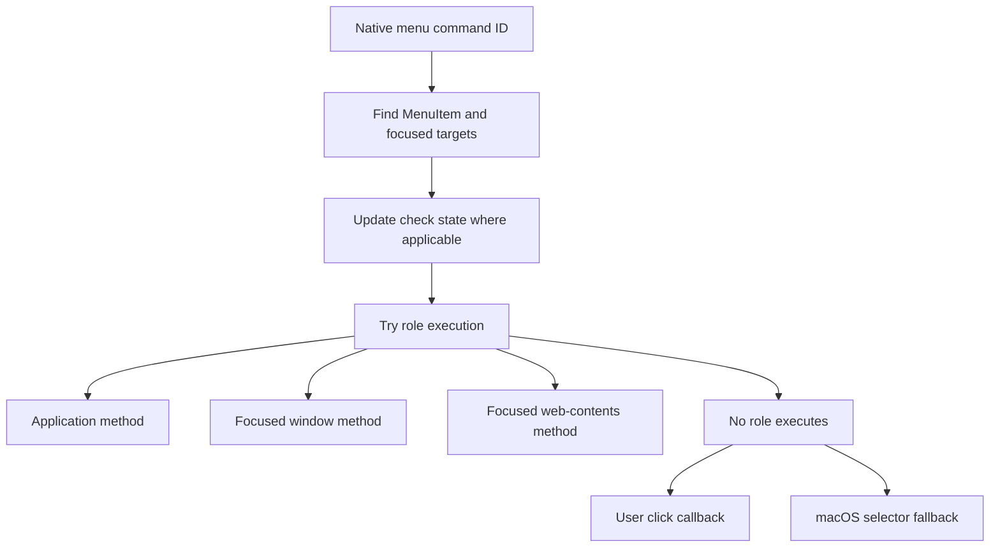

## Overview

Menus and dialogs turn main-process application actions into native user interfaces. Menu templates become native menu items whose commands resolve the focused window and web contents. Dialog wrappers normalize arguments and options before calling native bindings. These flows use the window ownership described in [[Windows and Web Contents]]; a renderer can request a dialog through the invocation pattern in [[Interprocess Communication]].

Sources: [lib/browser/api/menu.ts:54-59](repo://lib/browser/api/menu.ts#L54-L59), [lib/browser/api/menu.ts:190-211](repo://lib/browser/api/menu.ts#L190-L211), [lib/browser/api/dialog.ts:115-154](repo://lib/browser/api/dialog.ts#L115-L154), [docs/fiddles/ipc/pattern-2/main.js:1-22](repo://docs/fiddles/ipc/pattern-2/main.js#L1-L22)

## Build a menu from a template

`Menu.buildFromTemplate` requires an array. Its item validation accepts non-null objects with a label, a role, or separator type. It recursively sorts array submenus, removes extra separators, creates a Menu, and appends existing MenuItem objects or constructs new ones from option objects. Separator cleanup collapses adjacent separators and removes edge separators while retaining explicitly invisible entries.

Sources: [lib/browser/api/menu.ts:190-232](repo://lib/browser/api/menu.ts#L190-L232), [lib/browser/api/menu.ts:251-265](repo://lib/browser/api/menu.ts#L251-L265)

MenuItem preserves extra option fields, lowercases string roles, obtains role-defined submenus when necessary, and recursively builds submenu templates. It fills defaults for label, enabled, visible, checked, and accelerator behavior; rejects unknown item types or invalid submenu construction; and assigns a unique command ID. Insertion dispatches to the native operation for the item type, records the parent menu, and indexes the command for later execution.

Sources: [lib/browser/api/menu-item.ts:7-45](repo://lib/browser/api/menu-item.ts#L7-L45), [lib/browser/api/menu-item.ts:74-98](repo://lib/browser/api/menu-item.ts#L74-L98), [lib/browser/api/menu.ts:127-156](repo://lib/browser/api/menu.ts#L127-L156), [lib/browser/api/menu.ts:267-298](repo://lib/browser/api/menu.ts#L267-L298)

## Dispatch a user command

When native code invokes a command ID, the menu finds that MenuItem, obtains the focused BaseWindow and focused WebContents, and calls the item's click wrapper. Checkboxes and radio items update their checked state unless the role controls it. The wrapper attempts role execution first; if no role executes, it calls the user callback, or on macOS forwards an explicit selector to the first responder.

Sources: [lib/browser/api/menu.ts:54-59](repo://lib/browser/api/menu.ts#L54-L59), [lib/browser/api/menu-item.ts:56-71](repo://lib/browser/api/menu-item.ts#L56-L71)

Sources: [lib/browser/api/menu.ts:54-59](repo://lib/browser/api/menu.ts#L54-L59), [lib/browser/api/menu-item.ts:56-71](repo://lib/browser/api/menu-item.ts#L56-L71), [lib/browser/api/menu-item-roles.ts:376-397](repo://lib/browser/api/menu-item-roles.ts#L376-L397)

Role dispatch prioritizes an application method, then a window method if a focused window exists, then a web-contents method if focused contents exist. It returns a boolean indicating execution, which determines whether the user callback remains eligible. Radio groups also maintain an invariant: selecting one clears the other members, and showing a menu ensures each group has a selected item, choosing its first member when none is checked.

Sources: [lib/browser/api/menu-item-roles.ts:376-397](repo://lib/browser/api/menu-item-roles.ts#L376-L397), [lib/browser/api/menu.ts:61-67](repo://lib/browser/api/menu.ts#L61-L67), [lib/browser/api/menu.ts:275-295](repo://lib/browser/api/menu.ts#L275-L295)

## Install application menus and show popups

`setApplicationMenu` checks the object, records it, and marks the application menu as explicitly set. On macOS it prepares the menu and uses the native application-menu binding; elsewhere it assigns the menu to existing BaseWindows. The default-menu builder exits if an application menu was already set. Otherwise it composes platform-sensitive role menus and a help menu whose development links are omitted for packaged applications.

Sources: [lib/browser/api/menu.ts:172-188](repo://lib/browser/api/menu.ts#L172-L188), [lib/browser/default-menu.ts:6-60](repo://lib/browser/default-menu.ts#L6-L60)

A popup validates its options, defaults absent coordinates and positioning index to -1, and defaults the source type to mouse. It uses the requested window only when that window is in the live BaseWindow list, otherwise choosing the focused window or first available window. With no window it throws. Closing a popup with a BaseWindow targets that ID; closing without one sends -1 to close all runners belonging to the menu.

Sources: [lib/browser/api/menu.ts:69-108](repo://lib/browser/api/menu.ts#L69-L108)

## Choose a dialog operation

| Operation family | Wrapper responsibilities |
| --- | --- |
| Open-file dialog | Normalizes file/directory selection properties, filters, labels, path, and optional owner |
| Save-file dialog | Normalizes destination path, filters, directory/overwrite flags, and name-field options |
| Message box | Validates type and buttons, determines cancellation behavior, and supports a checkbox and abort signal |
| Error box | Forwards directly to the native error-box binding |

Sources: [lib/browser/api/dialog.ts:76-154](repo://lib/browser/api/dialog.ts#L76-L154), [lib/browser/api/dialog.ts:156-238](repo://lib/browser/api/dialog.ts#L156-L238), [lib/browser/api/dialog.ts:289-291](repo://lib/browser/api/dialog.ts#L289-L291)

Open, save, and message-box methods accept either options alone or a BaseWindow followed by options. Their public overload implementations distinguish the two shapes and pass the selected owner to shared normalization. Synchronous and asynchronous variants use the same normalization helpers, then select separate native binding methods. The shared helpers require app readiness; the error-box forwarding wrapper does not run that readiness helper.

Sources: [lib/browser/api/dialog.ts:54-58](repo://lib/browser/api/dialog.ts#L54-L58), [lib/browser/api/dialog.ts:76-77](repo://lib/browser/api/dialog.ts#L76-L77), [lib/browser/api/dialog.ts:115-116](repo://lib/browser/api/dialog.ts#L115-L116), [lib/browser/api/dialog.ts:156-157](repo://lib/browser/api/dialog.ts#L156-L157), [lib/browser/api/dialog.ts:241-291](repo://lib/browser/api/dialog.ts#L241-L291)

## Normalize file selection

Open dialogs default to open-file selection. The wrapper requires the properties list to be an array and validates title, button label, default path, and message strings. Recognized property names are ORed into native bit flags; unrecognized names contribute no flag. Save dialogs similarly validate their string settings and translate recognized save properties, including overwrite confirmation and directory creation. Filters and bookmark settings pass through as part of the native settings object.

Sources: [lib/browser/api/dialog.ts:6-24](repo://lib/browser/api/dialog.ts#L6-L24), [lib/browser/api/dialog.ts:60-154](repo://lib/browser/api/dialog.ts#L60-L154)

The file-dialog IPC example awaits showOpenDialog, checks cancellation, and returns the first selected path only when selection succeeded. Its handler is registered before the window is created, giving the preload's open-file invocation an available target as soon as the renderer can call it. This is the application action served by the IPC transport, rather than an additional dialog-specific messaging system.

Sources: [docs/fiddles/ipc/pattern-2/main.js:4-22](repo://docs/fiddles/ipc/pattern-2/main.js#L4-L22), [docs/fiddles/ipc/pattern-2/preload.js:1-5](repo://docs/fiddles/ipc/pattern-2/preload.js#L1-L5)

## Message-box cancellation and validation

Message boxes accept none, info, warning, error, and question types. The wrapper checks button-array and string fields, coerces checkbox state to boolean, and rejects a checked checkbox without a label. Optional access-key normalization removes mnemonic ampersands on macOS and translates them to underscore conventions on Linux, escaping existing underscores.

Sources: [lib/browser/api/dialog.ts:31-52](repo://lib/browser/api/dialog.ts#L31-L52), [lib/browser/api/dialog.ts:156-192](repo://lib/browser/api/dialog.ts#L156-L192)

Without an explicit cancelId, the wrapper chooses an initial index that differs from default button zero when another button exists, then prefers a button whose lowercase text is cancel or no. An AbortSignal assigns an ID for native closure; a later abort closes that message box. An already-aborted signal returns a resolved object containing the cancelId and checkbox state before opening any native box. These branches are distinct from ordinary button completion.

Sources: [lib/browser/api/dialog.ts:194-238](repo://lib/browser/api/dialog.ts#L194-L238)
