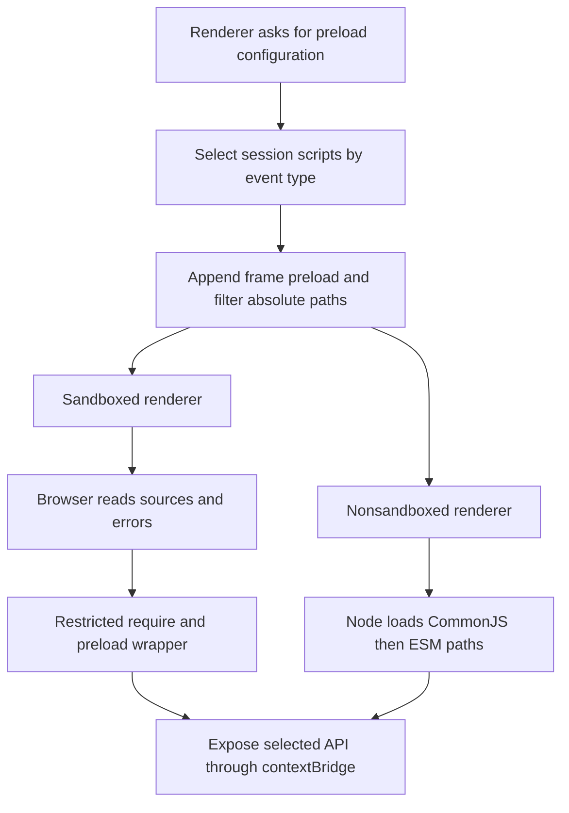

## Overview

Preload scripts initialize capabilities before an application's renderer code uses them. Electron obtains the appropriate script list from the browser process, then executes it through either the sandboxed preload wrapper or the Node-enabled renderer loader. ContextBridge exposes a chosen API into another JavaScript world. Window ownership and child preference inheritance remain in [[Windows and Web Contents]]; this page follows what happens after those preferences have selected a renderer environment.

Sources: [lib/browser/rpc-server.ts:52-107](repo://lib/browser/rpc-server.ts#L52-L107), [lib/sandboxed_renderer/init.ts:16-71](repo://lib/sandboxed_renderer/init.ts#L16-L71), [lib/renderer/init.ts:136-168](repo://lib/renderer/init.ts#L136-L168), [lib/renderer/api/context-bridge.ts:7-20](repo://lib/renderer/api/context-bridge.ts#L7-L20)

## Select scripts in the browser process

The RPC server chooses the session from the event: service-worker events carry their session, while frame events use the sender's session. It retrieves registered preload scripts and filters them by frame or service-worker type. For frames, the window's web-preference preload is appended after session preloads. The final filter accepts only absolute paths; the source identifies this as compatibility handling while older session preload registration is being deprecated.

Sources: [lib/browser/rpc-server.ts:52-70](repo://lib/browser/rpc-server.ts#L52-L70)

Sandboxed requests return script records containing source text or a captured read error, plus process properties such as architecture, platform, environment, versions, and the helper executable path. Files are read concurrently with `Promise.all`, preserving the ordered result list. Nonsandboxed requests return paths instead, leaving the renderer's Node loader to read and evaluate the files. The two modes therefore cross the process boundary with different payloads.

Sources: [lib/browser/rpc-server.ts:72-107](repo://lib/browser/rpc-server.ts#L72-L107)



Sources: [lib/browser/rpc-server.ts:52-107](repo://lib/browser/rpc-server.ts#L52-L107), [lib/sandboxed_renderer/preload.ts:46-101](repo://lib/sandboxed_renderer/preload.ts#L46-L101), [lib/renderer/init.ts:136-168](repo://lib/renderer/init.ts#L136-L168), [docs/fiddles/ipc/pattern-2/preload.js:1-5](repo://docs/fiddles/ipc/pattern-2/preload.js#L1-L5)

## Sandboxed preload capabilities

Sandboxed initialization creates explicit maps of available modules. Electron and its common/renderer aliases, plus events and its Node-prefixed alias, are already loaded. Timers and URL modules, also with Node-prefixed aliases, load lazily. `preloadRequire` returns cached entries, initializes permitted lazy entries once, and throws `module not found` for everything else. This loader does not perform a general filesystem package search.

Sources: [lib/sandboxed_renderer/init.ts:24-39](repo://lib/sandboxed_renderer/init.ts#L24-L39), [lib/sandboxed_renderer/preload.ts:46-57](repo://lib/sandboxed_renderer/preload.ts#L46-L57)

The preload process object is an EventEmitter with a remote memory-info method and a forwarded deprecation setting. Initialization merges native process properties and the browser-supplied properties into it, then installs a hidden hook that delivers process events to both the runtime and preload process objects. Buffer, the global object, setImmediate, and clearImmediate are supplied explicitly as wrapper arguments; they are not evidence that arbitrary Node modules are available.

Sources: [lib/sandboxed_renderer/preload.ts:19-43](repo://lib/sandboxed_renderer/preload.ts#L19-L43), [lib/sandboxed_renderer/init.ts:41-71](repo://lib/sandboxed_renderer/init.ts#L41-L71)

Each script is compiled as a function receiving `require`, `process`, `exports`, `module`, and the configured globals. The source comment explains that evaluation happens in global scope without access to the loader's own closure. Scripts run sequentially; an exception or recorded file-read error logs the path and sends a preload-error message, then the loop continues to later scripts. An empty source with no recorded error performs no evaluation.

Sources: [lib/sandboxed_renderer/preload.ts:59-101](repo://lib/sandboxed_renderer/preload.ts#L59-L101)

## Nonsandboxed loading and ordering

The Node renderer initializer adjusts Module's wrapper so preloads retain `process`, `global`, and Buffer even when page-facing globals are removed later. When Node integration is enabled, it exposes require and module globally and constructs module lookup paths from a file page's directory or the application path. When Node integration is disabled and context isolation is also disabled, a `loaded` listener deletes the listed Node globals from the global object.

Sources: [lib/renderer/init.ts:20-40](repo://lib/renderer/init.ts#L20-L40), [lib/renderer/init.ts:60-103](repo://lib/renderer/init.ts#L60-L103), [lib/renderer/init.ts:117-131](repo://lib/renderer/init.ts#L117-L131)

Paths ending in `.mjs` enter the ESM group; every other preload enters the CommonJS group. All CommonJS preloads run before ESM preloads, even if the original registration list interleaved the groups. Each CommonJS load is individually caught. ESM imports run sequentially and catch their own failures, then `appCodeLoaded` runs in a finalizer; without ESM preloads, completion is signaled immediately after the CommonJS group.

Sources: [lib/renderer/init.ts:133-168](repo://lib/renderer/init.ts#L133-L168)

## Expose an API across worlds

The public bridge checks `process.contextIsolated` before all three operations: exposing in the main world, exposing in a specified isolated world, and executing in the main world. Main-world operations use world ID 0. Native exposure selects the target context, rejects an existing property with the requested key, and passes the value across contexts before defining it. In a preload realm, arbitrary isolated-world targets are rejected; only the initiating main context is supported.

Sources: [lib/renderer/api/context-bridge.ts:1-20](repo://lib/renderer/api/context-bridge.ts#L1-L20), [shell/renderer/api/electron_api_context_bridge.cc:733-822](repo://shell/renderer/api/electron_api_context_bridge.cc#L733-L822)

The native implementation has an explicit mutability feature branch. With that feature enabled it assigns the bridged value normally. Otherwise it deep-freezes eligible objects, excluding typed arrays from that step, and defines a read-only, nonconfigurable global property. Describing every bridge value as unconditionally mutable or unconditionally frozen would miss this implementation branch.

Sources: [shell/renderer/api/electron_api_context_bridge.cc:751-767](repo://shell/renderer/api/electron_api_context_bridge.cc#L751-L767)

The repository's file-dialog example exposes one function that invokes one channel. This keeps the page's API in terms of the operation it needs. [[Interprocess Communication]] follows the invocation after this function calls the renderer IPC wrapper, including handler selection and error replies.

Sources: [docs/fiddles/ipc/pattern-2/preload.js:1-5](repo://docs/fiddles/ipc/pattern-2/preload.js#L1-L5), [lib/renderer/api/ipc-renderer.ts:21-27](repo://lib/renderer/api/ipc-renderer.ts#L21-L27)

```js
const { contextBridge, ipcRenderer } = require('electron/renderer')

contextBridge.exposeInMainWorld('electronAPI', {
  openFile: () => ipcRenderer.invoke('dialog:openFile')
})
```

Sources: [docs/fiddles/ipc/pattern-2/preload.js:1-5](repo://docs/fiddles/ipc/pattern-2/preload.js#L1-L5)

## Observe preload failures

Both execution modes report failing paths and errors through the internal preload-error channel. The browser listener forwards frame failures as `preload-error` on the sender's WebContents; it returns without forwarding for non-frame events. This is distinct from page navigation failure, and provides a browser-side observation point when the page loads but its expected exposed API is absent.

Sources: [lib/sandboxed_renderer/preload.ts:87-101](repo://lib/sandboxed_renderer/preload.ts#L87-L101), [lib/renderer/init.ts:139-163](repo://lib/renderer/init.ts#L139-L163), [lib/browser/rpc-server.ts:109-112](repo://lib/browser/rpc-server.ts#L109-L112)
