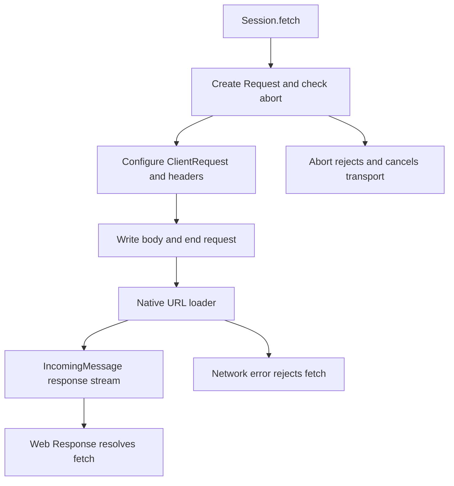

## Overview

A Session wraps an ElectronBrowserContext and supplies session-bound operations such as fetch. The browser `net` module exposes a default-session fetch shortcut and a stream-oriented ClientRequest interface. Session initialization also installs the browser IPC dispatcher, whose message behavior is covered by [[Interprocess Communication]]. This page follows context selection and outbound request execution; URL interception belongs to [[Custom Protocols]].

Sources: [shell/browser/api/electron_api_session.cc:1685-1728](repo://shell/browser/api/electron_api_session.cc#L1685-L1728), [lib/browser/api/session.ts:25-46](repo://lib/browser/api/session.ts#L25-L46), [lib/browser/api/net.ts:8-21](repo://lib/browser/api/net.ts#L8-L21), [lib/browser/api/protocol.ts:159-180](repo://lib/browser/api/protocol.ts#L159-L180)

## Select a browser context

Session objects are obtained through factories rather than `new`. The exported native factories reject access before application readiness. `defaultSession` calls `fromPartition` with an empty string. A partition beginning with `persist:` strips that prefix and selects a persistent context; another nonempty partition selects an in-memory context. `fromPath` instead requires a nonempty absolute path and creates or retrieves a persistent context keyed by that path.

Sources: [lib/browser/api/session.ts:114-120](repo://lib/browser/api/session.ts#L114-L120), [shell/browser/api/electron_api_session.cc:1713-1755](repo://shell/browser/api/electron_api_session.cc#L1713-L1755), [shell/browser/api/electron_api_session.cc:1874-1905](repo://shell/browser/api/electron_api_session.cc#L1874-L1905), [shell/browser/electron_browser_context.cc:888-896](repo://shell/browser/electron_browser_context.cc#L888-L896)

Browser contexts are cached by partition plus memory mode, or by path. Constructor options are applied when creating a missing context; a later lookup returns the existing context rather than reconstructing it with new options. Session creation similarly reuses an existing live wrapper. A newly created wrapper runs `_init` and then emits `session-created` on the application.

Sources: [shell/browser/electron_browser_context.cc:869-896](repo://shell/browser/electron_browser_context.cc#L869-L896), [shell/browser/api/electron_api_session.cc:1685-1709](repo://shell/browser/api/electron_api_session.cc#L1685-L1709)

## Request interfaces

| Entry point | Context and behavior |
| --- | --- |
| `net.fetch(input, init)` | Delegates to `session.defaultSession.fetch` |
| `session.fetch(input, init)` | Passes that session and `net.request` into the fetch adapter |
| `net.request(options, callback)` | Requires app readiness and creates ClientRequest |
| `net.resolveHost(host, options)` | Delegates to the default session |
| `net.online` or `net.isOnline()` | Reads the native online-state function |

Sources: [lib/browser/api/net.ts:6-27](repo://lib/browser/api/net.ts#L6-L27), [lib/browser/api/session.ts:44-46](repo://lib/browser/api/session.ts#L44-L46)

ClientRequest accepts a URL string or options. Option parsing builds a URL when necessary, uppercases the method, validates headers, and permits only the three redirect modes. Outside utility processes, an explicit Session takes precedence over a partition string, with type checks for both. Direct ClientRequest construction supports HTTP and HTTPS unless the internal allow-any-protocol marker is present; the fetch adapter supplies that marker for its broader URL handling.

Sources: [lib/common/api/net-client-request.ts:200-205](repo://lib/common/api/net-client-request.ts#L200-L205), [lib/common/api/net-client-request.ts:229-316](repo://lib/common/api/net-client-request.ts#L229-L316), [lib/common/api/net-client-request.ts:332-347](repo://lib/common/api/net-client-request.ts#L332-L347), [lib/browser/api/net-fetch.ts:79-88](repo://lib/browser/api/net-fetch.ts#L79-L88)

## Convert a fetch request

The fetch adapter first constructs a web Request, returning a rejected promise if construction fails. It rejects an already-aborted request with the signal's reason or an AbortError. For a live request, it derives the origin from headers and changes `same-origin` credentials to `include` when no origin exists, because ClientRequest requires an origin for same-origin credentials. It forwards method, URL, session, cache, referrer policy, and redirect behavior into the request object.

Sources: [lib/browser/api/net-fetch.ts:18-47](repo://lib/browser/api/net-fetch.ts#L18-L47), [lib/browser/api/net-fetch.ts:75-88](repo://lib/browser/api/net-fetch.ts#L75-L88), [lib/common/api/net-client-request.ts:339-344](repo://lib/common/api/net-client-request.ts#L339-L344)

Headers are copied onto ClientRequest before upload. The adapter sets the custom-protocol bypass flag from `init`, and supplies Sec-Fetch-Mode only when that mode can be represented with the available origin. A request body is piped into a web Writable wrapping ClientRequest; successful piping ends the request, and requests without a body end immediately. Custom handler conversion is detailed in [[Custom Protocols]].

Sources: [lib/browser/api/net-fetch.ts:90-99](repo://lib/browser/api/net-fetch.ts#L90-L99), [lib/browser/api/net-fetch.ts:118-124](repo://lib/browser/api/net-fetch.ts#L118-L124)

Sources: [lib/browser/api/session.ts:44-46](repo://lib/browser/api/session.ts#L44-L46), [lib/browser/api/net-fetch.ts:18-99](repo://lib/browser/api/net-fetch.ts#L18-L99), [lib/browser/api/net-fetch.ts:101-124](repo://lib/browser/api/net-fetch.ts#L101-L124), [lib/common/api/net-client-request.ts:402-457](repo://lib/common/api/net-client-request.ts#L402-L457)

## Upload and response streaming

ClientRequest prevents setting or removing headers after the first write or transport startup. Chunked encoding can be selected only once and before startup. Without a configured body stream, writes accumulate in a SlurpStream and begin the request when that buffer finishes; ending a request without a body starts immediately. `_startRequest` derives transport fields from headers, creates the native URL loader, and connects response, data, completion, and error events.

Sources: [lib/common/api/net-client-request.ts:349-377](repo://lib/common/api/net-client-request.ts#L349-L377), [lib/common/api/net-client-request.ts:389-457](repo://lib/common/api/net-client-request.ts#L389-L457)

IncomingMessage queues native chunks and pushes them only while its readable side accepts data. It calls the native resume callback when ready for more, clearing that callback first to avoid a race. The fetch adapter builds a web Response from the incoming headers, status, and body stream, but uses a null body for HEAD and statuses 101, 204, 205, and 304. Fetch resolves on the response event; subsequent body consumption remains streaming work.

Sources: [lib/common/api/net-client-request.ts:101-127](repo://lib/common/api/net-client-request.ts#L101-L127), [lib/browser/api/net-fetch.ts:101-116](repo://lib/browser/api/net-fetch.ts#L101-L116)

## Redirects, authentication, and cancellation

With redirect policy `error`, a redirect terminates the request. In `manual` mode, a redirect listener must call `followRedirect()` during event handling; otherwise the request fails with `Redirect was cancelled`. The callback is cleared after the event, so calling it later throws. In `follow` mode the event still fires and a call to followRedirect is allowed but has no effect. Authentication emits `login`; without a listener, the wrapper calls the supplied callback without credentials to cancel the request.

Sources: [lib/common/api/net-client-request.ts:459-495](repo://lib/common/api/net-client-request.ts#L459-L495), [lib/common/api/net-client-request.ts:509-515](repo://lib/common/api/net-client-request.ts#L509-L515)

A later AbortSignal event marks the fetch locally aborted, rejects its promise, attempts applicable request-body cancellation, and aborts ClientRequest. A response arriving after that marker is ignored by the fetch adapter. ClientRequest abort emits its own abort event once, destroys the writable, cancels the URL loader, and destroys any response. Its cleanup also handles errors arriving after the writable has ended, because network completion can outlast upload completion.

Sources: [lib/browser/api/net-fetch.ts:49-73](repo://lib/browser/api/net-fetch.ts#L49-L73), [lib/browser/api/net-fetch.ts:101-102](repo://lib/browser/api/net-fetch.ts#L101-L102), [lib/common/api/net-client-request.ts:517-539](repo://lib/common/api/net-client-request.ts#L517-L539)
