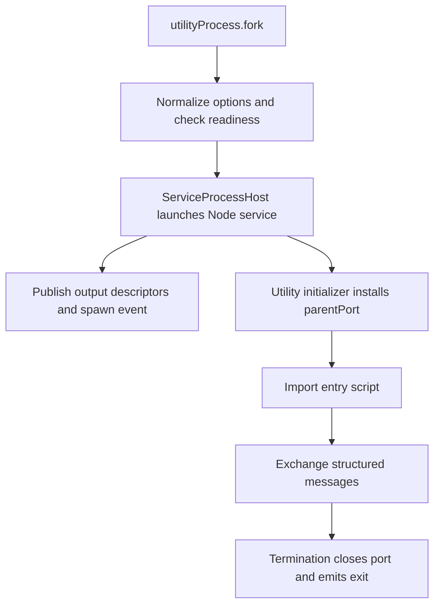

## Overview

`utilityProcess.fork` starts a Node entry script through Chromium's service-process host and returns an EventEmitter wrapper for its lifecycle, messages, and optional output streams. The child receives `process.parentPort` for communication with its parent. This is a separate launch path from the application's main-script startup, and it uses port messages rather than the channel-handler dispatch described in [[Interprocess Communication]].

Sources: [lib/browser/api/utility-process.ts:7-25](repo://lib/browser/api/utility-process.ts#L7-L25), [lib/browser/api/utility-process.ts:93-151](repo://lib/browser/api/utility-process.ts#L93-L151), [shell/browser/api/electron_api_utility_process.cc:164-204](repo://shell/browser/api/electron_api_utility_process.cc#L164-L204), [lib/utility/init.ts:18-36](repo://lib/utility/init.ts#L18-L36)

## Fork arguments and options

The JavaScript wrapper requires an entry-script path. Omitted arguments become an empty array; an object in the second position is treated as options. Options are shallow-copied before normalization. The wrapper checks that execArgv is an array and that serviceName and cwd, when supplied, are strings. Native creation additionally validates argument, environment, and execution-argument conversion and rejects creation before the application is ready.

Sources: [lib/browser/api/utility-process.ts:13-53](repo://lib/browser/api/utility-process.ts#L13-L53), [shell/browser/api/electron_api_utility_process.cc:438-475](repo://shell/browser/api/electron_api_utility_process.cc#L438-L475)

| Option | Launch behavior |
| --- | --- |
| `serviceName` | Supplies the service display name; otherwise native launch uses Node Utility Process |
| `cwd` | Supplies the child working directory |
| `execArgv` | Supplies execution arguments and extra launch switches |
| `env` | A nonempty custom map clears the inherited environment; an empty map inherits |
| `stdio` | Configures ignored input and inherited, ignored, or piped output |
| `allowLoadingUnsignedLibraries` | On macOS, selects the plugin helper when true |

Sources: [shell/browser/api/electron_api_utility_process.cc:164-187](repo://shell/browser/api/electron_api_utility_process.cc#L164-L187), [shell/browser/api/electron_api_utility_process.cc:467-505](repo://shell/browser/api/electron_api_utility_process.cc#L467-L505)

## Configure standard streams

A string stdio option expands into three entries with stdin always ignored. `pipe` creates PassThrough streams for stdout and stderr; `inherit` or `ignore` applies that mode to both outputs. An array must provide at least three entries, must specify ignored stdin, and may choose output modes independently. Unsupported modes throw before native fork. The native defaults are ignored stdin and inherited stdout and stderr.

Sources: [lib/browser/api/utility-process.ts:55-91](repo://lib/browser/api/utility-process.ts#L55-L91), [shell/browser/api/electron_api_utility_process.cc:483-495](repo://shell/browser/api/electron_api_utility_process.cc#L483-L495)

On successful process launch, native code records the process ID, registers the wrapper by ID, emits available output descriptors, and finally emits `spawn`. The JavaScript event adapter wraps each piped descriptor in a readable Socket and pipes it into the corresponding PassThrough. The public stdout and stderr getters return those streams or null, so their presence reflects the configured mode rather than every child having a readable pipe.

Sources: [shell/browser/api/electron_api_utility_process.cc:244-257](repo://shell/browser/api/electron_api_utility_process.cc#L244-L257), [lib/browser/api/utility-process.ts:110-132](repo://lib/browser/api/utility-process.ts#L110-L132)

## Child initialization

The utility initializer reads its hidden startup-script value and restores argv with that entry path. It loads shared initialization and sets the native EventEmitter prototype, then defines an enumerable, nonwritable `process.parentPort`. Only after the port is installed does it load the entry through Node's ESM entry-point loader and a file URL. Import failure is forwarded to Node's internal uncaught-exception mechanism.

Sources: [lib/utility/init.ts:1-50](repo://lib/utility/init.ts#L1-L50)



Sources: [lib/browser/api/utility-process.ts:13-93](repo://lib/browser/api/utility-process.ts#L13-L93), [shell/browser/api/electron_api_utility_process.cc:164-204](repo://shell/browser/api/electron_api_utility_process.cc#L164-L204), [shell/browser/api/electron_api_utility_process.cc:244-289](repo://shell/browser/api/electron_api_utility_process.cc#L244-L289), [lib/utility/init.ts:18-50](repo://lib/utility/init.ts#L18-L50)

The utility Electron module list includes net and systemPreferences. Its networking wrapper shares ClientRequest and the fetch adapter with browser networking, but calls fetchWithSession without a Session and resolves hosts through the native net binding. The shared request parser skips browser Session and partition processing for utility processes. [[Sessions and Networking]] covers the common transport machinery while distinguishing browser-owned contexts.

Sources: [lib/utility/api/module-list.ts:1-5](repo://lib/utility/api/module-list.ts#L1-L5), [lib/utility/api/net.ts:1-22](repo://lib/utility/api/net.ts#L1-L22), [lib/common/api/net-client-request.ts:303-315](repo://lib/common/api/net-client-request.ts#L303-L315)

## Exchange messages and ports

The child parent-port wrapper converts incoming native ports into MessagePortMain wrappers and forwards events. Its first message listener starts delivery; removing the last message listener pauses it. The repository's echo fixture demonstrates the event shape: the payload arrives on `event.data`, and posting it back uses parentPort's postMessage method.

Sources: [lib/utility/parent-port.ts:7-31](repo://lib/utility/parent-port.ts#L7-L31), [lib/utility/init.ts:25-36](repo://lib/utility/init.ts#L25-L36), [spec/fixtures/api/utility-process/post-message.js:1-3](repo://spec/fixtures/api/utility-process/post-message.js#L1-L3)

```js
process.parentPort.on('message', (e) => {
  process.parentPort.postMessage(e.data);
});
```

Sources: [spec/fixtures/api/utility-process/post-message.js:1-3](repo://spec/fixtures/api/utility-process/post-message.js#L1-L3)

On the parent side, postMessage unwraps any transferred MessagePortMain objects before native delivery. Native code serializes the payload, validates the transfer list and each port, disentangles ports, and sends a transferable message over a dedicated connector. The separate message pipe exists so messages can queue without blocking other service interfaces. Child-to-parent messages are deserialized and emitted as the wrapper's `message` event payload.

Sources: [lib/browser/api/utility-process.ts:134-139](repo://lib/browser/api/utility-process.ts#L134-L139), [shell/browser/api/electron_api_utility_process.cc:197-204](repo://shell/browser/api/electron_api_utility_process.cc#L197-L204), [shell/browser/api/electron_api_utility_process.cc:332-384](repo://shell/browser/api/electron_api_utility_process.cc#L332-L384), [shell/browser/api/electron_api_utility_process.cc:410-422](repo://shell/browser/api/electron_api_utility_process.cc#L410-L422)

## Termination and cleanup

Native termination handling is guarded so multiple callbacks cannot process the same exit twice. It removes the process registry entry, clears the PID, closes the connector port, emits exit, and releases the wrapper's pin. Normal termination and crash observers both reach this path after matching the service type and PID. On POSIX, a process killed through this wrapper has SIGTERM or SIGKILL exit signals normalized to zero in the handled case.

Sources: [shell/browser/api/electron_api_utility_process.cc:259-325](repo://shell/browser/api/electron_api_utility_process.cc#L259-L325)

The JavaScript exit adapter emits the public exit event inside a try block and clears its native handle and output-stream listeners in finally. Cleanup therefore happens even if an exit listener throws. After that, pid becomes undefined, stdout and stderr become null, postMessage has no live handle to use, and kill returns false. Before exit, native kill also returns false when no PID exists; otherwise it requests termination and records whether that request succeeded.

Sources: [lib/browser/api/utility-process.ts:93-147](repo://lib/browser/api/utility-process.ts#L93-L147), [shell/browser/api/electron_api_utility_process.cc:386-407](repo://shell/browser/api/electron_api_utility_process.cc#L386-L407)
