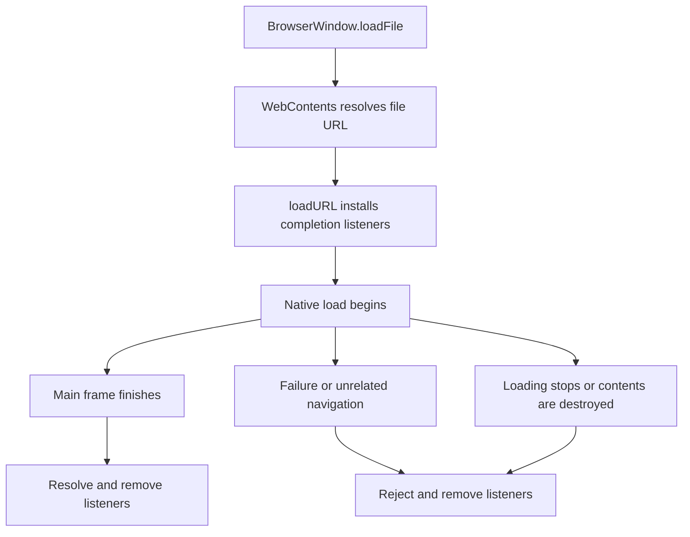

## Overview

BrowserWindow combines a native BaseWindow with a WebContentsView and its WebContents. The native constructor prepares web preferences, creates the view, observes its contents, associates the contents with the owner window, and installs the view before applying final window options. The JavaScript wrapper adds event propagation and convenience methods. The window opened in [[Quickstart]] therefore has both a desktop lifetime and a content-navigation lifetime.

Sources: [shell/browser/api/electron_api_browser_window.cc:28-98](repo://shell/browser/api/electron_api_browser_window.cc#L28-L98), [lib/browser/api/browser-window.ts:4-38](repo://lib/browser/api/browser-window.ts#L4-L38), [lib/browser/api/browser-window.ts:131-150](repo://lib/browser/api/browser-window.ts#L131-L150)

## Ownership and initialization

BrowserWindow inherits BaseWindow's prototype and calls its initializer first. It captures the window ID in a nonwritable property so the identifier remains accessible after native destruction. Partial `setBounds` calls are merged with current bounds before entering the native method. Focus and blur events are also emitted on `app` with the corresponding window, and initialization ends by reporting `browser-window-created`.

Sources: [lib/browser/api/browser-window.ts:4-38](repo://lib/browser/api/browser-window.ts#L4-L38), [lib/browser/api/browser-window.ts:83-98](repo://lib/browser/api/browser-window.ts#L83-L98)

The native view sits before BaseWindow's content view in paint order. This lets views added to `contentView` appear above the BrowserWindow's own web content. Native destruction removes observers and destroys any remaining owned WebContents; conversely, destruction of those contents clears the weak pointer and closes the window immediately. Ownership is therefore bidirectional in its cleanup effects, rather than a loose reference between independently surviving objects.

Sources: [shell/browser/api/electron_api_browser_window.cc:87-117](repo://shell/browser/api/electron_api_browser_window.cc#L87-L117)

## Navigation entry points

Window `loadURL`, `loadFile`, reload, send, and developer-tools methods forward to WebContents. For `loadFile`, WebContents requires a string, resolves it relative to `app.getAppPath()`, and creates a file URL with the supplied query, search, and hash. This explains why application-relative HTML works independently of the shell's working directory. Sending a message uses the distinct routing described in [[Interprocess Communication]].

Sources: [lib/browser/api/browser-window.ts:131-170](repo://lib/browser/api/browser-window.ts#L131-L170), [lib/browser/api/web-contents.ts:324-338](repo://lib/browser/api/web-contents.ts#L324-L338)

`loadURL` installs its completion listeners before calling native `_loadURL`, so even a fast completion can be observed. It returns the promise and attaches an internal no-op rejection handler to suppress an unhandled-rejection report; the returned promise still rejects for a caller awaiting it. The promise settles through load, navigation, stop, failure, or destruction events, then removes all of its listeners.

Sources: [lib/browser/api/web-contents.ts:342-361](repo://lib/browser/api/web-contents.ts#L342-L361), [lib/browser/api/web-contents.ts:410-433](repo://lib/browser/api/web-contents.ts#L410-L433)

Sources: [lib/browser/api/browser-window.ts:141-143](repo://lib/browser/api/browser-window.ts#L141-L143), [lib/browser/api/web-contents.ts:324-433](repo://lib/browser/api/web-contents.ts#L324-L433)

## Completion and failure guarantees

A second unrelated main-frame navigation rejects the previous load with `ERR_ABORTED`. Same-document navigation is treated separately so hash changes and virtual routing do not automatically abort a page load. Only main-frame failures populate the stored load error. If loading stops without a finish or failure event, the fallback creates `ERR_FAILED`; the source identifies a bad scheme as one situation that can take this path.

Sources: [lib/browser/api/web-contents.ts:363-409](repo://lib/browser/api/web-contents.ts#L363-L409)

Rejected load errors carry `errno`, `code`, and `url` properties in addition to their message. The message truncates a string URL to 2,048 characters, while the attached URL value remains available. Renderer termination is a separate `render-process-gone` event forwarded to `app`; when logging is enabled, the wrapper prints a diagnostic hint. An unsuccessful navigation and a terminated renderer therefore have different observation points.

Sources: [lib/browser/api/web-contents.ts:348-354](repo://lib/browser/api/web-contents.ts#L348-L354), [lib/browser/api/web-contents.ts:600-607](repo://lib/browser/api/web-contents.ts#L600-L607)

## Child-window policy

`setWindowOpenHandler` installs the main-process decision callback. Its result must be a non-null object with action `allow` or `deny`; malformed results prevent the event and log an explanation. An allow result may carry constructor overrides, an `outlivesOpener` boolean, and a custom creation function. For link-created windows, a thrown handler also prevents creation before the exception is rethrown.

Sources: [lib/browser/api/web-contents.ts:435-477](repo://lib/browser/api/web-contents.ts#L435-L477), [lib/browser/api/web-contents.ts:624-662](repo://lib/browser/api/web-contents.ts#L624-L662)

The guest-window manager combines default dimensions and visibility with parsed feature options, then main-process overrides. A live window registered under the same frame name is reused by navigating its contents. Otherwise the manager uses the supplied creation function or constructs a BrowserWindow. A custom creator receiving existing guest contents must return those same contents; substituting another object throws. Normal creation emits `did-create-window` with the effective options and request details.

Sources: [lib/browser/guest-window-manager.ts:29-102](repo://lib/browser/guest-window-manager.ts#L29-L102)

Child web preferences are merged in a deliberate order: parsed renderer features, inherited restrictive settings, then trusted main-process overrides. The restrictive map includes enabled context isolation and sandboxing, disabled Node integration, and other limits when the parent already has those values. Main-process overrides can change them; the comments explicitly reserve that elevated input for the main process. [[Preloads and Context Isolation]] explains what the resulting renderer settings mean for preload capabilities.

Sources: [lib/browser/guest-window-manager.ts:140-175](repo://lib/browser/guest-window-manager.ts#L140-L175)

## Responsiveness, visibility, and teardown

WebContents unresponsiveness starts a 50 ms window timer; responsiveness cancels it and emits `responsive`. During an uncancelled close, a microtask can schedule a longer five-second unresponsive timer. Contents destruction clears pending timers. Window visibility is computed as visible and not minimized, and changes from show, hide, minimize, maximize, or restore emit an internal visibility notification only when that computed value changes.

Sources: [lib/browser/api/browser-window.ts:40-81](repo://lib/browser/api/browser-window.ts#L40-L81)

Guest lifetime follows the opener unless `outlivesOpener` is true. The manager listens for deletion of the opener's current render view and destroys the guest; guest destruction removes the reciprocal listener and unregisters a named frame. The source calls this an Electron convention rather than browser behavior. Legacy BrowserViews attached to a BrowserWindow also receive close calls when the owning window closes, with before-unload waiting enabled.

Sources: [lib/browser/guest-window-manager.ts:104-138](repo://lib/browser/guest-window-manager.ts#L104-L138), [lib/browser/api/browser-window.ts:83-87](repo://lib/browser/api/browser-window.ts#L83-L87)
