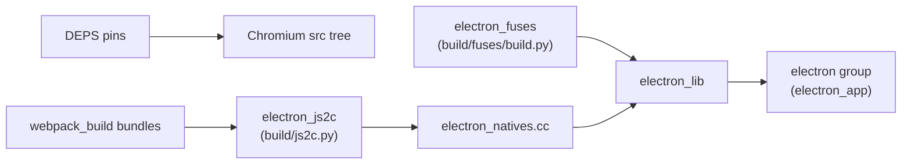

## Overview

The binary is built by Chromium's GN and Ninja tooling, with Electron's own GN file, `BUILD.gn`, added to the Chromium tree. The build has three inputs that this page covers: the pinned versions in `DEPS`, the argument files that select a configuration, and the generated code that is compiled in, which includes the bundled JavaScript and the fuse table. Applying Electron's patches to the vendored trees is on [[Chromium Patches]], and the steps that run the build are on [[Quickstart]].

Sources: [BUILD.gn:423-437](repo://BUILD.gn#L423-L437), [DEPS:3-7](repo://DEPS#L3-L7)

## Pinned versions

`DEPS` pins the Chromium version and the Node.js version as variables. The `src` entry checks out Chromium at the Chromium version, so a change to that variable moves the whole tree.

Sources: [DEPS:3-7](repo://DEPS#L3-L7), [DEPS:78-80](repo://DEPS#L78-L80)

The version variables for the other vendored trees, such as `nan_version` and `squirrel.mac_version`, sit beside it, so one file records the pins.

Sources: [DEPS:8-12](repo://DEPS#L8-L12)

## Argument files

`build/args/all.gn` is the shared base. It sets `is_electron_build`, adds `//electron` to `root_extra_deps`, and fixes the Node module version and the V8 embedder string to Electron's values. The other files import it and change only what differs.

Sources: [build/args/all.gn:1-8](repo://build/args/all.gn#L1-L8)

`build/args/release.gn` imports the base and sets an official build. `build/args/testing.gn` imports the base as well, but turns off `is_debug` and sets `dcheck_always_on`, so the spec suite runs with DCHECKs enabled.

Sources: [build/args/release.gn:1-3](repo://build/args/release.gn#L1-L3), [build/args/testing.gn:1-7](repo://build/args/testing.gn#L1-L7)

`buildflags/buildflags.gni` declares Electron's own build arguments, such as `enable_pdf_viewer`, with `declare_args`. Its fake geolocation provider is turned on only for non-official builds.

Sources: [buildflags/buildflags.gni:5-12](repo://buildflags/buildflags.gni#L5-L12)

## Bundled JavaScript

Each `webpack_build` target builds one bundle from `lib/`, and each one writes its output under the generated `js2c` folder. The browser bundle comes from the browser webpack config, and the renderer bundle from the renderer config.

Sources: [BUILD.gn:165-172](repo://BUILD.gn#L165-L172), [build/webpack/webpack.config.renderer.js:1-7](repo://build/webpack/webpack.config.renderer.js#L1-L7)

The `electron_js2c` action depends on all eight bundle targets, plus the Node.js `node_js2c` target, so the bundles are built before the step that embeds them. The action runs `build/js2c.py` with the bundle paths and an output file, `electron_natives.cc`.

Sources: [BUILD.gn:237-248](repo://BUILD.gn#L237-L248), [BUILD.gn:250-266](repo://BUILD.gn#L250-L266)

`build/js2c.py` calls the Node.js `js2c` tool with `--only-js` and the root folder, which turns the list of bundle files into one C++ source that holds their text. The output is compiled into the binary, and the native side later looks up each bundle by the `electron/js2c/<name>` key.

Sources: [build/js2c.py:1-17](repo://build/js2c.py#L1-L17)

## Fuses

The `electron_fuses` action runs `build/fuses/build.py` on `build/fuses/fuses.json5`. It writes `fuses.h` and `fuses.cc` into the generated folder, and `electron_lib` depends on it, so the fuse getters are compiled into the library. The fuse table and what each fuse does are on [[ASAR Archives and Fuses]].

Sources: [BUILD.gn:393-404](repo://BUILD.gn#L393-L404), [BUILD.gn:423-437](repo://BUILD.gn#L423-L437)

Sources: [BUILD.gn:237-266](repo://BUILD.gn#L237-L266), [BUILD.gn:393-404](repo://BUILD.gn#L393-L404), [BUILD.gn:423-437](repo://BUILD.gn#L423-L437), [BUILD.gn:1557-1559](repo://BUILD.gn#L1557-L1559)

The `electron` group that a build of the binary names has only one public dependency, `electron_app`, so building `electron` builds the app target and everything it depends on.

Sources: [BUILD.gn:1557-1559](repo://BUILD.gn#L1557-L1559)
