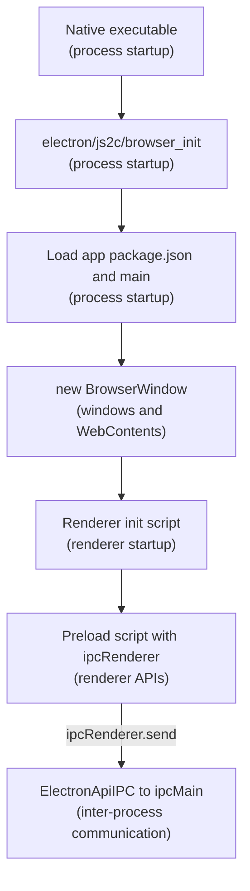

## Overview

This repository builds Electron: a patched Chromium and Node.js runtime, a C++ layer that exposes browser features to JavaScript, and the JavaScript modules that implement the `electron` API. An app runs its own `main` script in the browser process and creates windows whose pages run in renderer processes. Each process type runs a different init script, and the modules under `lib/` are compiled into those scripts.

Sources: [lib/browser/init.ts:14-17](repo://lib/browser/init.ts#L14-L17)

The browser process starts from the native executable, which sets up Node.js with a per-process init script before any app code runs.

Sources: [shell/common/node_bindings.cc:702-704](repo://shell/common/node_bindings.cc#L702-L704)

## Parts

| Area | What it does | Page |
| --- | --- | --- |
| Quickstart | Builds the binary, starts it and runs the specs | [[Quickstart]] |
| Process startup | Starts Chromium and Node.js, then runs the browser init script | [[Process Startup]] |
| Renderer init | Runs one init script per renderer, sandboxed, preload or worker realm | [[Renderer Startup and Realms]] |
| Module system | Resolves `require('electron')` and bundles `lib/` with webpack | [[JavaScript Module Loading]] |
| IPC | Carries `ipcRenderer` and `ipcMain` messages over Mojo | [[Inter-process Communication]] |
| ASAR and fuses | Reads app code from archives and toggles build-time behaviour | [[ASAR Archives and Fuses]] |
| Native bindings | Wraps C++ classes as JavaScript objects with gin_helper | [[Native Bindings with gin_helper]] |
| Windows | Builds `BrowserWindow` on a native window and `WebContents` | [[Windows and WebContents]] |
| Sessions | Maps each session to a Chromium browser context | [[Sessions and Browser Context]] |
| Renderer APIs | Provides preload APIs and `contextBridge` | [[Renderer APIs and Context Bridge]] |
| API docs | Turns `docs/api` into the typings shipped with the package | [[API Docs and TypeScript Types]] |
| Build | Builds the binary with GN and bundles JavaScript into it | [[Build System]] |
| Patches | Keeps Electron's changes to vendored trees as patch files | [[Chromium Patches]] |
| Tests | Runs the spec suite in the built binary | [[Testing with the Spec Suite]] |
| Release | Prepares, uploads and publishes release artifacts | [[Release and Publishing]] |

Sources: [lib/browser/init.ts:76-79](repo://lib/browser/init.ts#L76-L79), [lib/common/init.ts:92-93](repo://lib/common/init.ts#L92-L93), [lib/browser/ipc-dispatch.ts:59-64](repo://lib/browser/ipc-dispatch.ts#L59-L64), [build/webpack/webpack.config.base.js:1-12](repo://build/webpack/webpack.config.base.js#L1-L12), [script/create-api-json.mjs:1-14](repo://script/create-api-json.mjs#L1-L14)

## Main flow

The flow from launching an app to a rendered window crosses the native startup, the browser init script, `WebContents`, and a renderer init script. Each step names the page that follows it.

Sources: [shell/common/node_bindings.cc:702-704](repo://shell/common/node_bindings.cc#L702-L704), [lib/browser/init.ts:141-163](repo://lib/browser/init.ts#L141-L163)

Sources: [shell/common/node_bindings.cc:702-704](repo://shell/common/node_bindings.cc#L702-L704), [lib/browser/init.ts:141-163](repo://lib/browser/init.ts#L141-L163), [lib/renderer/init.ts:47-64](repo://lib/renderer/init.ts#L47-L64), [shell/common/api/api.mojom:28-35](repo://shell/common/api/api.mojom#L28-L35)

## Design decisions

The browser init script loads the RPC server and guest view manager before it reads the app's `package.json`, so those modules are ready when the app's `main` runs.

Sources: [lib/browser/init.ts:76-79](repo://lib/browser/init.ts#L76-L79)

Each process type registers its own `electron/main`, `electron/renderer` or `electron/utility` alias, and the resolver maps every `electron/*` name onto the one `electron` module, so the same `require` works in any process while TypeScript sees only that process's types.

Sources: [lib/common/init.ts:92-100](repo://lib/common/init.ts#L92-L100), [lib/common/init.ts:113-115](repo://lib/common/init.ts#L113-L115)

Renderer code wraps every module in a function that receives `process`, `global` and `Buffer` explicitly, so modules keep those globals after the page deletes them.

Sources: [lib/renderer/init.ts:34-37](repo://lib/renderer/init.ts#L34-L37)

Messages from a renderer pass through the main process before reaching `ipcMain`. The Mojo handler builds an event and passes it to the session, and the dispatcher then emits the event on the frame, on `WebContents`, and on `ipcMain`, in that order.

Sources: [shell/browser/electron_api_ipc_handler_impl.cc:44-56](repo://shell/browser/electron_api_ipc_handler_impl.cc#L44-L56), [lib/browser/ipc-dispatch.ts:59-64](repo://lib/browser/ipc-dispatch.ts#L59-L64)
