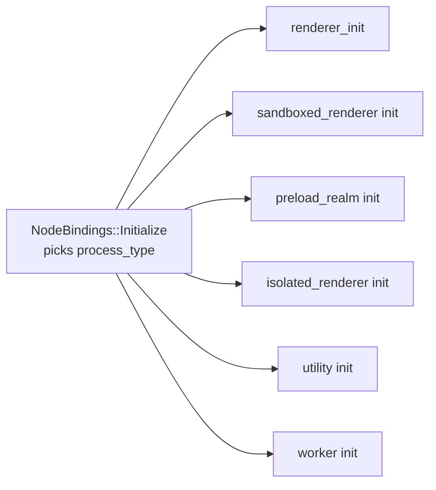

## Overview

Each Chromium renderer process, and each utility, worker or preload realm, gets its own init script. The native side chooses the script from the process type, and each script installs only the APIs that process may use. A page with Node integration gets the full module system, a sandboxed page gets a smaller set and runs its preload scripts in a separate realm, and a utility process runs an app entry script with `parentPort` attached. Browser startup is on [[Process Startup]].

Sources: [shell/common/node_bindings.cc:702-704](repo://shell/common/node_bindings.cc#L702-L704)

The renderer init script begins by wrapping every Node module so that `process`, `global` and `Buffer` are passed in as parameters. Preload scripts run inside that wrapper, so they keep those globals after the page's own code deletes them.

Sources: [lib/renderer/init.ts:20-37](repo://lib/renderer/init.ts#L20-L37)

## Renderer realm

`lib/renderer/init.ts` reads the `nodeIntegration` web preference from the main frame, then runs the common renderer init. When Node integration is on, the script sets `module` and `require` on the global scope, so page code can use Node modules directly. For a `file:` page it also sets `__filename` to the page's path.

Sources: [lib/renderer/init.ts:58-68](repo://lib/renderer/init.ts#L58-L68)

`lib/renderer/common-init.ts` reads four web preferences that decide which features run: `nodeIntegration`, `webviewTag`, `hiddenPage` and `isWebView`. It then switches on the page's protocol. `devtools:` pages get the inspector overrides, `chrome:` and `chrome-extension:` pages get none, and every other page gets `windowSetup`. Only the main frame installs the `webview` tag.

Sources: [lib/renderer/common-init.ts:6-11](repo://lib/renderer/common-init.ts#L6-L11), [lib/renderer/common-init.ts:15-32](repo://lib/renderer/common-init.ts#L15-L32), [lib/renderer/common-init.ts:35-38](repo://lib/renderer/common-init.ts#L35-L38)

Preload scripts for a page without a sandbox come from the browser process. The script requests them with `BROWSER_NONSANDBOX_LOAD`, splits the list by extension, and loads CommonJS preloads with `Module._load`. ESM preloads (`.mjs`) go through the ESM loader afterward. A failing preload is logged and reported to the browser through `BROWSER_PRELOAD_ERROR`, and the rest still load.

Sources: [lib/renderer/init.ts:136-148](repo://lib/renderer/init.ts#L136-L148), [lib/renderer/init.ts:156-162](repo://lib/renderer/init.ts#L156-L162)

## Sandboxed realm

A sandboxed renderer cannot read the file system, so `lib/sandboxed_renderer/init.ts` gets everything it needs over IPC. It calls `invokeSync` with `BROWSER_SANDBOX_LOAD` and receives the preload script list and a `process` object from the browser process, a reply described in [[Inter-process Communication]]. The loaded modules are a fixed table: `electron`, `electron/common`, `electron/renderer`, `events`, and `node:events`. The loadable table adds `timers` and `url` on demand.

Sources: [lib/sandboxed_renderer/init.ts:16-22](repo://lib/sandboxed_renderer/init.ts#L16-L22), [lib/sandboxed_renderer/init.ts:24-36](repo://lib/sandboxed_renderer/init.ts#L24-L36)

The preload realm is a separate script that receives the same preload list and runs each preload through `executeSandboxedPreloadScripts`. It copies the browser's `process` properties onto the preload's own `process` object, and it exposes `Buffer` and `global` to the preload as globals. Values that preload code shares with the page go through [[Renderer APIs and Context Bridge]].

Sources: [lib/preload_realm/init.ts:14-22](repo://lib/preload_realm/init.ts#L14-L22), [lib/preload_realm/init.ts:38-43](repo://lib/preload_realm/init.ts#L38-L43), [lib/preload_realm/init.ts:47-57](repo://lib/preload_realm/init.ts#L47-L57)

The isolated realm script has one job. When the page's guest view internals are present, it installs the `webview` element in the main world, because the element must exist there for the page to use it.

Sources: [lib/isolated_renderer/init.ts:4-9](repo://lib/isolated_renderer/init.ts#L4-L9)

## Utility and worker processes

A utility process starts with the entry script name stored by the native side in a hidden value. The script puts that name back into `process.argv`, loads the common init, and attaches a `ParentPort` as `process.parentPort`. The port starts receiving messages only when a `message` listener is added, and pauses again when the last one is removed.

Sources: [lib/utility/init.ts:6-11](repo://lib/utility/init.ts#L6-L11), [lib/utility/init.ts:14-23](repo://lib/utility/init.ts#L14-L23), [lib/utility/init.ts:25-36](repo://lib/utility/init.ts#L25-L36)

It then loads the entry as an ES module through Node's ESM loader. An error thrown while loading is rethrown as an uncaught exception.

Sources: [lib/utility/init.ts:38-50](repo://lib/utility/init.ts#L38-L50)

A web worker's script sets `module`, `require` and the `blinkfetch` globals, and it sets up `__filename` in two ways. A `file:` worker gets its own URL's path, and any other worker gets a fake path under the `electron.asar` worker folder. Only when the `app-path` switch is set does it add that directory to the module search path.

Sources: [lib/worker/init.ts:12-18](repo://lib/worker/init.ts#L12-L18), [lib/worker/init.ts:21-26](repo://lib/worker/init.ts#L21-L26), [lib/worker/init.ts:28-49](repo://lib/worker/init.ts#L28-L49)

Sources: [shell/common/node_bindings.cc:702-704](repo://shell/common/node_bindings.cc#L702-L704), [lib/sandboxed_renderer/init.ts:1-2](repo://lib/sandboxed_renderer/init.ts#L1-L2), [lib/preload_realm/init.ts:1](repo://lib/preload_realm/init.ts#L1), [lib/isolated_renderer/init.ts:1-2](repo://lib/isolated_renderer/init.ts#L1-L2)
