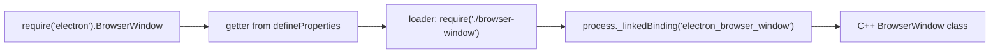

## Overview

Every public main-process module, such as `app`, `BrowserWindow` or `session`, is built the same way: a native class is exposed through a linked binding, and a TypeScript file extends its prototype with the behaviour Electron adds on top. The `electron` module is the list of those entries. This page follows one module, `BrowserWindow`, from the `require('electron')` call to the native class, and then gives the checklist for adding a module. The window and web contents that the class creates are in [[Windows and Web Contents]].

Sources: [lib/browser/api/exports/electron.ts:1-8](repo://lib/browser/api/exports/electron.ts#L1-L8)

## The module list

`lib/browser/api/exports/electron.ts` copies the browser and common lists onto `module.exports`. The lists are in `module-list.ts`, which pairs each public name with a loader function. Nothing is loaded until a property is read.

Sources: [lib/browser/api/module-list.ts:4-43](repo://lib/browser/api/module-list.ts#L4-L43)

`defineProperties` makes each entry a getter, so the loader runs on first access. A loader that returns an ES module with a `default` export is unwrapped to that default.

Sources: [lib/common/define-properties.ts:1-5](repo://lib/common/define-properties.ts#L1-L5)

Sources: [lib/common/define-properties.ts:7-17](repo://lib/common/define-properties.ts#L7-L17)

Sources: [lib/browser/api/browser-window.ts:4-6](repo://lib/browser/api/browser-window.ts#L4-L6)

## The native class and its prototype

`lib/browser/api/browser-window.ts` gets the native constructor from `_linkedBinding`. It then makes the native prototype inherit from `BaseWindow`, so `BrowserWindow` shares the methods of `BaseWindow`. The native class is registered by `NODE_LINKED_BINDING_CONTEXT_AWARE`, which is the entry that `ELECTRON_BROWSER_BINDINGS` names.

Sources: [lib/browser/api/browser-window.ts:4-6](repo://lib/browser/api/browser-window.ts#L4-L6)

`BrowserWindow.prototype._init` runs when the object is created. It calls the base `_init`, fixes the `id` so it survives window destruction, and forwards window focus and blur to `app`. It also starts the unresponsive timer and emits `browser-window-created` on `app`.

Sources: [lib/browser/api/browser-window.ts:8-27](repo://lib/browser/api/browser-window.ts#L8-L27)

Sources: [lib/browser/api/browser-window.ts:90-90](repo://lib/browser/api/browser-window.ts#L90-L90)

On the C++ side, `BrowserWindow::New` is registered as the constructor in `Initialize`, and `BaseWindow` registers its own constructor the same way. The `BaseWindow` constructor creates the `NativeWindow` that holds the platform window.

Sources: [shell/browser/api/electron_api_browser_window.cc:340-353](repo://shell/browser/api/electron_api_browser_window.cc#L340-L353)

Sources: [shell/browser/api/electron_api_base_window.cc:96-116](repo://shell/browser/api/electron_api_base_window.cc#L96-L116)

Sources: [shell/browser/api/electron_api_base_window.cc:1332-1340](repo://shell/browser/api/electron_api_base_window.cc#L1332-L1340)

## Adding a module

The steps are in the creating-API guide. Add the C++ sources to the GN file list. Declare the class with `gin::Wrappable` and an `ObjectTemplateBuilder` that lists its methods. Link the binding into Node, then add the Markdown in `docs/api/` so the typings can be generated, as described in [[API Documentation and Typings]].

Sources: [docs/development/creating-api.md:7-13](repo://docs/development/creating-api.md#L7-L13)

Sources: [docs/development/creating-api.md:41-45](repo://docs/development/creating-api.md#L41-L45)

Sources: [docs/development/creating-api.md:128-130](repo://docs/development/creating-api.md#L128-L130)

Sources: [docs/development/creating-api.md:154-170](repo://docs/development/creating-api.md#L154-L170)

A new module also needs an entry in `module-list.ts`, which is the only place the `electron` module learns its names.

Sources: [lib/browser/api/module-list.ts:4-43](repo://lib/browser/api/module-list.ts#L4-L43)
