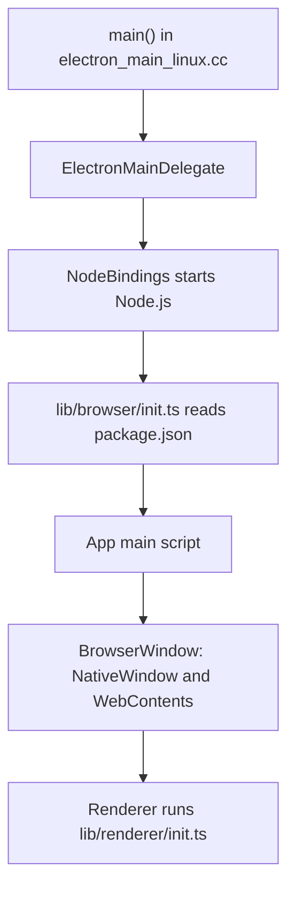

## Overview

This repository is Electron's source. The main process hosts Chromium's browser code and a Node.js environment, and exposes both to JavaScript as the `electron` module; web pages run in Chromium renderer processes. The native shell is in `shell/`, the TypeScript that implements the JavaScript side is in `lib/`, the public API documentation is in `docs/`, and the GN, webpack and patch tooling that builds it all is in `build/`, `patches/` and `script/`. The repository's own map of these folders is in the source-code directory structure document.

Sources: [docs/development/source-code-directory-structure.md:12-20](repo://docs/development/source-code-directory-structure.md#L12-L20)

## Parts

| Area | What it does | Page |
| --- | --- | --- |
| `shell/app/` | The native entry point and the Chromium content delegate | [[Application Startup]] |
| `lib/browser/`, `lib/common/` | Main process JavaScript: the Node.js init, public modules | [[Node.js Environment]], [[Main Process Modules]] |
| `shell/browser/` | Native windows, web contents and the `electron_browser_*` bindings | [[Windows and Web Contents]] |
| `lib/renderer/`, `shell/renderer/` | Renderer JavaScript and the renderer-side IPC binding | [[Renderer Initialization]], [[Inter-process Messaging]] |
| `lib/sandboxed_renderer/`, `lib/preload_realm/` | Preload scripts in sandboxed renderers | [[Preload Scripts and Sandboxing]] |
| `lib/renderer/api/context-bridge.ts` | The `contextBridge` API between isolated worlds | [[Context Bridge]] |
| `BUILD.gn`, `build/` | Native build targets and the JavaScript bundling | [[GN Build]], [[JavaScript Bundles]] |
| `patches/`, `script/` | Patches to Chromium and Node.js, and the tools that apply them | [[Patching Upstream Projects]] |
| `docs/api/`, `typings/` | Public API documentation and its type definitions | [[API Documentation and Typings]] |
| `spec/`, `script/lint.js` | Tests and lint | [[Testing and Linting]] |

Sources: [docs/development/source-code-directory-structure.md:14-93](repo://docs/development/source-code-directory-structure.md#L14-L93)

## Main flow

A packaged app starts in native code: `main()` calls into `ElectronMainDelegate`, which hands control to the Node.js environment, which loads the app's main script. The diagram below shows that path and the first window.

Sources: [shell/app/electron_main_linux.cc:29-43](repo://shell/app/electron_main_linux.cc#L29-L43)

Sources: [shell/app/electron_main_delegate.cc:418-435](repo://shell/app/electron_main_delegate.cc#L418-L435)

Sources: [lib/browser/init.ts:101-101](repo://lib/browser/init.ts#L101-L101)

Sources: [lib/browser/init.ts:221-221](repo://lib/browser/init.ts#L221-L221)

Sources: [lib/renderer/init.ts:60-64](repo://lib/renderer/init.ts#L60-L64)

Each step is covered on its own page: the entry point and the init file in [[Application Startup]], the Node.js setup in [[Node.js Environment]], the window in [[Windows and Web Contents]] and the renderer in [[Renderer Initialization]].

## Design decisions

The same TypeScript init code runs in the main process and in the renderers. `lib/browser/init.ts` and `lib/renderer/init.ts` each start by loading `@electron/internal/common/init`, so timers, the `electron` module alias and the other shared setup behave the same in both.

Sources: [lib/browser/init.ts:17-17](repo://lib/browser/init.ts#L17-L17)

Sources: [lib/renderer/init.ts:47-47](repo://lib/renderer/init.ts#L47-L47)

The native side groups its linked bindings into lists per process type. The browser list includes `electron_browser_app`, `electron_browser_web_contents` and `electron_browser_window`, and the renderer list includes `electron_renderer_ipc` and `electron_renderer_web_frame`.

Sources: [shell/common/node_bindings.cc:53-123](repo://shell/common/node_bindings.cc#L53-L123)

The JavaScript that Node.js loads is built from `lib/` into bundles and embedded in the binary, so each process starts from a fixed copy of the init code. The GN targets write `browser_init.js`, `renderer_init.js` and the other bundles into the generated `js2c` folder.

Sources: [BUILD.gn:171-225](repo://BUILD.gn#L171-L225)

Changes to Chromium, Node.js and the other upstream dependencies are kept as patch files in `patches/`, applied in the order each `.patches` file lists. The versions the build pins live in `DEPS`.

Sources: [DEPS:4-7](repo://DEPS#L4-L7)
