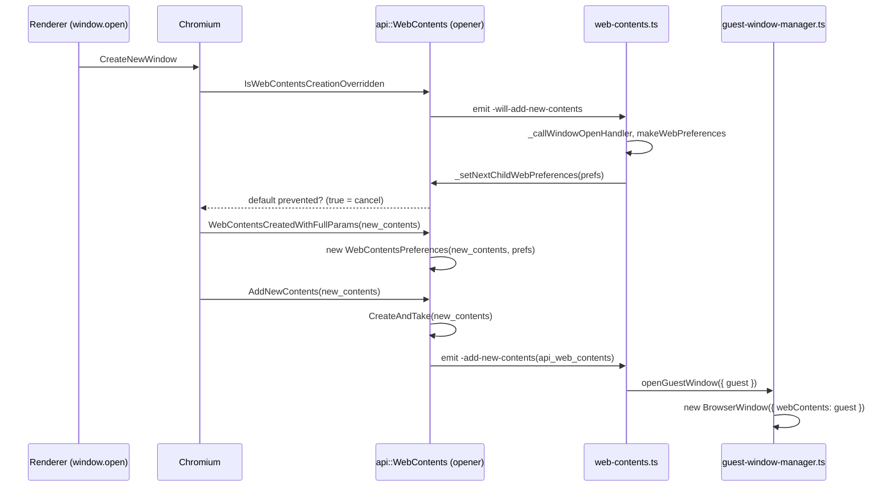

## Overview

When a page calls `window.open`, or the user opens a link in a new window, Chromium asks the embedder whether to create a new `WebContents` and where to put it. Electron answers with an app-visible decision, `webContents.setWindowOpenHandler`. If the handler allows the window, Electron wraps the new contents in a `BrowserWindow` and ties its lifetime to the opener. The C++ side is a few `WebContentsDelegate` overrides on `api::WebContents`. The policy lives in `lib/browser/api/web-contents.ts` and `lib/browser/guest-window-manager.ts`.

Sources: [shell/browser/api/electron_api_web_contents.cc:1149-1191](repo://shell/browser/api/electron_api_web_contents.cc#L1149-L1191), [lib/browser/guest-window-manager.ts:1-7](repo://lib/browser/guest-window-manager.ts#L1-L7)

The file's own comment explains its terms: "guest" means child window, whatever its process, and "embedder" means the opener. This page uses the same terms. How the new `WebContents` and `BrowserWindow` objects work is covered in [[WebContents]] and [[Windows and Views]]. How the child's renderer avoids initializing Node with the opener's preferences is covered in [[Renderer Process Initialization]].

Sources: [lib/browser/guest-window-manager.ts:1-7](repo://lib/browser/guest-window-manager.ts#L1-L7), [shell/renderer/electron_render_frame_observer.cc:94-114](repo://shell/renderer/electron_render_frame_observer.cc#L94-L114)

## Two paths into a new window

Chromium reaches Electron in two ways, and both end in `openGuestWindow`.

Sources: [lib/browser/api/web-contents.ts:622-664](repo://lib/browser/api/web-contents.ts#L622-L664), [lib/browser/api/web-contents.ts:669-755](repo://lib/browser/api/web-contents.ts#L669-L755)

| Path | Chromium hook | Event | Who creates the `content::WebContents` |
| --- | --- | --- | --- |
| Scripted `window.open`, and links Chromium opens with an opener | `IsWebContentsCreationOverridden`, `WebContentsCreatedWithFullParams`, `AddNewContents` | `-will-add-new-contents`, then `-add-new-contents` | Chromium, before Electron wraps it |
| Navigations sent to `OpenURLFromTab` with a disposition other than the current tab | `OpenURLFromTab` | `-new-window` | Electron, as a new `BrowserWindow` that loads the URL |

Sources: [shell/browser/api/electron_api_web_contents.cc:1178-1191](repo://shell/browser/api/electron_api_web_contents.cc#L1178-L1191), [shell/browser/api/electron_api_web_contents.cc:1239-1277](repo://shell/browser/api/electron_api_web_contents.cc#L1239-L1277), [shell/browser/api/electron_api_web_contents.cc:1279-1290](repo://shell/browser/api/electron_api_web_contents.cc#L1279-L1290)

Before either path, `ElectronBrowserClient::CanCreateWindow` checks the opener's preferences. A contents with popups disabled, which is a `<webview>` without `allowpopups`, gets `false`, and `window.open` returns `null`.

Sources: [shell/browser/electron_browser_client.cc:651-681](repo://shell/browser/electron_browser_client.cc#L651-L681)

## The window open handler

`setWindowOpenHandler` stores one function on the contents. `_callWindowOpenHandler` calls it with the details (`url`, `frameName`, `features`, `disposition`, `referrer`, `postBody`) and validates the answer:

Sources: [lib/browser/api/web-contents.ts:435-439](repo://lib/browser/api/web-contents.ts#L435-L439)

- With no handler, the window is allowed with default options.
- `{ action: 'deny' }` calls `event.preventDefault()`.
- `{ action: 'allow' }` returns `overrideBrowserWindowOptions` (if an object), `outlivesOpener` (if a boolean) and `createWindow` (if a function).
- A non-object, `null`, or any other `action` is logged and treated as a deny.

Sources: [lib/browser/api/web-contents.ts:439-477](repo://lib/browser/api/web-contents.ts#L439-L477)

If the handler throws, the listener prevents the default and rethrows.

Sources: [lib/browser/api/web-contents.ts:687-693](repo://lib/browser/api/web-contents.ts#L687-L693)

## The window.open path

### Sequence

Sources: [shell/browser/api/electron_api_web_contents.cc:1149-1200](repo://shell/browser/api/electron_api_web_contents.cc#L1149-L1200), [shell/browser/api/electron_api_web_contents.cc:1239-1277](repo://shell/browser/api/electron_api_web_contents.cc#L1239-L1277), [lib/browser/api/web-contents.ts:669-755](repo://lib/browser/api/web-contents.ts#L669-L755)

### Deciding and preparing preferences

`IsWebContentsCreationOverridden` emits `-will-add-new-contents`. If a listener prevents the default, Chromium is sent to `CreateCustomWebContents`, which returns `nullptr`, so `window.open` returns `null` in the page.

Sources: [shell/browser/api/electron_api_web_contents.cc:1178-1210](repo://shell/browser/api/electron_api_web_contents.cc#L1178-L1210)

The listener runs the handler and remembers its `outlivesOpener`, options and `createWindow` for the next step. When the window is allowed, it builds the child's web preferences with `makeWebPreferences`. `backgroundColor` and `transparent` from the override options are copied into the preferences too, because the comment notes the renderer needs them at init time. It passes the result to the native `_setNextChildWebPreferences`, which holds it in `pending_child_web_preferences_`.

Sources: [lib/browser/api/web-contents.ts:669-717](repo://lib/browser/api/web-contents.ts#L669-L717), [shell/browser/api/electron_api_web_contents.cc:1193-1200](repo://shell/browser/api/electron_api_web_contents.cc#L1193-L1200)

### Attaching preferences to the new contents

Chromium then calls `MaybeOverrideCreateParamsForNewWindow`, where an `offscreen` preference gives the child an offscreen view. It creates the contents and calls `WebContentsCreatedWithFullParams`. Electron records the URL, frame name, referrer, raw features and body in a `ChildWebContentsTracker`, and turns the pending preferences into the child's `WebContentsPreferences` before the renderer reads them. That is why `InitWithSessionAndOptions` later skips creating preferences when they already exist.

Sources: [shell/browser/api/electron_api_web_contents.cc:1149-1176](repo://shell/browser/api/electron_api_web_contents.cc#L1149-L1176), [shell/browser/api/electron_api_web_contents.cc:1213-1237](repo://shell/browser/api/electron_api_web_contents.cc#L1213-L1237), [shell/browser/api/electron_api_web_contents.cc:968-973](repo://shell/browser/api/electron_api_web_contents.cc#L968-L973)

### Wrapping the contents

`AddNewContents` wraps the contents with `CreateAndTake`, as `kOffScreen` if its preferences are offscreen and `kBrowserWindow` otherwise. It runs `HandleNewRenderFrame` on the initial `about:blank` frame, because a window that never navigates would otherwise miss settings such as the background colour. It then emits `-add-new-contents` with the tracker's data, and destroys the wrapper if that event is prevented.

Sources: [shell/browser/api/electron_api_web_contents.cc:1239-1277](repo://shell/browser/api/electron_api_web_contents.cc#L1239-L1277)

The `-add-new-contents` listener takes the remembered handler results and resets them, so they apply to exactly one window. It rejects dispositions other than `foreground-tab`, `new-window` and `background-tab`, then calls `openGuestWindow` with the new contents as `guest`.

Sources: [lib/browser/api/web-contents.ts:719-754](repo://lib/browser/api/web-contents.ts#L719-L754)

## The link path

`OpenURLFromTab` with any disposition other than `CURRENT_TAB` emits `-new-window` with the URL, disposition, referrer and post data. There is no frame name or feature string. The listener builds the same handler details, including a `postBody` with the content type parsed from the post data. If the handler allows it, the listener calls `openGuestWindow` without a guest.

Sources: [shell/browser/api/electron_api_web_contents.cc:1279-1290](repo://shell/browser/api/electron_api_web_contents.cc#L1279-L1290), [lib/browser/api/web-contents.ts:622-664](repo://lib/browser/api/web-contents.ts#L622-L664)

## openGuestWindow

`openGuestWindow` builds the window options. It starts from `show: true`, `width: 800` and `height: 600`, then applies the options parsed from the feature string, then the handler's override options.

Sources: [lib/browser/guest-window-manager.ts:29-48](repo://lib/browser/guest-window-manager.ts#L29-L48)

It handles three cases.

Sources: [lib/browser/guest-window-manager.ts:50-81](repo://lib/browser/guest-window-manager.ts#L50-L81)

1. **A named window already exists.** Per the HTML spec, a second `window.open` with the same frame name reuses the window, so the existing contents just `loadURL` the new URL. A destroyed entry is dropped.
2. **The handler supplied `createWindow`.** The app builds the window itself, receiving the options plus `webContents: guest`. It must return that same guest, or `openGuestWindow` throws `Invalid webContents`.
3. **Otherwise** it creates `new BrowserWindow({ webContents: guest, ...options })`. On the link path there is no guest, so the new window loads the URL with the referrer and any post data, with `content-type` headers rebuilt from the body.

Sources: [lib/browser/guest-window-manager.ts:50-99](repo://lib/browser/guest-window-manager.ts#L50-L99), [lib/browser/guest-window-manager.ts:177-213](repo://lib/browser/guest-window-manager.ts#L177-L213)

After creating the window it emits `did-create-window` on the opener with the window and `{ url, frameName, options, disposition, referrer, postData }`. When the app supplied `createWindow`, the event is not emitted.

Sources: [lib/browser/guest-window-manager.ts:99-101](repo://lib/browser/guest-window-manager.ts#L99-L101), [lib/browser/guest-window-manager.ts:64-79](repo://lib/browser/guest-window-manager.ts#L64-L79)

## Security preferences a child inherits

`makeWebPreferences` merges three sources in a fixed order:

Sources: [lib/browser/guest-window-manager.ts:151-175](repo://lib/browser/guest-window-manager.ts#L151-L175)

1. Preferences parsed from the page's feature string. These are untrusted, and only `zoomFactor`, `nodeIntegration`, `javascript`, `contextIsolation` and `webviewTag` are accepted from it.
2. Security preferences inherited from the opener, which override the feature string.
3. The handler's `webPreferences`, which come from the main process and override both.

Sources: [lib/browser/parse-features-string.ts:78-92](repo://lib/browser/parse-features-string.ts#L78-L92), [lib/browser/guest-window-manager.ts:167-174](repo://lib/browser/guest-window-manager.ts#L167-L174)

The inherited set is `contextIsolation: true`, `javascript: false`, `nodeIntegration: false`, `sandbox: true`, `webviewTag: false`, `nodeIntegrationInSubFrames: false` and `enableWebSQL: false`. A key is inherited only when the opener has exactly the restrictive value, so a sandboxed, isolated opener always produces a sandboxed, isolated child. A page cannot turn on `nodeIntegration` by writing `nodeIntegration=yes` in its feature string, but the app's handler can.

Sources: [lib/browser/guest-window-manager.ts:140-165](repo://lib/browser/guest-window-manager.ts#L140-L165)

## Parsing the feature string

`parseCommaSeparatedKeyValue` splits `"key=value,..."` pairs and coerces each value. Known numeric keys (`x`, `y`, `width`, `height`, the min and max sizes, `opacity`, plus `top`, `left`, `innerWidth` and `innerHeight`) become integers. `yes`, `1`, `true` and a bare key become `true`; `no`, `0` and `false` become `false`. Anything else stays a string. A compile-time check object makes TypeScript fail if a numeric `BrowserWindow` option is added without updating the list.

Sources: [lib/browser/parse-features-string.ts:13-72](repo://lib/browser/parse-features-string.ts#L13-L72)

`parseFeatures` moves the allowed web preferences out of the options, drops `resizable` because the spec says opened windows are always resizable, and maps `left` and `top` to `x` and `y`. The comment notes one known gap: `width` and `height` are applied as the outer window size, while the spec treats them as the content size.

Sources: [lib/browser/parse-features-string.ts:27-34](repo://lib/browser/parse-features-string.ts#L27-L34), [lib/browser/parse-features-string.ts:84-107](repo://lib/browser/parse-features-string.ts#L84-L107)

## Lifetime and named windows

`handleWindowLifecycleEvents` ties the child to its opener. That is Electron convention, as its comment says, not browser behaviour. Unless `outlivesOpener` is set, the child is destroyed when the opener emits `current-render-view-deleted`, which `api::WebContents` emits when the opener's current render view goes away. When the child is destroyed first, that listener is removed. A child opened with a frame name is registered in `frameNamesToWindow` until it is destroyed, which is what makes reuse by name work.

Sources: [lib/browser/guest-window-manager.ts:104-138](repo://lib/browser/guest-window-manager.ts#L104-L138), [shell/browser/api/electron_api_web_contents.cc:1830-1844](repo://shell/browser/api/electron_api_web_contents.cc#L1830-L1844)
