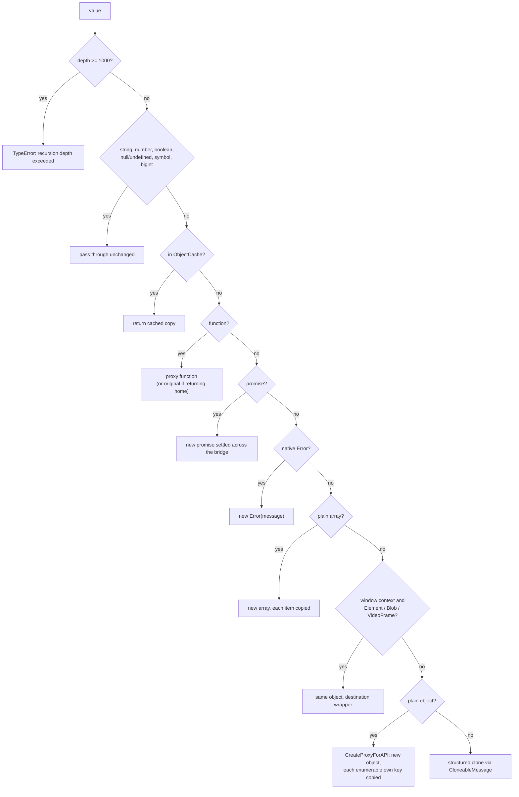

## Overview

With `contextIsolation` on, a frame's preload scripts and Electron's renderer code run in a separate V8 context, the *isolated world*, while the page runs in the *main world*. Both share the DOM but not JavaScript objects, so the page cannot reach `ipcRenderer`, Node, or anything the preload holds unless the preload hands it over. `contextBridge` is that hand-over. It copies values from one context into another and replaces functions with proxies that cross back into the owning context when called.

Sources: [lib/renderer/api/context-bridge.ts:1-22](repo://lib/renderer/api/context-bridge.ts#L1-L22), [shell/renderer/api/electron_api_context_bridge.cc:153-243](repo://shell/renderer/api/electron_api_context_bridge.cc#L153-L243), [shell/renderer/api/electron_api_context_bridge.cc:245-353](repo://shell/renderer/api/electron_api_context_bridge.cc#L245-L353), [shell/renderer/api/electron_api_context_bridge.cc:355-468](repo://shell/renderer/api/electron_api_context_bridge.cc#L355-L468)

Which contexts get Node and preloads is decided in [[Renderer Process Initialization]], for both renderer kinds. This page covers the isolated world itself, the copy algorithm in `PassValueToOtherContext`, the public and internal API on top of it, and the `isolated_renderer` bundle.

Sources: [shell/renderer/electron_render_frame_observer.cc:116-145](repo://shell/renderer/electron_render_frame_observer.cc#L116-L145)

## The isolated world

Electron's isolated world has id `ISOLATED_WORLD_ID = 999`. The header comment says the number is chosen far from 0 so it cannot collide with worlds Chrome creates. Extension worlds start at `1 << 20`.

Sources: [shell/common/world_ids.h:12-26](repo://shell/common/world_ids.h#L12-L26)

`ElectronRenderFrameObserver` creates the world when context isolation is on and the frame is the main frame, or any frame with `nodeIntegrationInSubFrames`. `CreateIsolatedWorldContext` names it "Electron Isolated Context", the label shown in DevTools' context picker. It gives the world the document's security origin and runs `void 0` in it to create its first context.

Sources: [shell/renderer/electron_render_frame_observer.cc:126-145](repo://shell/renderer/electron_render_frame_observer.cc#L126-L145), [shell/renderer/electron_render_frame_observer.cc:171-189](repo://shell/renderer/electron_render_frame_observer.cc#L171-L189)

When the main process sends a message to the frame, `RendererClientBase::GetContext` picks the isolated world's context if context isolation is on and the main world's otherwise, so `ipcRenderer` listeners always run where the preload lives.

Sources: [shell/renderer/renderer_client_base.cc:536-546](repo://shell/renderer/renderer_client_base.cc#L536-L546)

## The JavaScript API

`contextBridge` is a thin layer over the `electron_renderer_context_bridge` binding. Every method first throws `contextBridge API can only be used when contextIsolation is enabled` when `process.contextIsolated` is false.

Sources: [lib/renderer/api/context-bridge.ts:1-22](repo://lib/renderer/api/context-bridge.ts#L1-L22)

| Method | Native call |
| --- | --- |
| `exposeInMainWorld(key, api)` | `exposeAPIInWorld(0, key, api)` |
| `exposeInIsolatedWorld(worldId, key, api)` | `exposeAPIInWorld(worldId, key, api)` |
| `executeInMainWorld({ func, args })` | `executeInWorld(0, script)` |

Sources: [lib/renderer/api/context-bridge.ts:7-20](repo://lib/renderer/api/context-bridge.ts#L7-L20), [shell/renderer/api/electron_api_context_bridge.cc:1128-1143](repo://shell/renderer/api/electron_api_context_bridge.cc#L1128-L1143)

`internalContextBridge` wraps the two `_override*FromIsolatedWorld` methods. Electron's own renderer code uses them to mirror changes made in the isolated world into the main world, such as the `window.close` and `prompt` overrides in `window-setup.ts`. The internal object is attached to `contextBridge` only in DCHECK builds, where the binding sets `_isDebug`, so tests can reach it.

Sources: [lib/renderer/api/context-bridge.ts:24-39](repo://lib/renderer/api/context-bridge.ts#L24-L39), [lib/renderer/window-setup.ts:7-20](repo://lib/renderer/window-setup.ts#L7-L20)

## Exposing an API

`ExposeAPIInWorld` finds the target context with `GetTargetContext`. In a window this is the main world for id 0, or the frame's context for another world id. In a preload realm, only world 0 is allowed, and it maps to the service worker's own context; any other id throws `Isolated worlds are not supported in preload realms.`.

Sources: [shell/renderer/api/electron_api_context_bridge.cc:770-823](repo://shell/renderer/api/electron_api_context_bridge.cc#L770-L823)

`ExposeAPI` then refuses to overwrite: if the target's global already has the key, it throws `Cannot bind an API on top of an existing property on the window object`. Otherwise it copies the value with `PassValueToOtherContext`, deep-freezes the copy unless it is a typed array, and defines it on the global as read-only and non-configurable. The page can neither replace the API nor change what it contains. The disabled-by-default `ContextBridgeMutability` feature skips the freeze and sets a plain property.

Sources: [shell/renderer/api/electron_api_context_bridge.cc:733-768](repo://shell/renderer/api/electron_api_context_bridge.cc#L733-L768), [shell/renderer/api/electron_api_context_bridge.cc:35-39](repo://shell/renderer/api/electron_api_context_bridge.cc#L35-L39), [shell/renderer/api/electron_api_context_bridge.cc:66-89](repo://shell/renderer/api/electron_api_context_bridge.cc#L66-L89)

## How a value is copied

`PassValueToOtherContext` creates an `ObjectCache` for the call, or uses one passed in, and recurses through `PassValueToOtherContextInner`. Each value takes the first branch that matches:

Sources: [shell/renderer/api/electron_api_context_bridge.cc:469-490](repo://shell/renderer/api/electron_api_context_bridge.cc#L469-L490)

Sources: [shell/renderer/api/electron_api_context_bridge.cc:153-243](repo://shell/renderer/api/electron_api_context_bridge.cc#L153-L243), [shell/renderer/api/electron_api_context_bridge.cc:245-353](repo://shell/renderer/api/electron_api_context_bridge.cc#L245-L353), [shell/renderer/api/electron_api_context_bridge.cc:355-468](repo://shell/renderer/api/electron_api_context_bridge.cc#L355-L468)

A few branches need more detail.

Sources: [shell/renderer/api/electron_api_context_bridge.cc:355-467](repo://shell/renderer/api/electron_api_context_bridge.cc#L355-L467)

- **Errors.** Errors are not structured-cloneable, so the bridge builds a new `Error` from the `message` property, falling back to the V8 message text. Only the message crosses, not the stack or custom properties.
- **Plain objects.** `IsPlainObject` excludes dates, regexps, maps, sets, buffers, proxies, promises and other built-ins, so those fall through to structured clone. A plain object becomes a fresh object in the destination, built by `CreateProxyForAPI`, which copies each enumerable own property. With `support_dynamic_properties` (used only by the internal override helper), getters and setters are proxied as accessors instead of being read once.
- **Last resort.** Anything else goes through `blink::CloneableMessage`. If the value cannot be serialized, the V8 serializer throws, in the source or destination context depending on `BridgeErrorTarget`.

Sources: [shell/renderer/api/electron_api_context_bridge.cc:91-115](repo://shell/renderer/api/electron_api_context_bridge.cc#L91-L115), [shell/renderer/api/electron_api_context_bridge.cc:355-467](repo://shell/renderer/api/electron_api_context_bridge.cc#L355-L467), [shell/renderer/api/electron_api_context_bridge.cc:631-729](repo://shell/renderer/api/electron_api_context_bridge.cc#L631-L729)

`ObjectCache` maps each source object to its copy for the duration of one call. Its purpose is that an object reachable twice in one value, or passed twice as arguments, is copied once and the copy keeps that identity. It records copies only for object values.

Sources: [shell/renderer/api/context_bridge/object_cache.cc:10-33](repo://shell/renderer/api/context_bridge/object_cache.cc#L10-L33), [shell/renderer/api/electron_api_context_bridge.cc:192-196](repo://shell/renderer/api/electron_api_context_bridge.cc#L192-L196)

## Function proxies

A function is replaced by a new function created in the destination context with `ProxyFunctionWrapper` as its callback. Private keys on a state object hold the original function, its receiver (the object it was a property of), and the dynamic-properties flag. Another private key on the proxy records the original. If that proxy is later passed back over the bridge to the context that created the original, the bridge returns the original function instead of wrapping a proxy in a proxy.

Sources: [shell/renderer/api/electron_api_context_bridge.cc:198-243](repo://shell/renderer/api/electron_api_context_bridge.cc#L198-L243)

Calling the proxy runs `ProxyFunctionWrapper`.

Sources: [shell/renderer/api/electron_api_context_bridge.cc:492-520](repo://shell/renderer/api/electron_api_context_bridge.cc#L492-L520)

1. It reads the original function and receiver from the private keys and finds the context that owns the function.
2. Inside that context, it copies every argument from the calling context with one shared `ObjectCache`, so callbacks passed in become proxies the other way.
3. It calls the original function with the original receiver.
4. If the call throws, it takes the exception's `message` and throws a new `Error` with that message in the calling context. A thrown non-object becomes a generic "unknown exception occurred in the isolated context" error.
5. It copies the return value back into the calling context. If that copy fails, it rethrows the conversion error in the caller.

Sources: [shell/renderer/api/electron_api_context_bridge.cc:492-560](repo://shell/renderer/api/electron_api_context_bridge.cc#L492-L560), [shell/renderer/api/electron_api_context_bridge.cc:561-629](repo://shell/renderer/api/electron_api_context_bridge.cc#L561-L629)

## Promise proxies

A promise becomes a new promise in the destination context. The bridge attaches `then` and `catch` callbacks to the source promise that copy the result or the rejection reason across and settle the proxy. Both callbacks hold the two contexts only through weak handles and do nothing if either context is gone, so a promise that settles after a navigation does not touch a dead context. If the result cannot cross, the proxy rejects with an explanation that the value is not supported by the context bridge.

Sources: [shell/renderer/api/electron_api_context_bridge.cc:245-353](repo://shell/renderer/api/electron_api_context_bridge.cc#L245-L353)

## Running code in the main world

`executeInMainWorld` does not copy the function itself. `ExecuteInWorld` converts `func` to source with `FunctionProtoToString`, compiles `(<source>)` in the target context, and runs it, failing unless the result is a function. It copies `args` into the target context with one shared cache, calls the copy, and copies the result back into the caller's context. Because only the source text crosses, the function cannot close over anything in the preload; it sees only the main world and its arguments. Errors at each step, whether compiling, running, calling or cloning, are rethrown as `Error`s in the caller.

Sources: [shell/renderer/api/electron_api_context_bridge.cc:921-1010](repo://shell/renderer/api/electron_api_context_bridge.cc#L921-L1010), [shell/renderer/api/electron_api_context_bridge.cc:1011-1118](repo://shell/renderer/api/electron_api_context_bridge.cc#L1011-L1118)

## Overriding main-world globals

`OverrideGlobalValueFromIsolatedWorld` walks a key path such as `['document', 'hidden']` from the main world's global, copies the value from the isolated world, and assigns it to the last key. `OverrideGlobalPropertyFromIsolatedWorld` does the same with a getter and optional setter, defining an accessor property. Unlike `exposeInMainWorld`, these replace existing properties, which is why they are internal only.

Sources: [shell/renderer/api/electron_api_context_bridge.cc:825-919](repo://shell/renderer/api/electron_api_context_bridge.cc#L825-L919)

## The isolated_renderer bundle

The `<webview>` element has to be defined in the main world, where the page's DOM code can see it, but its implementation needs `ipcRendererInternal` from the isolated world. `SetupMainWorldOverrides` bridges the two when the `webviewTag` preference is on. It builds an `isolatedApi` object with `allowGuestViewElementDefinition` and `setIsWebView`, copies the hidden `guestViewInternal` object from the isolated world with `PassValueToOtherContext`, and runs `electron/js2c/isolated_bundle` in the main world with `isolatedApi` as its parameter.

Sources: [shell/renderer/renderer_client_base.cc:568-610](repo://shell/renderer/renderer_client_base.cc#L568-L610), [shell/renderer/electron_render_frame_observer.cc:138-144](repo://shell/renderer/electron_render_frame_observer.cc#L138-L144)

The bundle itself is ten lines. If `guestViewInternal` arrived, it calls `setupWebView(isolatedApi)` to register the element. Every call the element later makes into `guestViewInternal` is a context bridge function proxy back into the isolated world. [[The webview Tag]] follows those calls.

Sources: [lib/isolated_renderer/init.ts:1-10](repo://lib/isolated_renderer/init.ts#L1-L10)
