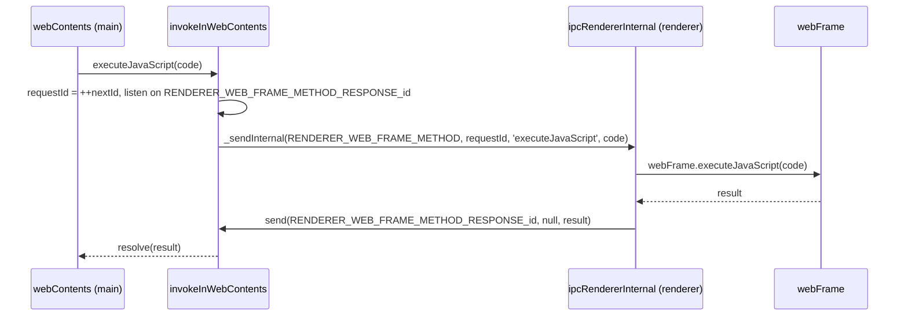

## Overview

A lot of Electron's renderer-side API needs the main process. `window.close()` must close the owning `BrowserWindow`. Preload scripts must be read from disk, `<webview>` must create guest contents, and `webContents.executeJavaScript` must run code in a frame. Electron sends these requests over the same Mojo pipes as app messages, with the `internal` flag set to `true`. The browser routes internal messages to `ipcMainInternal` and the renderer routes them to `ipcRendererInternal`, so app code listening on `ipcMain` or `ipcRenderer` never sees them, even on the same channel name.

Sources: [lib/browser/ipc-dispatch.ts:59-63](repo://lib/browser/ipc-dispatch.ts#L59-L63), [lib/renderer/ipc-native-setup.ts:7-14](repo://lib/renderer/ipc-native-setup.ts#L7-L14)

This page covers the internal emitters, the channel names, the two request/response helpers built on them, and the handlers in `rpc-server.ts`. The transport and event dispatch are covered in [[IPC Between Main and Renderer]].

Sources: [lib/browser/rpc-server.ts:1-10](repo://lib/browser/rpc-server.ts#L1-L10)

## The internal emitters

`ipcMainInternal` is just another `IpcMainImpl`, so it has the same `on`, `handle` and `handleOnce` methods as `ipcMain`. The dispatcher sends every event whose hidden `internal` value is set to it, and to nothing else. That covers `-ipc-message`, `-ipc-invoke` and `-ipc-message-sync` alike.

Sources: [lib/browser/ipc-main-internal.ts:1-3](repo://lib/browser/ipc-main-internal.ts#L1-L3), [lib/browser/ipc-dispatch.ts:58-63](repo://lib/browser/ipc-dispatch.ts#L58-L63), [lib/browser/ipc-dispatch.ts:93-95](repo://lib/browser/ipc-dispatch.ts#L93-L95), [lib/browser/ipc-dispatch.ts:112-117](repo://lib/browser/ipc-dispatch.ts#L112-L117)

`ipcRendererInternal` mirrors `ipcRenderer` with `internal = true`. It has `send`, `sendSync` and `invoke`, but no `sendToHost` or `postMessage`. Main-to-renderer internal messages are sent with `webContents._sendInternal` or `webFrameMain._sendInternal`, which pass `internal = true` to the native `_send`. In the renderer, the `ipcNative.onMessage` callback emits them on `ipcRendererInternal`.

Sources: [lib/renderer/ipc-renderer-internal.ts:1-26](repo://lib/renderer/ipc-renderer-internal.ts#L1-L26), [lib/browser/api/web-frame-main.ts:26-36](repo://lib/browser/api/web-frame-main.ts#L26-L36), [lib/browser/api/web-contents.ts:129-131](repo://lib/browser/api/web-contents.ts#L129-L131), [lib/renderer/ipc-native-setup.ts:9-14](repo://lib/renderer/ipc-native-setup.ts#L9-L14)

## Channel names

All fixed channel names live in one `const enum`, `IPC_MESSAGES`, which TypeScript inlines at each use. The prefix tells you who handles the message.

Sources: [lib/common/ipc-messages.ts:1-28](repo://lib/common/ipc-messages.ts#L1-L28)

| Prefix | Handled in | Channels |
| --- | --- | --- |
| `BROWSER_` | Main process, mostly `rpc-server.ts` | `CLIPBOARD_SYNC`, `GET_LAST_WEB_PREFERENCES`, `PRELOAD_ERROR`, `SANDBOX_LOAD`, `NONSANDBOX_LOAD`, `WINDOW_CLOSE`, `GET_PROCESS_MEMORY_INFO`, `GET_FRAME_ROUTING_ID_SYNC`, `GET_FRAME_TOKEN_SYNC` |
| `GUEST_VIEW_MANAGER_` | Main process, `guest-view-manager.ts` | `CREATE_AND_ATTACH_GUEST`, `DETACH_GUEST`, `FOCUS_CHANGE`, `CALL`, `PROPERTY_GET`, `PROPERTY_SET` |
| `GUEST_VIEW_INTERNAL_`, `GUEST_INSTANCE_` | Renderer | `DISPATCH_EVENT` (suffixed with the view instance id), `VISIBILITY_CHANGE` |
| `RENDERER_` | Renderer, `web-frame-init.ts` | `WEB_FRAME_METHOD` |
| `INSPECTOR_` | Main process, `devtools.ts` | `CONFIRM`, `CONTEXT_MENU`, `SELECT_FILE` |

Sources: [lib/common/ipc-messages.ts:1-28](repo://lib/common/ipc-messages.ts#L1-L28), [lib/browser/guest-view-manager.ts:289-300](repo://lib/browser/guest-view-manager.ts#L289-L300), [lib/browser/devtools.ts:70-96](repo://lib/browser/devtools.ts#L70-L96), [lib/renderer/web-frame-init.ts:12-22](repo://lib/renderer/web-frame-init.ts#L12-L22)

## Synchronous calls from the renderer

Some renderer APIs have to return a value synchronously: `clipboard` methods, `webFrame.routingId`, and the preload list read before any page script runs. They use the pair `invokeSync` (renderer) and `handleSync` (main).

Sources: [lib/renderer/ipc-renderer-internal-utils.ts:16-24](repo://lib/renderer/ipc-renderer-internal-utils.ts#L16-L24), [lib/browser/ipc-main-internal-utils.ts:5-13](repo://lib/browser/ipc-main-internal-utils.ts#L5-L13)

`handleSync` registers an `ipcMainInternal` listener that awaits the handler and assigns `event.returnValue = [null, result]`, or `[error]` if it throws. Because the assignment happens after `await`, an async handler still works: the renderer stays blocked in its `[Sync]` Mojo call until `returnValue` is set. `invokeSync` calls `ipcRendererInternal.sendSync` and destructures `[error, result]`, rethrowing the error in the renderer.

Sources: [lib/browser/ipc-main-internal-utils.ts:5-13](repo://lib/browser/ipc-main-internal-utils.ts#L5-L13), [lib/renderer/ipc-renderer-internal-utils.ts:16-24](repo://lib/renderer/ipc-renderer-internal-utils.ts#L16-L24)

```typescript
export const handleSync = function <T extends IPCHandler> (channel: string, handler: T) {
  ipcMainInternal.on(channel, async (event, ...args) => {
    try {
      event.returnValue = [null, await handler(event, ...args)];
    } catch (error) {
      event.returnValue = [error];
    }
  });
};
```

Sources: [lib/browser/ipc-main-internal-utils.ts:5-13](repo://lib/browser/ipc-main-internal-utils.ts#L5-L13)

## Calls from main into a renderer

The other direction has no native invoke, so `invokeInWebContents` and the renderer's `handle` build one from plain messages. The main side picks a request id from a counter and listens on `<command>_RESPONSE_<id>`. It then sends `command` with the id as the first argument through `_sendInternal`. The renderer's `handle` listener runs the handler and sends `(null, result)` or `(error)` back on the response channel. The main listener removes itself and settles the promise.

Sources: [lib/browser/ipc-main-internal-utils.ts:15-38](repo://lib/browser/ipc-main-internal-utils.ts#L15-L38), [lib/renderer/ipc-renderer-internal-utils.ts:5-14](repo://lib/renderer/ipc-renderer-internal-utils.ts#L5-L14)



Sources: [lib/browser/api/web-contents.ts:163-183](repo://lib/browser/api/web-contents.ts#L163-L183), [lib/renderer/web-frame-init.ts:12-22](repo://lib/renderer/web-frame-init.ts#L12-L22), [lib/browser/ipc-main-internal-utils.ts:15-38](repo://lib/browser/ipc-main-internal-utils.ts#L15-L38)

A reply on the response channel from a different `WebContents` is logged as `Reply to <command> sent by unexpected WebContents` and ignored, so one page cannot answer a request made of another. `webContents.insertCSS`, `insertText`, `removeInsertedCSS`, `setVisualZoomLevelLimits`, `executeJavaScript` and `executeJavaScriptInIsolatedWorld` all go through `RENDERER_WEB_FRAME_METHOD`. The two `executeJavaScript` variants first wait for `did-stop-loading` if the page has not finished loading.

Sources: [lib/browser/ipc-main-internal-utils.ts:21-26](repo://lib/browser/ipc-main-internal-utils.ts#L21-L26), [lib/browser/api/web-contents.ts:150-183](repo://lib/browser/api/web-contents.ts#L150-L183)

## The RPC server

### Registered handlers

`rpc-server.ts` is loaded by the browser init script before the app runs, as [[Process Startup]] describes. It registers the main-process half of the `BROWSER_*` channels.

Sources: [lib/browser/init.ts:76-77](repo://lib/browser/init.ts#L76-L77), [lib/browser/rpc-server.ts:11-126](repo://lib/browser/rpc-server.ts#L11-L126)

| Channel | Kind | What the handler does |
| --- | --- | --- |
| `BROWSER_WINDOW_CLOSE` | `on` | Closes `event.sender.getOwnerBrowserWindow()`; sent by `window.close()` |
| `BROWSER_GET_LAST_WEB_PREFERENCES` | `handle` | Returns the sender's last web preferences; used by the security warnings |
| `BROWSER_GET_PROCESS_MEMORY_INFO` | `handle` | Returns `_getProcessMemoryInfo()` for `process.getProcessMemoryInfo()` in renderers |
| `BROWSER_CLIPBOARD_SYNC` | `handleSync` | Calls a clipboard method in the main process |
| `BROWSER_SANDBOX_LOAD` | `handleSync` | Reads every preload script and returns their contents plus a `process` snapshot |
| `BROWSER_NONSANDBOX_LOAD` | `handleSync` | Returns only the preload paths |
| `BROWSER_PRELOAD_ERROR` | `on` | Emits `preload-error` on the sender `webContents` |
| `BROWSER_GET_FRAME_ROUTING_ID_SYNC`, `BROWSER_GET_FRAME_TOKEN_SYNC` | `handleSync` | Converts between a frame token and a routing id within the sender's process |

Sources: [lib/browser/rpc-server.ts:11-126](repo://lib/browser/rpc-server.ts#L11-L126), [lib/renderer/window-setup.ts:8-12](repo://lib/renderer/window-setup.ts#L8-L12), [lib/renderer/security-warnings.ts:277-280](repo://lib/renderer/security-warnings.ts#L277-L280)

Most handlers return early when `event.type` is not `frame`, so a service worker cannot use them. The frame id handlers also refuse when the sender frame is destroyed, and they only look up frames in the sender's own process.

Sources: [lib/browser/rpc-server.ts:12-30](repo://lib/browser/rpc-server.ts#L12-L30), [lib/browser/rpc-server.ts:114-126](repo://lib/browser/rpc-server.ts#L114-L126)

### Clipboard forwarding

The renderer's `clipboard` module is the native binding with some methods swapped for `invokeSync` calls. On Linux every method is forwarded, because the renderer cannot reach the clipboard. On macOS only `readFindText` and `writeFindText` are, because only the main process is notified of find pasteboard changes. The server keeps a matching allow-list per platform and throws `Invalid method` for anything else, so a compromised renderer cannot call arbitrary clipboard methods through the channel.

Sources: [lib/renderer/api/clipboard.ts:1-21](repo://lib/renderer/api/clipboard.ts#L1-L21), [lib/browser/rpc-server.ts:32-50](repo://lib/browser/rpc-server.ts#L32-L50)

### Preload scripts

`getPreloadScriptsFromEvent` takes `session.getPreloadScripts()`, keeps those whose `type` matches the sender (`frame` or `service-worker`), and for frames appends the `webPreferences.preload` script. It drops any path that is not absolute. The comment says that filter can go once `Session.setPreloads` is fully deprecated.

Sources: [lib/browser/rpc-server.ts:52-70](repo://lib/browser/rpc-server.ts#L52-L70)

`BROWSER_NONSANDBOX_LOAD` returns only paths, because a Node-enabled renderer can `require` them itself. `BROWSER_SANDBOX_LOAD` reads each file with `fs.promises.readFile` and attaches any read error to the script entry instead of failing the call. It also returns `arch`, `platform`, `env`, `version`, `versions` and the helper `execPath`, which sandboxed preloads expose as their limited `process`. [[Renderer Process Initialization]] and [[Sandboxed Renderers and Preload Scripts]] show how each result is used.

Sources: [lib/browser/rpc-server.ts:72-107](repo://lib/browser/rpc-server.ts#L72-L107), [lib/renderer/init.ts:136-136](repo://lib/renderer/init.ts#L136-L136), [lib/sandboxed_renderer/init.ts:15-22](repo://lib/sandboxed_renderer/init.ts#L15-L22)

## Guarding webview channels

The `GUEST_VIEW_MANAGER_*` handlers are wrapped by `makeSafeHandler`. It rejects non-frame events and checks the sender's last web preferences for `webviewTag`, caching the answer per `WebContents` in a `WeakMap`. A page without `<webview>` enabled gets `<webview> disabled` instead of a guest. [[The webview Tag]] describes what the handlers do.

Sources: [lib/browser/guest-view-manager.ts:258-287](repo://lib/browser/guest-view-manager.ts#L258-L287)
