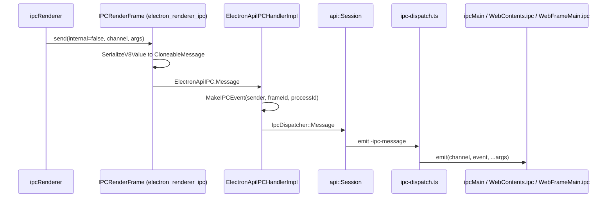

## Overview

Pages and preload scripts run in renderer processes, and the app's main script runs in the browser process. `ipcRenderer` and `ipcMain` are the bridge between them. Under the JavaScript API, every message is a Mojo call on one of two interfaces in `api.mojom`. `ElectronApiIPC` carries renderer-to-main messages and is implemented in the browser by `ElectronApiIPCHandlerImpl`. `ElectronRenderer` carries main-to-renderer messages and is implemented in each frame by `ElectronApiServiceImpl`.

Sources: [shell/common/api/api.mojom:8-56](repo://shell/common/api/api.mojom#L8-L56)

Every method carries an `internal` flag. Electron's own modules send on internal channels that never reach `ipcMain` or `ipcRenderer` listeners; [[Internal IPC and RPC]] covers that side. This page follows the public channels. The `-ipc-*` events surface on `Session`, a class described in [[Sessions and Browser Contexts]], and replies reach the frame through `WebFrameMain`, part of [[WebContents]].

Sources: [lib/browser/ipc-dispatch.ts:58-74](repo://lib/browser/ipc-dispatch.ts#L58-L74)

Sources: [shell/renderer/api/electron_api_ipc_renderer.cc:66-80](repo://shell/renderer/api/electron_api_ipc_renderer.cc#L66-L80), [shell/browser/electron_api_ipc_handler_impl.cc:44-56](repo://shell/browser/electron_api_ipc_handler_impl.cc#L44-L56), [shell/browser/api/ipc_dispatcher.h:27-37](repo://shell/browser/api/ipc_dispatcher.h#L27-L37), [lib/browser/ipc-dispatch.ts:58-74](repo://lib/browser/ipc-dispatch.ts#L58-L74)

## The renderer side

`ipcRenderer` is an `EventEmitter` subclass whose methods forward to a native object from `getIPCRenderer()`. That function calls `createForRenderFrame()` in a page and `createForServiceWorker()` in a service worker's preload realm, and throws for any other process type. `invoke` unwraps the `{ error, result }` reply and rethrows an error as `Error invoking remote method '<channel>': <error>`.

Sources: [lib/renderer/api/ipc-renderer.ts:1-34](repo://lib/renderer/api/ipc-renderer.ts#L1-L34), [lib/renderer/ipc-renderer-bindings.ts:1-17](repo://lib/renderer/ipc-renderer-bindings.ts#L1-L17)

The native object comes from the `IPCBase<T>` template in `electron_api_ipc_renderer.cc`. Each method serializes its arguments with `SerializeV8Value` (structured clone into a `blink::CloneableMessage`) and calls the matching `ElectronApiIPC` method.

Sources: [shell/renderer/api/electron_api_ipc_renderer.cc:57-80](repo://shell/renderer/api/electron_api_ipc_renderer.cc#L57-L80)

| JS method | Mojo call | Behaviour |
| --- | --- | --- |
| `send` | `Message` | Fire and forget |
| `invoke` | `Invoke` | Returns a promise resolved from the reply callback |
| `sendSync` | `MessageSync` | `[Sync]` Mojo call; blocks the renderer until the main process replies |
| `sendToHost` | `MessageHost` | Delivered to the embedding `<webview>`'s host page |
| `postMessage` | `ReceivePostMessage` | `TransferableMessage` with `MessagePort`s disentangled from the transfer list |

Sources: [shell/renderer/api/electron_api_ipc_renderer.cc:82-197](repo://shell/renderer/api/electron_api_ipc_renderer.cc#L82-L197), [shell/common/api/api.mojom:28-56](repo://shell/common/api/api.mojom#L28-L56)

`IPCRenderFrame` gets its associated remote from the frame's remote associated interfaces. It drops the remote when the frame is destroyed or when the context that created it is released. `IPCServiceWorker` gets it through the service worker's proxy and drops it when the worker thread stops. After that, every call throws `IPC method called after context was released`.

Sources: [shell/renderer/api/electron_api_ipc_renderer.cc:36-55](repo://shell/renderer/api/electron_api_ipc_renderer.cc#L36-L55), [shell/renderer/api/electron_api_ipc_renderer.cc:199-260](repo://shell/renderer/api/electron_api_ipc_renderer.cc#L199-L260)

## Which frames may send

`ElectronBrowserClient` registers the `ElectronApiIPC` binder per frame. It registers it only for the primary main frame, or for any frame when the web preferences allow Node integration in subframes. A plain cross-origin iframe therefore has no channel to `ipcMain` at all.

Sources: [shell/browser/electron_browser_client.cc:1450-1468](repo://shell/browser/electron_browser_client.cc#L1450-L1468)

## Turning a message into an event

`ElectronApiIPCHandlerImpl` lives as long as its frame's `WebContents`. It deletes itself when the contents are destroyed or the pipe disconnects. For each call it looks up the `Session` of the frame's browser context and builds an event with `MakeIPCEvent`:

Sources: [shell/browser/electron_api_ipc_handler_impl.cc:20-42](repo://shell/browser/electron_api_ipc_handler_impl.cc#L20-L42), [shell/browser/electron_api_ipc_handler_impl.cc:131-178](repo://shell/browser/electron_api_ipc_handler_impl.cc#L131-L178)

- `type: 'frame'` and `sender`, the `WebContents`.
- A hidden `internal` value when the message was internal.
- `_replyChannel` when the call expects a reply (`Invoke`, `MessageSync`).
- `senderFrame` as a getter, plus `frameId`, `processId` and `frameTreeNodeId`.

Sources: [shell/browser/electron_api_ipc_handler_impl.cc:162-178](repo://shell/browser/electron_api_ipc_handler_impl.cc#L162-L178)

If the session, the `api::WebContents` or its JavaScript wrapper is gone, `MakeIPCEvent` still answers a pending reply callback with an error, because a Mojo reply callback must always run. `ReplyChannel` enforces the same rule from the other end: if it is garbage-collected before `sendReply` is called, its destructor sends `reply was never sent`. A blocked `sendSync` or a pending `invoke` therefore always gets an answer.

Sources: [shell/browser/electron_api_ipc_handler_impl.cc:131-160](repo://shell/browser/electron_api_ipc_handler_impl.cc#L131-L160), [shell/common/gin_helper/reply_channel.cc:35-64](repo://shell/common/gin_helper/reply_channel.cc#L35-L64)

`Session` mixes in the `IpcDispatcher` template. Each of its methods emits a private event on the session (`-ipc-message`, `-ipc-invoke`, `-ipc-message-sync`, `-ipc-message-host`, `-ipc-ports`). For `ReceivePostMessage`, it first entangles the transferred ports into `MessagePort` objects and deserializes the message.

Sources: [shell/browser/api/ipc_dispatcher.h:27-80](repo://shell/browser/api/ipc_dispatcher.h#L27-L80)

## Dispatch in ipc-dispatch.ts

`Session.prototype._init` calls `addIpcDispatchListeners(this)`, so each session listens for its own `-ipc-*` events. Internal events (`internal` hidden value set) go straight to `ipcMainInternal`. Frame events go to three emitters, in this order:

Sources: [lib/browser/api/session.ts:25-26](repo://lib/browser/api/session.ts#L25-L26), [lib/browser/ipc-dispatch.ts:58-74](repo://lib/browser/ipc-dispatch.ts#L58-L74)

1. `WebFrameMain.ipc` of the sending frame, looked up by `frameTreeNodeId`. The comment explains the choice: lookup by frame tree node still works for messages sent while a frame is unloading during a frame swap.
2. `WebContents.ipc` of the sender.
3. The global `ipcMain`.

Sources: [lib/browser/ipc-dispatch.ts:33-53](repo://lib/browser/ipc-dispatch.ts#L33-L53), [lib/browser/api/web-frame-main.ts:6-12](repo://lib/browser/api/web-frame-main.ts#L6-L12), [lib/browser/api/web-contents.ts:552-556](repo://lib/browser/api/web-contents.ts#L552-L556), [lib/browser/api/ipc-main.ts:1-5](repo://lib/browser/api/ipc-main.ts#L1-L5)

Service worker events skip these emitters and go to the `ServiceWorkerMain.ipc` found by `versionId`. Each emitter is an `IpcMainImpl`: an `EventEmitter` with a no-op `error` listener, so a channel named `error` never throws, plus a map of invoke handlers.

Sources: [lib/browser/ipc-dispatch.ts:22-31](repo://lib/browser/ipc-dispatch.ts#L22-L31), [lib/browser/ipc-main-impl.ts:1-35](repo://lib/browser/ipc-main-impl.ts#L1-L35)

## Message, invoke and sync semantics

| Event | Who receives it | How it is answered |
| --- | --- | --- |
| `-ipc-message` | `webContents` emits `ipc-message`, then every emitter in order emits the channel | `event.reply(channel, ...)` calls `sender.sendToFrame([processId, frameId], ...)` |
| `-ipc-invoke` | The first emitter whose `_invokeHandlers` has the channel | Handler result, awaited, sent as `{ result }`; a thrown error is logged and sent as `{ error: String(err) }`; no handler sends `No handler registered for '<channel>'` |
| `-ipc-message-sync` | `webContents` emits `ipc-message-sync`, then every emitter | Setting `event.returnValue` calls `_replyChannel.sendReply` |
| `-ipc-message-host` | Re-emitted on the sender `webContents` | none |
| `-ipc-ports` | Every emitter, with `event.ports` wrapped as `MessagePortMain` | none |

Sources: [lib/browser/ipc-dispatch.ts:9-20](repo://lib/browser/ipc-dispatch.ts#L9-L20), [lib/browser/ipc-dispatch.ts:58-151](repo://lib/browser/ipc-dispatch.ts#L58-L151)

Invoke handlers are exclusive. `handle` throws when a channel already has a handler, and `handleOnce` removes itself before calling the function. Because the dispatcher takes the first emitter with a handler, a handler on `WebFrameMain.ipc` overrides one on `ipcMain` for that frame only.

Sources: [lib/browser/ipc-main-impl.ts:15-35](repo://lib/browser/ipc-main-impl.ts#L15-L35), [lib/browser/ipc-dispatch.ts:76-110](repo://lib/browser/ipc-dispatch.ts#L76-L110)

When nothing listens to a `sendSync` channel, neither `ipc-message-sync` on the contents nor any emitter, the dispatcher warns `WebContents #<id> called ipcRenderer.sendSync() with '<channel>' channel without listeners.` The renderer stays blocked until a reply is sent or the `ReplyChannel` is collected.

Sources: [lib/browser/ipc-dispatch.ts:112-136](repo://lib/browser/ipc-dispatch.ts#L112-L136), [shell/common/gin_helper/reply_channel.cc:38-41](repo://shell/common/gin_helper/reply_channel.cc#L38-L41)

## Main to renderer

`webContents.send`, `postMessage` and `_sendInternal` all forward to the main frame's `WebFrameMain`, and `sendToFrame` resolves a frame id or `[processId, frameId]` pair first. `WebFrameMain.send` calls the native `_send(internal, channel, args)`. That serializes the arguments and calls `ElectronRenderer.Message` on a `mojo::Remote` that `WebFrameMain` binds lazily once the render frame is live.

Sources: [lib/browser/api/web-contents.ts:121-148](repo://lib/browser/api/web-contents.ts#L121-L148), [lib/browser/api/web-frame-main.ts:14-43](repo://lib/browser/api/web-frame-main.ts#L14-L43), [shell/browser/api/electron_api_web_frame_main.cc:273-316](repo://shell/browser/api/electron_api_web_frame_main.cc#L273-L316)

In the renderer, `ElectronApiServiceImpl::Message` picks the context with `renderer_client_->GetContext`: the isolated world when context isolation is on, as [[Context Bridge]] explains. It converts the message and calls `ipc_native::EmitIPCEvent`. That function looks up a private `ipcNative` object on the global and calls its `onMessage(internal, channel, ports, args)` inside a `node::CallbackScope` when the context has Node. `ipc-native-setup.ts` defines `onMessage` to emit the channel on `ipcRendererInternal` or `ipcRenderer`, with `{ sender, ports }` as the event.

Sources: [shell/renderer/electron_api_service_impl.cc:86-130](repo://shell/renderer/electron_api_service_impl.cc#L86-L130), [shell/renderer/electron_ipc_native.cc:19-80](repo://shell/renderer/electron_ipc_native.cc#L19-L80), [lib/renderer/ipc-native-setup.ts:1-14](repo://lib/renderer/ipc-native-setup.ts#L1-L14)

## MessagePorts in the main process

`MessageChannelMain` calls the native `createPair()`, which creates two `MessagePort` objects entangled over a `blink::MessagePortDescriptorPair`. `MessagePortMain` wraps each native port and re-wraps the ports of every received `message` event, so JavaScript only sees `MessagePortMain`.

Sources: [lib/browser/api/message-channel.ts:1-16](repo://lib/browser/api/message-channel.ts#L1-L16), [shell/browser/api/message_port.cc:307-325](repo://shell/browser/api/message_port.cc#L307-L325), [lib/browser/message-port-main.ts:1-28](repo://lib/browser/message-port-main.ts#L1-L28)

The native port reads its pipe with a `mojo::Connector` that is paused at creation and resumed by `start()`. Each incoming message is deserialized in `Accept`, which entangles any ports it carries and emits `message` with `{ data, ports }`. A port pins its own JavaScript wrapper while it is started and entangled, so a port the app stops referencing keeps delivering messages; `close()` and a pipe error release it.

Sources: [shell/browser/api/message_port.cc:120-191](repo://shell/browser/api/message_port.cc#L120-L191), [shell/browser/api/message_port.cc:240-279](repo://shell/browser/api/message_port.cc#L240-L279)

To send a port to a renderer, `WebFrameMain.postMessage` unwraps `MessagePortMain` objects to their native ports. The native side disentangles them into the `TransferableMessage` and calls `ElectronRenderer.ReceivePostMessage`. The renderer entangles each channel back into a DOM `MessagePort` before emitting the event.

Sources: [lib/browser/api/web-frame-main.ts:38-43](repo://lib/browser/api/web-frame-main.ts#L38-L43), [shell/browser/api/electron_api_web_frame_main.cc:339-370](repo://shell/browser/api/electron_api_web_frame_main.cc#L339-L370), [shell/renderer/electron_api_service_impl.cc:104-130](repo://shell/renderer/electron_api_service_impl.cc#L104-L130)
