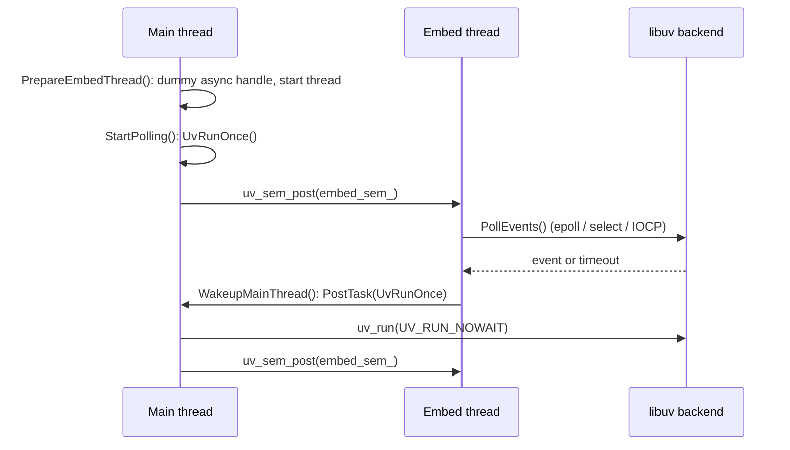

## Overview

Chromium's processes run their own message loop, and Node.js expects to own a libuv loop. Electron keeps both. `NodeBindings` creates a Node environment inside a V8 context that Chromium or Electron already made. A background *embed thread* then waits for libuv activity and posts a task to the main thread whenever there is something to run, so Node callbacks and Chromium tasks share one thread without either loop blocking the other.

Sources: [shell/common/node_bindings.cc:860-893](repo://shell/common/node_bindings.cc#L860-L893), [shell/common/node_bindings.cc:926-993](repo://shell/common/node_bindings.cc#L926-L993)

This page covers how an environment is created for each process type, the loop integration, the microtask policy, and the hooks that keep Node and Blink apart in renderers. The script that runs once the environment loads is described in [[Internal JavaScript Bundles]]. When the browser process calls these methods during startup is described in [[Process Startup]].

Sources: [shell/browser/electron_browser_main_parts.cc:232-261](repo://shell/browser/electron_browser_main_parts.cc#L232-L261)

## One class, four environments

`NodeBindings::BrowserEnvironment` has four values. Each process type creates its bindings with `NodeBindings::Create`:

Sources: [shell/common/node_bindings.h:117-122](repo://shell/common/node_bindings.h#L117-L122)

| Environment | Created by | `process.type` | Event loop |
| --- | --- | --- | --- |
| `kBrowser` | `ElectronBrowserMainParts` | `browser` | `uv_default_loop()` |
| `kRenderer` | `ElectronRendererClient` | `renderer` | `uv_default_loop()` |
| `kWorker` | `WebWorkerObserver` | `worker` | A loop of its own, from `uv_loop_init` |
| `kUtility` | `NodeService` | `utility` | `uv_default_loop()` |

Sources: [shell/browser/electron_browser_main_parts.cc:175-180](repo://shell/browser/electron_browser_main_parts.cc#L175-L180), [shell/renderer/electron_renderer_client.cc:38-42](repo://shell/renderer/electron_renderer_client.cc#L38-L42), [shell/renderer/web_worker_observer.cc:40-45](repo://shell/renderer/web_worker_observer.cc#L40-L45), [shell/services/node/node_service.cc:88-92](repo://shell/services/node/node_service.cc#L88-L92), [shell/common/node_bindings.cc:513-529](repo://shell/common/node_bindings.cc#L513-L529), [shell/common/node_bindings.cc:653-670](repo://shell/common/node_bindings.cc#L653-L670)

Web workers get their own loop because several can run in one renderer process, each on its own thread. When the bindings are destroyed, a worker's loop is stopped and drained by `stop_and_close_uv_loop`, which closes any handle still open and pumps the loop until it is empty. Every loop is configured with `UV_LOOP_INTERRUPT_ON_IO_CHANGE`, so starting a new handle interrupts the embed thread's poll.

Sources: [shell/common/node_bindings.cc:134-157](repo://shell/common/node_bindings.cc#L134-L157), [shell/common/node_bindings.cc:480-497](repo://shell/common/node_bindings.cc#L480-L497), [shell/common/node_bindings.cc:513-529](repo://shell/common/node_bindings.cc#L513-L529)

## Initializing Node

`Initialize` runs once per process before any environment exists:

Sources: [shell/common/node_bindings.cc:587-651](repo://shell/common/node_bindings.cc#L587-L651)

1. It registers the linked bindings for the current process type with `RegisterBuiltinBindings`: browser, common, renderer or utility lists, plus the testing binding in DCHECK builds.
2. It cleans `NODE_OPTIONS` with `SetNodeOptions`. In a packaged app only `--http-parser` and `--max-http-header-size` survive. Options that conflict with BoringSSL, such as `--openssl-config` and `--force-fips`, are always removed. With the `node_options` fuse off, the variable is dropped entirely.
3. It builds Node's argument list with `ParseNodeCliFlags`. This keeps only a short allow-list from Chromium's command line: inspector flags when the `node_cli_inspect` fuse allows them, `--expose-internals` only in unpackaged apps, and a few trace and deprecation flags. Renderers and workers also get `--no-experimental-fetch`, so Node's `fetch` cannot conflict with Blink's.
4. It calls `node::InitializeOncePerProcess` with flags that stop Node from initializing V8, cppgc or its platform, which Chromium already owns. Renderers skip Node's default signal handling, and utility processes do not inherit stdio.

Sources: [shell/common/node_bindings.cc:531-547](repo://shell/common/node_bindings.cc#L531-L547), [shell/common/node_bindings.cc:355-456](repo://shell/common/node_bindings.cc#L355-L456), [shell/common/node_bindings.cc:555-585](repo://shell/common/node_bindings.cc#L555-L585)

## Creating an environment

`CreateEnvironment` turns a V8 context into a Node environment:

Sources: [shell/common/node_bindings.cc:653-735](repo://shell/common/node_bindings.cc#L653-L735), [shell/common/node_bindings.cc:737-842](repo://shell/common/node_bindings.cc#L737-L842)

- It inserts `electron/js2c/<type>_init` as the second argument. That is the script Node runs as its "main": the per-process bundle.
- In the browser, it stores the app search paths as private globals for `init.ts`.
- It creates `IsolateData` and stores it in the context's embedder data slot `kElectronContextEmbedderDataIndex`, which is how `isolate_data()` later finds it from any context.
- It sets environment flags. Every environment gets `kNoGlobalSearchPaths` and `kNoRegisterESMLoader`. Renderers and workers also get `kNoBrowserGlobals` and `kNoCreateInspector`, because Blink already defines `setImmediate`, `queueMicrotask` and the other DOM globals and owns the ESM loader. When the inspect fuse is off, `kNoStartDebugSignalHandler` stops Node listening for `SIGUSR1`.
- It sets `process.type` and, in browser and renderer processes, `process.appCodeLoaded`.

Sources: [shell/common/node_bindings.cc:672-735](repo://shell/common/node_bindings.cc#L672-L735), [shell/common/node_bindings.cc:805-824](repo://shell/common/node_bindings.cc#L805-L824), [shell/common/node_bindings.cc:499-511](repo://shell/common/node_bindings.cc#L499-L511)

The returned `shared_ptr` carries a deleter that clears the embedder data slot before freeing the environment and its `IsolateData`, so no context keeps a dangling pointer.

Sources: [shell/common/node_bindings.cc:826-842](repo://shell/common/node_bindings.cc#L826-L842)

`LoadEnvironment` runs Node's bootstrap with `OnNodePreload` as the preload callback, then emits `loaded` on `process`. `OnNodePreload` adds `process.resourcesPath`, `process.helperExecPath` and the `electron` and `chrome` entries in `process.versions`. It then compiles and calls `electron/js2c/node_init` with `process` and `require`, which installs the ASAR file system patches described in [[ASAR Archives]].

Sources: [shell/common/node_bindings.cc:855-858](repo://shell/common/node_bindings.cc#L855-L858), [shell/common/node_bindings.cc:995-1022](repo://shell/common/node_bindings.cc#L995-L1022)

## Isolate settings

### Per-process settings

The `IsolateSettings` passed to `node::SetIsolateUpForNode` differ by process:

Sources: [shell/common/node_bindings.cc:737-803](repo://shell/common/node_bindings.cc#L737-L803)

| Setting | Browser and utility | Renderer and worker |
| --- | --- | --- |
| Fatal and OOM callbacks | `V8FatalErrorCallback`, `V8OOMErrorCallback` set crash keys before crashing | Same |
| Abort on uncaught exception | Never in the browser; utility behaves like Node and may abort | Never |
| Microtask policy | `kExplicit` | Left as the isolate's current policy |
| Message listener | Node's | Node's removed; `ErrorMessageListener` added to clear the async hook stack |
| Promise rejection and stack trace callbacks | Node's | Blink's |

Sources: [shell/common/node_bindings.cc:161-198](repo://shell/common/node_bindings.cc#L161-L198), [shell/common/node_bindings.cc:328-351](repo://shell/common/node_bindings.cc#L328-L351), [shell/common/node_bindings.cc:747-803](repo://shell/common/node_bindings.cc#L747-L803)

Renderers keep the isolate's policy because one renderer isolate holds many contexts, and Blink expects `kScoped` microtasks. The policy is switched to explicit only while `UvRunOnce` runs Node callbacks.

Sources: [shell/common/node_bindings.cc:774-783](repo://shell/common/node_bindings.cc#L774-L783), [shell/common/node_bindings.cc:926-959](repo://shell/common/node_bindings.cc#L926-L959)

### Code generation and modules

Several V8 host callbacks check whether the current context has a Node environment and hand off to Blink when it does not, or when it is a renderer context that is not Electron's isolated world.

Sources: [shell/common/node_bindings.cc:214-248](repo://shell/common/node_bindings.cc#L214-L248)

- `AllowWasmCodeGenerationCallback` and `ModifyCodeGenerationFromStrings` ask Blink first in renderers, so the page's CSP still applies to `eval` and WebAssembly even in a Node-enabled context.
- `HostImportModuleWithPhaseDynamically` and `HostInitializeImportMetaObject` send dynamic `import()` and `import.meta` to Node only for Node contexts, and to Blink otherwise.

Sources: [shell/common/node_bindings.cc:200-293](repo://shell/common/node_bindings.cc#L200-L293), [shell/common/node_bindings.cc:295-326](repo://shell/common/node_bindings.cc#L295-L326)

## Running libuv beside Chromium

### The embed thread

The loop integration has three parts: the embed thread that waits, the main-thread task that runs libuv, and a semaphore that passes control between them.

Sources: [shell/common/node_bindings.cc:961-993](repo://shell/common/node_bindings.cc#L961-L993)

Sources: [shell/common/node_bindings.cc:860-893](repo://shell/common/node_bindings.cc#L860-L893), [shell/common/node_bindings.cc:926-993](repo://shell/common/node_bindings.cc#L926-L993)

`PrepareEmbedThread` adds a dummy `uv_async` handle so libuv never decides there is nothing to do, then starts `EmbedThreadRunner`. The runner loops: wait on `embed_sem_`, call `PollEvents()`, then post `UvRunOnce` to the main thread's task runner. `UvRunOnce` enters the environment's context, runs `uv_run(UV_RUN_NOWAIT)` inside an explicit microtasks scope, and posts the semaphore so the embed thread polls again. If `uv_run` reports no active handles, it quits the run loop when idle.

Sources: [shell/common/node_bindings.cc:860-877](repo://shell/common/node_bindings.cc#L860-L877), [shell/common/node_bindings.cc:926-993](repo://shell/common/node_bindings.cc#L926-L993)

`PrepareEmbedThread` and `StartPolling` return early once the bindings are initialized. The comment links this to Windows: the IOCP completion port has a concurrency limit, and a second polling thread would exceed it.

Sources: [shell/common/node_bindings.cc:860-893](repo://shell/common/node_bindings.cc#L860-L893)

### Platform pollers

`PollEvents` is the only platform-specific piece. It waits for libuv's backend to have work, for at most `uv_backend_timeout`, without consuming the event.

Sources: [shell/common/node_bindings.cc:971-993](repo://shell/common/node_bindings.cc#L971-L993)

| Platform | Class | How it waits |
| --- | --- | --- |
| Linux | `NodeBindingsLinux` | `epoll_wait` on a private epoll set holding libuv's backend fd |
| macOS | `NodeBindingsMac` | `select` on the backend fd |
| Windows | `NodeBindingsWin` | `GetQueuedCompletionStatus` on libuv's IOCP, then `PostQueuedCompletionStatus` to put the event back |

Sources: [shell/common/node_bindings_linux.cc:11-39](repo://shell/common/node_bindings_linux.cc#L11-L39), [shell/common/node_bindings_mac.cc:21-51](repo://shell/common/node_bindings_mac.cc#L21-L51), [shell/common/node_bindings_win.cc:14-55](repo://shell/common/node_bindings_win.cc#L14-L55)

On single-core Windows machines, `NodeBindingsWin` replaces the fresh loop's completion port with one allowing two concurrent threads. The comment says this avoids CPU pegging from a busy loop in `PollEvents`.

Sources: [shell/common/node_bindings_win.cc:14-30](repo://shell/common/node_bindings_win.cc#L14-L30)

### Shutting the thread down

The destructor sets `embed_closed_`, posts the semaphore, wakes the poll through the dummy handle and joins the thread. `EmbedThreadRunner` checks `embed_closed_` both before and after polling, because the subclass's `PollEvents` is gone once the derived destructor has run.

Sources: [shell/common/node_bindings.cc:480-497](repo://shell/common/node_bindings.cc#L480-L497), [shell/common/node_bindings.cc:971-993](repo://shell/common/node_bindings.cc#L971-L993)

## Microtasks in the browser process

The browser process uses `kExplicit` microtasks, so someone must run checkpoints. `JavascriptEnvironment::CreateMicrotasksRunner` adds a `MicrotasksRunner` as a task observer on the UI thread. After every Chromium task, `DidProcessTask` opens and closes a `node::CallbackScope`, and Node performs the checkpoint as the scope closes. The comment cites electron/electron#20013: when Chromium and Node both ran checkpoints, they contended and Node's callbacks were delayed, so Node now always owns the checkpoint.

Sources: [shell/browser/javascript_environment.cc:144-149](repo://shell/browser/javascript_environment.cc#L144-L149), [shell/browser/microtasks_runner.cc:19-34](repo://shell/browser/microtasks_runner.cc#L19-L34)

## Task runner in Node mode

When the binary runs as plain Node (see [[Process Startup]]), there is no Chromium message loop, but gin and V8 still need a `SingleThreadTaskRunner`. `UvTaskRunner` provides one over the libuv loop: each `PostDelayedTask` starts a one-shot `uv_timer` and keeps the closure in a map until the timer fires.

Sources: [shell/app/uv_task_runner.cc:14-45](repo://shell/app/uv_task_runner.cc#L14-L45), [shell/app/node_main.cc:178-182](repo://shell/app/node_main.cc#L178-L182)
