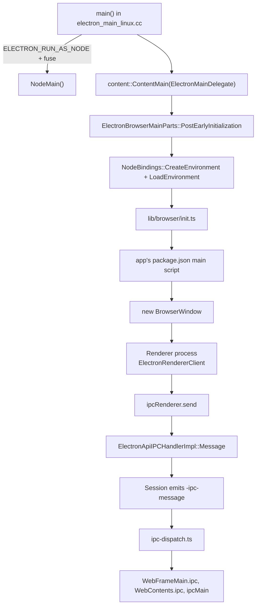

## Overview

Electron lets developers write cross-platform desktop applications in JavaScript, HTML and CSS. This repository is the runtime itself. It builds one executable that embeds Chromium's content layer and Node.js, then adds a JavaScript API (`app`, `BrowserWindow`, `ipcMain` and the rest) on top of both.

Sources: [README.md:9-12](repo://README.md#L9-L12)

The code has two halves. `shell/` is C++ that plugs into Chromium's embedder interfaces and Node's embedding API. `lib/` is TypeScript that turns those native objects into the public API and runs each process's startup script. Chromium, Node.js, V8 and several smaller dependencies are not forked. They are checked out at pinned revisions and changed by patch series stored in `patches/`.

Sources: [patches/config.json:1-16](repo://patches/config.json#L1-L16), [BUILD.gn:165-235](repo://BUILD.gn#L165-L235)

## Parts of the repository

| Area | What it does | Page |
| --- | --- | --- |
| `shell/app` | Platform `main` functions, `ElectronMainDelegate`, run-as-Node mode | [[Process Startup]] |
| `shell/common/node_bindings*` | Creates Node environments and runs libuv beside Chromium's loop | [[Node.js Integration and the Event Loop]] |
| `lib/`, `build/webpack` | TypeScript bundled into one startup script per process type | [[Internal JavaScript Bundles]] |
| `shell/common/api/api.mojom`, `lib/browser/ipc-dispatch.ts` | Messages between renderers and the main process | [[IPC Between Main and Renderer]] |
| `lib/common/ipc-messages.ts`, `lib/browser/rpc-server.ts` | Channels Electron itself uses across processes | [[Internal IPC and RPC]] |
| `shell/renderer`, `lib/renderer` | Renderer clients, preload loading, Node in frames | [[Renderer Process Initialization]] |
| `lib/sandboxed_renderer`, `lib/preload_realm` | Preloads in sandboxed renderers and service worker realms | [[Sandboxed Renderers and Preload Scripts]] |
| `shell/renderer/api/electron_api_context_bridge.cc` | Copying values between isolated worlds | [[Context Bridge]] |
| `shell/browser/native_window*`, `BaseWindow`, `View` | Top-level windows and the view tree | [[Windows and Views]] |
| `shell/browser/api/electron_api_web_contents.cc` | The `webContents` object around Chromium's `content::WebContents` | [[WebContents]] |
| `lib/browser/guest-window-manager.ts` | `window.open` and new-window handling | [[Child Windows and window.open]] |
| `lib/renderer/web-view`, `lib/browser/guest-view-manager.ts` | The `<webview>` element | [[The webview Tag]] |
| `shell/browser/electron_browser_context.cc`, `session` | Partitions, storage, permissions, downloads | [[Sessions and Browser Contexts]] |
| `protocol`, `net`, `shell/browser/net` | Custom schemes and HTTP requests from the main process | [[Custom Protocols and the net Module]] |
| `webRequest`, proxying loader factories | Observing and changing network traffic | [[Web Request Interception]] |
| `shell/common/gin_helper`, `gin_converters` | Exposing C++ classes to JavaScript | [[Native API Bindings with gin]] |
| `utilityProcess`, `shell/services/node` | Node.js child processes managed by Chromium | [[Utility Process]] |
| `shell/common/asar`, `lib/node/asar-fs-wrapper.ts` | Reading application code from `.asar` archives | [[ASAR Archives]] |
| `build/fuses` | Build-time feature switches in the binary | [[Fuses]] |
| `BUILD.gn`, `DEPS`, `patches/` | GN targets, dependencies and patch series | [[Build System and Patches]] |
| `spec/`, `script/spec-runner.js` | Test suites | [[Test Suite]] |
| `script/release`, `npm/` | Version bumps, uploads and the npm package | [[Release Tooling]] |

Sources: [shell/common/node_bindings.cc:53-113](repo://shell/common/node_bindings.cc#L53-L113), [BUILD.gn:165-235](repo://BUILD.gn#L165-L235)

To build and run the code yourself, start with [[Quickstart: Build and Run Electron]].

Sources: [package.json:60-95](repo://package.json#L60-L95)

## Main flow

The diagram follows one launch from the executable to the app's main script, then one `ipcRenderer.send` from a page back to an `ipcMain` listener.

Sources: [shell/app/electron_main_linux.cc:29-44](repo://shell/app/electron_main_linux.cc#L29-L44), [lib/browser/ipc-dispatch.ts:58-74](repo://lib/browser/ipc-dispatch.ts#L58-L74)

Sources: [shell/app/electron_main_linux.cc:29-44](repo://shell/app/electron_main_linux.cc#L29-L44), [shell/browser/electron_browser_main_parts.cc:225-261](repo://shell/browser/electron_browser_main_parts.cc#L225-L261), [shell/browser/electron_api_ipc_handler_impl.cc:44-56](repo://shell/browser/electron_api_ipc_handler_impl.cc#L44-L56), [lib/browser/ipc-dispatch.ts:58-74](repo://lib/browser/ipc-dispatch.ts#L58-L74)

1. `main` checks the `run_as_node` fuse and `ELECTRON_RUN_AS_NODE`; if both hold, the binary behaves as plain Node.js. Otherwise it hands an `ElectronMainDelegate` to Chromium's `ContentMain`. See [[Process Startup]].
2. In the browser process, `ElectronBrowserMainParts::PostEarlyInitialization` creates the V8 isolate, the Node environment and Electron's `process` extensions, then loads the browser bundle. See [[Node.js Integration and the Event Loop]].
3. The browser bundle's `init.ts` finds the app's `package.json`, sets the app name and version, and loads the `main` script as CommonJS or ESM. See [[Internal JavaScript Bundles]].
4. The app creates windows ([[Windows and Views]]), each hosting a [[WebContents]] whose renderer is set up as [[Renderer Process Initialization]] describes.
5. A message sent from the page reaches `ElectronApiIPCHandlerImpl`, which emits `-ipc-message` on the page's `Session`; `ipc-dispatch.ts` hands it to the listeners. See [[IPC Between Main and Renderer]].

Sources: [shell/app/electron_main_linux.cc:36-43](repo://shell/app/electron_main_linux.cc#L36-L43), [shell/browser/electron_browser_main_parts.cc:225-261](repo://shell/browser/electron_browser_main_parts.cc#L225-L261), [lib/browser/init.ts:87-125](repo://lib/browser/init.ts#L87-L125), [lib/browser/init.ts:199-227](repo://lib/browser/init.ts#L199-L227), [lib/browser/api/session.ts:25-26](repo://lib/browser/api/session.ts#L25-L26)

## Design decisions

### Patches instead of forks

Electron changes Chromium, Node.js, V8, BoringSSL, FFmpeg and the Squirrel.Mac updater by applying patch series to each checkout. `patches/config.json` maps every patch directory to the repository it applies to, so a dependency upgrade means rebasing a list of patches, not merging a fork. [[Build System and Patches]] covers the workflow.

Sources: [patches/config.json:1-16](repo://patches/config.json#L1-L16)

### Internal JavaScript compiled into the binary

Each process type gets its own webpack bundle (`browser_init.js`, `renderer_init.js`, `sandbox_bundle.js` and so on). The `electron_js2c` action then turns the bundles into `electron_natives.cc`, so Electron's own JavaScript ships inside the executable and does not load from disk. [[Internal JavaScript Bundles]] follows one bundle from source to the running process.

Sources: [BUILD.gn:165-273](repo://BUILD.gn#L165-L273)

### Native modules as linked bindings

Every native API module (`electron_browser_web_contents`, `electron_common_asar` and the rest) is a Node linked binding, listed per process type in `node_bindings.cc` and registered explicitly through `_register_<modname>` rather than static constructors. TypeScript reaches them with `process._linkedBinding(...)`. [[Native API Bindings with gin]] shows how a C++ class becomes such a module.

Sources: [shell/common/node_bindings.cc:53-127](repo://shell/common/node_bindings.cc#L53-L127), [lib/browser/init.ts:19-19](repo://lib/browser/init.ts#L19-L19)

### Native process lifetime, JavaScript policy

The main process does not crash on errors in app code. Unhandled rejections are set to `warn-with-error-code`, and an uncaught exception with no app listener shows an error box. `process.exit` is mapped to `app.exit` so quitting goes through Electron's shutdown path.

Sources: [shell/browser/electron_browser_main_parts.cc:245-246](repo://shell/browser/electron_browser_main_parts.cc#L245-L246), [lib/browser/init.ts:21-38](repo://lib/browser/init.ts#L21-L38), [lib/browser/init.ts:73-74](repo://lib/browser/init.ts#L73-L74)

### Security switches fixed at package time

Features that widen an app's attack surface, such as running as Node, honouring `NODE_OPTIONS`, or loading app code from outside an ASAR, are behind fuses. These are bytes in the binary that packagers flip without rebuilding, and the C++ reads them at the point of use. [[Fuses]] lists them.

Sources: [build/fuses/fuses.json5:1-13](repo://build/fuses/fuses.json5#L1-L13), [build/fuses/build.py:1-30](repo://build/fuses/build.py#L1-L30)
