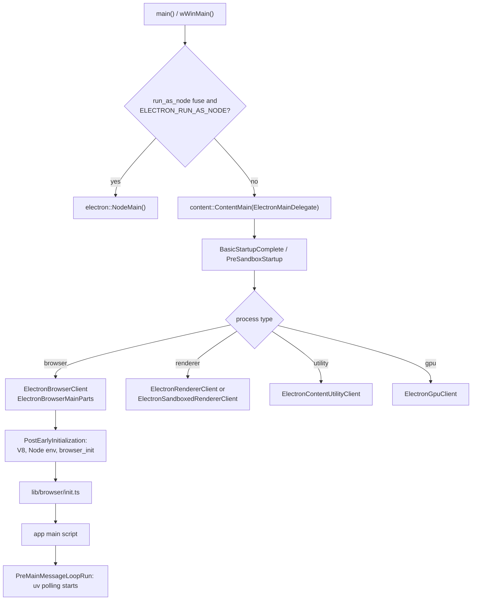

## Overview

Every Electron process starts from the same executable, and the same `main` function, whether it becomes the browser (main) process, a renderer, the GPU process, a utility process or plain Node.js. This page follows that function until the app's `main` script runs. It covers the platform entry points, the run-as-Node short cut, `ElectronMainDelegate`, the browser-process hooks in `ElectronBrowserMainParts`, and `lib/browser/init.ts`, which finds and loads the app.

Sources: [shell/app/electron_main_linux.cc:29-44](repo://shell/app/electron_main_linux.cc#L29-L44), [shell/app/electron_main_delegate.cc:446-488](repo://shell/app/electron_main_delegate.cc#L446-L488)

How the Node environment is created and kept running beside Chromium's message loop is covered in [[Node.js Integration and the Event Loop]]. How `init.ts` gets compiled into the binary is covered in [[Internal JavaScript Bundles]].

Sources: [shell/browser/electron_browser_main_parts.cc:225-261](repo://shell/browser/electron_browser_main_parts.cc#L225-L261)

Sources: [shell/app/electron_main_linux.cc:29-44](repo://shell/app/electron_main_linux.cc#L29-L44), [shell/app/electron_main_delegate.cc:446-480](repo://shell/app/electron_main_delegate.cc#L446-L480), [shell/browser/electron_browser_main_parts.cc:225-261](repo://shell/browser/electron_browser_main_parts.cc#L225-L261), [shell/browser/electron_browser_main_parts.cc:425-429](repo://shell/browser/electron_browser_main_parts.cc#L425-L429)

## Platform entry points

On Linux, `main` fixes the standard I/O streams, hands `argv` to libuv (`uv_setup_args`), and initializes both Chromium's `base::CommandLine` and Electron's own `ElectronCommandLine`. It then calls `content::ContentMain` with a stack-allocated `ElectronMainDelegate`.

Sources: [shell/app/electron_main_linux.cc:29-44](repo://shell/app/electron_main_linux.cc#L29-L44)

The macOS `main` does the same check for Node mode first. In helper executables (outside Mac App Store builds) it then sets up the Seatbelt sandbox server before calling `ElectronMain`, and aborts with a fatal error if the sandbox is required but cannot start.

Sources: [shell/app/electron_main_mac.cc:51-84](repo://shell/app/electron_main_mac.cc#L51-L84)

The Windows `wWinMain` routes stdio to the console unless `ELECTRON_NO_ATTACH_CONSOLE` is set. It handles the Crashpad handler process type itself, including an `ExitCodeWatcher` that watches the parent process. It allows dark mode for the app, rejects bad command-line arguments with `CheckCommandLineArguments`, and passes the sandbox info and instance handle into `ContentMainParams`.

Sources: [shell/app/electron_main_win.cc:160-236](repo://shell/app/electron_main_win.cc#L160-L236)

## Running as Node.js

When the `run_as_node` fuse is on and `ELECTRON_RUN_AS_NODE` is set, every platform's `main` calls `electron::NodeMain()` and never enters Chromium's content layer. [[Fuses]] explains the switch itself. `NodeMain` is a small Node.js embedder:

Sources: [shell/app/electron_main_linux.cc:36-40](repo://shell/app/electron_main_linux.cc#L36-L40), [shell/app/electron_main_win.cc:160-171](repo://shell/app/electron_main_win.cc#L160-L171)

1. If the `node_options` fuse is off, it removes `NODE_OPTIONS` and `NODE_EXTRA_CA_CERTS` from the environment.
2. On macOS, when the parent process is not signed like the current app, it removes the environment variables that could inject scripts. The code comment explains why: otherwise another app could run a sandboxed Electron app with `ELECTRON_RUN_AS_NODE` and `NODE_OPTIONS=--require bad.js` and get around macOS restrictions on passing arguments.
3. It installs a `UvTaskRunner` on `uv_default_loop()` as the current task runner, registers Electron's built-in bindings and rejects disallowed Node flags.
4. It calls `node::InitializeOncePerProcess` without letting Node initialize V8, sets up Crashpad, loads the V8 snapshot and starts a thread pool.
5. It creates a `JavascriptEnvironment`, then a Node environment whose `process` object gets `crash` and a minimal `crashReporter`, and runs `node::SpinEventLoop` until the script finishes.

Sources: [shell/app/node_main.cc:123-151](repo://shell/app/node_main.cc#L123-L151), [shell/app/node_main.cc:178-210](repo://shell/app/node_main.cc#L178-L210), [shell/app/node_main.cc:212-298](repo://shell/app/node_main.cc#L212-L298)

## ElectronMainDelegate

### Client objects per process

`ElectronMainDelegate` is Electron's `content::ContentMainDelegate`. Chromium calls it in every process, and it decides which client objects plug in Electron's behaviour:

Sources: [shell/app/electron_main_delegate.cc:446-480](repo://shell/app/electron_main_delegate.cc#L446-L480)

| Hook | Returns |
| --- | --- |
| `CreateContentClient` | `ElectronContentClient` |
| `CreateContentBrowserClient` | `ElectronBrowserClient` |
| `CreateContentGpuClient` | `ElectronGpuClient` |
| `CreateContentRendererClient` | `ElectronSandboxedRendererClient` when the sandbox is enabled on the command line, otherwise `ElectronRendererClient` |
| `CreateContentUtilityClient` | `ElectronContentUtilityClient` |
| `RunProcess` | `RelauncherMain` for the relauncher process type; every other type is left to Chromium |

Sources: [shell/app/electron_main_delegate.cc:446-488](repo://shell/app/electron_main_delegate.cc#L446-L488)

The renderer client choice is where the two renderer models split; [[Renderer Process Initialization]] and [[Sandboxed Renderers and Preload Scripts]] follow each one.

Sources: [shell/app/electron_main_delegate.cc:462-473](repo://shell/app/electron_main_delegate.cc#L462-L473)

### Early startup

`BasicStartupComplete` reads two environment variables. `ELECTRON_ENABLE_STACK_DUMPING` turns on in-process stack dumps, and `ELECTRON_DISABLE_SANDBOX` appends `--no-sandbox`. It registers Chrome's and Electron's path providers. On Linux it refuses to start as root with the sandbox enabled, citing crbug.com/638180.

Sources: [shell/app/electron_main_delegate.cc:264-331](repo://shell/app/electron_main_delegate.cc#L264-L331)

`PreSandboxStartup` applies `--user-data-dir`, initializes logging, and loads the resource bundle for the subprocess types that need it. It starts Crashpad immediately in child processes. In the browser process Crashpad waits until JavaScript calls `crashReporter.start()`, as the comment there says. For the browser process only, it appends `--allow-file-access-from-files`.

Sources: [shell/app/electron_main_delegate.cc:334-409](repo://shell/app/electron_main_delegate.cc#L334-L409)

`PreBrowserMain` initializes the feature list before Mojo core, because the service manager reads feature flags. `GetBrowserV8SnapshotFilename` returns `browser_v8_context_snapshot.bin` when the `load_browser_process_specific_v8_snapshot` fuse is on.

Sources: [shell/app/electron_main_delegate.cc:418-444](repo://shell/app/electron_main_delegate.cc#L418-L444)

## ElectronBrowserMainParts

### What it owns

In the browser process, `ElectronBrowserClient` creates `ElectronBrowserMainParts`, a singleton (a `DCHECK` forbids a second one). It owns a fake `BrowserProcessImpl`, the browser-flavoured `NodeBindings`, the `ElectronBindings` that extend `process`, and the `Browser` object behind `app`.

Sources: [shell/browser/electron_browser_main_parts.cc:175-192](repo://shell/browser/electron_browser_main_parts.cc#L175-L192)

### Booting JavaScript

`PostEarlyInitialization` is where JavaScript starts. The comment explains the timing: `ProxyResolverV8` has already set up a V8 environment, so Electron creates its own only afterwards. The method then:

Sources: [shell/browser/electron_browser_main_parts.cc:225-233](repo://shell/browser/electron_browser_main_parts.cc#L225-L233)

1. Creates `JavascriptEnvironment`, which applies `--js-flags`, builds a single-threaded `gin::IsolateHolder`, and enters a new Node context.
2. Initializes Node and creates the environment, setting unhandled rejections to `warn-with-error-code` so they do not crash the main process.
3. Binds Electron's extra `process` methods, creates the explicit microtasks runner, and loads the environment, which runs the browser bundle.
4. Calls `JoinAppCode`, which pumps the libuv loop with `uv_run(UV_RUN_ONCE)` until `process.appCodeLoaded()` has been called or the browser starts shutting down.

Sources: [shell/browser/electron_browser_main_parts.cc:232-261](repo://shell/browser/electron_browser_main_parts.cc#L232-L261), [shell/browser/javascript_environment.cc:58-100](repo://shell/browser/javascript_environment.cc#L58-L100), [shell/common/node_bindings.cc:895-924](repo://shell/common/node_bindings.cc#L895-L924)

Step 4 matters for ESM entry points. `init.ts` calls `appCodeLoaded` only after the module's import promise settles, so an app whose top-level `await`s depend on libuv work still finishes loading before Chromium continues startup.

Sources: [lib/browser/init.ts:205-219](repo://lib/browser/init.ts#L205-L219), [shell/common/node_bindings.cc:811-824](repo://shell/common/node_bindings.cc#L811-L824)

### The message loop

`PreMainMessageLoopRun` starts the embed thread and libuv polling, so Node callbacks run on the UI thread from then on. It locks the URL scheme registries, sets up extensions and the WebUI factory, and handles `--remote-debugging-pipe` and `--remote-debugging-port`. Outside macOS it emits `will-finish-launching` and `ready` through `Browser::WillFinishLaunching` and `DidFinishLaunching`; on macOS the app delegate makes the same calls.

Sources: [shell/browser/electron_browser_main_parts.cc:425-486](repo://shell/browser/electron_browser_main_parts.cc#L425-L486)

`WillRunMainMessageLoop` gives `Browser` the run loop's quit closure, which is what `app.quit()` eventually calls. On POSIX systems, `PostCreateMainMessageLoop` installs signal handlers that turn `SIGINT` and `SIGTERM` into `Browser::Quit`. On Linux it also configures `os_crypt` before anything starts the network service.

Sources: [shell/browser/electron_browser_main_parts.cc:488-547](repo://shell/browser/electron_browser_main_parts.cc#L488-L547)

### Shutdown

`PostMainMessageLoopRun` tears down in an order the comments explain. Download managers shut down before Node so `DownloadItem` callbacks cannot crash. Utility processes started by `utilityProcess` are shut down while Node is still alive, so their `exit` events can be emitted; Chromium's own cleanup would come too late. Only then are the microtasks runner and the Node environment stopped and every browser context destroyed.

Sources: [shell/browser/electron_browser_main_parts.cc:549-607](repo://shell/browser/electron_browser_main_parts.cc#L549-L607)

## Loading the app in init.ts

### Process-wide setup

`lib/browser/init.ts` is the entry of the browser bundle. It first removes its own path from `process.argv` and runs the common init. It points the native event emitter at Node's `EventEmitter.prototype`, and installs an `uncaughtException` handler. When the app has no handler of its own, this one shows the error in a dialog. It maps `process.exit` to `app.exit`, and loads the RPC server and the guest view manager.

Sources: [lib/browser/init.ts:12-80](repo://lib/browser/init.ts#L12-L80)

### Finding the package

The C++ side stores two private values on the global object before the bundle runs: `appSearchPaths` and `appSearchPathsOnlyLoadASAR`. Normally the search paths are `app.asar`, `app` and `default_app.asar`. With the `only_load_app_from_asar` fuse, only `app.asar` is searched.

Sources: [shell/common/node_bindings.cc:679-700](repo://shell/common/node_bindings.cc#L679-L700)

`init.ts` joins each path with `process.resourcesPath` and tries to load `package.json` from it. In ASAR-only mode it skips any path that `_getOrCreateArchive` cannot open as an archive. If no package is found, it throws `Unable to find a valid app` and exits with code 1.

Sources: [lib/browser/init.ts:82-112](repo://lib/browser/init.ts#L82-L112)

From `package.json` it sets the app version, takes the name from `productName` or else `name`, sets the desktop name, applies `v8Flags`, and records the app path. It then preloads the modules that must exist before `ready`: devtools, protocol, service-worker-main, web-contents, web-frame-main and web-contents-view.

Sources: [lib/browser/init.ts:114-153](repo://lib/browser/init.ts#L114-L153)

### Default behaviours and the main script

Before handing over, `init.ts` adds two defaults. A `window-all-closed` listener quits the app only when it is the sole listener. The default application menu is set on `will-finish-launching`, so it exists before any window is created. On Linux desktops that support app indicators, `XDG_CURRENT_DESKTOP` is rewritten to `Unity`, and the original value is kept in `ORIGINAL_XDG_CURRENT_DESKTOP`.

Sources: [lib/browser/init.ts:155-197](repo://lib/browser/init.ts#L155-L197)

The main script is `package.json`'s `main`, or `index.js`. A script ending in `.mjs`, or any non-`.cjs` script in a `"type": "module"` package, runs through Node's ESM loader, and `appCodeLoaded` is called when the import settles. A failed import is re-emitted as `uncaughtException`. Any other script is loaded synchronously with `Module._load`.

Sources: [lib/browser/init.ts:155-155](repo://lib/browser/init.ts#L155-L155), [lib/browser/init.ts:199-227](repo://lib/browser/init.ts#L199-L227)

## The default app

When the search reaches `default_app.asar`, the bundled `default_app` runs. It parses `--version`, `--abi`, `--app=`, `-i`, `-r` and a path argument. A URL loads in a window, an `.html` file is opened, and anything else is treated as an app folder or script: the default app reads its `package.json` the way `init.ts` does, sets `process.defaultApp`, and imports it. With no argument, it prints usage and shows its own `index.html`.

Sources: [default_app/main.ts:20-75](repo://default_app/main.ts#L20-L75), [default_app/main.ts:77-140](repo://default_app/main.ts#L77-L140), [default_app/main.ts:255-297](repo://default_app/main.ts#L255-L297)
