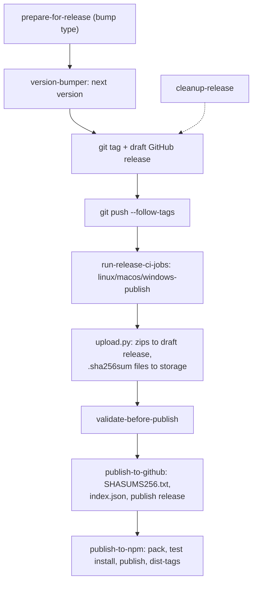

## Overview

An Electron release is a git tag, a GitHub release carrying every platform's zips, symbols and checksums, an `index.json` entry on the artifacts server, and an `electron` npm package that downloads the right binary on install. The scripts in `script/release` produce all of these. Their README says none of them is run by hand: Sudowoodo, Electron's release bot, calls each script at the right point in the process. It also warns that the scripts are old and only loosely documented, so changes should be made carefully.

Sources: [script/release/bin/README.md:1-10](repo://script/release/bin/README.md#L1-L10)

The release builds themselves are ordinary GN builds of the targets described in [[Build System and Patches]], with the `release.gn` arguments from [[Quickstart: Build and Run Electron]].

Sources: [build/args/release.gn:1-9](repo://build/args/release.gn#L1-L9)

Sources: [script/release/prepare-release.ts:213-222](repo://script/release/prepare-release.ts#L213-L222), [script/release/release.ts:408-433](repo://script/release/release.ts#L408-L433), [script/release/bin/README.md:12-58](repo://script/release/bin/README.md#L12-L58)

## The scripts

The entry points live in `script/release/bin` and are summarised in their README:

Sources: [script/release/bin/README.md:12-15](repo://script/release/bin/README.md#L12-L15)

| Script | What it does |
| --- | --- |
| `print-next-version` | Prints the version a release would use |
| `prepare-for-release` | Creates the tag and draft release, and starts the release builds |
| `run-release-builds` | Restarts specific release builds after a failure |
| `validate-before-publish` | Checks that all assets exist, checksums match, and headers and symbols are on their CDNs |
| `publish-to-github` | Uploads header checksums, updates `index.json`, and publishes the GitHub release |
| `publish-to-npm` | Publishes the npm package |
| `cleanup-release` | Deletes the draft release and the tag of a failed version; the only case where a tag is deleted, since tags are immutable once published |

Sources: [script/release/bin/README.md:16-58](repo://script/release/bin/README.md#L16-L58)

## Choosing the version

`prepare-for-release` takes a bump type: `stable`, `minor`, `beta`, `alpha` or `nightly`. Everything except `stable` and `minor` is a prerelease, and nightlies go to the separate `nightlies` repository instead of `electron`.

Sources: [script/release/bin/prepare-for-release.ts:1-32](repo://script/release/bin/prepare-for-release.ts#L1-L32), [script/release/types.ts:1-11](repo://script/release/types.ts#L1-L11)

`version-bumper.ts` computes the next version from the current one and the bump type:

Sources: [script/release/version-bumper.ts:59-60](repo://script/release/version-bumper.ts#L59-L60)

| Current | `nightly` | `alpha` / `beta` | `minor` | `stable` |
| --- | --- | --- | --- | --- |
| Prerelease (nightly, alpha, beta) | next nightly | next alpha / beta | error | the version without its prerelease part |
| Stable | next nightly | error | `inc(minor)` | `inc(patch)` |

Sources: [script/release/version-bumper.ts:60-100](repo://script/release/version-bumper.ts#L60-L100)

Alpha and beta numbers come from existing tags. `nextAlpha` lists `v<version>-alpha.*` tags, sorts them by their last number, and increments the highest, or starts at `alpha.1`; `nextBeta` does the same for betas. A nightly is `<version>-nightly.<YYYYMMDD>`. On `main` the version is one major above the last major released from main, and on a stable branch it is the next patch.

Sources: [script/release/version-utils.ts:12-68](repo://script/release/version-utils.ts#L12-L68)

## Preparing a release

`prepareRelease` runs four steps in order:

Sources: [script/release/prepare-release.ts:213-222](repo://script/release/prepare-release.ts#L213-L222)

1. It computes the new version with a dry run of the bumper.
2. `createRelease` bumps again for real, generates release notes (nightlies get a fixed note instead), and creates an annotated tag. It aborts if a draft release with that tag already exists, then creates a draft GitHub release. Prereleases get a body explaining how to install them: `npm install electron-nightly`, `electron@alpha` or `electron@beta`. Nightly drafts target `main`, and all others target the release branch.
3. `pushRelease` pushes the branch with `--follow-tags`.
4. `runReleaseBuilds` triggers the release CI jobs for the new version.

Sources: [script/release/prepare-release.ts:29-111](repo://script/release/prepare-release.ts#L29-L111), [script/release/prepare-release.ts:113-166](repo://script/release/prepare-release.ts#L113-L166), [script/release/prepare-release.ts:168-206](repo://script/release/prepare-release.ts#L168-L206)

`run-release-ci-jobs.ts` dispatches the `linux-publish`, `macos-publish` and `windows-publish` GitHub Actions workflows on the branch and reports the run URLs. A single architecture can only be requested together with a single workflow.

Sources: [script/release/run-release-ci-jobs.ts:12-80](repo://script/release/run-release-ci-jobs.ts#L12-L80), [script/release/run-release-ci-jobs.ts:140-150](repo://script/release/run-release-ci-jobs.ts#L140-L150)

## Uploading build artifacts

The publish workflows build Electron and then run `script/release/uploaders/upload.py`. `upload.py` uploads each artifact it finds: the Electron zip, symbols, API JSON and `electron.d.ts`, dSYM and PDB archives, debug builds, libc++ objects and headers, FFmpeg, chromedriver, mksnapshot, hunspell dictionaries and the toolchain profile.

Sources: [.github/actions/build-electron/action.yml:205-215](repo://.github/actions/build-electron/action.yml#L205-L215), [script/release/uploaders/upload.py:47-163](repo://script/release/uploaders/upload.py#L47-L163)

For each file, `upload_electron` first zeroes the zip's timestamps to remove non-determinism. With `--upload_to_storage` it stores the file under `release-builds/` in artifact storage. Otherwise it uploads it to the draft release through `upload-to-github.ts`. Either way it writes a `<file>.sha256sum` and stores it, by default under `checksums-scratchpad/<version>`.

Sources: [script/release/uploaders/upload.py:334-384](repo://script/release/uploaders/upload.py#L334-L384)

## Publishing to GitHub

`release.ts` picks the repository from the version: `nightlies` for nightlies and `electron` otherwise.

Sources: [script/release/release.ts:25-36](repo://script/release/release.ts#L25-L36)

`validateReleaseAssets` compares the release's assets with the expected list from `assetsForVersion`, which names every chromedriver, Electron, symbol, dSYM, PDB and other zip per platform and architecture. A missing asset stops the script. It then verifies SHA-256 sums: for a draft through authenticated download URLs, for a published release through the public ones, and for the Node headers and other files on the artifacts server.

Sources: [script/release/release.ts:82-127](repo://script/release/release.ts#L82-L127), [script/release/release.ts:128-205](repo://script/release/release.ts#L128-L205), [script/release/release.ts:438-478](repo://script/release/release.ts#L438-L478)

`makeRelease`, run by `publish-to-github`, finishes the release in this order:

Sources: [script/release/bin/publish-to-github.ts:1-3](repo://script/release/bin/publish-to-github.ts#L1-L3)

1. It uploads the Node header checksums with `upload-node-checksums.py`.
2. It builds `SHASUMS256.txt` by concatenating the `.sha256sum` files from `checksums-scratchpad/<version>` and uploads it to the release, replacing an existing one.
3. It re-fetches the release and validates every asset.
4. It uploads `index.json`. The comment explains the timing: the file goes live as soon as it is uploaded, so it is done as late as possible, but before publishing, so that no published release is missing from it.
5. It publishes the release, marking it latest only for a stable version at least as new as the current latest.

Sources: [script/release/release.ts:250-276](repo://script/release/release.ts#L250-L276), [script/release/release.ts:278-340](repo://script/release/release.ts#L278-L340), [script/release/release.ts:382-433](repo://script/release/release.ts#L382-L433)

## Publishing to npm

### The package and how it is published

The npm package is small. `npm/package.json` declares `index.js` as main, `cli.js` as the `electron` binary, `electron.d.ts` as the types, and a `postinstall` that runs `install.js`, with `@electron/get` and `extract-zip` as dependencies.

Sources: [npm/package.json:1-18](repo://npm/package.json#L1-L18)

`publish-to-npm.ts` requires `ELECTRON_NPM_OTP`. It copies `cli.js`, `index.js`, `install.js`, `package.json`, `README.md` and `LICENSE` into a temp directory, fills `name`, `repository`, `description`, `license`, `author` and `keywords` from the root `package.json`, and sets the version. From the GitHub release it downloads `electron.d.ts` and `SHASUMS256.txt`, turning the latter into `checksums.json`. It writes `abi_version` from `node_module_version` in `build/args/all.gn`.

Sources: [script/release/bin/publish-to-npm.ts:15-92](repo://script/release/bin/publish-to-npm.ts#L15-L92), [script/release/bin/publish-to-npm.ts:93-152](repo://script/release/bin/publish-to-npm.ts#L93-L152)

It then chooses the npm tag. Nightlies are renamed to `electron-nightly` and tagged `latest` on `main` or `nightly-<branch>` elsewhere. Releases from `main` are refused, because the comment says main only produces nightlies. Stable releases are tagged with the branch name, prereleases with `alpha-<branch>` or `beta-<branch>`. It runs `npm pack`, installs the tarball into the temp directory, and checks that the module resolves to a string path that exists on disk. It publishes only if that version is not already on npm, so a re-run is safe. Finally, for the `electron` package, it moves the `latest`, `beta` or `alpha` dist-tag when the new version is newer than the current one.

Sources: [script/release/bin/publish-to-npm.ts:153-243](repo://script/release/bin/publish-to-npm.ts#L153-L243)

### What the package does on install

`install.js` exits early when `ELECTRON_SKIP_BINARY_DOWNLOAD` is set, or when `dist/version` and `path.txt` already match this version and platform. It takes the platform and architecture from `npm_config_platform` and `npm_config_arch`, or from the running Node. On an Apple Silicon Mac running x64 Node under Rosetta, it picks `arm64`. It downloads the `electron` artifact with `@electron/get`, verifying it against the bundled `checksums.json` unless remote checksums are requested. It extracts the zip into `dist/`, moves any `electron.d.ts` up a level, and writes `path.txt` with the executable's relative path.

Sources: [npm/install.js:1-109](repo://npm/install.js#L1-L109)

`require('electron')` from Node returns the path to that executable, read from `path.txt` (or under `ELECTRON_OVERRIDE_DIST_PATH`), and throws if the install failed. The `electron` command, `cli.js`, spawns it with the given arguments, forwards `SIGINT` and `SIGTERM`, and exits with the child's code. Inside Electron, `require('electron')` resolves to the built-in API module instead, as [[Internal JavaScript Bundles]] explains.

Sources: [npm/index.js:1-21](repo://npm/index.js#L1-L21), [npm/cli.js:1-25](repo://npm/cli.js#L1-L25), [lib/common/init.ts:78-117](repo://lib/common/init.ts#L78-L117)
