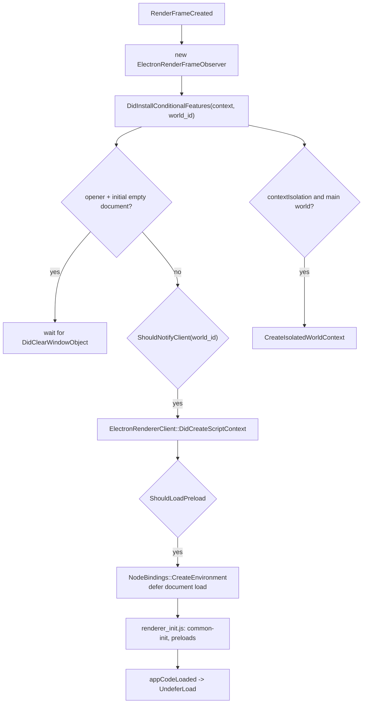

## Overview

A renderer process hosts one or more frames, and each frame has one or more JavaScript contexts: the main world, Electron's isolated world, and any extension worlds. Electron has to decide, per context, whether to create a Node.js environment, then run its renderer bundle and the app's preload scripts before the page's own scripts. This page follows that for a non-sandboxed renderer: `ElectronRendererClient`, its base class `RendererClientBase`, the per-frame `ElectronRenderFrameObserver`, and `lib/renderer/init.ts`.

Sources: [shell/renderer/electron_renderer_client.cc:39-56](repo://shell/renderer/electron_renderer_client.cc#L39-L56), [shell/renderer/renderer_client_base.cc:198-210](repo://shell/renderer/renderer_client_base.cc#L198-L210)

`ElectronMainDelegate` picks this client only when the sandbox is disabled. Sandboxed renderers, the default, use `ElectronSandboxedRendererClient`, covered in [[Sandboxed Renderers and Preload Scripts]]. The isolated world that context isolation creates, and how values cross it, are covered in [[Context Bridge]].

Sources: [shell/app/electron_main_delegate.cc:462-473](repo://shell/app/electron_main_delegate.cc#L462-L473)

Sources: [shell/renderer/electron_renderer_client.cc:51-56](repo://shell/renderer/electron_renderer_client.cc#L51-L56), [shell/renderer/electron_render_frame_observer.cc:70-145](repo://shell/renderer/electron_render_frame_observer.cc#L70-L145), [shell/renderer/electron_renderer_client.cc:89-191](repo://shell/renderer/electron_renderer_client.cc#L89-L191)

## Process-wide setup

`RendererClientBase`'s constructor reads the custom scheme switches the browser passes on the command line (`--service-worker-schemes`, `--standard-schemes`, `--cors-schemes`, `--streaming-schemes`, `--secure-schemes`) and registers each scheme with `url` and Blink. This is how `protocol.registerSchemesAsPrivileged` in the main process reaches renderers; see [[Custom Protocols and the net Module]]. It also stores the renderer client id that later builds `process.contextId`.

Sources: [shell/renderer/renderer_client_base.cc:138-172](repo://shell/renderer/renderer_client_base.cc#L138-L172)

`RenderThreadStarted` registers more schemes for fetch, service workers, CSP bypass and code caching. It adds `webview` and `browserplugin` as allowed embedder custom element names. When the `grant_file_protocol_extra_privileges` fuse is on, it lets `file:` use service workers and fetch. `ElectronRendererClient::PostIOThreadCreated` sets `--no-freeze-flags-after-init`, because the comment says freezing V8 flags conflicts with Node in the renderer.

Sources: [shell/renderer/renderer_client_base.cc:212-297](repo://shell/renderer/renderer_client_base.cc#L212-L297), [shell/renderer/electron_renderer_client.cc:47-53](repo://shell/renderer/electron_renderer_client.cc#L47-L53)

## Per-frame helpers

For every new frame, `ElectronRendererClient::RenderFrameCreated` creates an `ElectronRenderFrameObserver`, then the base class adds its helpers: the autofill agent, `ContentSettingsObserver`, the print helper, extension helpers, a spellcheck provider when enabled, and `ElectronApiServiceImpl`. The comment explains that `ElectronApiServiceImpl` must exist this early to see `DidCreateDocumentElement`; it is the `ElectronRenderer` Mojo endpoint described in [[IPC Between Main and Renderer]].

Sources: [shell/renderer/electron_renderer_client.cc:55-59](repo://shell/renderer/electron_renderer_client.cc#L55-L59), [shell/renderer/renderer_client_base.cc:306-342](repo://shell/renderer/renderer_client_base.cc#L306-L342)

`RendererClientBase::DidClearWindowObject` executes `void 0` in every frame so that a script context always exists, even on a page with no scripts. Without a context, nothing would trigger Node or preload setup.

Sources: [shell/renderer/renderer_client_base.cc:358-362](repo://shell/renderer/renderer_client_base.cc#L358-L362)

## Deciding which contexts get Node

### World and frame checks

`ElectronRenderFrameObserver::DidInstallConditionalFeatures` runs for each new context. It forwards to `DidCreateScriptContext` only when `ShouldNotifyClient(world_id)` is true. With context isolation on (in the main frame, or in any frame when `nodeIntegrationInSubFrames` is set) that is the isolated world; otherwise it is the main world. A subframe still on `about:blank` with `nodeIntegrationInSubFrames` is skipped. The comment explains why: cleaning up that environment when the iframe's `src` is set later causes illegal access errors.

Sources: [shell/renderer/electron_render_frame_observer.cc:91-123](repo://shell/renderer/electron_render_frame_observer.cc#L91-L123), [shell/renderer/electron_render_frame_observer.cc:194-211](repo://shell/renderer/electron_render_frame_observer.cc#L194-L211)

`DidCreateScriptContext` then asks `ShouldLoadPreload`. The answer is yes for the main frame, for `devtools:` and `chrome-extension:` pages, and for subframes when `nodeIntegrationInSubFrames` is on, but never for a frame whose `frameElement` is a `<webview>`. A webview's guest runs its own preloads as a separate `WebContents`.

Sources: [shell/renderer/renderer_client_base.cc:126-134](repo://shell/renderer/renderer_client_base.cc#L126-L134), [shell/renderer/renderer_client_base.cc:198-210](repo://shell/renderer/renderer_client_base.cc#L198-L210), [shell/renderer/renderer_client_base.cc:548-566](repo://shell/renderer/renderer_client_base.cc#L548-L566)

### Child windows opened with window.open

Chromium creates a JavaScript context in a `window.open` child immediately, using web preferences copied from the opener. The real preferences arrive later with the first navigation, so initializing Node at once could give a child with `nodeIntegration=no` Node anyway. The observer therefore delays initialization while the frame has an opener and is on its initial empty document, and finishes it in `DidClearWindowObject` once a real page loads. `about:blank` is the exception: Chromium does no browser-side navigation for it, so there is nothing to wait for (crbug.com/1215096). [[Child Windows and window.open]] covers the browser side.

Sources: [shell/renderer/electron_render_frame_observer.cc:70-114](repo://shell/renderer/electron_render_frame_observer.cc#L70-L114)

## Creating the frame's Node environment

`DidCreateScriptContext` does the setup once per qualifying context:

Sources: [shell/renderer/electron_renderer_client.cc:89-174](repo://shell/renderer/electron_renderer_client.cc#L89-L174)

1. On the first context in the process, it initializes `NodeBindings` and starts the embed thread. It sets up Node's tracing agent if none exists.
2. It calls `node::InitializeContext`, then sets the document loader to `LoaderFreezeMode::kStrict`, so Blink holds back the page body. The comment says this lets the preload run asynchronously (for example as ESM) without racing the page.
3. It creates the environment with `UndeferLoad` as the app-code-ready callback, so `process.appCodeLoaded()` releases the page.
4. It copies Blink's `fetch`, `Response`, `FormData`, `Request`, `Headers` and `EventSource` to `blink*` names, because Node deletes the globals when its own fetch is disabled; `node_init.js` puts them back, as [[Internal JavaScript Bundles]] shows.
5. It forces context-aware native modules, sets unhandled rejections to `warn-with-error-code`, binds Electron's `process` extras plus `isMainFrame`, `contextIsolated` and `contextId`, and loads the environment.
6. The first environment becomes the one the libuv loop runs in, and polling starts.

Sources: [shell/renderer/electron_renderer_client.cc:100-174](repo://shell/renderer/electron_renderer_client.cc#L100-L174), [shell/renderer/renderer_client_base.cc:186-196](repo://shell/renderer/renderer_client_base.cc#L186-L196)

`RunScriptsAtDocumentStart` and `RunScriptsAtDocumentEnd` emit `document-start` and `document-end` on the frame's `process`. When the context is released, `WillReleaseScriptContext` emits `exit` and detaches the environment from the loop if it was the loop's. It destroys the environment inside an explicit microtasks scope, because destruction runs the uv loop.

Sources: [shell/renderer/electron_renderer_client.cc:61-85](repo://shell/renderer/electron_renderer_client.cc#L61-L85), [shell/renderer/electron_renderer_client.cc:176-202](repo://shell/renderer/electron_renderer_client.cc#L176-L202)

## lib/renderer/init.ts

### Before any app code

The renderer bundle runs as the environment's main script. Before anything else it does three things. It warns when an app loads `vm`, which conflicts with Blink's contexts. It replaces `Module.wrapper` so every module, preloads included, gets `process`, `global` and `Buffer` as wrapper arguments that survive later deletion of the globals. It removes its own path from `process.argv` and runs the common init.

Sources: [lib/renderer/init.ts:8-46](repo://lib/renderer/init.ts#L8-L46)

### Node integration on or off

With `nodeIntegration`, the page gets a global `require` and `module`. For `file:` pages, `__filename` and `__dirname` point at the HTML file, with a Windows network share fix, and `module.paths` searches from there. Other pages use a fake path under `electron.asar/renderer`, and their module paths come from `--app-path`. `window.onerror` forwards to `process`'s `uncaughtException` when the app listens for it.

Sources: [lib/renderer/init.ts:56-114](repo://lib/renderer/init.ts#L56-L114)

Without Node integration and without context isolation, the preload shares the page's global scope. In that case `process`, `Buffer`, `setImmediate`, `clearImmediate`, `global`, `root` and `GLOBAL` are deleted from the global once the environment emits `loaded`. The preload keeps its own copies through the module wrapper, and Electron's own code keeps them through `webpack-provider.ts`.

Sources: [lib/renderer/init.ts:115-129](repo://lib/renderer/init.ts#L115-L129), [lib/common/webpack-provider.ts:1-18](repo://lib/common/webpack-provider.ts#L1-L18)

### Common renderer setup

`common-init.ts` installs the `ipcNative` receiver. On ordinary pages it runs `windowSetup`, which replaces `window.close` with an internal `BROWSER_WINDOW_CLOSE` message (except in sandboxed or webview pages) and makes `window.prompt` throw `prompt() is not supported.`. In a webview guest it also makes `document.hidden` and `visibilityState` follow the embedder's visibility. `devtools:` pages load inspector overrides instead. Main frames then initialize the `<webview>` element. Every frame registers the `RENDERER_WEB_FRAME_METHOD` handler. Main frames schedule the security warnings.

Sources: [lib/renderer/common-init.ts:1-48](repo://lib/renderer/common-init.ts#L1-L48), [lib/renderer/window-setup.ts:1-53](repo://lib/renderer/window-setup.ts#L1-L53)

With context isolation on, each override is mirrored into the main world through `internalContextBridge.overrideGlobalValueFromIsolatedWorld`, because the page cannot see changes made to the isolated world's `window`.

Sources: [lib/renderer/window-setup.ts:5-20](repo://lib/renderer/window-setup.ts#L5-L20)

### Preload scripts

`init.ts` asks the main process for preload paths with a synchronous `BROWSER_NONSANDBOX_LOAD` call, as covered in [[Internal IPC and RPC]], and splits them into CommonJS and `.mjs`. CommonJS preloads load synchronously with `Module._load`. ESM preloads are imported in order through Node's ESM loader, and `appCodeLoaded()` runs only when they settle, which un-defers the page. A preload that throws is logged as `Unable to load preload script` and reported with `BROWSER_PRELOAD_ERROR`, which the main process emits as `preload-error`. The remaining preloads still run.

Sources: [lib/renderer/init.ts:131-168](repo://lib/renderer/init.ts#L131-L168), [lib/browser/rpc-server.ts:104-112](repo://lib/browser/rpc-server.ts#L104-L112)

## Security warnings

`securityWarnings` waits for the page's `load` event, then logs console warnings about risky settings: Node integration with remote content, disabled web security, insecure resources, allowed insecure content, experimental and Blink features, missing or unsafe CSP, and `allowpopups`. By default they appear only when running the unpackaged `electron` binary, judged from `execPath`. `ELECTRON_DISABLE_SECURITY_WARNINGS` and `ELECTRON_ENABLE_SECURITY_WARNINGS`, set in the environment or on `window`, override that.

Sources: [lib/renderer/security-warnings.ts:18-50](repo://lib/renderer/security-warnings.ts#L18-L50), [lib/renderer/security-warnings.ts:264-293](repo://lib/renderer/security-warnings.ts#L264-L293)

## Node in web workers

Dedicated workers get Node only when the renderer was started with `--node-integration-in-worker`, which comes from the `nodeIntegrationInWorker` preference. Service workers, shared workers and main-thread worklets never do. The comment says these run out of process, where Electron cannot customize the sandbox policy. Each worker thread gets one `WebWorkerObserver`, held in thread-local storage, with `kWorker` bindings and its own uv loop.

Sources: [shell/renderer/electron_renderer_client.cc:204-238](repo://shell/renderer/electron_renderer_client.cc#L204-L238), [shell/renderer/web_worker_observer.cc:20-46](repo://shell/renderer/web_worker_observer.cc#L20-L46)

`WorkerScriptReadyForEvaluation` repeats the frame steps without deferring a document: start the embed thread, create the environment, stash Blink's fetch globals, bind `process`, load, and start polling. `ContextWillDestroy` emits `exit`, destroys the environment, and clears the thread-local observer. The worker bundle, `lib/worker/init.ts`, sets up `require`, `module`, `__filename` and `__dirname` the same way the page bundle does for `file:` and non-file locations.

Sources: [shell/renderer/web_worker_observer.cc:48-129](repo://shell/renderer/web_worker_observer.cc#L48-L129), [lib/worker/init.ts:1-50](repo://lib/worker/init.ts#L1-L50)
