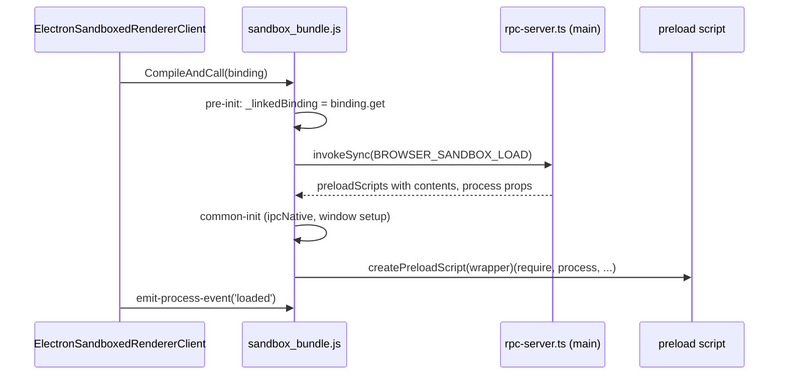

## Overview

A sandboxed renderer runs inside Chromium's OS sandbox and has no Node.js environment, but apps still need preload scripts there to expose `ipcRenderer` and friends to the page. Electron solves this without Node. The main process reads the preload files and sends their source over IPC. A small webpack bundle, `sandbox_bundle.js`, then runs each one as a function that receives a hand-built `require`, `process` and `Buffer`. The same machinery, in a separate bundle, runs preload scripts inside service workers.

Sources: [shell/renderer/electron_sandboxed_renderer_client.cc:110-136](repo://shell/renderer/electron_sandboxed_renderer_client.cc#L110-L136), [lib/browser/rpc-server.ts:89-102](repo://lib/browser/rpc-server.ts#L89-L102)

The frame observers, the "which context" rules and the shared `common-init.ts` are the same as in the Node-enabled renderer described in [[Renderer Process Initialization]]. This page covers what differs. How a preload exposes values to an isolated page is covered in [[Context Bridge]].

Sources: [shell/renderer/electron_sandboxed_renderer_client.cc:93-97](repo://shell/renderer/electron_sandboxed_renderer_client.cc#L93-L97), [lib/sandboxed_renderer/init.ts:55-56](repo://lib/sandboxed_renderer/init.ts#L55-L56)

## When a renderer is sandboxed

`WebContentsPreferences::IsSandboxed` returns the explicit `sandbox` preference when there is one. Otherwise it returns true unless `nodeIntegration` or `nodeIntegrationInWorker` is on, so sandboxing is the default. When the browser launches a renderer, `AppendCommandLineSwitches` adds `--enable-sandbox` for sandboxed contents, and for subframe processes unless `nodeIntegrationInSubFrames` is set. Otherwise it adds `--no-sandbox` and `--no-zygote`.

Sources: [shell/browser/web_contents_preferences.cc:280-286](repo://shell/browser/web_contents_preferences.cc#L280-L286), [shell/browser/web_contents_preferences.cc:308-325](repo://shell/browser/web_contents_preferences.cc#L308-L325)

In the renderer, `IsSandboxEnabled` reads those switches back, and `ElectronMainDelegate` creates an `ElectronSandboxedRendererClient` when it is true. The choice is per process, so one renderer process never mixes the two models.

Sources: [shell/app/command_line_args.cc:57-60](repo://shell/app/command_line_args.cc#L57-L60), [shell/app/electron_main_delegate.cc:462-473](repo://shell/app/electron_main_delegate.cc#L462-L473)

## The binding object

Without Node there is no `process._linkedBinding`, so the client builds a `binding` object and passes it as the bundle's only parameter. `InitializeBindings` puts three things on it:

Sources: [shell/renderer/electron_sandboxed_renderer_client.cc:71-91](repo://shell/renderer/electron_sandboxed_renderer_client.cc#L71-L91)

| Member | What it is |
| --- | --- |
| `get(name)` | `preload_utils::GetBinding`: finds a linked module with `node::binding::get_linked_module`, runs its context-aware register function, and caches the exports on a hidden `native-binding-cache` object on the global |
| `createPreloadScript(src)` | `preload_utils::CreatePreloadScript`: compiles and runs `src` as a script in the current context and returns the result |
| `process` | A plain object with memory and CPU getters from `ElectronBindings::BindProcess`, plus `isMainFrame`, `contextIsolated`, `contextId`, `uptime`, `argv`, `pid`, `sandboxed: true` and `type: 'renderer'` |

Sources: [shell/renderer/preload_utils.cc:15-73](repo://shell/renderer/preload_utils.cc#L15-L73), [shell/renderer/electron_sandboxed_renderer_client.cc:71-91](repo://shell/renderer/electron_sandboxed_renderer_client.cc#L71-L91), [shell/renderer/renderer_client_base.cc:186-196](repo://shell/renderer/renderer_client_base.cc#L186-L196)

The constructor calls `NodeBindings::RegisterBuiltinBindings()`, so the renderer and common linked modules exist for `get` to find even though Node itself never starts. `GetBinding` throws `No such binding: <name>` for anything else.

Sources: [shell/renderer/electron_sandboxed_renderer_client.cc:62-66](repo://shell/renderer/electron_sandboxed_renderer_client.cc#L62-L66), [shell/renderer/preload_utils.cc:46-50](repo://shell/renderer/preload_utils.cc#L46-L50)

## Running the bundle

### Lifecycle events

`DidCreateScriptContext` checks `ShouldLoadPreload`, the same main-frame, devtools and subframe rule the Node-enabled client uses. It builds the binding object, runs `electron/js2c/sandbox_bundle` with `CompileAndCall`, then emits `loaded`. There is no Node `process` emitter here, so lifecycle events are delivered by `InvokeEmitProcessEvent`. It calls a function the bundle stored as the private global `emit-process-event`, which emits on both the internal `process` and the preload's `process`. `document-start`, `document-end` and `exit` arrive the same way, but only for frames that were injected.

Sources: [shell/renderer/electron_sandboxed_renderer_client.cc:36-58](repo://shell/renderer/electron_sandboxed_renderer_client.cc#L36-L58), [shell/renderer/electron_sandboxed_renderer_client.cc:99-170](repo://shell/renderer/electron_sandboxed_renderer_client.cc#L99-L170), [lib/sandboxed_renderer/init.ts:41-48](repo://lib/sandboxed_renderer/init.ts#L41-L48)



Sources: [lib/sandboxed_renderer/pre-init.ts:10-30](repo://lib/sandboxed_renderer/pre-init.ts#L10-L30), [lib/sandboxed_renderer/init.ts:16-71](repo://lib/sandboxed_renderer/init.ts#L16-L71), [shell/renderer/electron_sandboxed_renderer_client.cc:130-140](repo://shell/renderer/electron_sandboxed_renderer_client.cc#L130-L140)

### pre-init

`pre-init.ts` runs first in both sandboxed bundles. It makes `process._linkedBinding` point at `binding.get` and copies `binding.process` onto webpack's `process` shim. It stores webpack's `Buffer` shim as a hidden global; the comment says C++ uses it to deserialize `Buffer` values sent from the browser. Then it turns `process` into a real `EventEmitter` by deleting any shim properties that clash with `EventEmitter.prototype` and setting the prototype.

Sources: [lib/sandboxed_renderer/pre-init.ts:1-30](repo://lib/sandboxed_renderer/pre-init.ts#L1-L30)

### Fetching the preloads

`init.ts` makes one synchronous `BROWSER_SANDBOX_LOAD` call. The main process returns each preload with its file contents, or the error from reading it, plus a `process` snapshot: `arch`, `platform`, `env`, `version`, `versions` and the helper's `execPath`. [[Internal IPC and RPC]] shows the handler. The snapshot is copied onto both the internal `process` and the preload's `process`.

Sources: [lib/sandboxed_renderer/init.ts:14-53](repo://lib/sandboxed_renderer/init.ts#L14-L53), [lib/browser/rpc-server.ts:72-102](repo://lib/browser/rpc-server.ts#L72-L102)

## What a sandboxed preload can use

`executeSandboxedPreloadScripts` wraps each script's source in a function and evaluates it with `createPreloadScript`, so it runs in the frame's global scope (the isolated world when context isolation is on), not inside the bundle's closure.

Sources: [lib/sandboxed_renderer/preload.ts:59-82](repo://lib/sandboxed_renderer/preload.ts#L59-L82)

```typescript
const preloadWrapperSrc = `(function(require, process, exports, module, ${globalVariables.join(', ')}) {
  ${preloadSrc}
  })`;
```

Sources: [lib/sandboxed_renderer/preload.ts:73-75](repo://lib/sandboxed_renderer/preload.ts#L73-L75)

The arguments are the preload's whole environment.

Sources: [lib/sandboxed_renderer/preload.ts:59-82](repo://lib/sandboxed_renderer/preload.ts#L59-L82)

- `require` is `preloadRequire`. It returns a module from `loadedModules` (`electron`, `electron/common`, `electron/renderer`, `events`, `node:events`), or loads one from `loadableModules` on first use (`timers`, `url` and their `node:` forms). Any other name throws `module not found: <name>`.
- `process` is a fresh `EventEmitter` from `createPreloadProcessObject`. It has `getProcessMemoryInfo` over internal IPC, a `noDeprecation` property that writes through to the real `process`, and `_linkedBinding` only when the `--unsafely-expose-electron-internals-for-testing` switch is present.
- `Buffer`, `global` (the real `globalThis`), `setImmediate` and `clearImmediate` come from `exposeGlobals`.

Sources: [lib/sandboxed_renderer/init.ts:24-41](repo://lib/sandboxed_renderer/init.ts#L24-L41), [lib/sandboxed_renderer/init.ts:58-71](repo://lib/sandboxed_renderer/init.ts#L58-L71), [lib/sandboxed_renderer/preload.ts:19-57](repo://lib/sandboxed_renderer/preload.ts#L19-L57)

The `electron` module in this bundle comes from `lib/sandboxed_renderer/api/module-list.ts`: `contextBridge`, `crashReporter`, `ipcRenderer`, `nativeImage`, `webFrame` and `webUtils`. There is no `clipboard` and no `shell`.

Sources: [lib/sandboxed_renderer/api/module-list.ts:1-26](repo://lib/sandboxed_renderer/api/module-list.ts#L1-L26)

Preloads run one after another, and every script runs synchronously. A script whose read failed, or which throws, is logged as `Unable to load preload script` and reported with `BROWSER_PRELOAD_ERROR`, and the loop moves on to the next one.

Sources: [lib/sandboxed_renderer/preload.ts:84-101](repo://lib/sandboxed_renderer/preload.ts#L84-L101)

## Preload realms for service workers

### When a realm is created

Service workers can have preload scripts too, registered on the session with type `service-worker`. When the session has one, `ElectronBrowserClient` adds `--service-worker-preload` to the renderer's command line. Only then does `WillEvaluateServiceWorkerOnWorkerThread` create a thread-local `ServiceWorkerData` for the worker and call `preload_realm::OnCreatePreloadableV8Context`.

Sources: [shell/browser/electron_browser_client.cc:586-596](repo://shell/browser/electron_browser_client.cc#L586-L596), [shell/renderer/electron_sandboxed_renderer_client.cc:172-213](repo://shell/renderer/electron_sandboxed_renderer_client.cc#L172-L213)

### The realm and its lifetime

`OnCreatePreloadableV8Context` builds a ShadowRealm-style context beside the worker's global scope. It creates a `DOMWrapperWorld` of type `kShadowRealm`, a `ShadowRealmGlobalScope`, and a new `v8::Context` that shares the worker's microtask queue. It then hands them to a `PreloadRealmLifetimeController`.

Sources: [shell/renderer/preload_realm_context.cc:234-289](repo://shell/renderer/preload_realm_context.cc#L234-L289)

The controller ties the realm's lifetime to the worker. It is a `ContextLifecycleObserver` on the worker's execution context, and it stores a pointer to itself in the embedder data of both contexts. That pointer is how `GetPreloadRealmContext` and `GetInitiatorContext` find one context from the other, and how `GetServiceWorkerData` finds the worker data. It registers the realm with the worker's debugger under the path `electron-preload-realm`, so DevTools can find it. When the worker context is destroyed, the controller clears the pointers and disposes the realm.

Sources: [shell/renderer/preload_realm_context.cc:39-121](repo://shell/renderer/preload_realm_context.cc#L39-L121), [shell/renderer/preload_realm_context.cc:134-150](repo://shell/renderer/preload_realm_context.cc#L134-L150), [shell/renderer/preload_realm_context.cc:202-232](repo://shell/renderer/preload_realm_context.cc#L202-L232)

### The preload_realm bundle

`RunInitScript` passes the realm the same kind of `binding` object, with `type: 'service-worker'` and `contextIsolated: true`, and runs `electron/js2c/preload_realm_bundle`. That bundle repeats the sandbox flow with fewer pieces. It runs `pre-init`, makes the `BROWSER_SANDBOX_LOAD` call (the main process filters to `service-worker` preloads), and installs only `ipc-native-setup`, since there is no window to set up. It then runs the preloads with `Buffer` and `global`, no timers.

Sources: [shell/renderer/preload_realm_context.cc:152-187](repo://shell/renderer/preload_realm_context.cc#L152-L187), [lib/preload_realm/init.ts:1-58](repo://lib/preload_realm/init.ts#L1-L58), [lib/browser/rpc-server.ts:52-70](repo://lib/browser/rpc-server.ts#L52-L70)

Its `electron` module offers only `contextBridge`, `ipcRenderer` and `nativeImage`, and `require` knows `electron`, `electron/common`, `events` and `url`. `ipcRenderer` in this realm is the service worker variant: `getIPCRenderer` sees `process.type === 'service-worker'` and binds the remote through `ServiceWorkerData`. Messages then reach `ServiceWorkerMain.ipc` in the main process, as [[IPC Between Main and Renderer]] describes.

Sources: [lib/preload_realm/api/module-list.ts:1-14](repo://lib/preload_realm/api/module-list.ts#L1-L14), [lib/preload_realm/init.ts:24-36](repo://lib/preload_realm/init.ts#L24-L36), [lib/renderer/ipc-renderer-bindings.ts:6-17](repo://lib/renderer/ipc-renderer-bindings.ts#L6-L17), [shell/renderer/api/electron_api_ipc_renderer.cc:242-260](repo://shell/renderer/api/electron_api_ipc_renderer.cc#L242-L260)
