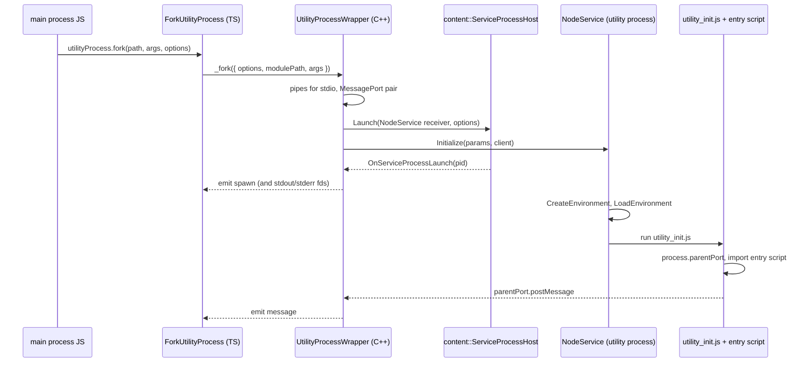

## Overview

`utilityProcess.fork(modulePath, args, options)` starts a Node.js child process that Chromium manages, unlike `child_process.fork`, which runs the Electron binary as plain Node. The child is a Chromium utility process hosting Electron's `NodeService` Mojo service. It gets a full Node environment, Chromium's network stack for `net` requests, and a `MessagePort`-based channel, `process.parentPort`, back to the main process.

Sources: [lib/browser/api/utility-process.ts:150-152](repo://lib/browser/api/utility-process.ts#L150-L152), [shell/services/node/public/mojom/node_service.mojom:13-31](repo://shell/services/node/public/mojom/node_service.mojom#L13-L31), [lib/node/init.ts:15-38](repo://lib/node/init.ts#L15-L38)

The Node environment uses the same `NodeBindings` class as the other processes, with the `kUtility` flavour described in [[Node.js Integration and the Event Loop]]. Its `postMessage` and transferable ports work like the main process's `MessagePortMain`, covered in [[IPC Between Main and Renderer]].

Sources: [shell/services/node/node_service.cc:88-96](repo://shell/services/node/node_service.cc#L88-L96)

Sources: [lib/browser/api/utility-process.ts:93-119](repo://lib/browser/api/utility-process.ts#L93-L119), [shell/browser/api/electron_api_utility_process.cc:67-170](repo://shell/browser/api/electron_api_utility_process.cc#L67-L170), [shell/browser/api/electron_api_utility_process.cc:171-238](repo://shell/browser/api/electron_api_utility_process.cc#L171-L238), [shell/services/node/node_service.cc:98-194](repo://shell/services/node/node_service.cc#L98-L194)

## The TypeScript wrapper

`ForkUtilityProcess` validates the arguments before anything native runs. A missing module path throws. `args` may be omitted, with options in its place. `execArgv` must be an array, and `serviceName` and `cwd` must be strings. `stdio` is normalized to a three-element array. As a string, `'inherit'`, `'ignore'` or `'pipe'` applies to stdout and stderr. As an array, stdin must be `'ignore'`, and stdout and stderr must each be `inherit`, `pipe` or `ignore`. For each `pipe` it creates a `PassThrough` stream to expose as `stdout` or `stderr`.

Sources: [lib/browser/api/utility-process.ts:13-91](repo://lib/browser/api/utility-process.ts#L13-L91)

It then calls the native `_fork` and replaces the handle's `emit`. Native `stdout` and `stderr` events carry a file descriptor, which is wrapped in a `net.Socket` and piped into the matching `PassThrough`. `exit` is re-emitted, then the handle and streams are released. Everything else, such as `spawn`, `message` and `error`, is re-emitted unchanged. `postMessage` unwraps `MessagePortMain` objects in the transfer list. `kill` returns `false` once the process has exited.

Sources: [lib/browser/api/utility-process.ts:93-148](repo://lib/browser/api/utility-process.ts#L93-L148)

## UtilityProcessWrapper

### Creating the wrapper

`UtilityProcessWrapper::Create` throws before `ready`. It reads `modulePath` and `args`, plus `env`, `execArgv`, `serviceName`, `cwd`, `stdio`, `respondToAuthRequestsFromMainProcess`, and on macOS `allowLoadingUnsignedLibraries`. It then pins the new wrapper so the process object is not garbage-collected while the child runs.

Sources: [shell/browser/api/electron_api_utility_process.cc:438-509](repo://shell/browser/api/electron_api_utility_process.cc#L438-L509)

### Launching

The constructor sets up the child step by step:

Sources: [shell/browser/api/electron_api_utility_process.cc:67-75](repo://shell/browser/api/electron_api_utility_process.cc#L67-L75)

1. **stdio.** For `pipe` it creates an OS pipe and keeps the read end. For `ignore` it opens `/dev/null`, or `NUL` on Windows. On POSIX the write ends are remapped onto fds 1 and 2 of the child, and on Windows they are passed as the child's stdout and stderr handles.
2. **Launch.** `content::ServiceProcessHost::Launch` starts a utility process for the `NodeService` interface, named after `serviceName` or `Node Utility Process`. It passes `execArgv` as extra command-line switches, the working directory, and the environment: a custom `env` replaces the parent's, otherwise it is inherited. On macOS the plugin helper can be chosen so unsigned libraries load.
3. **Message channel.** A `blink::MessagePortDescriptorPair` is created. The wrapper keeps one end behind a `mojo::Connector`, and the other end goes to the child in `params->port`. The comment explains why: a separate pipe lets `postMessage` queue messages without blocking the service interface.
4. **Network.** It creates a trusted URL loader factory and a host resolver on the system network context and passes them to the child. With `respondToAuthRequestsFromMainProcess`, it also creates a network observer, so authentication requests come back to the main process.
5. **Initialize.** It calls `NodeService::Initialize` with the parameters and a `NodeServiceClient` receiver.

Sources: [shell/browser/api/electron_api_utility_process.cc:76-170](repo://shell/browser/api/electron_api_utility_process.cc#L76-L170), [shell/browser/api/electron_api_utility_process.cc:171-238](repo://shell/browser/api/electron_api_utility_process.cc#L171-L238)

When Chromium reports the launch, `OnServiceProcessLaunch` records the pid in a global map, emits `stdout` and `stderr` with the read fds, and emits `spawn`.

Sources: [shell/browser/api/electron_api_utility_process.cc:244-257](repo://shell/browser/api/electron_api_utility_process.cc#L244-L257)

### Messages

`postMessage(message, transfer)` serializes the message as a `TransferableMessage`, checks that each transfer item is a native `MessagePort`, disentangles the ports into the message, and writes it to the connector. It does nothing if the service is disconnected. Incoming messages arrive in `Accept`, are deserialized, and are emitted as `message`.

Sources: [shell/browser/api/electron_api_utility_process.cc:332-384](repo://shell/browser/api/electron_api_utility_process.cc#L332-L384), [shell/browser/api/electron_api_utility_process.cc:410-423](repo://shell/browser/api/electron_api_utility_process.cc#L410-L423)

## Inside the utility process

### NodeService

`ElectronContentUtilityClient` registers `RunNodeService`, so the utility process creates a `NodeService` when the browser connects to that interface. The interface is declared with `ServiceSandbox=kNoSandbox`, so the child is not sandboxed.

Sources: [shell/utility/electron_content_utility_client.cc:102-104](repo://shell/utility/electron_content_utility_client.cc#L102-L104), [shell/utility/electron_content_utility_client.cc:152-156](repo://shell/utility/electron_content_utility_client.cc#L152-L156), [shell/services/node/public/mojom/node_service.mojom:27-31](repo://shell/services/node/public/mojom/node_service.mojom#L27-L31)

`NodeService::Initialize` runs once and follows the browser's pattern from [[Process Startup]]:

Sources: [shell/services/node/node_service.cc:98-102](repo://shell/services/node/node_service.cc#L98-L102)

1. It binds the client remote and gives the child's port to the `ParentPort` singleton.
2. It stores the URL loader factory and host resolver in `URLLoaderBundle`, where `net` in the child finds them.
3. It creates a `JavascriptEnvironment`, initializes Node, and creates the environment with the program path prepended to `args` (for `process.argv0`) and `execArgv`.
4. It installs a fatal-error handler that builds a Node report and sends it to the parent with `OnV8FatalError`, and a process exit handler.
5. It sets unhandled rejections to `warn-with-error-code`, binds Electron's `process` extras, and stores the entry script as the hidden `_serviceStartupScript`.
6. It creates the microtasks runner before `LoadEnvironment`, because, as the comment says, an uncaught exception in the entry script calls the exit handler, which needs both environments ready. Then it starts the embed thread and polling.

Sources: [shell/services/node/node_service.cc:98-194](repo://shell/services/node/node_service.cc#L98-L194), [shell/services/node/node_service.cc:33-50](repo://shell/services/node/node_service.cc#L33-L50)

The fatal error arrives in the parent as `error` with `'FatalError'`, the location and the report.

Sources: [shell/browser/api/electron_api_utility_process.cc:425-429](repo://shell/browser/api/electron_api_utility_process.cc#L425-L429)

### utility_init.js and parentPort

The utility bundle puts the entry script into `process.argv[1]`, runs the common init, and points native event emitters at `EventEmitter.prototype`. It defines a read-only `process.parentPort` and loads the entry script through Node's ESM loader. A failed import is reported with Node's internal `triggerUncaughtException`.

Sources: [lib/utility/init.ts:1-50](repo://lib/utility/init.ts#L1-L50)

`parentPort` follows Node's worker `MessagePort` behaviour. It starts receiving when the first `message` listener is added and pauses when the last is removed, and incoming ports are wrapped as `MessagePortMain`. Underneath, `ParentPort` holds the other end of the browser's pipe in a `mojo::Connector` that starts paused, serializes `postMessage` values, and emits `message` with `{ data, ports }`.

Sources: [lib/utility/init.ts:25-36](repo://lib/utility/init.ts#L25-L36), [lib/utility/parent-port.ts:1-32](repo://lib/utility/parent-port.ts#L1-L32), [shell/services/node/parent_port.cc:34-107](repo://shell/services/node/parent_port.cc#L34-L107)

Only the utility bindings are registered in this process: the event emitter, `systemPreferences`, `net` and `parentPort`. The utility bundle's `electron` module lists `net` and `systemPreferences` from its own module list, built the way [[Internal JavaScript Bundles]] describes.

Sources: [shell/common/node_bindings.cc:107-111](repo://shell/common/node_bindings.cc#L107-L111), [lib/utility/api/module-list.ts:1-5](repo://lib/utility/api/module-list.ts#L1-L5)

## Exit and shutdown

When the child's script calls `process.exit` or the event loop ends, the exit handler closes the parent port, destroys the microtasks runner, drops the client remote, and resets the service receiver with the reason `process_exit_termination` and the exit code. The browser's disconnect handler recognizes that reason and reports the exit code.

Sources: [shell/services/node/node_service.cc:152-161](repo://shell/services/node/node_service.cc#L152-L161), [shell/browser/api/electron_api_utility_process.cc:292-298](repo://shell/browser/api/electron_api_utility_process.cc#L292-L298)

`HandleTermination` can be reached from several places: that disconnect, Chromium's normal-termination and crash notifications (filtered to this service and pid), and an explicit `Shutdown`. It acts only the first time. It removes the pid from the map, closes the connector, emits `exit` with the code, and unpins the wrapper. After `kill()`, POSIX reports `SIGTERM` or `SIGKILL` as the exit code, so the comment explains these are converted to 0 to read as the graceful shutdown the app asked for.

Sources: [shell/browser/api/electron_api_utility_process.cc:259-330](repo://shell/browser/api/electron_api_utility_process.cc#L259-L330)

`kill()` terminates the process with `RESULT_CODE_NORMAL_EXIT` and makes sure it is reaped; the comment notes that unsandboxed utility processes do not use the zygote on Linux. When the main process quits, `ElectronBrowserMainParts::PostMainMessageLoopRun` finds every running `NodeService` process and calls `Shutdown(0)` on its wrapper before Node stops, so apps still receive `exit`.

Sources: [shell/browser/api/electron_api_utility_process.cc:386-401](repo://shell/browser/api/electron_api_utility_process.cc#L386-L401), [shell/browser/electron_browser_main_parts.cc:561-590](repo://shell/browser/electron_browser_main_parts.cc#L561-L590)
