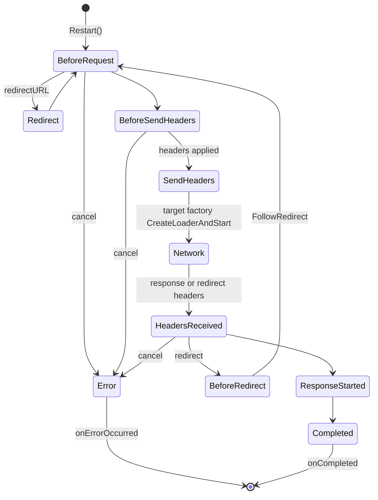

## Overview

`session.webRequest` lets the main process watch and change a session's HTTP and WebSocket traffic. It can cancel or redirect a request, rewrite request headers before they are sent, rewrite response headers and the status line, and observe the remaining lifecycle events. With the network service, Chromium no longer offers a hook inside the network stack for this. Instead Electron inserts a proxy between each URL loader factory and its client: `ProxyingURLLoaderFactory` for ordinary requests, and `ProxyingWebSocket` for WebSocket handshakes. The proxy calls into `api::WebRequest` at each stage.

Sources: [shell/browser/electron_browser_client.cc:1309-1373](repo://shell/browser/electron_browser_client.cc#L1309-L1373), [shell/browser/api/electron_api_web_request.cc:325-349](repo://shell/browser/api/electron_api_web_request.cc#L325-L349)

The same proxy also runs the session's intercepted protocol handlers for `http`, `https` and `file`, whose registration is described in [[Custom Protocols and the net Module]]. Each session has its own `webRequest`, as [[Sessions and Browser Contexts]] notes.

Sources: [shell/browser/net/proxying_url_loader_factory.cc:796-813](repo://shell/browser/net/proxying_url_loader_factory.cc#L796-L813), [shell/browser/api/electron_api_session.cc:1355-1361](repo://shell/browser/api/electron_api_session.cc#L1355-L1361)

## The listener API

### Response and simple listeners

`api::WebRequest` exposes eight methods in two kinds. Response listeners receive `(details, callback)` and block the request until the callback runs: `onBeforeRequest`, `onBeforeSendHeaders` and `onHeadersReceived`. Simple listeners receive only `details` and cannot change anything: `onSendHeaders`, `onBeforeRedirect`, `onResponseStarted`, `onErrorOccurred` and `onCompleted`.

Sources: [shell/browser/api/electron_api_web_request.cc:325-349](repo://shell/browser/api/electron_api_web_request.cc#L325-L349)

Each event has at most one listener. `SetListener` stores `{ filter, listener }` in a map keyed by event, so a second call replaces the first and passing `null` removes it. The `WebRequest` object for a session is created on first use, attached to the browser context as user data, and shared by the session getter and the browser client.

Sources: [shell/browser/api/electron_api_web_request.cc:648-714](repo://shell/browser/api/electron_api_web_request.cc#L648-L714), [shell/browser/api/electron_api_web_request.cc:315-323](repo://shell/browser/api/electron_api_web_request.cc#L315-L323), [shell/browser/api/electron_api_web_request.cc:736-751](repo://shell/browser/api/electron_api_web_request.cc#L736-L751)

### Filters

The optional first argument is a filter `{ urls, excludeUrls, types }`. `urls` is required in a filter object. An empty `urls` array is treated as `<all_urls>` with a deprecation warning, and no filter at all also means `<all_urls>`. Each pattern is parsed as an extensions `URLPattern` for any scheme, and an invalid one throws `Invalid url pattern`. Each `types` entry must be a known resource type, or it throws `Invalid type`. Gin would convert a function to a dictionary, so the code checks for a function first.

Sources: [shell/browser/api/electron_api_web_request.cc:652-708](repo://shell/browser/api/electron_api_web_request.cc#L652-L708), [shell/browser/api/electron_api_web_request.cc:265-282](repo://shell/browser/api/electron_api_web_request.cc#L265-L282)

A request matches when its URL matches an include pattern, matches no exclude pattern, and its type is in `types` (or `types` is empty).

Sources: [shell/browser/api/electron_api_web_request.cc:239-263](repo://shell/browser/api/electron_api_web_request.cc#L239-L263)

## Where the proxy is installed

`ElectronBrowserClient::WillCreateURLLoaderFactory` runs whenever Chromium creates a URL loader factory: for navigations, subresources, workers, and the session's own trusted factory used by `net`. With extensions built in, if the session has no `webRequest` listener, the extensions `WebRequestAPI` may install its own proxy instead, and the function returns. Otherwise it appends a pipe to the factory builder. The factory `ProxyingURLLoaderFactory` receives requests on one end and forwards them to the real factory on the other. It also gets a trusted header client receiver when Chromium offers one, and the session's intercept handlers.

Sources: [shell/browser/electron_browser_client.cc:1309-1373](repo://shell/browser/electron_browser_client.cc#L1309-L1373), [shell/browser/electron_browser_context.cc:571-605](repo://shell/browser/electron_browser_context.cc#L571-L605)

The comment there notes one difference from Chromium. Electron lets `webRequest` see requests sent from the browser process, so it creates navigation UI data whenever there is a navigation id, not only for renderer-initiated navigations.

Sources: [shell/browser/electron_browser_client.cc:1349-1358](repo://shell/browser/electron_browser_client.cc#L1349-L1358)

## Handling one request

### Short cuts

`ProxyingURLLoaderFactory::CreateLoaderAndStart` copies the request so it can change it. Requests that should ignore the connection limit get maximum priority. It then tries three short cuts in order:

Sources: [shell/browser/net/proxying_url_loader_factory.cc:781-795](repo://shell/browser/net/proxying_url_loader_factory.cc#L781-L795)

1. **Intercepted scheme.** Unless the request carries `kBypassCustomProtocolHandlers`, a handler in the session's intercept map takes over. The request goes to the JavaScript handler, and the response is built by `ElectronURLLoaderFactory::StartLoading`, as for registered schemes.
2. **Service worker scripts on `file:`.** Chromium's service worker loader refuses `file:` URLs, so the comment explains these are served directly by the ASAR loader.
3. **No listeners.** If `HasListener()` is false, the request passes straight through to the target factory.

Sources: [shell/browser/net/proxying_url_loader_factory.cc:796-833](repo://shell/browser/net/proxying_url_loader_factory.cc#L796-L833), [shell/browser/api/electron_api_web_request.cc:355-357](repo://shell/browser/api/electron_api_web_request.cc#L355-L357)

Otherwise it gives the request a new id, unique per browser context, and creates an `InProgressRequest`. Requests from the `net` module have network request id zero, because they have no renderer process; the comment notes that Chromium assumes such requests never use the extra-headers path.

Sources: [shell/browser/net/proxying_url_loader_factory.cc:835-854](repo://shell/browser/net/proxying_url_loader_factory.cc#L835-L854)

Sources: [shell/browser/net/proxying_url_loader_factory.cc:103-180](repo://shell/browser/net/proxying_url_loader_factory.cc#L103-L180), [shell/browser/net/proxying_url_loader_factory.cc:421-512](repo://shell/browser/net/proxying_url_loader_factory.cc#L421-L512), [shell/browser/net/proxying_url_loader_factory.cc:612-690](repo://shell/browser/net/proxying_url_loader_factory.cc#L612-L690), [shell/browser/net/proxying_url_loader_factory.cc:690-732](repo://shell/browser/net/proxying_url_loader_factory.cc#L690-L732)

### onBeforeRequest

`Restart` builds a fresh `WebRequestInfo`. It does this again after each redirect, keeping the original initiator. `RestartInternal` then calls `OnBeforeRequest`. A listener that blocks returns `ERR_IO_PENDING`, and the proxy pauses its client receiver and header client until the continuation runs. A cancellation completes the request with `ERR_BLOCKED_BY_CLIENT`. A `redirectURL` makes the proxy synthesize a redirect to that URL before any network request is made.

Sources: [shell/browser/net/proxying_url_loader_factory.cc:103-178](repo://shell/browser/net/proxying_url_loader_factory.cc#L103-L178), [shell/browser/net/proxying_url_loader_factory.cc:421-437](repo://shell/browser/net/proxying_url_loader_factory.cc#L421-L437)

In `api::WebRequest`, every response event follows the same pattern. Return `net::OK` if there is no listener or the filter does not match. Otherwise record a `BlockedRequest` under the request id, fill a `details` object, call the listener with a bound result callback, and return `ERR_IO_PENDING`. For `onBeforeRequest`, the result `{ cancel: true }` becomes `ERR_BLOCKED_BY_CLIENT` and `{ redirectURL }` writes the new URL. The continuation is posted as a task rather than called directly.

Sources: [shell/browser/api/electron_api_web_request.cc:359-422](repo://shell/browser/api/electron_api_web_request.cc#L359-L422)

### onBeforeSendHeaders and onSendHeaders

`ContinueToBeforeSendHeaders` calls `OnBeforeSendHeaders` with a pointer to the request's headers. The proxy's comment notes that, in Electron, this event fires for every protocol. The listener may return `{ cancel }` or `{ requestHeaders }`. The new headers replace the old only when given, and `CalculateOnBeforeSendHeadersDelta` reports the removed and set header names. `ContinueToSendHeaders` applies the delta, emits `onSendHeaders`, and `ContinueToStartRequest` finally creates the real loader on the target factory.

Sources: [shell/browser/net/proxying_url_loader_factory.cc:439-512](repo://shell/browser/net/proxying_url_loader_factory.cc#L439-L512), [shell/browser/api/electron_api_web_request.cc:424-509](repo://shell/browser/api/electron_api_web_request.cc#L424-L509)

### onHeadersReceived

When response or redirect headers arrive, `OnHeadersReceived` blocks again. The listener may return `{ cancel }`, or `{ responseHeaders, statusLine }`. New response headers are built on top of the given status line, or the original one, and swapped in only when `responseHeaders` was supplied. Redirect responses then emit `onBeforeRedirect` and restart at `onBeforeRequest` for the new URL. Final responses emit `onResponseStarted`, and the request ends with `onCompleted` or `onErrorOccurred`, both of which drop any blocked state for the request.

Sources: [shell/browser/api/electron_api_web_request.cc:511-598](repo://shell/browser/api/electron_api_web_request.cc#L511-L598), [shell/browser/api/electron_api_web_request.cc:600-636](repo://shell/browser/api/electron_api_web_request.cc#L600-L636), [shell/browser/net/proxying_url_loader_factory.cc:230-273](repo://shell/browser/net/proxying_url_loader_factory.cc#L230-L273)

## The header client

Some headers are only visible inside the network service: cookies, and headers added by the network stack. For those, Chromium's `TrustedURLLoaderHeaderClient` lets the proxy see and change headers from there. `UpdateRequestInfo` sets `current_request_uses_header_client_` when a header client is bound, the request has a network id (or is a CORS preflight), and extra-headers listeners are possible.

Sources: [shell/browser/net/proxying_url_loader_factory.cc:108-128](repo://shell/browser/net/proxying_url_loader_factory.cc#L108-L128)

In that mode the order changes. The real request starts right after `onBeforeRequest`. The network service then calls the proxy's `OnBeforeSendHeaders` and `OnHeadersReceived` with the real headers, and the proxy runs the listeners from there before answering. Without the header client, those network-service calls answer immediately and the listeners run in the proxy's own sequence. CORS preflights are only shown to listeners in header-client mode, otherwise they are dropped from the proxy.

Sources: [shell/browser/net/proxying_url_loader_factory.cc:130-149](repo://shell/browser/net/proxying_url_loader_factory.cc#L130-L149), [shell/browser/net/proxying_url_loader_factory.cc:330-366](repo://shell/browser/net/proxying_url_loader_factory.cc#L330-L366), [shell/browser/net/proxying_url_loader_factory.cc:470-512](repo://shell/browser/net/proxying_url_loader_factory.cc#L470-L512)

## WebSockets

WebSocket connections bypass URL loader factories, so they need their own hook. `WillInterceptWebSocket` tells Chromium to route a frame's WebSocket through Electron when the session has a `webRequest` listener, or when the extensions API may have proxies. `CreateWebSocket` then hands the connection to the extensions proxy when there are no Electron listeners, and otherwise calls `ProxyingWebSocket::StartProxying`.

Sources: [shell/browser/electron_browser_client.cc:1245-1307](repo://shell/browser/electron_browser_client.cc#L1245-L1307)

`ProxyingWebSocket` runs the same listener sequence for the handshake: `OnBeforeRequest`, then `OnBeforeSendHeaders` and `onSendHeaders`, `OnHeadersReceived` for the handshake response (and again for authentication challenges), and `OnCompleted` with `ERR_WS_UPGRADE` once the connection is established. Like the URL loader proxy, it uses the header client path when available.

Sources: [shell/browser/net/proxying_websocket.cc:59-115](repo://shell/browser/net/proxying_websocket.cc#L59-L115), [shell/browser/net/proxying_websocket.cc:152-219](repo://shell/browser/net/proxying_websocket.cc#L152-L219), [shell/browser/net/proxying_websocket.cc:251-281](repo://shell/browser/net/proxying_websocket.cc#L251-L281)
