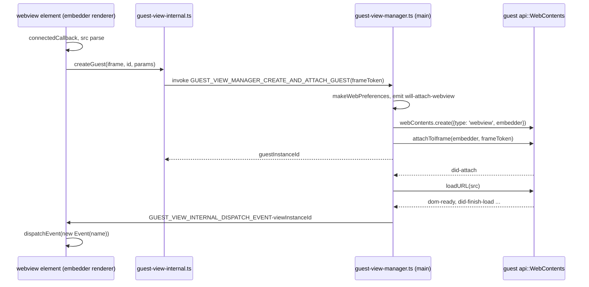

## Overview

`<webview>` embeds another page, with its own `WebContents`, session and preferences, inside a page that has `webviewTag: true`. Electron builds it from parts that live in two processes. In the embedder's renderer, a custom element hosts an internal `<iframe>` in its shadow DOM and forwards its attributes and methods. In the main process, `guest-view-manager.ts` creates a guest `WebContents` of type `webview` and attaches it as an inner `WebContents` in that iframe's frame. Every exchange between the two goes over internal IPC.

Sources: [lib/renderer/web-view/web-view-impl.ts:35-63](repo://lib/renderer/web-view/web-view-impl.ts#L35-L63), [lib/browser/guest-view-manager.ts:82-134](repo://lib/browser/guest-view-manager.ts#L82-L134), [lib/browser/guest-view-manager.ts:136-204](repo://lib/browser/guest-view-manager.ts#L136-L204), [shell/browser/web_view_guest_delegate.cc:30-55](repo://shell/browser/web_view_guest_delegate.cc#L30-L55)

The channels used here are listed in [[Internal IPC and RPC]]. With context isolation, the element is defined in the main world through the `isolated_renderer` bundle described in [[Context Bridge]]. The guest is a regular `api::WebContents`, covered in [[WebContents]].

Sources: [lib/common/ipc-messages.ts:14-21](repo://lib/common/ipc-messages.ts#L14-L21), [lib/isolated_renderer/init.ts:1-10](repo://lib/isolated_renderer/init.ts#L1-L10)

Sources: [lib/renderer/web-view/web-view-element.ts:51-63](repo://lib/renderer/web-view/web-view-element.ts#L51-L63), [lib/renderer/web-view/guest-view-internal.ts:21-32](repo://lib/renderer/web-view/guest-view-internal.ts#L21-L32), [lib/browser/guest-view-manager.ts:82-134](repo://lib/browser/guest-view-manager.ts#L82-L134), [lib/browser/guest-view-manager.ts:136-204](repo://lib/browser/guest-view-manager.ts#L136-L204)

## Registering the element

`webViewInit` runs in the main frame of every page whose `webviewTag` preference is on, unless the page is itself a webview guest; nested `<webview>`s are refused. Without context isolation it calls `setupWebView` directly with three hooks: `guestViewInternal`, `allowGuestViewElementDefinition`, and `setIsWebView`, which marks an iframe as a webview frame. With context isolation it only stores `guestViewInternal` as a hidden value, and `RendererClientBase::SetupMainWorldOverrides` builds the same hooks for the main world.

Sources: [lib/renderer/web-view/web-view-init.ts:22-42](repo://lib/renderer/web-view/web-view-init.ts#L22-L42), [shell/renderer/renderer_client_base.cc:568-610](repo://shell/renderer/renderer_client_base.cc#L568-L610)

The file header explains the constraint behind `web-view-element.ts`. With context isolation it runs in the main world, where there is no Node, so every native function must arrive through the hooks, and the code that touches the per-element state must live in that file.

Sources: [lib/renderer/web-view/web-view-element.ts:1-15](repo://lib/renderer/web-view/web-view-element.ts#L1-L15)

`setupWebView` waits for the first `readystatechange` after `loading`, then registers the element. Registration has to happen inside `allowGuestViewElementDefinition`, which opens Blink's `EmbedderNamesAllowedScope`, because `webview` is an embedder-reserved custom element name. Inside that scope it calls `customElements.define('webview', ...)`, exposes `window.WebView`, and deletes the lifecycle callbacks and `observedAttributes` from the class so page code cannot call them.

Sources: [lib/renderer/web-view/web-view-element.ts:87-125](repo://lib/renderer/web-view/web-view-element.ts#L87-L125), [shell/renderer/renderer_client_base.cc:612-627](repo://shell/renderer/renderer_client_base.cc#L612-L627)

## The element and its state

### Shadow DOM and lifecycle

Each element gets a `WebViewImpl`, kept in a module-private `WeakMap`. The constructor attaches an open shadow root with a `display: flex` style and an internal `<iframe>` marked as a webview frame. `RendererClientBase::IsWebViewFrame` checks that mark so the embedder's renderer never runs its own preloads or Node in that frame. The constructor also gives the element a `viewInstanceId` and makes `contentWindow` return the iframe's window.

Sources: [lib/renderer/web-view/web-view-element.ts:15-41](repo://lib/renderer/web-view/web-view-element.ts#L15-L41), [lib/renderer/web-view/web-view-impl.ts:20-63](repo://lib/renderer/web-view/web-view-impl.ts#L20-L63), [shell/renderer/renderer_client_base.cc:548-566](repo://shell/renderer/renderer_client_base.cc#L548-L566)

Lifecycle callbacks drive the rest. `connectedCallback` subscribes to events for the instance and parses `src`. `attributeChangedCallback` hands the change to the attribute object. `disconnectedCallback` unsubscribes, detaches the guest, and calls `reset`, which replaces the iframe with a fresh local one because attachment turned the old one into a remote frame.

Sources: [lib/renderer/web-view/web-view-element.ts:51-83](repo://lib/renderer/web-view/web-view-element.ts#L51-L83), [lib/renderer/web-view/web-view-impl.ts:65-89](repo://lib/renderer/web-view/web-view-impl.ts#L65-L89)

### Attributes

`setupWebViewAttributes` creates one handler per observed attribute: `partition`, `src`, `httpreferrer`, `useragent`, the boolean `nodeintegration`, `nodeintegrationinsubframes`, `plugins`, `disablewebsecurity` and `allowpopups`, plus `preload`, `blinkfeatures`, `disableblinkfeatures` and `webpreferences`. `buildParams` collects all of their values into the parameters sent when the guest is created.

Sources: [lib/renderer/web-view/web-view-attributes.ts:255-271](repo://lib/renderer/web-view/web-view-attributes.ts#L255-L271), [lib/renderer/web-view/web-view-impl.ts:171-181](repo://lib/renderer/web-view/web-view-impl.ts#L171-L181)

Two attributes carry the navigation rules. `PartitionAttribute` refuses changes once the view has navigated, restoring the old value, and treats `persist:` with no name as invalid. `SrcAttribute.parse` does nothing until the element is attached, the partition is valid and `src` is set. On the first parse it creates the guest. Afterwards it calls `loadURL` with the referrer and user agent attributes. Clearing `src` after navigation is reverted. A `MutationObserver` catches assignments of the same value, so setting `src` again after a guest crash reloads it.

Sources: [lib/renderer/web-view/web-view-attributes.ts:75-163](repo://lib/renderer/web-view/web-view-attributes.ts#L75-L163), [lib/renderer/web-view/web-view-attributes.ts:164-195](repo://lib/renderer/web-view/web-view-attributes.ts#L164-L195)

## Creating and attaching the guest

### The request

`createGuest` in the renderer finds the internal iframe's frame and invokes `GUEST_VIEW_MANAGER_CREATE_AND_ATTACH_GUEST` with that frame's token, a fresh element instance id, and the parameters. The main-process handler only runs for embedders whose `webviewTag` preference is on.

Sources: [lib/renderer/web-view/web-view-impl.ts:105-111](repo://lib/renderer/web-view/web-view-impl.ts#L105-L111), [lib/renderer/web-view/guest-view-internal.ts:21-32](repo://lib/renderer/web-view/guest-view-internal.ts#L21-L32), [lib/browser/guest-view-manager.ts:258-291](repo://lib/browser/guest-view-manager.ts#L258-L291)

### Preferences

`makeWebPreferences` maps the attributes to web preferences. `nodeintegration` and `nodeintegrationinsubframes` default to false. `allowpopups` becomes `disablePopups: !allowpopups`, and `disablewebsecurity` becomes `webSecurity: !disablewebsecurity`. The zoom factor is copied from the embedder. `partition` and the blink feature lists pass through, `webpreferences` is parsed like a `window.open` feature string, and `preload` must be a `file:` URL, which is converted to a path.

Sources: [lib/browser/guest-view-manager.ts:25-48](repo://lib/browser/guest-view-manager.ts#L25-L48)

Like child windows, a guest inherits the embedder's restrictive security preferences: `contextIsolation: true`, `javascript: false`, `nodeIntegration: false`, `sandbox: true`, `nodeIntegrationInSubFrames: false` and `enableWebSQL: false` are copied whenever the embedder has exactly that value. [[Child Windows and window.open]] uses the same rule.

Sources: [lib/browser/guest-view-manager.ts:50-68](repo://lib/browser/guest-view-manager.ts#L50-L68)

### createGuest in the main process

The main-process `createGuest` works in this order.

Sources: [lib/browser/guest-view-manager.ts:82-98](repo://lib/browser/guest-view-manager.ts#L82-L98)

1. It emits `will-attach-webview` on the embedder with the preferences and parameters, so the app can edit them; `preventDefault` makes the call return `-1`, and the element dispatches `destroyed`.
2. It creates the guest with `webContents.create({ ...webPreferences, type: 'webview', embedder })` and records it in `guestInstances` under its id.
3. It subscribes to the guest's events, described below.
4. If the same element already had a guest, it detaches that one from its outer frame.
5. It calls `setEmbedder`, starts watching the embedder, registers the pair with the native `WebViewManager`, which also applies the zoom factor, and calls `attachToIframe(embedder, frameToken)`.

Sources: [lib/browser/guest-view-manager.ts:82-134](repo://lib/browser/guest-view-manager.ts#L82-L134), [lib/browser/guest-view-manager.ts:136-204](repo://lib/browser/guest-view-manager.ts#L136-L204), [lib/renderer/web-view/web-view-impl.ts:183-197](repo://lib/renderer/web-view/web-view-impl.ts#L183-L197), [shell/browser/api/electron_api_web_view_manager.cc:18-38](repo://shell/browser/api/electron_api_web_view_manager.cc#L18-L38)

`WebContents::AttachToIframe` parses the frame token and hands it to `WebViewGuestDelegate`. The delegate finds the embedder's `RenderFrameHost` for the iframe and calls `AttachInnerWebContents`, so the guest renders in place of that frame. The guest was created with a `chrome-guest://fake-host` site instance, as the constructor in [[WebContents]] shows.

Sources: [shell/browser/api/electron_api_web_contents.cc:3612-3627](repo://shell/browser/api/electron_api_web_contents.cc#L3612-L3627), [shell/browser/web_view_guest_delegate.cc:30-55](repo://shell/browser/web_view_guest_delegate.cc#L30-L55), [shell/browser/api/electron_api_web_contents.cc:836-846](repo://shell/browser/api/electron_api_web_contents.cc#L836-L846)

On the first `did-attach`, the guest records its `viewInstanceId`, loads `src` with the referrer and user agent, and the embedder emits `did-attach-webview`. If the element was removed before the id came back, the renderer immediately detaches the new guest so no orphaned frame remains.

Sources: [lib/browser/guest-view-manager.ts:120-134](repo://lib/browser/guest-view-manager.ts#L120-L134), [lib/renderer/web-view/web-view-impl.ts:183-197](repo://lib/renderer/web-view/web-view-impl.ts#L183-L197)

## Events from the guest

`web-view-events.ts` maps each forwarded guest event to the names of its arguments, for example `did-fail-load` to `errorCode`, `errorDescription`, `validatedURL`, `isMainFrame` and the frame ids. For each event the manager subscribes on the guest, converts the arguments into a props object, and sends `GUEST_VIEW_INTERNAL_DISPATCH_EVENT-<viewInstanceId>` to the embedder with `_sendInternal`. Two events are built by hand: `ipc-message` from the guest's `sendToHost` messages (`-ipc-message-host`), and `will-frame-navigate`.

Sources: [lib/browser/web-view-events.ts:1-12](repo://lib/browser/web-view-events.ts#L1-L12), [lib/browser/guest-view-manager.ts:136-174](repo://lib/browser/guest-view-manager.ts#L136-L174)

In the renderer, `registerEvents` listens on the suffixed channel, and `WebViewImpl.dispatchEvent` creates a DOM `Event`, copies the props onto it, and dispatches it on the element. On `load-commit` for the main frame it updates the `src` attribute without triggering a navigation. `-focus-change` events, sent by the guest page's own focus and blur listeners, become `focus` and `blur` on the element.

Sources: [lib/renderer/web-view/guest-view-internal.ts:11-19](repo://lib/renderer/web-view/guest-view-internal.ts#L11-L19), [lib/renderer/web-view/web-view-impl.ts:113-165](repo://lib/renderer/web-view/web-view-impl.ts#L113-L165), [lib/renderer/web-view/web-view-init.ts:9-20](repo://lib/renderer/web-view/web-view-init.ts#L9-L20), [lib/browser/guest-view-manager.ts:297-302](repo://lib/browser/guest-view-manager.ts#L297-L302)

The embedder's window visibility is forwarded the other way. `-window-visibility-change` on the embedder sends `GUEST_INSTANCE_VISIBILITY_CHANGE` to its guests, and the guest re-sends the last state on `dom-ready`. `windowSetup` in the guest then makes `document.visibilityState` follow it.

Sources: [lib/browser/guest-view-manager.ts:176-183](repo://lib/browser/guest-view-manager.ts#L176-L183), [lib/browser/guest-view-manager.ts:226-241](repo://lib/browser/guest-view-manager.ts#L226-L241), [lib/renderer/window-setup.ts:22-52](repo://lib/renderer/window-setup.ts#L22-L52)

## Methods and properties

`setupMethods` defines the element's API from three allow-lists in `web-view-methods.ts`. Sync methods such as `getURL` and `reload` use `invokeSync`. Async methods such as `loadURL`, `executeJavaScript` and `send` use `invoke`. Properties such as `zoomFactor` and `userAgent` become getters and setters over `PROPERTY_GET` and `PROPERTY_SET`. Each call first takes `getWebContentsId()`, which throws if the element has no guest yet.

Sources: [lib/renderer/web-view/web-view-impl.ts:200-237](repo://lib/renderer/web-view/web-view-impl.ts#L200-L237), [lib/common/web-view-methods.ts:1-83](repo://lib/common/web-view-methods.ts#L1-L83), [lib/renderer/web-view/web-view-element.ts:43-49](repo://lib/renderer/web-view/web-view-element.ts#L43-L49)

The main process checks every call twice. The name must be in the same allow-list, or it throws `Invalid method` or `Invalid property`. And `getGuestForWebContents` checks that the guest's `hostWebContents` is the sender, or it throws `Access denied to guestInstanceId`. One page therefore cannot drive a webview owned by another. The old history methods are redirected to `navigationHistory`.

Sources: [lib/browser/guest-view-manager.ts:304-358](repo://lib/browser/guest-view-manager.ts#L304-L358)

## Detaching and cleanup

`detachGuest` removes a guest from `guestInstances`, from the element map and from the native `WebViewManager`, but only when called by the guest's own embedder. A guest's `destroyed` event triggers it. The embedder's `will-destroy` detaches all of its guests and removes the visibility listener, because, as the comment explains, an embedder destroyed before its guests would otherwise leave them pointing at an invalid embedder.

Sources: [lib/browser/guest-view-manager.ts:206-256](repo://lib/browser/guest-view-manager.ts#L206-L256), [lib/browser/guest-view-manager.ts:113-118](repo://lib/browser/guest-view-manager.ts#L113-L118)
