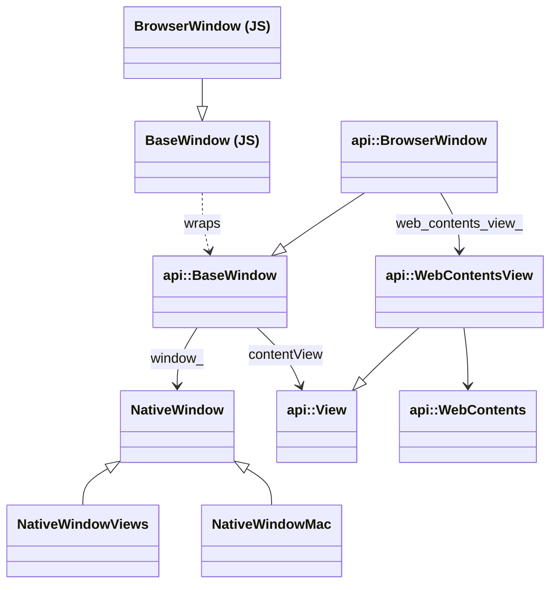

## Overview

A top-level window in Electron is three objects stacked on each other. The JavaScript `BaseWindow` or `BrowserWindow` is a gin wrapper around `api::BaseWindow` or `api::BrowserWindow`. That owns a `NativeWindow`, Electron's platform-neutral window class, which is a `views::WidgetDelegate`. Below it is a platform subclass: `NativeWindowViews` on Windows and Linux, `NativeWindowMac` on macOS. Window contents are a tree of `View` objects wrapping `views::View`, and a `WebContentsView` is the view that shows a web page.

Sources: [shell/browser/api/electron_api_base_window.cc:96-124](repo://shell/browser/api/electron_api_base_window.cc#L96-L124), [shell/browser/native_window.h:63-66](repo://shell/browser/native_window.h#L63-L66), [shell/browser/native_window_views.cc:1948-1954](repo://shell/browser/native_window_views.cc#L1948-L1954), [shell/browser/native_window_mac.mm:1879-1883](repo://shell/browser/native_window_mac.mm#L1879-L1883)

This page covers how those objects are created from the constructor options, how views compose, and how a window closes. The page itself, the `webContents` object a `BrowserWindow` hosts, is covered in [[WebContents]]. The general pattern of C++ classes exposed as JavaScript classes is covered in [[Native API Bindings with gin]].

Sources: [shell/browser/api/electron_api_browser_window.cc:66-80](repo://shell/browser/api/electron_api_browser_window.cc#L66-L80)

Sources: [lib/browser/api/base-window.ts:6-8](repo://lib/browser/api/base-window.ts#L6-L8), [lib/browser/api/browser-window.ts:4-6](repo://lib/browser/api/browser-window.ts#L4-L6), [lib/browser/api/web-contents-view.ts:1-7](repo://lib/browser/api/web-contents-view.ts#L1-L7), [shell/browser/api/electron_api_browser_window.cc:66-83](repo://shell/browser/api/electron_api_browser_window.cc#L66-L83)

## The JavaScript classes

Each class comes from a linked binding, and its prototype chain is fixed up in TypeScript. `BaseWindow.prototype` gets `EventEmitter.prototype`, `BrowserWindow.prototype` gets `BaseWindow.prototype`, `View` gets `EventEmitter`, and `WebContentsView` gets `View`. The native constructor calls `_init` once the wrapper exists. `BaseWindow._init` applies `app.applicationMenu` to the window on platforms other than macOS, where the menu is per window. The file also defines property accessors such as `fullScreen` and `autoHideMenuBar` over the getter and setter methods.

Sources: [lib/browser/api/base-window.ts:1-40](repo://lib/browser/api/base-window.ts#L1-L40), [lib/browser/api/view.ts:1-7](repo://lib/browser/api/view.ts#L1-L7)

`BrowserWindow._init` adds behaviour on top of `BaseWindow`.

Sources: [lib/browser/api/browser-window.ts:8-10](repo://lib/browser/api/browser-window.ts#L8-L10)

- It freezes `id` so it stays readable after the native window is gone.
- It makes `setBounds` merge partial bounds with the current ones.
- It re-emits `focus` and `blur` as `app` events.
- It debounces `unresponsive`: the event fires 50 ms after the page's `unresponsive`, or 5 s after a `close` that was not prevented.
- It forwards visibility changes (`show`, `hide`, `minimize`, `maximize`, `restore`) to the page as `-window-visibility-change`.
- It emits `browser-window-created` on `app`.

Sources: [lib/browser/api/browser-window.ts:8-99](repo://lib/browser/api/browser-window.ts#L8-L99)

The static helpers `fromId`, `getAllWindows` and `getFocusedWindow` filter `BaseWindow`'s lists by `constructor.name === 'BrowserWindow'`. Methods like `loadURL`, `reload`, `send` and the DevTools calls simply forward to `this.webContents`. The deprecated `BrowserView` support is also in TypeScript: `addBrowserView` adds the view's `webContentsView` to `contentView` and records it in `_browserViews`.

Sources: [lib/browser/api/browser-window.ts:101-199](repo://lib/browser/api/browser-window.ts#L101-L199), [lib/browser/api/browser-window.ts:201-253](repo://lib/browser/api/browser-window.ts#L201-L253)

## Creating a BaseWindow

### The constructor

`BaseWindow::New` reads the options object and constructs the window. The constructor then records `parent`, if given, and continues with these steps.

Sources: [shell/browser/api/electron_api_base_window.cc:1147-1152](repo://shell/browser/api/electron_api_base_window.cc#L1147-L1152), [shell/browser/api/electron_api_base_window.cc:96-101](repo://shell/browser/api/electron_api_base_window.cc#L96-L101)

1. Forces `frame: false` when `webPreferences.offscreen` is set; the comment says offscreen windows are always frameless.
2. Calls `NativeWindow::Create(options, parent)`, which each platform file defines to return its own subclass, and registers itself as the window's observer.
3. Creates an empty `View` as the content view.
4. Sets the icon on toolkit-views platforms.

Sources: [shell/browser/api/electron_api_base_window.cc:96-132](repo://shell/browser/api/electron_api_base_window.cc#L96-L132)

`InitWith` runs after the JavaScript wrapper exists. It attaches the API object as user data on the native window, adds the window to its parent's `child_windows_`, which needs the wrapper, and keeps a strong reference to its own wrapper in `self_ref_`. A window therefore cannot be garbage-collected while open, even if the app drops every reference to it.

Sources: [shell/browser/api/electron_api_base_window.cc:146-161](repo://shell/browser/api/electron_api_base_window.cc#L146-L161)

### NativeWindow and the options

The `NativeWindow` constructor reads options that fix the window's shape: `titleBarStyle`, `transparent`, `enableLargerThanScreen`, `modal` (only with a parent), `frame` (a non-normal title bar style also means no frame), and `titleBarOverlay`. It also adds the window to `WindowList`. `InitFromOptions` runs last and applies the rest in order. That covers position or `center`, size constraints (with `useContentSize`), `closable`, `movable`, `hasShadow`, `opacity`, `alwaysOnTop`, `fullscreen` and `fullscreenable`, `resizable`, `skipTaskbar`, `kiosk`, vibrancy or background material, background colour, the title (the app name by default), and finally `show`, true by default.

Sources: [shell/browser/native_window.cc:100-126](repo://shell/browser/native_window.cc#L100-L126), [shell/browser/native_window.cc:137-245](repo://shell/browser/native_window.cc#L137-L245)

Background colour follows one rule in both places: an explicit `backgroundColor` wins, otherwise a translucent window gets a transparent background, otherwise white.

Sources: [shell/browser/native_window.cc:234-240](repo://shell/browser/native_window.cc#L234-L240)

### Platform subclasses

`NativeWindowViews` builds a `views::Widget`. Its frame comes from `CreateNonClientFrameView`: `WinFrameView` on Windows, and on Linux `NativeFrameView` for a normal frame, `ClientFrameViewLinux` for a client-drawn frame, or `OpaqueFrameView` for frameless windows. `NativeWindowMac` also initializes a `views::Widget`, but through an `ElectronNativeWidgetMac` whose native window is an `ElectronNSWindow` with an `ElectronNSWindowDelegate`. On macOS only non-modal children get a native parent window.

Sources: [shell/browser/native_window_views.cc:1847-1868](repo://shell/browser/native_window_views.cc#L1847-L1868), [shell/browser/native_window_mac.mm:175-215](repo://shell/browser/native_window_mac.mm#L175-L215)

## Creating a BrowserWindow

`BrowserWindow::New` throws `Cannot create BrowserWindow before app is ready` until the `ready` event. The constructor runs the whole `BaseWindow` constructor, then turns window options into web preferences for the page:

Sources: [shell/browser/api/electron_api_browser_window.cc:293-311](repo://shell/browser/api/electron_api_browser_window.cc#L293-L311)

1. It copies `backgroundColor`, or transparent for a translucent window, into `webPreferences` as a hidden value.
2. With `paintWhenInitiallyHidden: false`, it copies `show`, so a hidden window does not paint. It defaults `show` to true otherwise.
3. It passes an existing `webContents` option through as a hidden value.
4. It creates a `WebContentsView` from those preferences, registers it as a draggable region provider, and makes the window the contents' owner window.
5. It calls `InitWithArgs`, which runs the JavaScript `_init`. Then it inserts the web contents view at index 0 of the window's contents view, behind the `contentView`, so views the app adds to `contentView` paint on top of the page (electron/electron#41256).
6. It calls `InitFromOptions` last.

Sources: [shell/browser/api/electron_api_browser_window.cc:30-97](repo://shell/browser/api/electron_api_browser_window.cc#L30-L97)

A `BrowserWindow` also observes its `WebContents`. Page title updates become the window title unless `page-title-updated` is prevented. `window.resizeTo` and `moveTo` set the window bounds. Show and hide call `WasShown` and `WasOccluded` on the contents. Focus moves to the page when the window gains focus, except on macOS or when DevTools is open.

Sources: [shell/browser/api/electron_api_browser_window.cc:113-190](repo://shell/browser/api/electron_api_browser_window.cc#L113-L190), [shell/browser/api/electron_api_browser_window.cc:282-290](repo://shell/browser/api/electron_api_browser_window.cc#L282-L290)

## Views

### The view tree

`View` keeps a list of child views with a strong `v8::Global` reference to each child's wrapper, so a child added to a parent stays alive. `addChildView` refuses a destroyed child or the view itself. Adding a view that is already a child reorders it. On macOS, implicit Core Animation layer animations are disabled during insert and remove.

Sources: [shell/browser/api/electron_api_view.cc:210-281](repo://shell/browser/api/electron_api_view.cc#L210-L281)

`setLayout` takes either a `calculateProposedLayout` callback, which becomes a `JSLayoutManager`, or flex options (`orientation`, axis alignments, margins and so on), which configure a `views::FlexLayout`. `setBounds` sets the bounds directly.

Sources: [shell/browser/api/electron_api_view.cc:283-338](repo://shell/browser/api/electron_api_view.cc#L283-L338)

### WebContentsView

`new WebContentsView({ webPreferences, webContents })` validates its options and refuses a `webContents` already attached to a window. It defaults `show` to false and creates the page with `WebContents::CreateFromWebPreferences`. The view wraps the contents' `InspectableWebContents` view, the one that also hosts docked DevTools, and does not delete it itself.

Sources: [shell/browser/api/electron_api_web_contents_view.cc:155-209](repo://shell/browser/api/electron_api_web_contents_view.cc#L155-L209), [shell/browser/api/electron_api_web_contents_view.cc:32-43](repo://shell/browser/api/electron_api_web_contents_view.cc#L32-L43)

When the view is added to a widget, `OnViewAddedToWidget` finds the `NativeWindow`, sets it as the contents' owner window, and registers the view as a draggable region provider. `NonClientHitTest` reports `HTCAPTION` for points inside the page's draggable region, which is how `-webkit-app-region: drag` moves the window. When the contents are destroyed, the view drops its reference, and a destroyed view ignores further calls.

Sources: [shell/browser/api/electron_api_web_contents_view.cc:84-123](repo://shell/browser/api/electron_api_web_contents_view.cc#L84-L123), [shell/browser/api/electron_api_web_contents_view.cc:45-56](repo://shell/browser/api/electron_api_web_contents_view.cc#L45-L56)

## Closing a window

### The close sequence

`win.close()` calls `NativeWindow::Close`. On views platforms a window that is not closable cancels the close, otherwise `widget()->Close()` starts it. When the user clicks the close button, `NotifyWindowCloseButtonClicked` asks the observers in two rounds:

Sources: [shell/browser/native_window_views.cc:528-539](repo://shell/browser/native_window_views.cc#L528-L539), [shell/browser/native_window.cc:486-502](repo://shell/browser/native_window.cc#L486-L502)

1. `WillCloseWindow`: `BaseWindow` emits `close`, and a prevented event cancels the close through `WindowList::WindowCloseCancelled`.
2. `OnCloseButtonClicked`: `BrowserWindow` takes over. It marks user activation so `beforeunload` handlers run, then dispatches `beforeunload` or closes the contents directly. The window closes only when the contents are destroyed (`WebContentsDestroyed` calls `CloseImmediately`). A cancelled `beforeunload` reports `WindowCloseCancelled`.

Sources: [shell/browser/api/electron_api_base_window.cc:163-167](repo://shell/browser/api/electron_api_base_window.cc#L163-L167), [shell/browser/api/electron_api_browser_window.cc:109-152](repo://shell/browser/api/electron_api_browser_window.cc#L109-L152)

`BrowserWindow::CloseImmediately` closes child windows first. When the native window reports itself closed, `NotifyWindowClosed` runs once and removes the window from `WindowList`. `BaseWindow::OnWindowClosed` invalidates weak pointers so delayed events cannot fire, marks the object destroyed, emits `closed`, detaches from its parent, and posts its own destruction. The destructor deletes the native window on the next task because native code might be iterating windows, and releases `self_ref_` so the wrapper can be collected.

Sources: [shell/browser/api/electron_api_browser_window.cc:210-220](repo://shell/browser/api/electron_api_browser_window.cc#L210-L220), [shell/browser/native_window.cc:504-512](repo://shell/browser/native_window.cc#L504-L512), [shell/browser/api/electron_api_base_window.cc:134-189](repo://shell/browser/api/electron_api_base_window.cc#L134-L189)

### All windows closed

When `WindowList::RemoveWindow` empties the list, `Browser::OnWindowAllClosed` decides what happens. During `app.exit()` it shuts down. During `app.quit()` it continues the quit. Otherwise `app` emits `window-all-closed`, and the default handler from [[Process Startup]] quits unless the app listens itself. A close cancelled while quitting also cancels the quit.

Sources: [shell/browser/window_list.cc:54-65](repo://shell/browser/window_list.cc#L54-L65), [shell/browser/browser.cc:252-267](repo://shell/browser/browser.cc#L252-L267), [shell/browser/api/electron_api_app.cc:585-587](repo://shell/browser/api/electron_api_app.cc#L585-L587), [lib/browser/init.ts:182-187](repo://lib/browser/init.ts#L182-L187)
