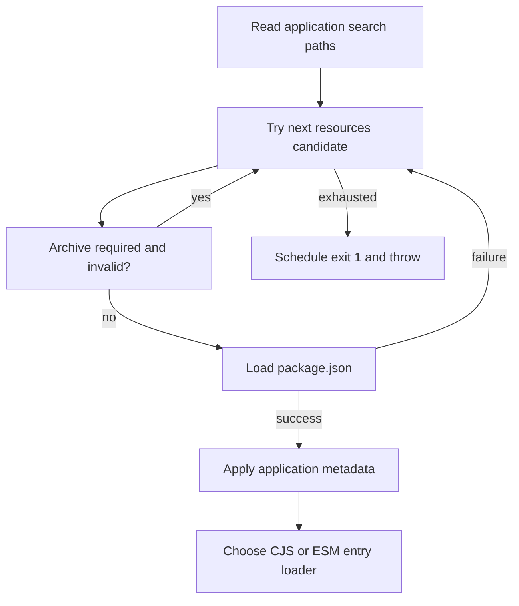

## Overview

Application startup connects the platform executable, Chromium process setup, Node initialization, and the application's main script. The main-process initializer establishes framework behavior before handing control to application code. The application in [[Quickstart]] begins at the end of this chain, when its main script registers lifecycle handlers and waits for readiness. Renderer initialization is a separate flow covered by [[Renderer Preloads and Isolation]].

Sources: [shell/app/electron_main_linux.cc:29-43](repo://shell/app/electron_main_linux.cc#L29-L43), [lib/browser/init.ts:12-19](repo://lib/browser/init.ts#L12-L19), [lib/browser/init.ts:204-222](repo://lib/browser/init.ts#L204-L222), [docs/fiddles/quick-start/main.js:16-30](repo://docs/fiddles/quick-start/main.js#L16-L30)

## Enter the runtime

On Linux, `main` repairs standard streams, sets up libuv arguments, and initializes Chromium and Electron command-line state. It chooses `NodeMain` only when the run-as-Node fuse is enabled and the associated environment variable is nonempty. The normal branch creates `ElectronMainDelegate` and calls Chromium's `ContentMain`. The delegate supplies browser, GPU, renderer, and utility clients, with renderer selection depending on sandbox configuration.

Sources: [shell/app/electron_main_linux.cc:20-43](repo://shell/app/electron_main_linux.cc#L20-L43), [shell/app/electron_main_delegate.cc:451-478](repo://shell/app/electron_main_delegate.cc#L451-L478)

The browser JavaScript initializer first removes the extra initialization argument from `process.argv` and imports common initialization. It sets the native event emitter's prototype, then installs a fallback uncaught-exception handler. That handler yields to another registered handler; otherwise it lazily imports `dialog` and displays the stack. The lazy import is necessary because this initializer is also responsible for arranging the Electron module require hook.

Sources: [lib/browser/init.ts:12-38](repo://lib/browser/init.ts#L12-L38)

Common initialization creates cached Electron module aliases and intercepts their filename resolution. The names are typing aliases, as explained in [[Electron Overview]], so startup can subsequently load `app` through `require('electron')`. The app object comes from a native binding and is placed on the `EventEmitter` prototype; the wrapper exports that single application object.

Sources: [lib/common/init.ts:78-119](repo://lib/common/init.ts#L78-L119), [lib/browser/init.ts:40-45](repo://lib/browser/init.ts#L40-L45), [lib/browser/api/app.ts:6-13](repo://lib/browser/api/app.ts#L6-L13)

## Discover an application package

The initializer obtains `appSearchPaths` and `appSearchPathsOnlyLoadASAR` from hidden global values. For each candidate beneath `process.resourcesPath`, it optionally verifies that the path is an archive and attempts to load its `package.json`. A failed candidate is skipped. The first successful package wins, and the borrowed archive helper is removed from `process` before application loading proceeds.

Sources: [lib/browser/init.ts:82-107](repo://lib/browser/init.ts#L82-L107)

Sources: [lib/browser/init.ts:82-141](repo://lib/browser/init.ts#L82-L141), [lib/browser/init.ts:204-222](repo://lib/browser/init.ts#L204-L222)

If no package loads, startup schedules `process.exit(1)` on the next tick and throws `Unable to find a valid app`. A valid package sets the version when present, prefers trimmed `productName` over `name`, and sets either the declared desktop name or an app-name-derived fallback. It also applies optional V8 flags lazily and records the selected directory with `app.setAppPath`.

Sources: [lib/browser/init.ts:109-141](repo://lib/browser/init.ts#L109-L141)

## Prepare framework services before user code

Before loading the entry script, startup imports RPC and guest-view management, DevTools support, protocol, service-worker, WebContents, and frame modules. It explicitly loads `web-contents-view` because `new BrowserWindow` uses that view machinery and needs inheritance established first. These imports explain why a constructor used immediately by application code already has its JavaScript-side behavior attached.

Sources: [lib/browser/init.ts:76-80](repo://lib/browser/init.ts#L76-L80), [lib/browser/init.ts:143-160](repo://lib/browser/init.ts#L143-L160)

The entry filename is `packageJson.main` with `index.js` as fallback. Startup installs the default application menu on `will-finish-launching`, which its comment identifies as preceding `ready` and user-window creation. [[Desktop Menus]] explains menu construction. On selected Linux desktops, startup saves the original desktop environment value and substitutes `Unity` to support the app-indicator workaround described in the source.

Sources: [lib/browser/init.ts:162-199](repo://lib/browser/init.ts#L162-L199)

## Load CommonJS or ECMAScript modules

An entry uses the ESM path when the package declares `type: 'module'` and the filename does not end in `.cjs`, or when the entry ends in `.mjs`. Startup converts the path to a file URL and uses Node's cascading ESM loader. It signals `appCodeLoaded` after the awaited import, including the error branch, and forwards import failures to `uncaughtException`.

Sources: [lib/browser/init.ts:201-217](repo://lib/browser/init.ts#L201-L217)

The CommonJS branch calls `appCodeLoaded` before invoking synchronous `Module._load` with the main-module flag. The comment says signaling first is safe because `_load` is synchronous. Both branches remove the exposed callback from `process` before using the captured reference. This sequencing is part of the framework's startup handoff rather than an API application code must call.

Sources: [lib/browser/init.ts:201-222](repo://lib/browser/init.ts#L201-L222)

## Launch a development application

The shipped default application adds another loading layer for command-line paths. It recognizes version, ABI, REPL, require, and application options; URL-like arguments and HTML paths take document-loading branches, while other paths go to `loadApplicationPackage`. That loader marks `process.defaultApp`, resolves the provided package path, reads optional metadata, resolves the actual module filename, and imports its file URL.

Sources: [default_app/main.ts:20-75](repo://default_app/main.ts#L20-L75), [default_app/main.ts:77-142](repo://default_app/main.ts#L77-L142), [default_app/main.ts:253-274](repo://default_app/main.ts#L253-L274)

Package parse and resolution failures display a focused launch-error dialog and terminate with status 1. An exception thrown while executing the application is logged and rethrown. This separates failure to locate an entry from failure inside that entry, which helps identify whether the launch path or application code needs attention.

Sources: [default_app/main.ts:90-103](repo://default_app/main.ts#L90-L103), [default_app/main.ts:126-148](repo://default_app/main.ts#L126-L148)

## Connect shutdown to application lifetime

Startup redirects `process.exit` to `app.exit`, emits Node's `exit` event when the app emits `quit`, and registers a default `window-all-closed` listener. That listener calls `app.quit` only when it is the sole listener. An application's own window-close listener therefore takes responsibility for that lifecycle decision, as the sample in [[Quickstart]] does when it keeps macOS behavior distinct.

Sources: [lib/browser/init.ts:40-45](repo://lib/browser/init.ts#L40-L45), [lib/browser/init.ts:73-74](repo://lib/browser/init.ts#L73-L74), [lib/browser/init.ts:186-191](repo://lib/browser/init.ts#L186-L191), [docs/fiddles/quick-start/main.js:26-30](repo://docs/fiddles/quick-start/main.js#L26-L30)
