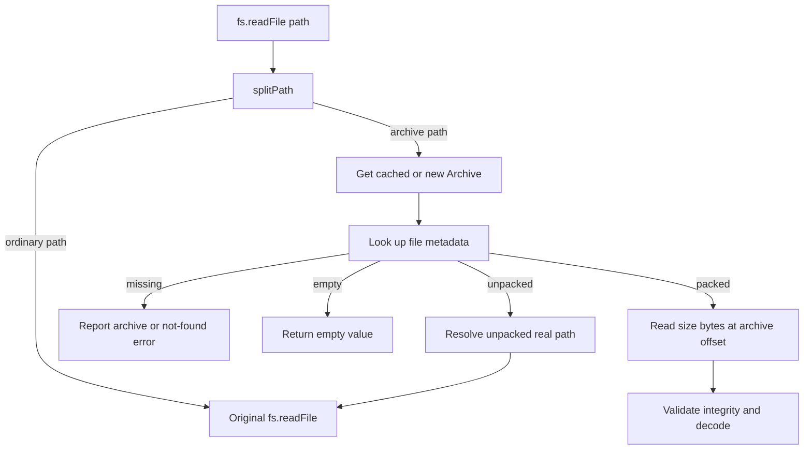

## Overview

Electron adapts Node's filesystem and module behavior so application files can be addressed inside ASAR archives. Node initialization wraps `fs`, then adds child-process and module-search adjustments. Reads can operate directly on archive offsets, while APIs requiring real filesystem paths extract or resolve a file first. [[Installation and Distribution]] covers delivery of the application and executable; this page follows archive paths after the runtime starts.

Sources: [lib/node/init.ts:3-5](repo://lib/node/init.ts#L3-L5), [lib/node/init.ts:15-59](repo://lib/node/init.ts#L15-L59), [lib/node/asar-fs-wrapper.ts:185-201](repo://lib/node/asar-fs-wrapper.ts#L185-L201), [lib/node/asar-fs-wrapper.ts:623-652](repo://lib/node/asar-fs-wrapper.ts#L623-L652)

## Recognize paths and cache archives

`splitPath` first checks whether ASAR handling is disabled. It accepts Buffer paths by converting them to strings and validates Node URL paths through the internal filesystem helper. Nonstrings and strings without an ASAR-looking suffix fragment take the ordinary filesystem branch. Remaining strings are normalized and passed to the native ASAR splitter, which identifies the archive path and path inside it.

Sources: [lib/node/asar-fs-wrapper.ts:66-87](repo://lib/node/asar-fs-wrapper.ts#L66-L87)

Archive objects are cached in a map keyed by archive path. A successful native Archive construction is retained; construction failures return null. The helper is briefly exposed as `process._getOrCreateArchive`, which the main initializer borrows and then deletes while locating application packages. [[Application Startup]] explains that discovery flow, including archive-only package selection.

Sources: [lib/node/asar-fs-wrapper.ts:29-47](repo://lib/node/asar-fs-wrapper.ts#L29-L47), [lib/browser/init.ts:82-105](repo://lib/browser/init.ts#L82-L105)

`process.noAsar` disables interpretation dynamically. The captured `ELECTRON_NO_ASAR` environment option applies only outside browser and renderer process types. Some wrappers temporarily set `process.noAsar` around an operation and restore its prior value in a finally block, so exceptions cannot leave that temporary setting in place.

Sources: [lib/node/asar-fs-wrapper.ts:15-18](repo://lib/node/asar-fs-wrapper.ts#L15-L18), [lib/node/asar-fs-wrapper.ts:1218-1227](repo://lib/node/asar-fs-wrapper.ts#L1218-L1227)

## Read packed and unpacked files

Sources: [lib/node/asar-fs-wrapper.ts:600-674](repo://lib/node/asar-fs-wrapper.ts#L600-L674), [shell/common/asar/archive.cc:356-376](repo://shell/common/asar/archive.cc#L356-L376)

The callback reader normalizes its options and callback positions, obtains an archive, and reads file metadata. Invalid archives and missing files report asynchronously through `nextTick`. Zero-size files return an empty string when encoding is requested or an empty Buffer otherwise. Unpacked files use a real path and re-enter ordinary file reading; packed files allocate a buffer and read from the archive descriptor at the metadata offset.

Sources: [lib/node/asar-fs-wrapper.ts:600-652](repo://lib/node/asar-fs-wrapper.ts#L600-L652)

The promise implementation detects archive paths and promisifies the same callback reader. The synchronous implementation uses the same archive and metadata branches, throws errors directly, reads into a buffer, validates it, and returns decoded text or bytes. Ordinary paths always delegate to the saved original method. The compatibility layer therefore adapts delivery style while sharing the underlying archive representation.

Sources: [lib/node/asar-fs-wrapper.ts:656-721](repo://lib/node/asar-fs-wrapper.ts#L656-L721)

## Materialize files for native consumers

Some APIs cannot use a virtual archive path. The generic synchronous override detects ASAR input, obtains an archive, calls `copyFileOut`, replaces the relevant argument with the returned path, and invokes the original API. Its callback counterpart does the same conversion, reporting lookup failures on the next tick. These adapters support filesystem opens and copies, dynamic library loading, native module loading, and executable-file launching.

Sources: [lib/node/asar-fs-wrapper.ts:185-237](repo://lib/node/asar-fs-wrapper.ts#L185-L237), [lib/node/asar-fs-wrapper.ts:1230-1252](repo://lib/node/asar-fs-wrapper.ts#L1230-L1252)

Native `Archive::CopyFileOut` first checks its extracted-file cache. An unpacked member resolves beneath the archive path with an `.unpacked` extension. A packed member creates a ScopedTemporaryFile from the archive descriptor, offset, size, and optional integrity data; POSIX executable entries receive mode 0755. Successful temporary files are retained in the extraction map so later requests reuse them.

Sources: [shell/common/asar/archive.cc:356-393](repo://shell/common/asar/archive.cc#L356-L393)

## Preserve integrity and useful errors

Packed read paths call `validateBufferIntegrity` after reading bytes. That helper skips files without integrity metadata, lazily loads crypto when needed, and hashes the buffer using the metadata's algorithm. A mismatch is logged and terminates the process with status 1. A detected hash mismatch is therefore a process-fatal branch rather than a normal missing-file callback.

Sources: [lib/node/asar-fs-wrapper.ts:253-265](repo://lib/node/asar-fs-wrapper.ts#L253-L265), [lib/node/asar-fs-wrapper.ts:648-652](repo://lib/node/asar-fs-wrapper.ts#L648-L652), [lib/node/asar-fs-wrapper.ts:710-713](repo://lib/node/asar-fs-wrapper.ts#L710-L713)

Filesystem failures use an ASAR-specific error factory for not-found, not-a-directory, invalid-archive, and access-denied cases. The wrappers decide whether those errors are thrown synchronously or scheduled through the callback. For debugging reads, access logging can record an archive member and byte offset, making the direct-offset path observable separately from extracted-file operations.

Sources: [lib/node/asar-fs-wrapper.ts:149-182](repo://lib/node/asar-fs-wrapper.ts#L149-L182), [lib/node/asar-fs-wrapper.ts:223-234](repo://lib/node/asar-fs-wrapper.ts#L223-L234), [lib/node/asar-fs-wrapper.ts:290-300](repo://lib/node/asar-fs-wrapper.ts#L290-L300)

## Integrate child processes and module resolution

Command-string execution temporarily disables ASAR interpretation because `exec` and `execSync` internally call executable-file machinery, which could mistake an entire command string for one archive path. `execFile` and `execFileSync` instead receive extraction wrappers. These child-process overrides are normally installed lazily on the first module load and tracked with a WeakSet to avoid applying them repeatedly.

Sources: [lib/node/asar-fs-wrapper.ts:1241-1278](repo://lib/node/asar-fs-wrapper.ts#L1241-L1278)

Node initialization also wraps `child_process.fork` to set `ELECTRON_RUN_AS_NODE=1`, using the helper executable on macOS unless an explicit executable is supplied. This differs from the service-based mechanism in [[Utility Processes]]. Module search is constrained when the originating directory is beneath `process.resourcesPath`: candidate paths outside those resources are filtered out, while module resolution outside the app retains Node's original candidates.

Sources: [lib/node/init.ts:15-59](repo://lib/node/init.ts#L15-L59)
