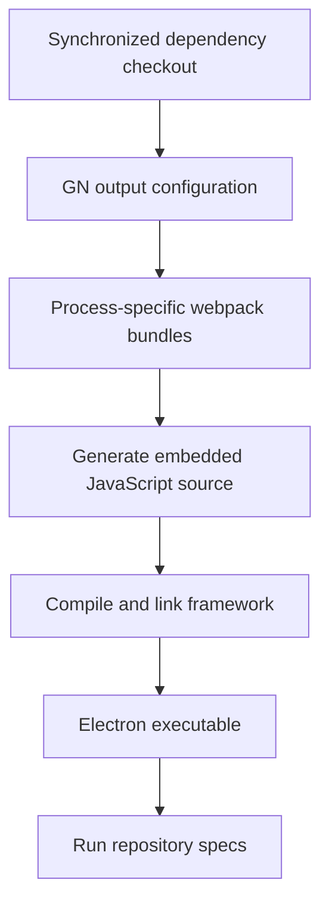

## Overview

Building this repository produces the Electron framework executable. The build combines a Chromium checkout, Electron's Node dependency, native sources, and bundled JavaScript initialization. GN generates the build graph and Ninja executes it. If you only need to run an application, [[Quickstart]] covers the installed-binary route; use this page when changing the framework and [[Testing and Validation]] to verify the resulting binary.

Sources: [DEPS:77-89](repo://DEPS#L77-L89), [docs/development/build-instructions-gn.md:3-21](repo://docs/development/build-instructions-gn.md#L3-L21), [BUILD.gn:165-180](repo://BUILD.gn#L165-L180), [BUILD.gn:237-270](repo://BUILD.gn#L237-L270)

## Prepare the dependency checkout

The manual checkout procedure uses depot_tools and gclient, with Electron located at `src/electron` inside a larger checkout. `DEPS` specifies pinned Chromium and Node revisions and controls whether they are checked out. These dependencies are not supplied merely by installing the root npm package's development dependencies. The build guide also points to platform-specific prerequisites before attempting compilation.

Sources: [docs/development/build-instructions-gn.md:7-13](repo://docs/development/build-instructions-gn.md#L7-L13), [docs/development/build-instructions-gn.md:32-66](repo://docs/development/build-instructions-gn.md#L32-L66), [DEPS:3-9](repo://DEPS#L3-L9), [DEPS:77-89](repo://DEPS#L77-L89)

```sh
mkdir electron && cd electron
gclient config --name "src/electron" --unmanaged https://github.com/electron/electron
gclient sync --with_branch_heads --with_tags
```

Sources: [docs/development/build-instructions-gn.md:59-66](repo://docs/development/build-instructions-gn.md#L59-L66)

Windows manual setup sets `DEPOT_TOOLS_WIN_TOOLCHAIN=0` to use the locally installed Visual Studio toolchain. The guide explains that the default downloader targets a Google-internal toolchain. After updating Electron source, synchronize dependencies again with `gclient sync -f` so the dependency tree matches `DEPS`; changing framework files and changing its underlying dependency revisions are related checkout operations.

Sources: [docs/development/build-instructions-gn.md:37-42](repo://docs/development/build-instructions-gn.md#L37-L42), [docs/development/build-instructions-gn.md:86-97](repo://docs/development/build-instructions-gn.md#L86-L97)

## Generate a GN configuration

Run GN from the parent Chromium `src` directory, with its build tools path configured as described in the repository guide. Testing and Release outputs live under that directory's `out` folder. Both configurations import Electron's shared arguments, but Testing disables official-build mode, keeps DCHECKs enabled, and uses symbol level 1; Release enables official-build mode. Both build FFmpeg as a component.

Sources: [docs/development/build-instructions-gn.md:99-159](repo://docs/development/build-instructions-gn.md#L99-L159), [build/args/testing.gn:1-7](repo://build/args/testing.gn#L1-L7), [build/args/release.gn:1-9](repo://build/args/release.gn#L1-L9)

```sh
gn gen out/Testing --args="import(\"//electron/build/args/testing.gn\")"
```

Sources: [docs/development/build-instructions-gn.md:122-128](repo://docs/development/build-instructions-gn.md#L122-L128)

Shared arguments set the Electron build flag and root dependency, Node module ABI, V8 embedding options, printing, and codec configuration. The Release comment explains why FFmpeg remains shared: it accommodates users avoiding proprietary codecs and users with a requirement to ship FFmpeg as a dynamically linked library. These settings describe the framework artifact, independently of an application's JavaScript package metadata.

Sources: [build/args/all.gn:1-20](repo://build/args/all.gn#L1-L20), [build/args/release.gn:5-9](repo://build/args/release.gn#L5-L9)

Use `gn args out/Testing` to edit an existing configuration and append `--list` to inspect available arguments. Output directories may use other names, but the guide places them beneath `out`. Repository launch tooling selects outputs using `ELECTRON_OUT_DIR` or a preset search order, as described in [[Quickstart]], so its chosen directory must correspond to the configuration you actually built.

Sources: [docs/development/build-instructions-gn.md:158-161](repo://docs/development/build-instructions-gn.md#L158-L161), [script/lib/utils.js:29-57](repo://script/lib/utils.js#L29-L57)

## Bundle process initialization

GN defines webpack builds for browser, renderer, worker, sandboxed renderer, isolated renderer, Node, utility, and preload-realm initialization. Each uses a process-specific configuration and generated JavaScript output. The browser and renderer targets depend on generated Electron definitions. The webpack GN template records source and configuration inputs, chooses development or production mode based on official-build status, and passes generated build flags to webpack.

Sources: [BUILD.gn:157-234](repo://BUILD.gn#L157-L234), [build/webpack/webpack.gni:3-45](repo://build/webpack/webpack.gni#L3-L45)



Sources: [docs/development/build-instructions-gn.md:86-97](repo://docs/development/build-instructions-gn.md#L86-L97), [docs/development/build-instructions-gn.md:122-189](repo://docs/development/build-instructions-gn.md#L122-L189), [BUILD.gn:237-270](repo://BUILD.gn#L237-L270), [script/spec-runner.js:194-221](repo://script/spec-runner.js#L194-L221)

The base webpack configuration selects `lib/<target>/init.ts` or its JavaScript fallback and a target-specific Electron API export file. It aliases framework imports to these internal implementations, supplies globals for environments without ordinary Node globals, and transpiles TypeScript through ts-loader. The `electron_js2c` action then consumes all generated initialization files and invokes the embedding script with Node's js2c tool.

Sources: [build/webpack/webpack.config.base.js:21-34](repo://build/webpack/webpack.config.base.js#L21-L34), [build/webpack/webpack.config.base.js:63-81](repo://build/webpack/webpack.config.base.js#L63-L81), [build/webpack/webpack.config.base.js:117-150](repo://build/webpack/webpack.config.base.js#L117-L150), [BUILD.gn:237-270](repo://BUILD.gn#L237-L270)

## Compile and locate the executable

Build the `electron` target in the generated output directory. This compiles Chromium content and its dependencies as well as Electron, so the documented build is substantially broader than compiling the TypeScript wrapper layer. The Linux executable is `out/Testing/electron`, Windows uses `electron.exe`, and macOS uses the executable inside `Electron.app/Contents/MacOS`.

Sources: [docs/development/build-instructions-gn.md:163-189](repo://docs/development/build-instructions-gn.md#L163-L189)

```sh
ninja -C out/Testing electron
```

Sources: [docs/development/build-instructions-gn.md:163-170](repo://docs/development/build-instructions-gn.md#L163-L170)

For a distributable framework ZIP, the guide uses the Release output and target `electron:electron_dist_zip`. [[Installation and Distribution]] follows what happens when artifacts reach npm consumers. Cross-compilation uses `target_cpu` and `target_os`, but the guide explicitly limits support to combinations Chromium supports, so selecting arguments alone is not a guarantee that every host-target pair builds.

Sources: [docs/development/build-instructions-gn.md:192-218](repo://docs/development/build-instructions-gn.md#L192-L218)
