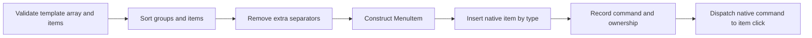

## Overview

Electron menus translate JavaScript templates into native command structures. The JavaScript layer validates options, orders items, manages radio groups, and dispatches commands using the focused window and WebContents. [[Application Startup]] explains when the default menu is installed. Window focus and ownership follow [[Windows and Navigation]]; this page covers the menu's own construction, command handling, and platform branches.

Sources: [lib/browser/api/menu.ts:4-18](repo://lib/browser/api/menu.ts#L4-L18), [lib/browser/api/menu.ts:54-67](repo://lib/browser/api/menu.ts#L54-L67), [lib/browser/api/menu.ts:190-211](repo://lib/browser/api/menu.ts#L190-L211), [lib/browser/init.ts:193-199](repo://lib/browser/init.ts#L193-L199)

## Build a menu from a template

`Menu.buildFromTemplate` requires an array. Every item must be a non-null object with its own label or role, or be a separator. The builder sorts the template, removes extra separators, creates a native-backed Menu, and appends each existing MenuItem or constructs one from its options. Array-valued submenus are recursively sorted, so nested menus participate in the same ordering machinery.

Sources: [lib/browser/api/menu.ts:190-232](repo://lib/browser/api/menu.ts#L190-L232)

Sources: [lib/browser/api/menu.ts:127-155](repo://lib/browser/api/menu.ts#L127-L155), [lib/browser/api/menu.ts:190-211](repo://lib/browser/api/menu.ts#L190-L211), [lib/browser/api/menu.ts:267-298](repo://lib/browser/api/menu.ts#L267-L298), [lib/browser/api/menu.ts:54-59](repo://lib/browser/api/menu.ts#L54-L59)

MenuItem construction preserves extra user fields, lowercases string roles, supplies a role's default submenu, and converts submenu templates into Menu instances. A submenu type without a valid Menu throws. Defaults include enabled and visible true, checked false, and role-derived labels and accelerator behavior. Type validation accepts normal, separator, submenu, checkbox, radio, header, and palette items, then assigns a unique command ID.

Sources: [lib/browser/api/menu-item.ts:5-45](repo://lib/browser/api/menu-item.ts#L5-L45), [lib/browser/api/menu-item.ts:74-74](repo://lib/browser/api/menu-item.ts#L74-L74)

## Resolve ordering constraints

The sorter treats separators without positioning constraints as group boundaries. It splits items into implicit groups, merges groups when cross-group `before` or `after` references require it, sorts each group's items, and then sorts groups. It rejoins the result with original separators where available, creating separators when needed. This makes template ordering more expressive than inserting items at fixed numeric offsets.

Sources: [lib/browser/api/menu-utils.ts:18-29](repo://lib/browser/api/menu-utils.ts#L18-L29), [lib/browser/api/menu-utils.ts:74-99](repo://lib/browser/api/menu-utils.ts#L74-L99), [lib/browser/api/menu-utils.ts:165-180](repo://lib/browser/api/menu-utils.ts#L165-L180)

Within a group, `before` and `after` IDs become graph edges; references to absent IDs add no edge. Group positioning uses `beforeGroupContaining` and `afterGroupContaining`. Both levels use the same depth-first topological traversal. The traversal marks a node before visiting dependencies, and the source explicitly says encountered cycles are broken, rather than reported as invalid templates.

Sources: [lib/browser/api/menu-utils.ts:49-72](repo://lib/browser/api/menu-utils.ts#L49-L72), [lib/browser/api/menu-utils.ts:101-162](repo://lib/browser/api/menu-utils.ts#L101-L162)

The cleanup stage folds adjacent separators and removes edge separators, while explicitly retaining entries marked invisible. Native insertion then chooses an operation by type: ordinary/header items, check items, separators, submenus/palettes, or radios. Additional properties such as tooltips, icons, roles, and custom native types are applied after insertion.

Sources: [lib/browser/api/menu.ts:138-148](repo://lib/browser/api/menu.ts#L138-L148), [lib/browser/api/menu.ts:251-298](repo://lib/browser/api/menu.ts#L251-L298)

## Execute commands and manage checked state

Native command execution finds the command ID in `commandsMap`, obtains the focused BaseWindow and WebContents, and calls the item's click wrapper. Checkbox and radio clicks flip checked state unless the role owns that state. The wrapper first asks the role implementation to execute; only when that does not handle the action does it invoke the user callback or, on macOS, send a selector to the first responder.

Sources: [lib/browser/api/menu.ts:54-59](repo://lib/browser/api/menu.ts#L54-L59), [lib/browser/api/menu-item.ts:56-71](repo://lib/browser/api/menu-item.ts#L56-L71)

Radio items are grouped between separators. Their checked-property setter clears every other item in the group and marks the selected item true. Before display, a group with no checked item has its first entry selected. Role-controlled items obtain their displayed check status through the role implementation instead of the stored boolean. These paths keep native state queries consistent with menu-level grouping.

Sources: [lib/browser/api/menu.ts:61-67](repo://lib/browser/api/menu.ts#L61-L67), [lib/browser/api/menu.ts:234-249](repo://lib/browser/api/menu.ts#L234-L249), [lib/browser/api/menu.ts:275-295](repo://lib/browser/api/menu.ts#L275-L295), [lib/browser/api/menu-item.ts:80-83](repo://lib/browser/api/menu-item.ts#L80-L83)

## Install an application menu

`Menu.setApplicationMenu` rejects a non-Menu truthy value, records the supplied menu, and marks the application menu as explicitly set. On macOS it prepares the menu tree and sends a non-null menu to the native binding. On other platforms it calls `setMenu` on every existing BaseWindow. The getter returns the recorded application-menu value.

Sources: [lib/browser/api/menu.ts:158-188](repo://lib/browser/api/menu.ts#L158-L188)

The default-menu installer returns immediately if application code already set a menu. Otherwise it builds role-based file, edit, view, window, and help entries, adding the app menu on macOS. Development builds receive help links for learning, documentation, community, and issues; packaged apps use an empty help submenu. It installs that template through the same builder and setter available to applications.

Sources: [lib/browser/default-menu.ts:4-60](repo://lib/browser/default-menu.ts#L4-L60)

## Display and close popup menus

`popup` requires an options object and supplies defaults for callback, coordinates, positioning item, and source type. It accepts a supplied window only when that window is in the current BaseWindow list. Otherwise it chooses the focused window, then the first available window. With none available it throws, so popup placement always resolves to a live listed native-window target before invoking `popupAt`.

Sources: [lib/browser/api/menu.ts:69-97](repo://lib/browser/api/menu.ts#L69-L97)

`closePopup` closes the runner for a provided BaseWindow ID or passes the invalid ID -1 to close all runners belonging to the menu. Item lookup searches the current level and then recursively searches submenus. Direct insertion rejects a non-MenuItem or a position outside the current count, then records both the item's owning menu and its command-map entry.

Sources: [lib/browser/api/menu.ts:100-155](repo://lib/browser/api/menu.ts#L100-L155)
