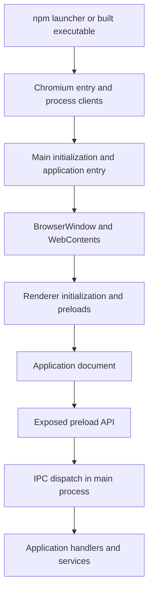

## Overview

Electron provides a desktop application runtime built on Chromium and Node.js. Applications use JavaScript, HTML, and CSS, while the framework supplies native windows, browser content, process communication, and operating system APIs. This repository contains the framework itself, its JavaScript API layer, native integration, developer tooling, and the npm launcher. Start with [[Quickstart]] to run the included small application; use [[Building Electron]] when changing the runtime binary.

Sources: [README.md:9-12](repo://README.md#L9-L12), [package.json:73-104](repo://package.json#L73-L104), [lib/browser/api/module-list.ts:4-42](repo://lib/browser/api/module-list.ts#L4-L42)

The implementation has two connected layers. Native entry code supplies Chromium clients, choosing a sandboxed or Node-enabled renderer client. JavaScript initialization supplies application loading and process-specific APIs. A `BrowserWindow` wrapper obtains its constructor from a linked native binding and then extends its behavior in JavaScript. Following a public method therefore often crosses from TypeScript into a native binding rather than ending inside one language.

Sources: [shell/app/electron_main_delegate.cc:446-478](repo://shell/app/electron_main_delegate.cc#L446-L478), [lib/browser/api/browser-window.ts:1-29](repo://lib/browser/api/browser-window.ts#L1-L29), [lib/browser/init.ts:82-114](repo://lib/browser/init.ts#L82-L114)

## Find the system you need

| Area | What it does | Page |
| --- | --- | --- |
| First application | Runs a main script, HTML document, and preload | [[Quickstart]] |
| Main process | Finds the application package and loads its entry | [[Application Startup]] |
| Windows and content | Connects native windows to navigation and document lifetime | [[Windows and Navigation]] |
| Renderer capabilities | Loads preloads and exposes APIs across isolated worlds | [[Renderer Preloads and Isolation]] |
| Process messages | Routes events, invocations, replies, and ports | [[IPC and Message Ports]] |
| Network context | Owns fetch requests and protocol handlers | [[Sessions Networking and Protocols]] |
| Desktop commands | Builds application menus and popup menus | [[Desktop Menus]] |
| Background services | Starts utility scripts with message and stream channels | [[Utility Processes]] |
| Application files | Adapts Node filesystem calls for ASAR archives | [[ASAR and Node Integration]] |
| Framework compilation | Combines dependency checkout, GN, Ninja, and JavaScript bundles | [[Building Electron]] |
| Verification | Runs specs, lint, and type generation | [[Testing and Validation]] |
| Binary delivery | Installs artifacts and launches the executable | [[Installation and Distribution]] |

Sources: [docs/fiddles/quick-start/main.js:1-30](repo://docs/fiddles/quick-start/main.js#L1-L30), [lib/browser/api/module-list.ts:4-42](repo://lib/browser/api/module-list.ts#L4-L42), [lib/browser/api/session.ts:44-46](repo://lib/browser/api/session.ts#L44-L46), [lib/node/init.ts:3-5](repo://lib/node/init.ts#L3-L5), [docs/development/build-instructions-gn.md:122-175](repo://docs/development/build-instructions-gn.md#L122-L175), [package.json:73-104](repo://package.json#L73-L104), [npm/cli.js:3-13](repo://npm/cli.js#L3-L13)

## Follow an application through the runtime

Sources: [npm/cli.js:3-13](repo://npm/cli.js#L3-L13), [shell/app/electron_main_linux.cc:29-43](repo://shell/app/electron_main_linux.cc#L29-L43), [lib/browser/init.ts:204-222](repo://lib/browser/init.ts#L204-L222), [docs/fiddles/quick-start/main.js:1-24](repo://docs/fiddles/quick-start/main.js#L1-L24), [lib/sandboxed_renderer/init.ts:16-71](repo://lib/sandboxed_renderer/init.ts#L16-L71), [lib/renderer/api/context-bridge.ts:7-19](repo://lib/renderer/api/context-bridge.ts#L7-L19), [lib/browser/ipc-dispatch.ts:76-108](repo://lib/browser/ipc-dispatch.ts#L76-L108)

The launcher resolves a binary and forwards its arguments, as detailed in [[Installation and Distribution]]. Native startup enters Chromium unless the permitted run-as-Node branch is selected. [[Application Startup]] then follows package discovery and the CJS or ESM entry loader. The example application's entry waits for readiness before constructing its window, so runtime initialization precedes application UI creation.

Sources: [npm/index.js:6-21](repo://npm/index.js#L6-L21), [npm/cli.js:7-13](repo://npm/cli.js#L7-L13), [shell/app/electron_main_linux.cc:29-43](repo://shell/app/electron_main_linux.cc#L29-L43), [lib/browser/init.ts:204-222](repo://lib/browser/init.ts#L204-L222), [docs/fiddles/quick-start/main.js:16-24](repo://docs/fiddles/quick-start/main.js#L16-L24)

[[Windows and Navigation]] follows `loadFile` into `WebContents.loadURL`, where navigation listeners determine completion or failure. [[Renderer Preloads and Isolation]] follows the corresponding document environment and the preload capability boundary. When a preload API invokes a channel, [[IPC and Message Ports]] follows dispatch to the first registered invoke handler and the reply that resolves or rejects the renderer promise.

Sources: [lib/browser/api/web-contents.ts:324-337](repo://lib/browser/api/web-contents.ts#L324-L337), [lib/browser/api/web-contents.ts:342-432](repo://lib/browser/api/web-contents.ts#L342-L432), [lib/renderer/api/context-bridge.ts:3-19](repo://lib/renderer/api/context-bridge.ts#L3-L19), [lib/browser/ipc-dispatch.ts:76-108](repo://lib/browser/ipc-dispatch.ts#L76-L108), [lib/renderer/api/ipc-renderer.ts:21-26](repo://lib/renderer/api/ipc-renderer.ts#L21-L26)

## Decisions that cross system boundaries

Electron explicitly activates the libuv loop around Node scheduling calls. Its comments explain that callbacks could otherwise wait arbitrarily long because the loop runs on requests; timer wrappers also force polling-timeout recalculation when called under Chromium's event loop. This is a runtime integration requirement shared by the browser and utility environments, rather than an application scheduling convention.

Sources: [lib/common/init.ts:8-20](repo://lib/common/init.ts#L8-L20), [lib/common/init.ts:37-62](repo://lib/common/init.ts#L37-L62)

Process-specific import names are aliases for the Electron module. The implementation states that names such as `electron/main` and `electron/renderer` exist for TypeScript typing; resolving one does not switch the executing process. Module properties use getters that load the corresponding implementation when accessed, while each process supplies its own module list. This explains why import spelling and runtime capability are separate concerns.

Sources: [lib/common/init.ts:78-119](repo://lib/common/init.ts#L78-L119), [lib/common/define-properties.ts:1-17](repo://lib/common/define-properties.ts#L1-L17), [lib/browser/api/module-list.ts:4-42](repo://lib/browser/api/module-list.ts#L4-L42)

IPC dispatch preserves frame identity using the frame-tree-node ID. The comment explains that an unloading frame can send a message while its old internal state awaits deletion, so routing looks up the frame through that stable identity. Invoke dispatch then checks frame, WebContents, and global emitters in priority order. These rules connect document lifetime to message ownership.

Sources: [lib/browser/ipc-dispatch.ts:33-52](repo://lib/browser/ipc-dispatch.ts#L33-L52), [lib/browser/ipc-dispatch.ts:85-106](repo://lib/browser/ipc-dispatch.ts#L85-L106)

Framework builds resolve Electron imports to a target-specific API export file and bundle that target's initialization entry. The webpack configuration also supplies globals for environments that delete Node globals or lack Node entirely. [[Building Electron]] explains this build boundary; [[Testing and Validation]] explains how the resulting executable runs the integration specs.

Sources: [build/webpack/webpack.config.base.js:21-34](repo://build/webpack/webpack.config.base.js#L21-L34), [build/webpack/webpack.config.base.js:63-81](repo://build/webpack/webpack.config.base.js#L63-L81), [build/webpack/webpack.config.base.js:109-126](repo://build/webpack/webpack.config.base.js#L109-L126), [script/spec-runner.js:194-221](repo://script/spec-runner.js#L194-L221)
