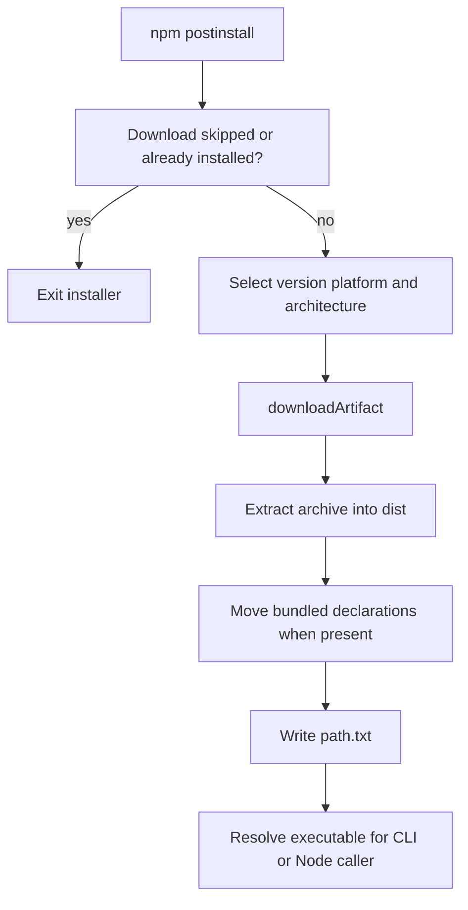

## Overview

The published Electron npm package supplies a launcher, executable-path resolver, type declarations, and an installer that downloads the framework binary. Application distribution then places application files beside that runtime in its resources layout. [[Building Electron]] covers producing framework artifacts, [[Application Startup]] covers finding the bundled entry, and [[ASAR and Node Integration]] covers file access after an archive is selected.

Sources: [npm/package.json:1-17](repo://npm/package.json#L1-L17), [npm/install.js:41-53](repo://npm/install.js#L41-L53), [script/release/bin/publish-to-npm.ts:25-40](repo://script/release/bin/publish-to-npm.ts#L25-L40), [script/release/bin/publish-to-npm.ts:103-135](repo://script/release/bin/publish-to-npm.ts#L103-L135), [docs/tutorial/application-distribution.md:25-64](repo://docs/tutorial/application-distribution.md#L25-L64)

## Install a framework artifact

The npm manifest maps the package entry to `index.js`, the command to `cli.js`, and postinstall to `install.js`. The installer exits immediately when `ELECTRON_SKIP_BINARY_DOWNLOAD` is set. Otherwise it calculates the platform executable path and skips downloading when its installed-version, path-file, and executable-existence checks all pass. A skipped download does not itself establish an executable path for the resolver.

Sources: [npm/package.json:1-9](repo://npm/package.json#L1-L9), [npm/install.js:14-22](repo://npm/install.js#L14-L22), [npm/install.js:55-70](repo://npm/install.js#L55-L70), [npm/index.js:6-18](repo://npm/index.js#L6-L18)

Artifact selection uses `npm_config_platform` and `npm_config_arch` when supplied, with host platform and architecture as defaults. When downloading on macOS with an apparent x64 architecture and no explicit architecture override, the installer checks whether it runs under Rosetta and chooses arm64 if translated. A failure of that probe is ignored. Platform-path selection throws for an unrecognized platform.

Sources: [npm/install.js:24-39](repo://npm/install.js#L24-L39), [npm/install.js:93-109](repo://npm/install.js#L93-L109)

| Platform branch | Relative executable path |
| --- | --- |
| `darwin`, `mas` | `Electron.app/Contents/MacOS/Electron` |
| `linux`, `freebsd`, `openbsd` | `electron` |
| `win32` | `electron.exe` |

Sources: [npm/install.js:93-109](repo://npm/install.js#L93-L109)

## Follow download and extraction

Sources: [npm/package.json:7-9](repo://npm/package.json#L7-L9), [npm/install.js:14-89](repo://npm/install.js#L14-L89), [npm/index.js:4-21](repo://npm/index.js#L4-L21)

The downloader requests the package version and artifact name `electron`, supplying selected platform and architecture, optional cache root, forced-cache bypass, and checksum configuration. Download or extraction errors print their stack and exit 1. Extraction writes into the package's `dist` directory, moves `electron.d.ts` upward when present at the checked distribution path, and writes `path.txt` only after successful extraction work.

Sources: [npm/install.js:41-53](repo://npm/install.js#L41-L53), [npm/install.js:73-90](repo://npm/install.js#L73-L90)

Installation reuse compares `dist/version` after removing a leading `v`, compares `path.txt` to the platform path, and checks the executable or override location. Read failures cause a reinstall decision. The override affects the paths checked or resolved, but the extraction call itself still targets the package's own `dist` directory; these are distinct branches in the implementation.

Sources: [npm/install.js:55-89](repo://npm/install.js#L55-L89)

## Resolve and launch the executable

In an ordinary Node process, requiring the npm package returns an executable path. The resolver reads `path.txt` when it exists. With `ELECTRON_OVERRIDE_DIST_PATH`, it joins that directory with the recorded executable path or falls back to `electron`; otherwise it joins the package's `dist` directory with the recorded path. Without either usable source, it throws the installation-failed error.

Sources: [README.md:60-75](repo://README.md#L60-L75), [npm/index.js:4-21](repo://npm/index.js#L4-L21)

The CLI spawns that executable with all arguments after the Node script name, inherits standard streams, and allows a visible Windows child. A normal close exits with the child's status; a signal-only close prints the signal and exits 1. SIGINT and SIGTERM handlers forward those signals while the child has not already been killed. [[Quickstart]] uses this path to launch the development application.

Sources: [npm/cli.js:3-25](repo://npm/cli.js#L3-L25)

## Place application files in resources

Manual distribution places an `app` directory containing `package.json`, the main script, and HTML beneath the runtime's resources directory. On macOS that directory is inside `Electron.app/Contents/Resources`; Windows and Linux use `resources` beside the executable. An archive distribution replaces the folder with `app.asar`. Native Node setup supplies the normal search order `app.asar`, `app`, then `default_app.asar`, or only `app.asar` when the corresponding fuse requires it.

Sources: [docs/tutorial/application-distribution.md:25-74](repo://docs/tutorial/application-distribution.md#L25-L74), [shell/common/node_bindings.cc:680-699](repo://shell/common/node_bindings.cc#L680-L699)

The packaging guide separately describes rebranding: executable renaming on Windows and Linux, and application and helper metadata changes on macOS. That work concerns the shipped runtime identity. Application metadata such as version and product name is read during [[Application Startup]], so changing package metadata and changing executable or bundle identity affect different stages of distribution.

Sources: [docs/tutorial/application-distribution.md:79-96](repo://docs/tutorial/application-distribution.md#L79-L96), [lib/browser/init.ts:116-141](repo://lib/browser/init.ts#L116-L141)

## Understand the repository release pipeline

The release-script guide describes orchestration by Sudowoodo rather than manual invocation. Preparation creates tags and starts release builds; validation checks required assets, checksums, headers, and symbols; GitHub publication finalizes the release; npm publication creates the package. Cleanup removes the draft release and tag for an unreleasable version, with the guide treating tags as immutable after publication.

Sources: [script/release/bin/README.md:7-58](repo://script/release/bin/README.md#L7-L58)

The npm publisher stages package files in a temporary directory, copies selected metadata from the root manifest, sets the release version, and locates the matching GitHub release. It downloads `electron.d.ts` and `SHASUMS256.txt`, converts checksum lines into `checksums.json`, and extracts the Node module ABI from shared GN arguments. Missing declarations, checksum assets, or ABI data fail the staging chain before a complete package can be assembled.

Sources: [script/release/bin/publish-to-npm.ts:58-101](repo://script/release/bin/publish-to-npm.ts#L58-L101), [script/release/bin/publish-to-npm.ts:103-151](repo://script/release/bin/publish-to-npm.ts#L103-L151)
