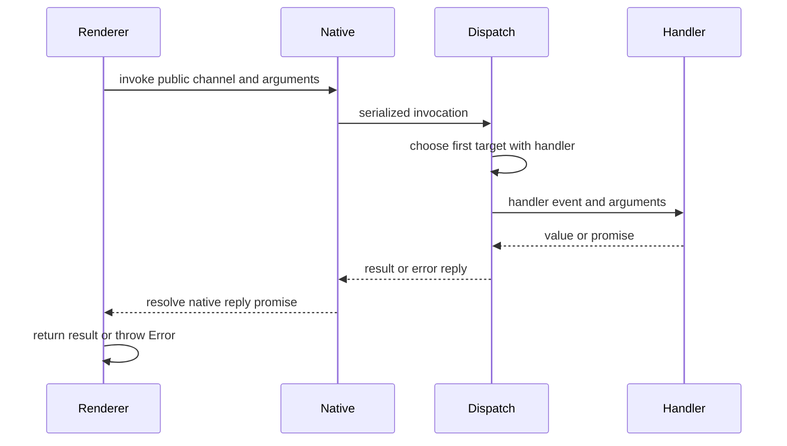

## Overview

Electron IPC connects renderer-side method calls to browser-side event emitters and invocation handlers. The renderer API offers event sending, synchronous replies, promise-based invocation, host messages, and transferable ports. [[Renderer Preloads and Isolation]] explains how application code obtains those capabilities. This page follows their transport and routing rules; [[Utility Processes]] covers the separate service-process lifecycle that also uses message ports.

Sources: [lib/renderer/api/ipc-renderer.ts:1-34](repo://lib/renderer/api/ipc-renderer.ts#L1-L34), [lib/browser/ipc-dispatch.ts:58-150](repo://lib/browser/ipc-dispatch.ts#L58-L150)

## Choose a communication operation

| Operation | Renderer behavior | Browser behavior |
| --- | --- | --- |
| `send` | Passes channel and argument array with the public flag | Emits to relevant listeners |
| `invoke` | Awaits result or error and returns or throws | Selects one registered handler |
| `sendSync` | Returns the native synchronous reply | Exposes a `returnValue` setter |
| `sendToHost` | Sends a host-directed channel | Emits the internal host-message event |
| `postMessage` | Sends a message with transferables | Wraps incoming ports for main-process listeners |

Sources: [lib/renderer/api/ipc-renderer.ts:5-31](repo://lib/renderer/api/ipc-renderer.ts#L5-L31), [lib/browser/ipc-dispatch.ts:17-21](repo://lib/browser/ipc-dispatch.ts#L17-L21), [lib/browser/ipc-dispatch.ts:58-150](repo://lib/browser/ipc-dispatch.ts#L58-L150)

The renderer binding is created lazily and cached. A renderer process gets a frame-backed implementation; a service worker gets a worker-backed implementation; other process types throw. Native send and invoke serialize arguments into cloneable messages and require a live IPC remote. A released execution context therefore fails before dispatch, and a serialization failure does not send the message.

Sources: [lib/renderer/ipc-renderer-bindings.ts:1-17](repo://lib/renderer/ipc-renderer-bindings.ts#L1-L17), [shell/renderer/api/electron_api_ipc_renderer.cc:66-105](repo://shell/renderer/api/electron_api_ipc_renderer.cc#L66-L105)

## Follow an invocation and its reply

Sources: [lib/renderer/api/ipc-renderer.ts:21-26](repo://lib/renderer/api/ipc-renderer.ts#L21-L26), [shell/renderer/api/electron_api_ipc_renderer.cc:82-105](repo://shell/renderer/api/electron_api_ipc_renderer.cc#L82-L105), [lib/browser/ipc-dispatch.ts:76-108](repo://lib/browser/ipc-dispatch.ts#L76-L108)

For a public frame invocation, dispatch searches the frame's IPC emitter, the WebContents emitter, and global `ipcMain`, in that order. It chooses the first whose handler map contains the channel. The frame lookup uses the frame-tree-node ID so messages from an unloading frame can still arrive after a frame swap. Internal invocations instead target `ipcMainInternal`; service-worker invocations target that worker's IPC object.

Sources: [lib/browser/ipc-dispatch.ts:33-52](repo://lib/browser/ipc-dispatch.ts#L33-L52), [lib/browser/ipc-dispatch.ts:85-99](repo://lib/browser/ipc-dispatch.ts#L85-L99)

The chosen handler receives the event followed by the message arguments. Dispatch awaits its result through `Promise.resolve`, sends a result reply on success, and catches thrown or rejected errors. Error replies log the channel and stringify the error. Missing handlers follow the same error-reply path. The renderer then constructs a new `Error` containing the remote channel and error text, so the reply is not the original exception object.

Sources: [lib/browser/ipc-dispatch.ts:79-106](repo://lib/browser/ipc-dispatch.ts#L79-L106), [lib/renderer/api/ipc-renderer.ts:21-26](repo://lib/renderer/api/ipc-renderer.ts#L21-L26)

## Register and remove handlers

`IpcMainImpl` stores invoke handlers separately from EventEmitter listeners. `handle` rejects duplicate channel registrations and rejects nonfunction callbacks before inserting into the map. `removeHandler` deletes that registration. `handleOnce` registers a wrapper that removes itself before calling the supplied function, so removal already holds while the first call's asynchronous result is still pending.

Sources: [lib/browser/ipc-main-impl.ts:5-34](repo://lib/browser/ipc-main-impl.ts#L5-L34)

The constructor installs an empty listener for the EventEmitter channel named `error`, specifically to prevent the ordinary unhandled-error-event exception. This listener is independent of invocation errors, which use reply objects. Registering an event listener with `on` and registering an invocation handler with `handle` therefore serve different dispatch paths even when their channel strings match.

Sources: [lib/browser/ipc-main-impl.ts:5-23](repo://lib/browser/ipc-main-impl.ts#L5-L23), [lib/browser/ipc-dispatch.ts:58-108](repo://lib/browser/ipc-dispatch.ts#L58-L108)

## Route events and synchronous replies

Public frame `send` messages receive an `event.reply` function that sends to the originating process and frame IDs. Dispatch first emits WebContents' generic `ipc-message` event, then emits the specific channel on each relevant frame, WebContents, and global emitter. This is fan-out to listeners, unlike invocation's first-handler selection. Internal events bypass the public emitters, and worker events go to the originating service worker.

Sources: [lib/browser/ipc-dispatch.ts:10-14](repo://lib/browser/ipc-dispatch.ts#L10-L14), [lib/browser/ipc-dispatch.ts:58-74](repo://lib/browser/ipc-dispatch.ts#L58-L74)

Synchronous messages attach a setter named `returnValue` that sends through the native reply channel. For frame events, dispatch warns when neither the generic synchronous event nor any channel emitter has listeners, then performs the event fan-out. Native `SendSync` waits for a cloneable reply and deserializes it before returning to JavaScript. These synchronous operations are a distinct transport call rather than a special case of the invoke promise.

Sources: [lib/browser/ipc-dispatch.ts:17-21](repo://lib/browser/ipc-dispatch.ts#L17-L21), [lib/browser/ipc-dispatch.ts:110-133](repo://lib/browser/ipc-dispatch.ts#L110-L133), [shell/renderer/api/electron_api_ipc_renderer.cc:164-181](repo://shell/renderer/api/electron_api_ipc_renderer.cc#L164-L181)

## Transfer ports and receive messages

Native `postMessage` serializes the message, converts the transfer argument to objects, and extracts a message-port channel from each transferable. Invalid transfer values throw a TypeError. On browser receipt, dispatch wraps each port as `MessagePortMain` and exposes the wrappers on `event.ports`, then emits the message through the frame emitters or service-worker emitter.

Sources: [shell/renderer/api/electron_api_ipc_renderer.cc:108-146](repo://shell/renderer/api/electron_api_ipc_renderer.cc#L108-L146), [lib/browser/ipc-dispatch.ts:139-150](repo://lib/browser/ipc-dispatch.ts#L139-L150)

`MessagePortMain` forwards start and close to its internal port. Incoming message events recursively wrap transferred ports, while outgoing `postMessage` unwraps transferred `MessagePortMain` instances before passing them to native code. Renderer reception uses a hidden `ipcNative.onMessage` callback to choose the public or internal emitter and deliver a channel event containing its sender and ports.

Sources: [lib/browser/message-port-main.ts:3-28](repo://lib/browser/message-port-main.ts#L3-L28), [lib/renderer/ipc-native-setup.ts:5-14](repo://lib/renderer/ipc-native-setup.ts#L5-L14)
