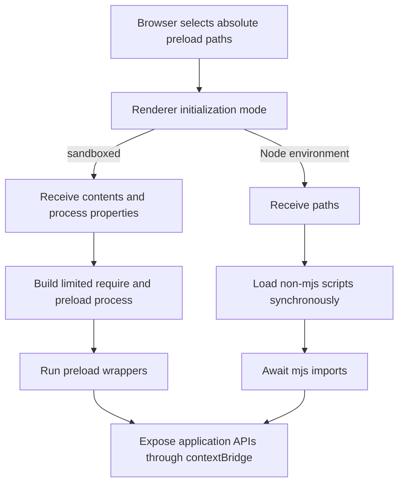

## Overview

Renderer initialization determines which Node facilities, Electron APIs, and preload scripts are available around a document. The native delegate chooses between sandboxed and nonsandboxed renderer clients, while JavaScript initialization configures the corresponding environment. This is the capability side of the document flow in [[Windows and Navigation]]. Channel dispatch belongs to [[IPC and Message Ports]]; this page follows how scripts obtain access to those channels.

Sources: [shell/app/electron_main_delegate.cc:462-472](repo://shell/app/electron_main_delegate.cc#L462-L472), [lib/renderer/init.ts:56-70](repo://lib/renderer/init.ts#L56-L70), [lib/sandboxed_renderer/init.ts:16-39](repo://lib/sandboxed_renderer/init.ts#L16-L39)

## Select preload inputs in the browser

The browser RPC server derives preloads from the event's session. Frame events select frame registrations and append a WebContents-specific preload if one exists. Service-worker events select service-worker registrations instead; an unknown event type throws. Finally, only absolute file paths survive. This selection happens before either renderer initialization path receives its preload inputs.

Sources: [lib/browser/rpc-server.ts:52-70](repo://lib/browser/rpc-server.ts#L52-L70)

Sandbox loading reads every selected file as UTF-8 and returns a record containing contents or an error. Its reply also supplies process properties including architecture, platform, environment, versions, and helper executable path. Nonsandbox loading returns only file paths, letting the renderer's Node loader read and execute them. Frame preload failures reported over the internal channel become `preload-error` events on the originating WebContents.

Sources: [lib/browser/rpc-server.ts:72-111](repo://lib/browser/rpc-server.ts#L72-L111)

## Initialize the shared document environment

Both JavaScript paths import common renderer initialization. It reads web preferences, installs native IPC reception, and selects document setup by URL protocol. DevTools gets inspector overrides; extension and Chrome pages skip ordinary window setup; other protocols receive the window overrides. Main frames also initialize the webview implementation according to preferences and run security-warning checks, while web-frame initialization runs for the shared flow.

Sources: [lib/renderer/init.ts:60-64](repo://lib/renderer/init.ts#L60-L64), [lib/sandboxed_renderer/init.ts:55-56](repo://lib/sandboxed_renderer/init.ts#L55-L56), [lib/renderer/common-init.ts:6-48](repo://lib/renderer/common-init.ts#L6-L48)

Sources: [lib/browser/rpc-server.ts:52-106](repo://lib/browser/rpc-server.ts#L52-L106), [lib/sandboxed_renderer/init.ts:16-71](repo://lib/sandboxed_renderer/init.ts#L16-L71), [lib/sandboxed_renderer/preload.ts:46-100](repo://lib/sandboxed_renderer/preload.ts#L46-L100), [lib/renderer/init.ts:136-168](repo://lib/renderer/init.ts#L136-L168), [lib/renderer/api/context-bridge.ts:3-19](repo://lib/renderer/api/context-bridge.ts#L3-L19)

## Run sandboxed preloads

The sandboxed renderer has a deliberate module catalogue. Already loaded modules include Electron's renderer aliases and `events`, including its `node:` form. Timers and URL modules load lazily and are cached. The preload's `require` checks these two maps and throws `module not found` for anything else. It does not perform general Node module resolution through application directories.

Sources: [lib/sandboxed_renderer/init.ts:24-39](repo://lib/sandboxed_renderer/init.ts#L24-L39), [lib/sandboxed_renderer/preload.ts:46-57](repo://lib/sandboxed_renderer/preload.ts#L46-L57)

Each preload runs inside a generated function with explicit `require`, `process`, `exports`, and `module` parameters plus supplied globals. The execution context provides `Buffer`, `global`, `setImmediate`, and `clearImmediate`. The wrapper is created through the native `createPreloadScript` callback and executed in global scope, so the code receives these arguments without inheriting the initializer's local scope.

Sources: [lib/sandboxed_renderer/init.ts:58-71](repo://lib/sandboxed_renderer/init.ts#L58-L71), [lib/sandboxed_renderer/preload.ts:59-82](repo://lib/sandboxed_renderer/preload.ts#L59-L82)

The preload process object starts as an EventEmitter, exposes process-memory querying, and forwards `noDeprecation` access. Initialization merges native and browser-supplied properties into it, and forwards lifecycle events to both the internal process object and the preload process. Each preload is caught independently: a read or execution error is logged and sent to the browser, then the loop can continue to later scripts.

Sources: [lib/sandboxed_renderer/preload.ts:19-43](repo://lib/sandboxed_renderer/preload.ts#L19-L43), [lib/sandboxed_renderer/init.ts:41-53](repo://lib/sandboxed_renderer/init.ts#L41-L53), [lib/sandboxed_renderer/preload.ts:87-100](repo://lib/sandboxed_renderer/preload.ts#L87-L100)

## Run preloads in a Node renderer

The nonsandboxed initializer restores arguments and common settings, then checks `nodeIntegration`. When enabled, it supplies a module and `require` globally. File documents derive filename, directory, and module-search paths from their URL, including Windows path handling; other documents use compatibility filenames and optionally search beneath the application path. A `window.onerror` adapter emits `uncaughtException` only when a listener exists.

Sources: [lib/renderer/init.ts:42-116](repo://lib/renderer/init.ts#L42-L116)

When Node integration is disabled and context isolation is also disabled, a `loaded` listener deletes Node globals such as `process`, `Buffer`, and `global`. Preloads retain explicit wrapper arguments: the initializer changes `Module.wrapper` because Node's alternative native wrapping path would not preserve that arrangement. Sandbox mode, Node integration, and context isolation therefore each affect a different branch of initialization.

Sources: [lib/renderer/init.ts:20-40](repo://lib/renderer/init.ts#L20-L40), [lib/renderer/init.ts:117-131](repo://lib/renderer/init.ts#L117-L131), [shell/app/electron_main_delegate.cc:462-472](repo://shell/app/electron_main_delegate.cc#L462-L472)

Preload paths are split by `.mjs` extension. Other scripts load synchronously through `Module._load`; ESM preloads import sequentially through Node's cascading loader. Each failure reports the path and error without terminating the remaining loop. `appCodeLoaded` is called after the ESM loader finishes, or immediately when there are no ESM preloads, completing this initialization handoff.

Sources: [lib/renderer/init.ts:133-168](repo://lib/renderer/init.ts#L133-L168)

## Expose APIs across worlds

Every public context-bridge method checks `process.contextIsolated` and throws if it is false. `exposeInMainWorld` calls the native binding for world 0; `exposeInIsolatedWorld` uses the requested world ID; `executeInMainWorld` executes through that same world-0 binding. These methods make the destination explicit rather than relying on shared JavaScript globals between worlds.

Sources: [lib/renderer/api/context-bridge.ts:1-20](repo://lib/renderer/api/context-bridge.ts#L1-L20)

The renderer's exported module list includes `contextBridge`, `ipcRenderer`, `webFrame`, clipboard, crash reporting, and web utilities. A preload can use the bridge to expose application operations and use IPC for work owned by main. The implementation also contains internal global-override helpers, but adds them to the public bridge object only when its binding reports debug mode.

Sources: [lib/renderer/api/module-list.ts:1-9](repo://lib/renderer/api/module-list.ts#L1-L9), [lib/renderer/api/context-bridge.ts:24-39](repo://lib/renderer/api/context-bridge.ts#L24-L39), [lib/renderer/api/ipc-renderer.ts:21-26](repo://lib/renderer/api/ipc-renderer.ts#L21-L26)
