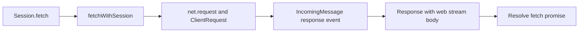

## Overview

A Session is the browser context used by Electron's networking and related browser services. Its JavaScript wrapper exposes fetch, preload registration compatibility, extension compatibility, and display-media handling alongside native methods. `net.fetch` and the global protocol facade use the default session; a session's own methods preserve that session as the operation's context. [[Windows and Navigation]] covers document navigation, while this page follows explicit requests and custom response handling.

Sources: [lib/browser/api/session.ts:25-46](repo://lib/browser/api/session.ts#L25-L46), [lib/browser/api/session.ts:48-82](repo://lib/browser/api/session.ts#L48-L82), [lib/browser/api/session.ts:114-120](repo://lib/browser/api/session.ts#L114-L120), [lib/browser/api/net.ts:15-21](repo://lib/browser/api/net.ts#L15-L21), [lib/browser/api/protocol.ts:159-180](repo://lib/browser/api/protocol.ts#L159-L180)

## Select a session

The exported session module supplies `fromPartition`, `fromPath`, and a lazy `defaultSession` getter that uses the empty partition. Native partition selection maps an empty name to the default browser context, a `persist:` name to a persistent named context, and other names to in-memory contexts. Path-based selection requires a nonempty absolute path. Session objects cannot be constructed directly with `new`.

Sources: [lib/browser/api/session.ts:114-120](repo://lib/browser/api/session.ts#L114-L120), [shell/browser/api/electron_api_session.cc:1713-1755](repo://shell/browser/api/electron_api_session.cc#L1713-L1755)

Native session methods include cache and storage clearing, proxy configuration, certificate verification, permission callbacks, and download-path configuration. Session initialization also installs IPC dispatch listeners, connecting worker-originated messages to the routing flow in [[IPC and Message Ports]]. These are operations on the selected browser context rather than settings attached to a fetch response.

Sources: [shell/browser/api/electron_api_session.cc:1760-1784](repo://shell/browser/api/electron_api_session.cc#L1760-L1784), [lib/browser/api/session.ts:25-27](repo://lib/browser/api/session.ts#L25-L27)

## Send an outgoing request

`net.request` checks `app.isReady` and constructs `ClientRequest`, while `net.fetch` delegates to `session.defaultSession.fetch`. `Session.fetch` calls the shared fetch adapter with itself and `net.request`. The adapter first constructs a standard Request, rejecting its promise if construction fails, then translates the request into Electron request options. This preserves session selection while offering Request and Response objects to callers.

Sources: [lib/browser/api/net.ts:8-17](repo://lib/browser/api/net.ts#L8-L17), [lib/browser/api/session.ts:44-46](repo://lib/browser/api/session.ts#L44-L46), [lib/browser/api/net-fetch.ts:18-27](repo://lib/browser/api/net-fetch.ts#L18-L27), [lib/browser/api/net-fetch.ts:75-88](repo://lib/browser/api/net-fetch.ts#L75-L88)

Sources: [lib/browser/api/session.ts:44-46](repo://lib/browser/api/session.ts#L44-L46), [lib/browser/api/net.ts:8-12](repo://lib/browser/api/net.ts#L8-L12), [lib/browser/api/net-fetch.ts:79-124](repo://lib/browser/api/net-fetch.ts#L79-L124)

The translated options include method, URL, origin, credentials, cache, referrer policy, and redirect mode. Without an Origin header, the adapter converts `same-origin` credentials to `include`, because the lower request layer requires an origin for the former. It copies headers, conditionally sets `Sec-Fetch-Mode`, and records `bypassCustomProtocolHandlers` on the loader options. A request body pipes into a web-wrapped writable request before ending it; bodyless requests end immediately.

Sources: [lib/browser/api/net-fetch.ts:75-99](repo://lib/browser/api/net-fetch.ts#L75-L99), [lib/browser/api/net-fetch.ts:122-124](repo://lib/browser/api/net-fetch.ts#L122-L124), [lib/common/api/net-client-request.ts:339-344](repo://lib/common/api/net-client-request.ts#L339-L344)

The lower request parser validates redirect mode as `follow`, `error`, or `manual`. In the browser process it accepts a Session instance or a string partition, giving an explicit session precedence. Ordinary ClientRequest construction allows only HTTP and HTTPS unless the internal allow-any-protocol option is present; the fetch adapter supplies that option to support protocol-aware fetching.

Sources: [lib/common/api/net-client-request.ts:271-316](repo://lib/common/api/net-client-request.ts#L271-L316), [lib/common/api/net-client-request.ts:339-344](repo://lib/common/api/net-client-request.ts#L339-L344), [lib/browser/api/net-fetch.ts:79-88](repo://lib/browser/api/net-fetch.ts#L79-L88)

## Adapt responses and cancellation

On the response event, the adapter builds Headers, joining array-valued headers with comma-space separators. It creates a web stream from the IncomingMessage except for HEAD requests and statuses 101, 204, 205, and 304, which receive a null body. It preserves the original response internally for later protocol adaptation and resolves the fetch promise. Request errors reject that same promise.

Sources: [lib/browser/api/net-fetch.ts:101-120](repo://lib/browser/api/net-fetch.ts#L101-L120)

An already-aborted signal rejects before creating the network request, using the signal's reason or an AbortError. Later aborts mark the operation locally aborted, reject, attempt body cancellation when applicable, and call the request's `abort`. The response listener ignores responses after a local abort. The explicit flag prevents a later response from becoming the meaningful outcome of a canceled operation.

Sources: [lib/browser/api/net-fetch.ts:29-73](repo://lib/browser/api/net-fetch.ts#L29-L73), [lib/browser/api/net-fetch.ts:101-102](repo://lib/browser/api/net-fetch.ts#L101-L102)

## Handle custom protocols

`Protocol.handle` chooses interception for `http`, `https`, and `file`, and registration for other schemes. It converts upload data into a Request body, removes an Origin header whose value is the literal string `null`, and creates a Request with method, referrer, headers, and streaming duplex mode when needed. The application handler may return a Response directly or through a promise.

Sources: [lib/browser/api/protocol.ts:13-13](repo://lib/browser/api/protocol.ts#L13-L13), [lib/browser/api/protocol.ts:111-127](repo://lib/browser/api/protocol.ts#L111-L127)

Upload conversion handles a single raw buffer directly; otherwise it streams raw chunks, file ranges, native pipes, and blob data. Unknown chunk types throw. Blob lookup uses the default session because the implementation comment states that the underlying blob retrieval relies on global state rather than the selected Session context. File and pipe adapters bridge their native or Node sources to web streams.

Sources: [lib/browser/api/protocol.ts:15-89](repo://lib/browser/api/protocol.ts#L15-L89)

## Interpret handler failures and registration state

Response validation checks object shape and the types of explicitly owned status, status text, headers, and body fields. An invalid response yields `ERR_UNEXPECTED`; `Response.error` yields `ERR_FAILED`. Successful responses convert a web body back into a Node readable and pass headers, status, text, and available MIME information to the native callback. Handler exceptions are logged and become `ERR_UNEXPECTED`.

Sources: [lib/browser/api/protocol.ts:92-109](repo://lib/browser/api/protocol.ts#L92-L109), [lib/browser/api/protocol.ts:127-144](repo://lib/browser/api/protocol.ts#L127-L144)

A failed native registration throws. `unhandle` reverses interception or registration according to the same built-in-scheme distinction, and throws if removal fails. `isProtocolHandled` selects the corresponding query. The global protocol object forwards these operations to `session.defaultSession.protocol`, so applications using another session must operate on that session's protocol object to install its handlers.

Sources: [lib/browser/api/protocol.ts:145-180](repo://lib/browser/api/protocol.ts#L145-L180)
