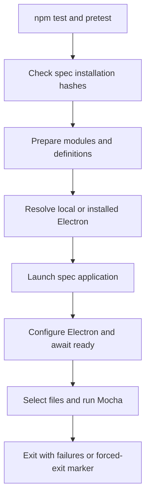

## Overview

Electron validates runtime behavior by launching the framework executable against the repository's spec application. The outer Node script prepares dependencies and selects an executable; the spec application's main entry configures Electron and runs Mocha. [[Building Electron]] provides the local binary. Lint and generated TypeScript checks complement runtime specs, with separate commands for source languages and documentation.

Sources: [package.json:61-92](repo://package.json#L61-L92), [script/spec-runner.js:69-107](repo://script/spec-runner.js#L69-L107), [script/spec-runner.js:194-221](repo://script/spec-runner.js#L194-L221), [spec/index.js:61-94](repo://spec/index.js#L61-L94)

## Select the test runner and executable

The root package's `test` script runs `script/spec-runner.js`; npm's `pretest` first regenerates TypeScript definitions. The outer runner currently registers one runner named `main`. A supplied comma-separated `--runners` list must contain only registered IDs. Unknown command-line options are collected for forwarding to the Electron-side spec application rather than interpreted as outer-runner configuration.

Sources: [package.json:79-92](repo://package.json#L79-L92), [script/spec-runner.js:22-67](repo://script/spec-runner.js#L22-L67)

```sh
npm test -- --runners=main
```

Sources: [package.json:87-92](repo://package.json#L87-L92), [script/spec-runner.js:42-67](repo://script/spec-runner.js#L42-L67)

With no `--electronVersion`, tests use the configured local executable. Supplying a version switches to an installer-managed released binary and restricts execution to the main runner. The resolver accepts a recognized exact version, `latest`, or a `latest@` major selector. This path also changes native-addon preparation to use published Electron headers rather than the local generated headers.

Sources: [script/spec-runner.js:48-89](repo://script/spec-runner.js#L48-L89), [script/spec-runner.js:194-201](repo://script/spec-runner.js#L194-L201), [script/spec-runner.js:231-249](repo://script/spec-runner.js#L231-L249)

## Prepare spec dependencies

Before execution, the runner compares saved and current hashes. It hashes the spec package manifest, its lockfile, and the runner script, and separately hashes installed spec modules while excluding `.bin`. A changed hash triggers module installation and saves the new hashes. If the generated root `electron.d.ts` file is absent, the runner invokes definition generation before running tests.

Sources: [script/spec-runner.js:92-128](repo://script/spec-runner.js#L92-L128), [script/spec-runner.js:265-286](repo://script/spec-runner.js#L265-L286)

Dependency installation provides node-gyp configuration, points at the local build's generated Node headers or downloaded release headers, removes the existing spec `node_modules`, and invokes the pinned Yarn version with a frozen lockfile. The spec manifest includes local native addons alongside Mocha, Chai, and server and network fixtures, so dependency preparation is part of testing binary compatibility as well as JavaScript behavior.

Sources: [script/spec-runner.js:224-260](repo://script/spec-runner.js#L224-L260), [spec/package.json:21-52](repo://spec/package.json#L21-L52)

## Follow test startup



Sources: [package.json:79-92](repo://package.json#L79-L92), [script/spec-runner.js:92-107](repo://script/spec-runner.js#L92-L107), [script/spec-runner.js:194-221](repo://script/spec-runner.js#L194-L221), [spec/index.js:9-69](repo://spec/index.js#L9-L69), [spec/index.js:129-191](repo://spec/index.js#L129-L191)

The outer runner launches the spec package with forwarded options and runs from the parent source directory. On Linux it wraps execution with `python3` and `dbus_mock.py`. It pipes stdout and stderr through, can record the child PID, and sets `MOCHA_FILE` under the configured results directory for each runner. Runner exceptions are collected and cause an overall failure status.

Sources: [script/spec-runner.js:131-170](repo://script/spec-runner.js#L131-L170), [script/spec-runner.js:194-207](repo://script/spec-runner.js#L194-L207)

The spec entry replaces the normal GUI exception fallback with logging and immediate exit 1, keeps the app alive when windows close, enables exposed garbage collection, and configures fake media devices and test DNS mappings. It registers test protocol schemes before readiness. After `app.whenReady`, it loads ts-node, parses file and grep options, and constructs Mocha.

Sources: [spec/index.js:9-69](repo://spec/index.js#L9-L69)

## Filter tests and understand hooks

The in-process runner supports `--files`, `--grep` or `-g`, and invert filtering. It normalizes absolute file paths relative to the Electron root, considers only names ending in `-spec.ts` or `-spec.js`, applies an optional npm module-match expression, and sorts selected files before adding them. Explicit file paths that match nothing terminate with an explanatory error instead of silently succeeding.

Sources: [spec/index.js:64-69](repo://spec/index.js#L64-L69), [spec/index.js:129-168](repo://spec/index.js#L129-L168)

Mocha options forbid focused tests in CI and enable three retries there. Reporter, multi-reporter, grep, invert, and timeout behavior can be configured through environment variables. The default reporter is TAP and the default timeout is 30 seconds. A root before-each hook skips tests listed by full title in `disabled-tests.json`.

Sources: [spec/index.js:71-107](repo://spec/index.js#L71-L107), [spec/index.js:123-127](repo://spec/index.js#L123-L127)

Cleanup hooks are attached as suites are created so deferred cleanup runs before ordinary after-each hooks. The source specifies that deferred functions run in reverse order after the test completes. At completion, normal mode exits with Mocha's failure count; forced-exit mode prints the recognized failure marker and kills the process, allowing the outer runner to recover the result from stdout.

Sources: [spec/index.js:109-121](repo://spec/index.js#L109-L121), [spec/index.js:170-179](repo://spec/index.js#L170-L179), [script/spec-runner.js:172-189](repo://script/spec-runner.js#L172-L189)

## Validate types, source style, and documentation

Definition generation first parses the repository's API docs into `electron-api.json`, then generates Electron declarations and runs the TypeScript smoke project. Parser or compiler failure exits nonzero. This links public API documentation to type validation rather than treating declarations as a wholly independent manually maintained interface.

Sources: [package.json:79-81](repo://package.json#L79-L81), [script/create-api-json.mjs:8-18](repo://script/create-api-json.mjs#L8-L18), [spec/ts-smoke/runner.js:4-18](repo://spec/ts-smoke/runner.js#L4-L18)

The root manifest offers separate JavaScript, C++, Objective-C, Python, GN, clang-format, and clang-tidy checks. Its documentation pipeline runs remark, JavaScript examples, declaration generation, TypeScript checks in Markdown, fiddle lint, relative-link checks, Markdown lint, and API-history validation. The full `lint` script invokes source lint and then this documentation pipeline, so its scope is broader than any individual language command.

Sources: [package.json:61-80](repo://package.json#L61-L80)
