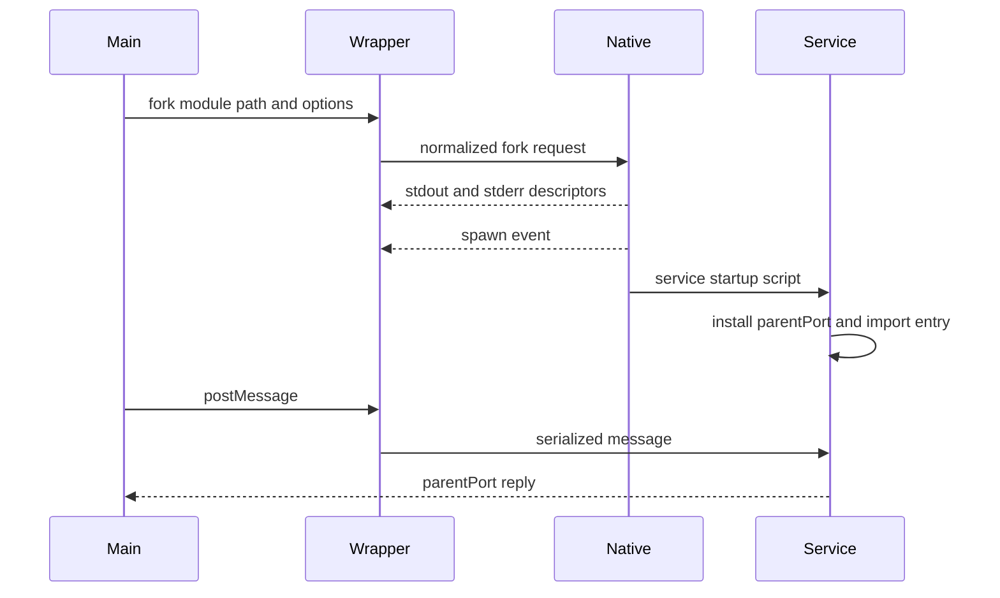

## Overview

`utilityProcess.fork` starts a script through Electron's native utility-process service and returns an EventEmitter wrapper. The wrapper coordinates launch, messages, standard streams, PID access, termination, and exit cleanup. Inside the service, initialization installs `process.parentPort` and imports the entry script. This communication is attached to a process instance; ordinary frame channels and invoke handlers are covered by [[IPC and Message Ports]].

Sources: [lib/browser/api/utility-process.ts:7-14](repo://lib/browser/api/utility-process.ts#L7-L14), [lib/browser/api/utility-process.ts:93-152](repo://lib/browser/api/utility-process.ts#L93-L152), [lib/utility/init.ts:18-50](repo://lib/utility/init.ts#L18-L50)

## Validate and normalize a fork

Native creation requires the application to be ready and throws a TypeError otherwise. It also validates conversion of the argument list, environment map, and executable arguments before creating the service wrapper. Callers therefore need the same application-readiness boundary used for window creation in [[Quickstart]], even though the child script runs without a browser window.

Sources: [shell/browser/api/electron_api_utility_process.cc:438-476](repo://shell/browser/api/electron_api_utility_process.cc#L438-L476), [docs/fiddles/quick-start/main.js:16-24](repo://docs/fiddles/quick-start/main.js#L16-L24)

The JavaScript constructor rejects a missing entry script. Omitted arguments become an empty array; an object in the argument position is treated as options. Supplied options are shallow-copied before mutation. It checks that `execArgv` is an array and that `serviceName` and `cwd` are strings when present. After stream normalization, it calls native `_fork` with the options, module path, and arguments.

Sources: [lib/browser/api/utility-process.ts:13-53](repo://lib/browser/api/utility-process.ts#L13-L53), [lib/browser/api/utility-process.ts:93-94](repo://lib/browser/api/utility-process.ts#L93-L94)

| Option | JavaScript wrapper behavior |
| --- | --- |
| `execArgv` | Requires an array when supplied |
| `serviceName` | Requires a string when supplied |
| `cwd` | Requires a string when supplied |
| `stdio: 'inherit'` | Ignores stdin and inherits stdout and stderr |
| `stdio: 'ignore'` | Ignores all three streams |
| `stdio: 'pipe'` | Ignores stdin and exposes stdout and stderr streams |
| `stdio` array | Requires at least three entries and ignored stdin |

Sources: [lib/browser/api/utility-process.ts:37-91](repo://lib/browser/api/utility-process.ts#L37-L91)

The string stdio forms are rewritten to a three-entry array. Array stdout and stderr values must each be `pipe`, `ignore`, or `inherit`; missing entries and other values throw. For each pipe, the wrapper allocates a PassThrough before starting the process, so callers can obtain the stream object before its native descriptor arrives. There is no supported writable stdin path in this wrapper.

Sources: [lib/browser/api/utility-process.ts:55-91](repo://lib/browser/api/utility-process.ts#L55-L91)

## Follow launch into the service script

Sources: [lib/browser/api/utility-process.ts:93-119](repo://lib/browser/api/utility-process.ts#L93-L119), [lib/browser/api/utility-process.ts:134-139](repo://lib/browser/api/utility-process.ts#L134-L139), [shell/browser/api/electron_api_utility_process.cc:244-256](repo://shell/browser/api/electron_api_utility_process.cc#L244-L256), [lib/utility/init.ts:8-50](repo://lib/utility/init.ts#L8-L50), [lib/utility/parent-port.ts:29-31](repo://lib/utility/parent-port.ts#L29-L31)

Native launch records the process PID and registers the wrapper under that ID. It emits available stdout and stderr descriptors before emitting `spawn`. The JavaScript adapter turns each descriptor into a readable Socket and pipes it into the previously created PassThrough. Other native events forward through the public EventEmitter unless they need the special exit cleanup path.

Sources: [shell/browser/api/electron_api_utility_process.cc:244-256](repo://shell/browser/api/electron_api_utility_process.cc#L244-L256), [lib/browser/api/utility-process.ts:93-119](repo://lib/browser/api/utility-process.ts#L93-L119)

The service initializer reads its hidden `_serviceStartupScript`, replaces the initialization argument in `process.argv` with that path, and loads common initialization. It installs a nonwritable, enumerable `process.parentPort`, converts the entry to a file URL, and imports through Node's cascading ESM loader. Import errors are sent into Node's uncaught-exception mechanism rather than turned into successful startup.

Sources: [lib/utility/init.ts:6-23](repo://lib/utility/init.ts#L6-L23), [lib/utility/init.ts:38-50](repo://lib/utility/init.ts#L38-L50)

## Exchange messages and transferred ports

Main-process `postMessage` delegates to the native handle. When a transfer array is present, it replaces `MessagePortMain` wrappers with their internal ports first, following the wrapping convention in [[IPC and Message Ports]]. Native sending requires a connected service, serializes the message, validates transferable ports, disentangles them, and passes the transferable message into the connector.

Sources: [lib/browser/api/utility-process.ts:134-139](repo://lib/browser/api/utility-process.ts#L134-L139), [shell/browser/api/electron_api_utility_process.cc:332-383](repo://shell/browser/api/electron_api_utility_process.cc#L332-L383)

The utility-side ParentPort wraps a native port as an EventEmitter. Incoming message events convert their transferred ports to `MessagePortMain` wrappers before emission. Its `start`, `pause`, and `postMessage` methods forward to native code. Initialization automatically starts the port when the first message listener is added and pauses it when the last message listener is removed, tying delivery to consumer interest.

Sources: [lib/utility/parent-port.ts:5-32](repo://lib/utility/parent-port.ts#L5-L32), [lib/utility/init.ts:25-36](repo://lib/utility/init.ts#L25-L36)

## Observe termination and release resources

The wrapper's PID getter reads the current native handle, while stdout and stderr getters expose the current pipe streams or null. `kill` returns false once the handle is null and otherwise forwards the termination request. On exit, it emits the user's exit listeners inside a try/finally and then clears the handle and removes stream listeners. Cleanup therefore still runs if an exit listener throws.

Sources: [lib/browser/api/utility-process.ts:94-109](repo://lib/browser/api/utility-process.ts#L94-L109), [lib/browser/api/utility-process.ts:122-147](repo://lib/browser/api/utility-process.ts#L122-L147)

Native termination uses a guard because multiple observers can report the same exit. The first report removes PID tracking, resets the PID, closes the connector, emits exit, and unpins the wrapper. On POSIX, a process killed through this API normalizes SIGTERM or SIGKILL termination status to zero, which the comment describes as the expected graceful-shutdown result for users.

Sources: [shell/browser/api/electron_api_utility_process.cc:259-290](repo://shell/browser/api/electron_api_utility_process.cc#L259-L290), [shell/browser/api/electron_api_utility_process.cc:318-329](repo://shell/browser/api/electron_api_utility_process.cc#L318-L329)

## Use the utility's Electron API surface

The utility-specific module list exposes networking and system preferences. Its net adapter constructs ClientRequest directly and uses the shared fetch adapter without a Session argument. The Request and Response conversion described in [[Sessions Networking and Protocols]] is reused, while browser-side `net.request` readiness checking and explicit Session selection are outside this utility adapter's implementation.

Sources: [lib/utility/api/module-list.ts:1-5](repo://lib/utility/api/module-list.ts#L1-L5), [lib/utility/api/net.ts:1-22](repo://lib/utility/api/net.ts#L1-L22), [lib/browser/api/net.ts:8-17](repo://lib/browser/api/net.ts#L8-L17)
