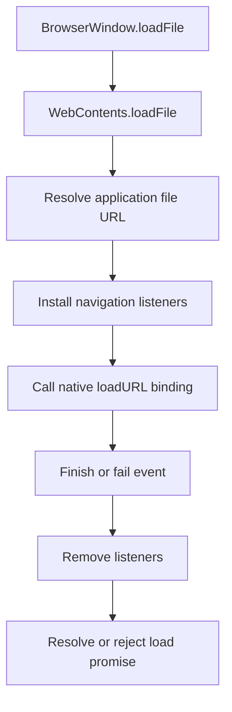

## Overview

`BrowserWindow` combines a native desktop window with a `WebContents` that owns the displayed document. Its JavaScript wrapper extends the native constructor, coordinates application events, and forwards document operations. [[Application Startup]] establishes the required view inheritance before application code constructs windows. This page follows window and document lifetime; [[Renderer Preloads and Isolation]] covers the capabilities inside the document environment.

Sources: [lib/browser/api/browser-window.ts:1-13](repo://lib/browser/api/browser-window.ts#L1-L13), [lib/browser/api/browser-window.ts:131-155](repo://lib/browser/api/browser-window.ts#L131-L155), [lib/browser/init.ts:158-160](repo://lib/browser/init.ts#L158-L160)

## Initialize a window

`BrowserWindow.prototype._init` invokes `BaseWindow` initialization and captures the window ID in a nonwritable property so it remains accessible after native destruction. It wraps `setBounds` to merge supplied coordinates with existing bounds. Focus and blur events are also emitted on `app` with the window instance, allowing application-level observers to identify the affected window.

Sources: [lib/browser/api/browser-window.ts:8-38](repo://lib/browser/api/browser-window.ts#L8-L38)

Initialization tracks effective visibility as visible and not minimized. Show, hide, minimize, maximize, and restore events recompute that value, emitting a WebContents visibility change only when it differs. After setting up view tracking and close behavior, initialization emits `browser-window-created`. The `devToolsWebContents` getter delegates to the document's current DevTools contents rather than capturing a fixed value.

Sources: [lib/browser/api/browser-window.ts:67-98](repo://lib/browser/api/browser-window.ts#L67-L98)

Lookup helpers distinguish BrowserWindows from other BaseWindows. `fromId` returns a BrowserWindow or null, and `getAllWindows` filters the base list. Focus lookup ignores destroyed windows and documents, and accepts either window focus or DevTools focus. `fromWebContents` asks the document for its owning BrowserWindow, so ownership remains the authoritative association.

Sources: [lib/browser/api/browser-window.ts:101-128](repo://lib/browser/api/browser-window.ts#L101-L128)

## Load a document

Window methods including `loadURL`, `loadFile`, reload, send, and DevTools operations forward to `webContents`. `WebContents.loadFile` requires a string and resolves it against `app.getAppPath`, preserving optional query, search, and hash fields when forming a file URL. A relative HTML path is therefore interpreted through application identity, rather than simply through the current working directory.

Sources: [lib/browser/api/browser-window.ts:131-170](repo://lib/browser/api/browser-window.ts#L131-L170), [lib/browser/api/web-contents.ts:324-337](repo://lib/browser/api/web-contents.ts#L324-L337)

Sources: [lib/browser/api/browser-window.ts:141-143](repo://lib/browser/api/browser-window.ts#L141-L143), [lib/browser/api/web-contents.ts:324-361](repo://lib/browser/api/web-contents.ts#L324-L361), [lib/browser/api/web-contents.ts:410-432](repo://lib/browser/api/web-contents.ts#L410-L432)

`loadURL` creates its promise before calling native `_loadURL`, so listeners are already installed when navigation starts. It attaches a no-op rejection handler to suppress an unhandled-rejection report but still returns the original promise to callers. The completion helper records main-frame failures, resolves after a successful finish, and rejects with an error carrying `errno`, `code`, and `url` on failure.

Sources: [lib/browser/api/web-contents.ts:342-361](repo://lib/browser/api/web-contents.ts#L342-L361), [lib/browser/api/web-contents.ts:383-390](repo://lib/browser/api/web-contents.ts#L383-L390), [lib/browser/api/web-contents.ts:427-432](repo://lib/browser/api/web-contents.ts#L427-L432)

## Understand navigation completion

A new unrelated main-frame navigation aborts a previously started load with `ERR_ABORTED`. Same-document transitions are excluded from that branch because hash changes and history updates can occur without leaving the current document. If loading stops without a finish or failure event, the helper supplies `ERR_FAILED`; destruction uses the same stop handler. Every settling branch removes all listeners installed for that promise.

Sources: [lib/browser/api/web-contents.ts:363-424](repo://lib/browser/api/web-contents.ts#L363-L424)

JavaScript execution waits until there is a URL and the main frame is no longer loading, or until `did-stop-loading` fires. It then uses an internal invocation to call the renderer's web-frame method. Both ordinary and isolated-world execution share this readiness gate. [[IPC and Message Ports]] describes the transport family used by those cross-process calls.

Sources: [lib/browser/api/web-contents.ts:164-182](repo://lib/browser/api/web-contents.ts#L164-L182)

## Decide whether child windows may open

`setWindowOpenHandler` stores a main-process callback. When present, its response must be a non-null object with `action` equal to `allow` or `deny`. Invalid responses prevent the operation and log an explanation; `deny` prevents it without requiring constructor options. An allowed response can supply constructor overrides, an `outlivesOpener` boolean, or a custom creation function. Without a handler, the wrapper returns its default response without preventing the event.

Sources: [lib/browser/api/web-contents.ts:435-476](repo://lib/browser/api/web-contents.ts#L435-L476)

Guest-window creation combines default dimensions, parsed feature options, and main-process overrides. Named windows reuse existing live WebContents; destroyed entries are unregistered. A custom creator must return the supplied guest WebContents when one already exists. Otherwise the manager constructs a BrowserWindow, initiates navigation when needed, connects lifecycle events, and emits `did-create-window` on the opener.

Sources: [lib/browser/guest-window-manager.ts:29-101](repo://lib/browser/guest-window-manager.ts#L29-L101)

Child preferences merge parsed renderer values first, inherited restrictive preferences second, and elevated main-process overrides last. The source explicitly describes this ordering as preventing renderer changes to important security settings while permitting deliberate main-process changes. Child lifetime normally follows the opener's current-render-view deletion; `outlivesOpener` skips that coupling. Named-child registration is removed when the guest is destroyed.

Sources: [lib/browser/guest-window-manager.ts:104-174](repo://lib/browser/guest-window-manager.ts#L104-L174)

## Handle responsiveness and embedded views

Window unresponsiveness is delayed by 50 milliseconds and emitted only for a surviving enabled window. A responsive event clears the pending timer. Closing schedules a five-second fallback only after checking in a microtask that close was not prevented, and WebContents destruction clears outstanding work. These guards avoid reporting stale state after recovery or destruction.

Sources: [lib/browser/api/browser-window.ts:40-65](repo://lib/browser/api/browser-window.ts#L40-L65)

BrowserView attachment ignores duplicate additions, removes a view from a previous owner, adds its WebContentsView to the content view, and updates ownership. Removal detaches the view and clears its owner. `setBrowserView` replaces existing attachments; `getBrowserView` rejects multiple attachments and directs callers to `getBrowserViews`. On window closure, tracked views close their contents while waiting for before-unload handling.

Sources: [lib/browser/api/browser-window.ts:83-87](repo://lib/browser/api/browser-window.ts#L83-L87), [lib/browser/api/browser-window.ts:201-240](repo://lib/browser/api/browser-window.ts#L201-L240)
