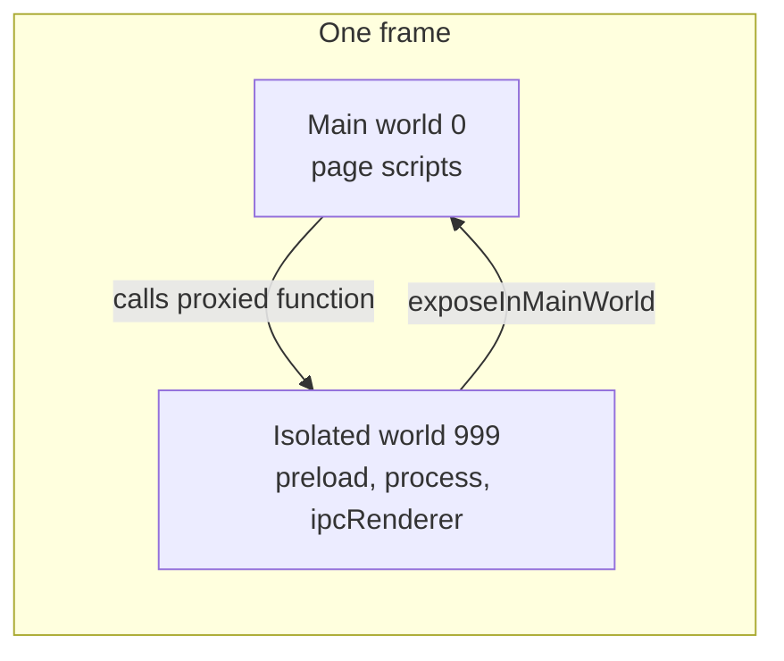

## Overview

With context isolation on, which is the default, the preload script and the page's own scripts run in separate V8 contexts of the same frame, called worlds. The page cannot see or modify the preload's globals, and the preload cannot be tampered with through prototypes the page changed. The only way across is `contextBridge`, which copies values from one world to the other: primitives directly, functions as proxies that call back into the originating world, and objects, arrays and promises recursively. This page covers how the isolated world is created, how the renderer chooses which world runs Electron's code, and how the bridge copies values. The preload loading itself is in [[Renderer Initialization and Preload Scripts]].

Sources: [shell/browser/web_contents_preferences.cc:111-122](repo://shell/browser/web_contents_preferences.cc#L111-L122), [lib/renderer/api/context-bridge.ts:1-22](repo://lib/renderer/api/context-bridge.ts#L1-L22)

## Worlds and the isolated context

World ids are constants. The main world is 0, the Electron isolated world is 999, chosen to be far from the ids Chrome allocates internally, and extension worlds start at `1 << 20`.

Sources: [shell/common/world_ids.h:10-27](repo://shell/common/world_ids.h#L10-L27)

```cpp
enum WorldIDs : int32_t {
  MAIN_WORLD_ID = 0,
  ISOLATED_WORLD_ID = 999,
  ISOLATED_WORLD_ID_EXTENSIONS = 1 << 20,
  ...
};
```

Sources: [shell/common/world_ids.h:10-27](repo://shell/common/world_ids.h#L10-L27)

`contextIsolation` is read from `webPreferences` into `WebContentsPreferences`, whose `Clear` default is true, and copied into the Blink preferences sent to the renderer.

Sources: [shell/browser/web_contents_preferences.cc:111-122](repo://shell/browser/web_contents_preferences.cc#L111-L122), [shell/browser/web_contents_preferences.cc:178-178](repo://shell/browser/web_contents_preferences.cc#L178-L178), [shell/browser/web_contents_preferences.cc:445-445](repo://shell/browser/web_contents_preferences.cc#L445-L445)

In the renderer, `ElectronRenderFrameObserver` makes the isolated world exist. After telling the client about a new script context, it creates the isolated context when three things hold: context isolation is on, the context just created is the main world, and the frame is a main frame or allows node integration in subframes. `CreateIsolatedWorldContext` names the world "Electron Isolated Context" (the label seen in DevTools' context selector), gives it the document's security origin, and runs a trivial `void 0` script so the world's context exists immediately. For frames that are not `<webview>` guests it then calls `SetupMainWorldOverrides`.

Sources: [shell/renderer/electron_render_frame_observer.cc:126-150](repo://shell/renderer/electron_render_frame_observer.cc#L126-L150), [shell/renderer/electron_render_frame_observer.cc:173-189](repo://shell/renderer/electron_render_frame_observer.cc#L173-L189)

`ShouldNotifyClient` decides which world the client treats as "the" context. With isolation on and a main frame (or subframe node integration) it is the isolated world; otherwise it is the main world. This means that Electron's bundle, `process`, and preload scripts run in the isolated world, and the page's own scripts run in world 0.

Sources: [shell/renderer/electron_render_frame_observer.cc:191-211](repo://shell/renderer/electron_render_frame_observer.cc#L191-L211)



Sources: [shell/renderer/electron_render_frame_observer.cc:191-211](repo://shell/renderer/electron_render_frame_observer.cc#L191-L211), [shell/common/world_ids.h:10-27](repo://shell/common/world_ids.h#L10-L27)

`SetupMainWorldOverrides` runs the isolated bundle in the main world, but only when the `webview` tag is enabled. It passes an `isolatedApi` with `allowGuestViewElementDefinition`, `setIsWebView`, and the guest view internals converted by the same value-passing code the bridge uses. `lib/isolated_renderer/init.ts` then installs the `<webview>` element if `guestViewInternal` was provided.

Sources: [shell/renderer/renderer_client_base.cc:568-610](repo://shell/renderer/renderer_client_base.cc#L568-L610), [lib/isolated_renderer/init.ts:1-10](repo://lib/isolated_renderer/init.ts#L1-L10)

## The JavaScript API

`lib/renderer/api/context-bridge.ts` is a thin layer over the `electron_renderer_context_bridge` binding. Each public method first calls `checkContextIsolationEnabled`, which throws "contextBridge API can only be used when contextIsolation is enabled" if `process.contextIsolated` is false. `exposeInMainWorld` calls `exposeAPIInWorld(0, key, api)`, `exposeInIsolatedWorld` passes an arbitrary world id, and `executeInMainWorld` calls `executeInWorld(0, script)`.

Sources: [lib/renderer/api/context-bridge.ts:1-22](repo://lib/renderer/api/context-bridge.ts#L1-L22)

An `internalContextBridge` object adds three helpers that are used by Electron's own code (to override globals from the isolated world); it is attached to the public object only when the binding reports a debug build.

Sources: [lib/renderer/api/context-bridge.ts:24-39](repo://lib/renderer/api/context-bridge.ts#L24-L39), [shell/renderer/api/electron_api_context_bridge.cc:1126-1145](repo://shell/renderer/api/electron_api_context_bridge.cc#L1126-L1145)

## Exposing an API

`ExposeAPIInWorld` resolves the target context from the world id and calls `ExposeAPI`. `GetTargetContext` handles two kinds of execution context. In a window it uses the main-world script context for id 0 and `GetScriptContextFromWorldId` for any other id. In a preload realm, a shadow-realm global scope used for service-worker preloads, only world 0 is supported, and other ids throw "Isolated worlds are not supported in preload realms."

Sources: [shell/renderer/api/electron_api_context_bridge.cc:770-823](repo://shell/renderer/api/electron_api_context_bridge.cc#L770-L823)

`ExposeAPI` refuses to overwrite an existing property ("Cannot bind an API on top of an existing property on the window object"). It copies the API with `PassValueToOtherContext`, then either assigns the result directly when the `ContextBridgeMutability` feature is on (it is off by default) or deep-freezes any object result and defines it as a read-only, non-configurable property.

Sources: [shell/renderer/api/electron_api_context_bridge.cc:35-39](repo://shell/renderer/api/electron_api_context_bridge.cc#L35-L39), [shell/renderer/api/electron_api_context_bridge.cc:733-768](repo://shell/renderer/api/electron_api_context_bridge.cc#L733-L768), [shell/renderer/api/electron_api_context_bridge.cc:66-89](repo://shell/renderer/api/electron_api_context_bridge.cc#L66-L89)

## How values are copied

### Type dispatch

`PassValueToOtherContextInner` is a recursive copier. It tests the value against a fixed sequence of cases, and the first that matches wins.

Sources: [shell/renderer/api/electron_api_context_bridge.cc:153-166](repo://shell/renderer/api/electron_api_context_bridge.cc#L153-L166)

| Order | Value | Result |
| --- | --- | --- |
| 1 | Depth at 1000 | Throws "recursion depth exceeded" |
| 2 | String, number, null, undefined, boolean, symbol, BigInt | Passed through unchanged |
| 3 | Already seen in this pass | The cached copy |
| 4 | Function | A new function in the destination context that calls the original |
| 5 | Promise | A new promise in the destination that settles when the source does |
| 6 | Native error | A new `Error` built from the `message` property |
| 7 | Plain array | A new array, with each element copied |
| 8 | Window-context DOM objects: elements, blobs, video frames | Re-wrapped for the destination world |
| 9 | Plain object | A new object built by `CreateProxyForAPI` |
| 10 | Anything else | Structured-cloned through `CloneableMessage` |

Sources: [shell/renderer/api/electron_api_context_bridge.cc:166-190](repo://shell/renderer/api/electron_api_context_bridge.cc#L166-L190), [shell/renderer/api/electron_api_context_bridge.cc:196-240](repo://shell/renderer/api/electron_api_context_bridge.cc#L196-L240), [shell/renderer/api/electron_api_context_bridge.cc:358-466](repo://shell/renderer/api/electron_api_context_bridge.cc#L358-L466)

The cache is an `ObjectCache` keyed by the source `v8::Object`. It makes shared and cyclic references come out as shared and cyclic references in the copy, and `CreateProxyForAPI` registers the new proxy in the cache before it copies the properties for that reason.

Sources: [shell/renderer/api/context_bridge/object_cache.cc:10-33](repo://shell/renderer/api/context_bridge/object_cache.cc#L10-L33), [shell/renderer/api/electron_api_context_bridge.cc:631-652](repo://shell/renderer/api/electron_api_context_bridge.cc#L631-L652)

What counts as a "plain" object is a negative list: `IsPlainObject` excludes dates, errors, regexes, promises, maps, sets, typed arrays and buffers, generators, proxies and similar built-ins. Those fall through to the structured clone at the end, which throws if the value cannot be cloned. A class instance is not on the exclusion list, so it is proxied like any plain object: only its own enumerable properties arrive, and methods that live on its prototype do not.

Sources: [shell/renderer/api/electron_api_context_bridge.cc:91-115](repo://shell/renderer/api/electron_api_context_bridge.cc#L91-L115), [shell/renderer/api/electron_api_context_bridge.cc:444-466](repo://shell/renderer/api/electron_api_context_bridge.cc#L444-L466)

### Functions

A function is not copied; it is wrapped. The destination gets a new `v8::Function` whose data object holds the original function, its receiver and the dynamic-properties flag as private properties. The proxy is also tagged with the original function, so passing a proxy back across the bridge returns the original when the destination context is the original's creation context.

Sources: [shell/renderer/api/electron_api_context_bridge.cc:48-59](repo://shell/renderer/api/electron_api_context_bridge.cc#L48-L59), [shell/renderer/api/electron_api_context_bridge.cc:196-238](repo://shell/renderer/api/electron_api_context_bridge.cc#L196-L238)

`ProxyFunctionWrapper` is what runs on a call. It reads the original from the private data, enters the original function's creation context, and copies every argument into that context with a single shared `ObjectCache` so duplicate arguments stay duplicates. It calls the function inside a `TryCatch`. A thrown error is rethrown in the caller's context as a plain `Error` with the original message, so stacks and custom error types are not carried across. The return value is copied back to the caller's context the same way, and a failure in that conversion becomes an error too.

Sources: [shell/renderer/api/electron_api_context_bridge.cc:492-560](repo://shell/renderer/api/electron_api_context_bridge.cc#L492-L560), [shell/renderer/api/electron_api_context_bridge.cc:560-629](repo://shell/renderer/api/electron_api_context_bridge.cc#L560-L629)

### Promises

A promise result is copied by creating a new promise in the destination and attaching `then` and `catch` callbacks to the source. Each callback copies its settled value with `PassValueToOtherContext` and resolves or rejects the proxy promise. Both callbacks hold only weak references to the contexts, and bail out if either has been released. If the copy fails, the proxy promise is rejected with an error explaining the value is not supported.

Sources: [shell/renderer/api/electron_api_context_bridge.cc:240-356](repo://shell/renderer/api/electron_api_context_bridge.cc#L240-L356)

### Objects and getters

`CreateProxyForAPI` makes an empty object in the destination, then copies every enumerable own property. Normally it reads the value, which invokes any getter once, and copies the result. When `support_dynamic_properties` is set, it looks at the property descriptor instead and, for accessors, proxies the getter and setter functions so the property stays live. The flag is only set by the internal helpers that override globals from the isolated world, never by `exposeInMainWorld`.

Sources: [shell/renderer/api/electron_api_context_bridge.cc:631-729](repo://shell/renderer/api/electron_api_context_bridge.cc#L631-L729), [shell/renderer/api/electron_api_context_bridge.cc:733-753](repo://shell/renderer/api/electron_api_context_bridge.cc#L733-L753)

## Executing code in the main world

`executeInMainWorld` takes `{ func, args }`. `ExecuteInWorld` validates that `func` is a function and `args` an array, turns the function into source text with `FunctionProtoToString`, compiles `(source)` in the target world, runs it to obtain a copy of the function and calls it there with the arguments copied across. Because the function is re-created from its text, it does not close over variables from the preload.

Sources: [shell/renderer/api/electron_api_context_bridge.cc:920-1010](repo://shell/renderer/api/electron_api_context_bridge.cc#L920-L1010), [lib/renderer/api/context-bridge.ts:16-19](repo://lib/renderer/api/context-bridge.ts#L16-L19)
