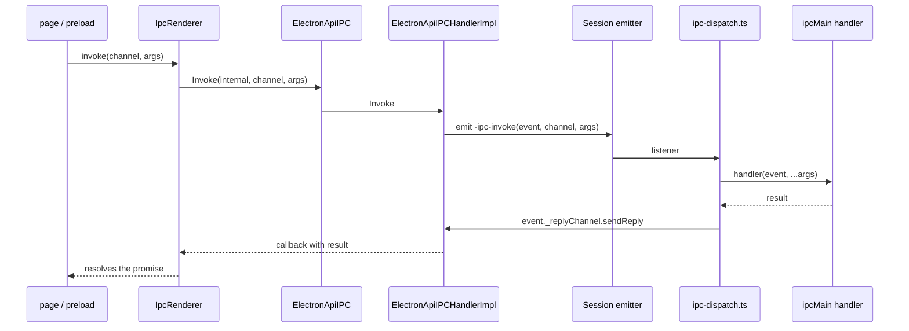

## Overview

Electron's IPC lets a page talk to the main process through `ipcRenderer` and `ipcMain`. It is built from three pieces: a small renderer-side object that serialises arguments and calls a Mojo interface; a browser-side Mojo handler that turns each call into a JavaScript event; and `ipc-dispatch.ts`, which routes that event to the right listeners. Replies travel back the same way, through a callback wrapped in a JavaScript object. This page follows `send`, `invoke` and `sendSync` through that path, plus main-to-renderer sends. The windows and frames that own these listeners are described in [[Windows, Views and WebContents]].

Sources: [lib/renderer/api/ipc-renderer.ts:1-34](repo://lib/renderer/api/ipc-renderer.ts#L1-L34), [shell/common/api/api.mojom:28-56](repo://shell/common/api/api.mojom#L28-L56), [lib/browser/ipc-dispatch.ts:55-110](repo://lib/browser/ipc-dispatch.ts#L55-L110)

Sources: [lib/renderer/api/ipc-renderer.ts:21-27](repo://lib/renderer/api/ipc-renderer.ts#L21-L27), [shell/browser/electron_api_ipc_handler_impl.cc:57-71](repo://shell/browser/electron_api_ipc_handler_impl.cc#L57-L71), [lib/browser/ipc-dispatch.ts:76-108](repo://lib/browser/ipc-dispatch.ts#L76-L108)

## The Mojo interface

`ElectronApiIPC` is declared in `api.mojom`. It has `Message` (fire and forget), `Invoke` (returns a message), `ReceivePostMessage`, a `[Sync]` `MessageSync` that blocks until it has a result, and `MessageHost`. Each carries an `internal` flag and a channel name; the payload is a `CloneableMessage`, so arguments follow the structured-clone rules. The reverse direction is `ElectronRenderer`, with `Message` and `ReceivePostMessage`.

Sources: [shell/common/api/api.mojom:8-17](repo://shell/common/api/api.mojom#L8-L17), [shell/common/api/api.mojom:28-56](repo://shell/common/api/api.mojom#L28-L56)

## The renderer side

`ipc-renderer.ts` builds `ipcRenderer` on `getIPCRenderer()`. That function asks the `electron_renderer_ipc` binding for an implementation by process type: `createForRenderFrame` for a renderer and `createForServiceWorker` for a service worker. Any other process throws.

Sources: [lib/renderer/ipc-renderer-bindings.ts:1-17](repo://lib/renderer/ipc-renderer-bindings.ts#L1-L17), [shell/renderer/api/electron_api_ipc_renderer.cc:127-139](repo://shell/renderer/api/electron_api_ipc_renderer.cc#L127-L139)

`IpcRenderer` is a thin class. `send` and `sendSync` pass `internal = false` and the channel and argument array. `invoke` awaits the binding and converts an `{ error }` reply into a thrown `Error("Error invoking remote method ...")`. `ipcRendererInternal` is the same class with `internal = true`, used for the framework's own channels.

Sources: [lib/renderer/api/ipc-renderer.ts:5-34](repo://lib/renderer/api/ipc-renderer.ts#L5-L34), [lib/renderer/ipc-renderer-internal.ts:1-26](repo://lib/renderer/ipc-renderer-internal.ts#L1-L26)

In C++, `IPCBase<T>` implements each method. It throws "IPC method called after context was released" if the Mojo remote is gone, serialises the arguments with `SerializeV8Value`, and calls the corresponding remote method. `Invoke` wraps the Mojo reply callback so it resolves a promise; `SendSync` calls `MessageSync` and deserialises the result. The remote is bound to the render frame's associated interfaces, or to the service worker proxy for workers.

Sources: [shell/renderer/api/electron_api_ipc_renderer.cc:57-106](repo://shell/renderer/api/electron_api_ipc_renderer.cc#L57-L106), [shell/renderer/api/electron_api_ipc_renderer.cc:143-163](repo://shell/renderer/api/electron_api_ipc_renderer.cc#L143-L163), [shell/renderer/api/electron_api_ipc_renderer.cc:199-222](repo://shell/renderer/api/electron_api_ipc_renderer.cc#L199-L222)

## The browser-side handler

`ElectronBrowserClient` registers the `ElectronApiIPC` binder for each render frame host. A frame gets it if it is the primary main frame or its preferences allow node integration in subframes, so other subframes cannot send IPC. Service workers get their own handler.

Sources: [shell/browser/electron_browser_client.cc:1425-1470](repo://shell/browser/electron_browser_client.cc#L1425-L1470)

`ElectronApiIPCHandlerImpl` is created per frame, binds the receiver and deletes itself on connection error. For each Mojo call it finds the frame's `Session` object, builds an event with `MakeIPCEvent`, and asks the session to emit.

Sources: [shell/browser/electron_api_ipc_handler_impl.cc:20-56](repo://shell/browser/electron_api_ipc_handler_impl.cc#L20-L56)

`MakeIPCEvent` creates a `gin_helper::internal::Event` and sets properties on it: `type` is `"frame"`, `sender` is the `WebContents`, and for internal calls a hidden `internal` value. If the call expects a reply it sets `_replyChannel`, and if the frame is still alive it sets `senderFrame`, `frameId`, `processId` and `frameTreeNodeId`. When the session, web contents or wrapper no longer exists, the code still has to answer a pending reply, so it creates a `ReplyChannel` and calls `SendError`.

Sources: [shell/browser/electron_api_ipc_handler_impl.cc:127-182](repo://shell/browser/electron_api_ipc_handler_impl.cc#L127-L182)

`ReplyChannel` owns the Mojo callback. The header comment gives the reason: Mojo requires callbacks to be called before they are destroyed, so if V8 garbage-collects the channel without a reply, the destructor sends the error "reply was never sent".

Sources: [shell/common/gin_helper/reply_channel.h:26-50](repo://shell/common/gin_helper/reply_channel.h#L26-L50), [shell/common/gin_helper/reply_channel.cc:28-64](repo://shell/common/gin_helper/reply_channel.cc#L28-L64)

The session emits through `IpcDispatcher<T>`: its `Message`, `Invoke`, `MessageSync`, `MessageHost` and `ReceivePostMessage` emit `-ipc-message`, `-ipc-invoke`, `-ipc-message-sync`, `-ipc-message-host` and `-ipc-ports` without a leading event object. A port message first deserialises the value and entangles the ports.

Sources: [shell/browser/api/ipc_dispatcher.h:25-76](repo://shell/browser/api/ipc_dispatcher.h#L25-L76), [lib/browser/api/session.ts:25-27](repo://lib/browser/api/session.ts#L25-L27)

## Dispatch in JavaScript

`Session.prototype._init` calls `addIpcDispatchListeners(this)`, which registers the five listeners. Their dispatch order, for ordinary frame messages, comes from `getIpcEmittersForFrameEvent`: the `WebFrameMain`'s `ipc`, then the `WebContents`' `ipc`, then the global `ipcMain`. The frame is looked up by `frameTreeNodeId` so that a message sent while a frame is being swapped is still delivered.

Sources: [lib/browser/ipc-dispatch.ts:33-53](repo://lib/browser/ipc-dispatch.ts#L33-L53), [lib/browser/ipc-dispatch.ts:55-58](repo://lib/browser/ipc-dispatch.ts#L55-L58)

For `-ipc-message`, internal events go to `ipcMainInternal` and frame events add a `reply` method, emit `ipc-message` on the sender web contents, then emit on each emitter in order. Service-worker events go to the worker's `ipc`.

Sources: [lib/browser/ipc-dispatch.ts:59-75](repo://lib/browser/ipc-dispatch.ts#L59-L75)

For `-ipc-invoke`, the first emitter that has an invoke handler for the channel wins. The handler's return value (or promise result) is sent with `sendReply({ result })`. A thrown error is logged and sent as `{ error }`, and a channel without a handler replies with "No handler registered".

Sources: [lib/browser/ipc-dispatch.ts:76-108](repo://lib/browser/ipc-dispatch.ts#L76-L108)

`IpcMainImpl` is where `ipcMain.handle` stores handlers. It refuses a second handler for the same channel, requires a function, and supports `handleOnce` and `removeHandler`. It also swallows an `error` channel so emitting on that name never throws.

Sources: [lib/browser/ipc-main-impl.ts:1-35](repo://lib/browser/ipc-main-impl.ts#L1-L35), [lib/browser/api/ipc-main.ts:1-5](repo://lib/browser/api/ipc-main.ts#L1-L5)

For `-ipc-message-sync`, `returnValue` is defined as a setter that sends the reply, so `event.returnValue = x` in a listener completes the blocked renderer call. The dispatcher warns if no listener is registered for the channel on the web contents or any emitter.

Sources: [lib/browser/ipc-dispatch.ts:17-22](repo://lib/browser/ipc-dispatch.ts#L17-L22), [lib/browser/ipc-dispatch.ts:110-133](repo://lib/browser/ipc-dispatch.ts#L110-L133)

## Main to renderer

`webContents.send` forwards to `mainFrame.send`. `WebFrameMain.prototype.send` validates the channel, calls native `_send` with `internal = false` and logs any exception instead of throwing. In C++, `WebFrameMain::Send` converts arguments to a `CloneableMessage` and calls `Message` on the frame's `ElectronRenderer` remote.

Sources: [lib/browser/api/web-contents.ts:121-131](repo://lib/browser/api/web-contents.ts#L121-L131), [lib/browser/api/web-frame-main.ts:14-24](repo://lib/browser/api/web-frame-main.ts#L14-L24), [shell/browser/api/electron_api_web_frame_main.cc:273-288](repo://shell/browser/api/electron_api_web_frame_main.cc#L273-L288)

In the renderer, `ElectronApiServiceImpl::Message` enters the frame's script context and calls `EmitIPCEvent`, which reaches the hidden `ipcNative` object set up in `ipc-native-setup.ts`. Its `onMessage` emits on `ipcRenderer` (or `ipcRendererInternal`) with `{ sender, ports }` as the event.

Sources: [shell/renderer/electron_api_service_impl.cc:86-102](repo://shell/renderer/electron_api_service_impl.cc#L86-L102), [lib/renderer/ipc-native-setup.ts:1-14](repo://lib/renderer/ipc-native-setup.ts#L1-L14)

## Internal channels

Channel names for the framework's own traffic are listed in the `IPC_MESSAGES` enum and are handled in `rpc-server.ts` with `ipcMainInternal`. Two helpers wrap the common patterns. `handleSync` replies to `sendSync` with `[null, result]` or `[error]`, and the renderer's `invokeSync` unwraps that. `invokeInWebContents` sends a request with a numeric id to a renderer and waits for a `<command>_RESPONSE_<id>` reply, rejecting replies from the wrong web contents; the renderer's `handle` helper answers it.

Sources: [lib/common/ipc-messages.ts:1-28](repo://lib/common/ipc-messages.ts#L1-L28), [lib/browser/ipc-main-internal-utils.ts:1-37](repo://lib/browser/ipc-main-internal-utils.ts#L1-L37), [lib/renderer/ipc-renderer-internal-utils.ts:1-24](repo://lib/renderer/ipc-renderer-internal-utils.ts#L1-L24)

The sandboxed renderer relies on this at start-up: `BROWSER_SANDBOX_LOAD` is a synchronous internal call that returns the preload scripts and process properties: see [[Renderer Initialization and Preload Scripts]].

Sources: [lib/browser/rpc-server.ts:89-102](repo://lib/browser/rpc-server.ts#L89-L102), [lib/sandboxed_renderer/init.ts:16-22](repo://lib/sandboxed_renderer/init.ts#L16-L22)
