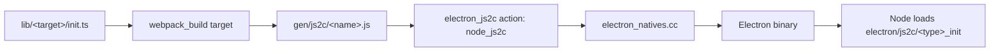

## Overview

Electron's TypeScript is never shipped as loose files. At build time, one webpack run per process kind turns an `init.ts` entry under `lib/` into a single JavaScript bundle, and a `js2c` step embeds all the bundles in C++ source that is compiled into the binary. At runtime, `NodeBindings` asks Node to start the process with the script named `electron/js2c/<type>_init`, and Node finds it in that embedded table. This page follows the build from webpack configuration to the generated `electron_natives.cc`. What the bundles do at runtime is covered in [[Process Startup and Main Process Boot]] and [[Renderer Initialization and Preload Scripts]].

Sources: [BUILD.gn:165-275](repo://BUILD.gn#L165-L275), [shell/common/node_bindings.cc:700-703](repo://shell/common/node_bindings.cc#L700-L703)

Sources: [BUILD.gn:165-275](repo://BUILD.gn#L165-L275), [build/js2c.py:1-17](repo://build/js2c.py#L1-L17)

## One webpack config per process kind

Each config in `build/webpack/` is a few lines calling the shared factory in `webpack.config.base.js` with a `target` and some flags. The entry is `lib/<target>/init.ts`, falling back to `init.js`.

Sources: [build/webpack/webpack.config.base.js:21-34](repo://build/webpack/webpack.config.base.js#L21-L34), [build/webpack/webpack.config.browser.js:1-4](repo://build/webpack/webpack.config.browser.js#L1-L4)

| Target | Has Node | Extra behaviour |
| --- | --- | --- |
| `browser` | yes | none |
| `renderer` | yes | deletes Node globals; profiling timeout wrapper and try/catch wrapper |
| `worker` | yes | loads `electron` from the renderer's API file; deletes Node globals; try/catch |
| `sandboxed_renderer` | no | profiling timeout and try/catch |
| `isolated_renderer` | no | try/catch |
| `preload_realm` | no | profiling timeout and try/catch |
| `node` | yes | none |
| `utility` | yes | none |

Sources: [build/webpack/webpack.config.renderer.js:1-7](repo://build/webpack/webpack.config.renderer.js#L1-L7), [build/webpack/webpack.config.worker.js:1-7](repo://build/webpack/webpack.config.worker.js#L1-L7), [build/webpack/webpack.config.sandboxed_renderer.js:1-6](repo://build/webpack/webpack.config.sandboxed_renderer.js#L1-L6), [build/webpack/webpack.config.isolated_renderer.js:1-5](repo://build/webpack/webpack.config.isolated_renderer.js#L1-L5), [build/webpack/webpack.config.preload_realm.js:1-6](repo://build/webpack/webpack.config.preload_realm.js#L1-L6), [build/webpack/webpack.config.node.js:1-4](repo://build/webpack/webpack.config.node.js#L1-L4), [build/webpack/webpack.config.utility.js:1-4](repo://build/webpack/webpack.config.utility.js#L1-L4)

`alwaysHasNode` chooses webpack's target: `node` when the process has Node, `web` otherwise. The sandboxed renderer has no Node, so the base config provides `Buffer` and `process` shims from the `buffer` and `process/browser` packages.

Sources: [build/webpack/webpack.config.base.js:72-77](repo://build/webpack/webpack.config.base.js#L72-L77), [build/webpack/webpack.config.base.js:113-113](repo://build/webpack/webpack.config.base.js#L113-L113)

## What the base config adds

The factory returns a configuration with these settings.

Sources: [build/webpack/webpack.config.base.js:21-34](repo://build/webpack/webpack.config.base.js#L21-L34)

- **Aliases.** `@electron/internal` points at `lib/`. `electron` and each of `electron/main`, `electron/renderer`, `electron/common` and `electron/utility` resolve to `lib/<target>/api/exports/electron.ts`, so the same `require('electron')` loads a different module list per bundle: see [[Exposing Native APIs to JavaScript]]. The `timers` import is redirected to a package that avoids `window.postMessage`.
- **Build flags.** If given a header via `--env buildflags=`, the config scans it for `#define BUILDFLAG_INTERNAL_X() (0|1)` lines and defines each as a boolean constant, so TypeScript can branch on compile-time flags such as `ENABLE_ELECTRON_EXTENSIONS`. The header is generated from `buildflags/BUILD.gn`.
- **Globals.** When `targetDeletesNodeGlobals` is set, `Buffer`, `global` and `process` are provided by `webpack-provider`, because the renderer deletes those globals from the page. `Promise` is always provided from `webpack-globals-provider`.
- **Wrappers.** `wrapInitWithProfilingTimeout` wraps the code in a function that runs immediately unless `--profile-electron-init` is in `argv`, in which case it is deferred with `setTimeout`. `wrapInitWithTryCatch` wraps the whole bundle in `try`/`catch` and logs "Electron <file> script failed to run".
- **Loader and output.** TypeScript is compiled by `ts-loader` using `tsconfig.electron.json`; `__dirname` and `__filename` are left alone; minification is on only for `--env mode=production`, with class and function names kept.

Sources: [build/webpack/webpack.config.base.js:36-110](repo://build/webpack/webpack.config.base.js#L36-L110), [build/webpack/webpack.config.base.js:112-166](repo://build/webpack/webpack.config.base.js#L112-L166), [buildflags/BUILD.gn:1-28](repo://buildflags/BUILD.gn#L1-L28)

The wrapper for failures matters because C++ runs these bundles with `CompileAndCall`, which only logs on failure: the comment there says that a caught exception at that level means "something has gone terrible wrong" since webpack already wraps the scripts in try/catch.

Sources: [shell/common/node_util.cc:23-59](repo://shell/common/node_util.cc#L23-L59)

## GN targets

`webpack_build` is a GN template. It wraps the `npm_action` helper, runs the `webpack` script with `--config`, `--output-filename`, `--output-path`, and `--env` arguments for the buildflags header and mode, and declares `config`, base config, `tsconfig.json`, `yarn.lock` and two typing files as inputs. Mode is `production` for official builds and `development` otherwise.

Sources: [build/webpack/webpack.gni:1-46](repo://build/webpack/webpack.gni#L1-L46)

`BUILD.gn` instantiates it once per bundle, each with its config, its dependency list from `auto_filenames`, and an `out_file` under `gen/js2c`. The TypeScript definitions generated from `docs/api` (`build_electron_definitions`) are a dependency of each bundle.

Sources: [BUILD.gn:150-235](repo://BUILD.gn#L150-L235)

The list of inputs per bundle is not written by hand. `filenames.auto.gni` is generated by `script/gen-filenames.ts`, which runs every webpack config with `PRINT_WEBPACK_GRAPH`. A plugin prints the module graph, and the script keeps files under the repository (not in `node_modules`), adds `tsconfig` and `package.json` files and the typings, sorts them and writes the `*_bundle_deps` lists. With the dependency list GN can rebuild a bundle only when one of its files changes.

Sources: [script/gen-filenames.ts:17-100](repo://script/gen-filenames.ts#L17-L100), [build/webpack/webpack.config.base.js:11-19](repo://build/webpack/webpack.config.base.js#L11-L19), [filenames.auto.gni:1-5](repo://filenames.auto.gni#L1-L5)

## js2c

The `electron_js2c` action depends on all eight bundle targets and Node's `node_js2c` tool. It runs `build/js2c.py` with the tool path, the generated directory, the output name `electron_natives.cc` and the bundle files. The script is only a wrapper that calls Node's `node_js2c` executable with `--only-js` and a root.

Sources: [BUILD.gn:237-275](repo://BUILD.gn#L237-L275), [build/js2c.py:1-17](repo://build/js2c.py#L1-L17)

The tool is built with the host toolchain when cross-compiling. `electron_js2c_toolchain` defaults to the current toolchain when the build is native, or to the host toolchain when targeting a different OS with the same CPU.

Sources: [build/js2c_toolchain.gni:5-30](repo://build/js2c_toolchain.gni#L5-L30)

The resulting `electron_natives.cc` is a dependency of the main Electron library, and Node loads each bundle from it by the id `electron/js2c/<file name without .js>`. `CreateEnvironment` builds the first one by name, `electron/js2c/browser_init` for the browser, and the others are compiled when needed: `electron/js2c/node_init` in `OnNodePreload`, `electron/js2c/sandbox_bundle` and `electron/js2c/isolated_bundle` from the renderer clients.

Sources: [BUILD.gn:434-438](repo://BUILD.gn#L434-L438), [shell/common/node_bindings.cc:700-703](repo://shell/common/node_bindings.cc#L700-L703), [shell/common/node_bindings.cc:1013-1021](repo://shell/common/node_bindings.cc#L1013-L1021), [shell/renderer/electron_sandboxed_renderer_client.cc:124-134](repo://shell/renderer/electron_sandboxed_renderer_client.cc#L124-L134), [shell/renderer/renderer_client_base.cc:603-609](repo://shell/renderer/renderer_client_base.cc#L603-L609)

## Default app and typings

The default app is built separately. `typescript_build("default_app_js")` compiles `default_app/` with `tsconfig.default_app.json`, and static files and icon dependencies are copied next to it.

Sources: [BUILD.gn:281-300](repo://BUILD.gn#L281-L300)
