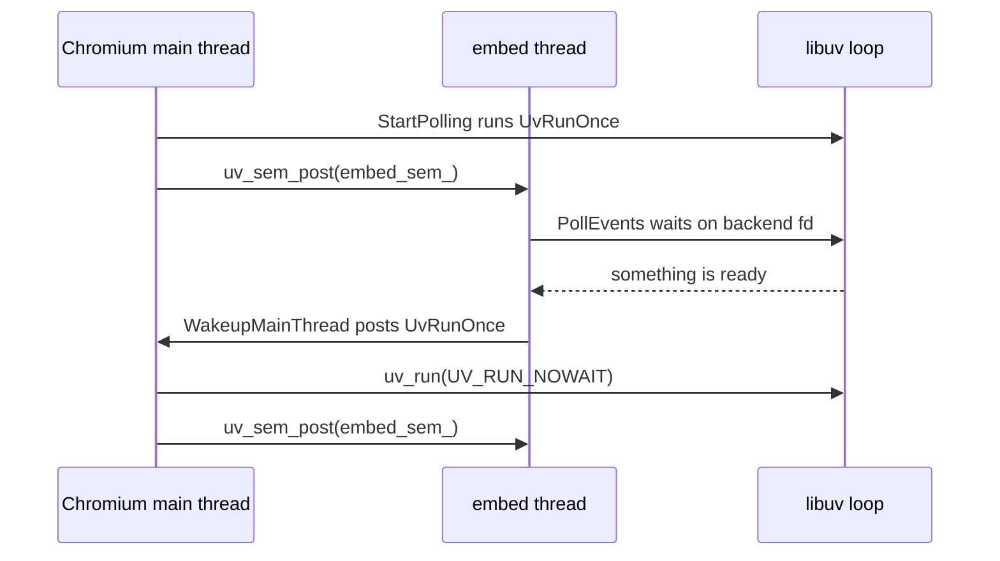

## Overview

Electron runs two event loops on one thread: Chromium's message loop, which owns the UI, and libuv's loop, which Node.js needs for timers, sockets and files. `NodeBindings` is the class that joins them. It creates a Node.js environment inside a V8 context Chromium already owns, and instead of running libuv in a blocking loop it polls libuv from a helper thread and asks Chromium's main thread to run libuv's ready callbacks. This page covers that machinery and the small JavaScript patches that go with it. The order in which the browser process builds the environment is in [[Process Startup and Main Process Boot]].

Sources: [shell/common/node_bindings.cc:476-497](repo://shell/common/node_bindings.cc#L476-L497), [shell/common/node_bindings.cc:860-877](repo://shell/common/node_bindings.cc#L860-L877), [shell/common/node_bindings.cc:961-989](repo://shell/common/node_bindings.cc#L961-L989)

## Process types and libuv loops

`NodeBindings::Create` takes a `BrowserEnvironment`: `kBrowser`, `kRenderer`, `kWorker` or `kUtility`. Its constructor calls `InitEventLoop`. Workers get their own freshly initialised `uv_loop_t`; every other kind uses `uv_default_loop()`. Both are configured with `UV_LOOP_INTERRUPT_ON_IO_CHANGE` so that starting a handle interrupts the polling thread.

Sources: [shell/common/node_bindings.cc:476-478](repo://shell/common/node_bindings.cc#L476-L478), [shell/common/node_bindings.cc:514-529](repo://shell/common/node_bindings.cc#L514-L529)

Which Electron bindings exist in a process also depends on the type. `RegisterBuiltinBindings` registers the browser list only in the browser process, the common list everywhere, the renderer list in renderers, and the utility list in utility processes. Each list is an X-macro of `electron_<process>_<name>` names, and each name expands to a call to a `_register_` function defined next to the binding: see [[Exposing Native APIs to JavaScript]].

Sources: [shell/common/node_bindings.cc:114-128](repo://shell/common/node_bindings.cc#L114-L128), [shell/common/node_bindings.cc:531-547](repo://shell/common/node_bindings.cc#L531-L547)

## Initialising Node.js

`Initialize` runs once per process. It registers the bindings, applies `NODE_OPTIONS` handling, and parses the command line, forwarding only options on an allow-list plus `--no-experimental-fetch` in renderer and worker processes, so Node's fetch cannot clash with Blink's. It then calls `node::InitializeOncePerProcess` with flags that stop Node from initialising V8, cppgc and its own platform, since Chromium already did. Stdio inheritance is enabled except in utility processes, default signal handling is disabled in renderers, and the `NODE_OPTIONS` environment variable is dropped when its fuse is off: see [[Fuses and Binary-Level Feature Switches]].

Sources: [shell/common/node_bindings.cc:555-585](repo://shell/common/node_bindings.cc#L555-L585), [shell/common/node_bindings.cc:587-649](repo://shell/common/node_bindings.cc#L587-L649)

## Creating an environment

`CreateEnvironment` maps the process type to a name and builds the init script path `electron/js2c/<type>_init`. That is the bundle that [[JavaScript Bundles and the GN Build Pipeline]] compiles into the binary. It then creates `IsolateData`, stores it in the context's embedder data, and selects environment flags: renderer and worker contexts get `kNoBrowserGlobals` and `kNoCreateInspector` because Blink supplies those, and the debug-signal handler is disabled when the inspect fuse is off.

Sources: [shell/common/node_bindings.cc:653-730](repo://shell/common/node_bindings.cc#L653-L730)

After the environment exists, `IsolateSettings` are tuned per process type. The key difference is the microtask policy.

Sources: [shell/common/node_bindings.cc:736-785](repo://shell/common/node_bindings.cc#L736-L785)

| Process | Microtask policy | Reason in the code |
| --- | --- | --- |
| Browser, utility | `kExplicit` | Node.js requires explicit checkpoints |
| Renderer, worker | the isolate's existing policy | Blink expects `kScoped`; the policy is toggled to explicit when entering Node.js through `UvRunOnce` |

Sources: [shell/common/node_bindings.cc:765-783](repo://shell/common/node_bindings.cc#L765-L783)

Renderers also keep Blink's promise rejection callback and prepare-stack-trace callback, and add their own error message listener. Neither the browser nor the renderer aborts on an uncaught exception, but utility processes do not install that override, so they behave like standard Node.js.

Sources: [shell/common/node_bindings.cc:744-800](repo://shell/common/node_bindings.cc#L744-L800)

`appCodeLoaded` is attached to `process` in browser and renderer environments. In the browser it sets a flag that ends `JoinAppCode`; in a renderer the caller passes a callback instead, which resumes the document load held back for preload scripts: see [[Renderer Initialization and Preload Scripts]].

Sources: [shell/common/node_bindings.cc:811-824](repo://shell/common/node_bindings.cc#L811-L824), [shell/common/node_bindings.cc:895-923](repo://shell/common/node_bindings.cc#L895-L923)

`LoadEnvironment` calls `node::LoadEnvironment` with an `OnNodePreload` hook that sets `process.resourcesPath` and `helperExecPath`, adds Electron and Chrome versions, and runs `electron/js2c/node_init` (`lib/node/init.ts`). That script wraps `fs` with ASAR support, restores Blink's fetch globals, hooks `child_process.fork` to run the child as Node, and filters module search paths. Finally the environment emits `loaded` on `process`.

Sources: [shell/common/node_bindings.cc:855-858](repo://shell/common/node_bindings.cc#L855-L858), [shell/common/node_bindings.cc:994-1024](repo://shell/common/node_bindings.cc#L994-L1024), [lib/node/init.ts:1-41](repo://lib/node/init.ts#L1-L41)

## Polling libuv from Chromium's loop

Polling is split across two threads. The sequence below is what `PrepareEmbedThread`, `StartPolling`, `EmbedThreadRunner` and `UvRunOnce` implement.

Sources: [shell/common/node_bindings.cc:860-893](repo://shell/common/node_bindings.cc#L860-L893), [shell/common/node_bindings.cc:926-989](repo://shell/common/node_bindings.cc#L926-L989)

Sources: [shell/common/node_bindings.cc:860-893](repo://shell/common/node_bindings.cc#L860-L893), [shell/common/node_bindings.cc:926-989](repo://shell/common/node_bindings.cc#L926-L989)

`PrepareEmbedThread` adds a dummy `uv_async` handle so libuv never decides it has nothing to do, creates a semaphore and starts the thread. `StartPolling` remembers the current task runner and runs `UvRunOnce` once so that libuv adds all its events to the poller. Both return early if already initialised, a guard whose comment is about not exceeding the IOCP concurrency limit on Windows.

Sources: [shell/common/node_bindings.cc:860-893](repo://shell/common/node_bindings.cc#L860-L893)

The thread body waits on the semaphore, calls the platform's `PollEvents`, and then calls `WakeupMainThread`, which posts `UvRunOnce` to the main task runner. On Linux `PollEvents` is an `epoll_wait` on libuv's backend file descriptor with `uv_backend_timeout` as the timeout.

Sources: [shell/common/node_bindings.cc:961-989](repo://shell/common/node_bindings.cc#L961-L989), [shell/common/node_bindings_linux.cc:11-32](repo://shell/common/node_bindings_linux.cc#L11-L32)

`UvRunOnce` does nothing if the environment is gone, which can happen after a navigation in a renderer. Otherwise it enters the Node context under an explicit microtask scope, runs `uv_run(UV_RUN_NOWAIT)`, and posts the semaphore so the thread resumes polling. If libuv reports no active handles, it asks the Chromium loop to quit when idle.

Sources: [shell/common/node_bindings.cc:926-959](repo://shell/common/node_bindings.cc#L926-L959)

The destructor reverses this: it marks the embed side closed, posts the semaphore, wakes the thread through the dummy handle and joins it.

Sources: [shell/common/node_bindings.cc:480-497](repo://shell/common/node_bindings.cc#L480-L497)

## Microtasks and activating the loop

In the browser process `MicrotasksRunner` is a task observer on the UI thread. After each task it opens a `node::CallbackScope`, which lets Node run its own microtask checkpoint. The comment records why: Node performs its own checkpoint now, and letting Chromium do it caused contention and delayed Node callbacks.

Sources: [shell/browser/microtasks_runner.cc:16-34](repo://shell/browser/microtasks_runner.cc#L16-L34), [shell/browser/javascript_environment.cc:144-150](repo://shell/browser/javascript_environment.cc#L144-L150)

Because libuv only runs when the embed thread wakes it, anything that schedules work without touching a file descriptor would wait indefinitely. `lib/common/init.ts` wraps `process.nextTick`, `setImmediate`, `setTimeout` and `setInterval` so each call first invokes `process.activateUvLoop`. In C++, `ElectronBindings::ActivateUVLoop` queues the current environment and sends a `uv_async`; its handler opens a `CallbackScope` for each queued environment so ticks are processed.

Sources: [lib/common/init.ts:8-62](repo://lib/common/init.ts#L8-L62), [shell/common/api/electron_bindings.cc:81-112](repo://shell/common/api/electron_bindings.cc#L81-L112)

The wrapped timer functions replace the globals only in browser and utility processes. Renderers that enable Node integration have those globals deleted, so they are not replaced.

Sources: [lib/common/init.ts:54-62](repo://lib/common/init.ts#L54-L62)

## The `electron` module in a Node environment

`lib/common/init.ts` also inserts fake `Module` entries into Node's cache for `electron` and its `common`, `main`, `renderer` and `utility` aliases, and overrides `_resolveFilename` so all of those requests resolve to the same module. The comment notes that the aliases only differ for TypeScript.

Sources: [lib/common/init.ts:78-119](repo://lib/common/init.ts#L78-L119)
