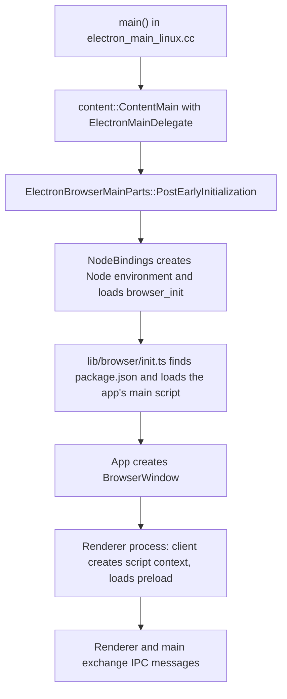

## Overview

Electron lets you write desktop applications in JavaScript, HTML and CSS by embedding Node.js into Chromium. This repository holds the layer that joins the two: a C++ "shell" under `shell/` that plugs into Chromium's content API, and a TypeScript runtime under `lib/` that runs inside every process and exposes the `electron` module.

Sources: [README.md:9-12](repo://README.md#L9-L12)

An Electron application has one browser (main) process that runs the app's main script, plus renderer, utility, GPU and helper processes that Chromium spawns. Each process that runs JavaScript gets its own Node.js environment, created by `NodeBindings` and initialised from a bundle named after the process type.

Sources: [shell/common/node_bindings.cc:653-702](repo://shell/common/node_bindings.cc#L653-L702)

## Parts of the repository

| Area | What it does | Page |
| --- | --- | --- |
| `shell/app`, `shell/browser/electron_browser_main_parts.cc` | Process entry, Chromium delegate hooks, main-process boot | [[Process Startup and Main Process Boot]] |
| `shell/common/node_bindings.cc`, `lib/common/init.ts` | Embeds Node.js and its libuv loop into Chromium | [[Node.js and Chromium Event Loop Integration]] |
| `shell/common/gin_helper`, `shell/browser/api`, `lib/browser/api` | Native classes bound to JS and the `electron` module | [[Exposing Native APIs to JavaScript]] |
| `BrowserWindow`, `WebContents`, `NativeWindow` | Windows and the pages inside them | [[Windows, Views and WebContents]] |
| `lib/browser/ipc-dispatch.ts`, `shell/common/api/api.mojom` | Renderer-to-main messaging | [[IPC Between Renderer and Main]] |
| `shell/renderer`, `lib/renderer`, `lib/sandboxed_renderer` | Renderer-side boot and preload scripts | [[Renderer Initialization and Preload Scripts]] |
| `lib/renderer/api/context-bridge.ts` | Isolated world and `contextBridge` | [[Context Isolation and the Context Bridge]] |
| `shell/browser/api/electron_api_session.cc`, `protocol_registry.cc` | Sessions, custom schemes, request interception | [[Sessions, Custom Protocols and Network Interception]] |
| `lib/utility`, `shell/app/node_main.cc` | Node.js without a window | [[Utility Processes and Run-as-Node]] |
| `build/fuses` | Switches flipped in the packaged binary | [[Fuses and Binary-Level Feature Switches]] |
| `build/webpack`, `BUILD.gn` | Bundles for each process, compiled into the binary | [[JavaScript Bundles and the GN Build Pipeline]] |
| `patches/` | Changes applied to Chromium, Node.js and others | [[Upstream Patches and Dependencies]] |
| `spec/` | The test application | [[Test Suite and Spec Runner]] |

Sources: [BUILD.gn:165-275](repo://BUILD.gn#L165-L275), [patches/config.json:1-16](repo://patches/config.json#L1-L16), [shell/browser/electron_browser_main_parts.cc:225-262](repo://shell/browser/electron_browser_main_parts.cc#L225-L262)

To build and run the repository itself, see [[Building and Running Electron from Source]]. The `package.json` at the root marks the repository private: it is a build and test workspace rather than a published package.

Sources: [package.json:1-4](repo://package.json#L1-L4), [package.json:60-60](repo://package.json#L60-L60)

## Main flow

Sources: [shell/app/electron_main_linux.cc:25-42](repo://shell/app/electron_main_linux.cc#L25-L42), [shell/browser/electron_browser_main_parts.cc:225-262](repo://shell/browser/electron_browser_main_parts.cc#L225-L262), [lib/browser/init.ts:86-110](repo://lib/browser/init.ts#L86-L110)

1. `main()` initialises the command line and hands control to `content::ContentMain` with an `ElectronMainDelegate`, unless the run-as-node fuse and environment variable select plain Node.js: see [[Utility Processes and Run-as-Node]].
2. In `PostEarlyInitialization` the main parts create the V8 environment and the Node environment, bind Electron's extras onto `process` and run the browser bundle: see [[Process Startup and Main Process Boot]].
3. `lib/browser/init.ts` searches `app.asar`, `app` and `default_app.asar`, reads `package.json` and loads the app's entry script.
4. The app constructs a window; `BrowserWindow` creates a `WebContents`: see [[Windows, Views and WebContents]].
5. Chromium starts a renderer; the renderer client builds a script context and runs preload scripts: see [[Renderer Initialization and Preload Scripts]] and [[Context Isolation and the Context Bridge]].
6. The page talks to the main process over a Mojo interface: see [[IPC Between Renderer and Main]].

Sources: [shell/app/electron_main_linux.cc:25-42](repo://shell/app/electron_main_linux.cc#L25-L42), [shell/browser/electron_browser_main_parts.cc:225-262](repo://shell/browser/electron_browser_main_parts.cc#L225-L262), [lib/browser/init.ts:86-110](repo://lib/browser/init.ts#L86-L110)

## Cross-cutting design decisions

**Delegate-based integration with Chromium.** Electron does not fork Chromium's browser; it supplies `ContentMainDelegate` and client objects. The delegate creates an `ElectronBrowserClient`, an `ElectronContentClient`, a GPU client, a utility client and, by sandbox state, one of two renderer clients.

Sources: [shell/app/electron_main_delegate.cc:446-488](repo://shell/app/electron_main_delegate.cc#L446-L488)

**One Node.js environment per JavaScript context, driven by Chromium's loop.** Node's libuv loop is not run by Node itself. A dedicated thread polls libuv and posts `UvRunOnce` to the Chromium main thread, so Node callbacks and Chromium tasks interleave on one thread: see [[Node.js and Chromium Event Loop Integration]].

Sources: [shell/common/node_bindings.cc:860-877](repo://shell/common/node_bindings.cc#L860-L877), [shell/common/node_bindings.cc:926-989](repo://shell/common/node_bindings.cc#L926-L989)

**Native modules are linked bindings, wrapped in TypeScript.** C++ registers `electron_<process>_<name>` bindings; the TypeScript in `lib/` fetches them with `process._linkedBinding` and shapes them into the public API. Which bindings exist depends on the process type.

Sources: [shell/common/node_bindings.cc:531-547](repo://shell/common/node_bindings.cc#L531-L547), [lib/browser/api/screen.ts:1-11](repo://lib/browser/api/screen.ts#L1-L11)

**The JavaScript runtime is compiled into the binary.** Webpack builds one bundle per process kind, and the `js2c` action turns the bundles into C++ so Node can load them as `electron/js2c/<type>_init`: see [[JavaScript Bundles and the GN Build Pipeline]].

Sources: [BUILD.gn:237-272](repo://BUILD.gn#L237-L272), [shell/common/node_bindings.cc:700-703](repo://shell/common/node_bindings.cc#L700-L703)

**Patches instead of forks.** Upstream projects are modified through ordered patch sets, each mapped to a repository by `patches/config.json`: see [[Upstream Patches and Dependencies]].

Sources: [patches/config.json:1-16](repo://patches/config.json#L1-L16)

**Behavior that apps can lock down at packaging time.** Fuses in `build/fuses/fuses.json5` gate run-as-node, `NODE_OPTIONS`, ASAR-only loading and more: see [[Fuses and Binary-Level Feature Switches]].

Sources: [build/fuses/fuses.json5:1-13](repo://build/fuses/fuses.json5#L1-L13)

**Safe-by-default renderers.** `WebContentsPreferences` resets `nodeIntegration` to off and `contextIsolation` to on, and `IsSandboxed` decides whether a renderer gets the sandboxed client.

Sources: [shell/browser/web_contents_preferences.cc:110-125](repo://shell/browser/web_contents_preferences.cc#L110-L125), [shell/browser/web_contents_preferences.cc:278-287](repo://shell/browser/web_contents_preferences.cc#L278-L287)
