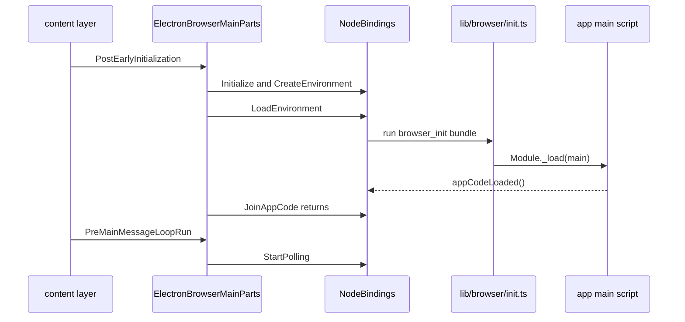

## Overview

Every Electron process, whether browser, renderer, GPU or utility, starts at the same `main()` and enters Chromium's `ContentMain` with Electron's delegate. In the browser process the delegate's hooks run first, then `ElectronBrowserMainParts` builds a V8 and Node.js environment and runs `lib/browser/init.ts`, which finds the application's `package.json` and loads its main script. This page follows that sequence; the mechanics of keeping libuv alive next to Chromium's loop are in [[Node.js and Chromium Event Loop Integration]].

Sources: [shell/app/electron_main_linux.cc:25-42](repo://shell/app/electron_main_linux.cc#L25-L42), [shell/browser/electron_browser_main_parts.cc:225-262](repo://shell/browser/electron_browser_main_parts.cc#L225-L262)

## Entry point

On Linux, `main()` fixes stdio, sets up libuv's argument handling, initialises `base::CommandLine` and `ElectronCommandLine`, and then makes one decision: if the run-as-node fuse is enabled and the `kRunAsNode` environment variable is set, it runs plain Node.js through `NodeMain`. Otherwise it constructs an `ElectronMainDelegate` and calls `content::ContentMain`. The run-as-node path is covered in [[Utility Processes and Run-as-Node]].

Sources: [shell/app/electron_main_linux.cc:25-42](repo://shell/app/electron_main_linux.cc#L25-L42)

## Delegate hooks

`ElectronMainDelegate` is Chromium's `ContentMainDelegate`. The content layer calls its hooks in a fixed order, in every process.

Sources: [shell/app/electron_main_delegate.cc:264-266](repo://shell/app/electron_main_delegate.cc#L264-L266), [shell/app/electron_main_delegate.cc:334-336](repo://shell/app/electron_main_delegate.cc#L334-L336)

| Hook | What Electron does |
| --- | --- |
| `BasicStartupComplete` | Enables stack dumping on an env var, maps an env var to `--no-sandbox`, registers path providers, refuses to run as root on Linux without `--no-sandbox` |
| `PreSandboxStartup` | Honours `--user-data-dir`, initialises logging and crash keys, loads the resource bundle, starts Crashpad in non-browser processes, and in the browser process appends `--allow-file-access-from-files` |
| `PreBrowserMain` | Initialises the feature list and Mojo core early, because the service manager reads feature flags |
| `CreateContentBrowserClient` and siblings | Creates `ElectronBrowserClient`, `ElectronContentClient`, the GPU and utility clients |
| `CreateContentRendererClient` | Chooses the sandboxed or the Node-enabled renderer client |

Sources: [shell/app/electron_main_delegate.cc:264-332](repo://shell/app/electron_main_delegate.cc#L264-L332), [shell/app/electron_main_delegate.cc:334-416](repo://shell/app/electron_main_delegate.cc#L334-L416), [shell/app/electron_main_delegate.cc:418-433](repo://shell/app/electron_main_delegate.cc#L418-L433), [shell/app/electron_main_delegate.cc:446-478](repo://shell/app/electron_main_delegate.cc#L446-L478)

Crash reporting is initialised differently by process. In the browser process the delegate waits for JavaScript to call `crashReporter.start()`, while renderers start Crashpad immediately at boot.

Sources: [shell/app/electron_main_delegate.cc:370-379](repo://shell/app/electron_main_delegate.cc#L370-L379)

`ShouldCreateFeatureList` and `ShouldInitializeMojo` return true only for child processes, since the browser process initialises both itself in `PreBrowserMain`. `RunProcess` diverts a relauncher process into `RelauncherMain` and passes every other type back to the content layer.

Sources: [shell/app/electron_main_delegate.cc:481-496](repo://shell/app/electron_main_delegate.cc#L481-L496)

## Building the main-process JavaScript environment

`ElectronBrowserMainParts` is created with its collaborators: a `BrowserProcessImpl` standing in for Chrome's browser process, a `NodeBindings` for the browser environment, `ElectronBindings` and a `Browser` object.

Sources: [shell/browser/electron_browser_main_parts.cc:175-184](repo://shell/browser/electron_browser_main_parts.cc#L175-L184)

The environment is built in `PostEarlyInitialization`, in this order:

Sources: [shell/browser/electron_browser_main_parts.cc:225-232](repo://shell/browser/electron_browser_main_parts.cc#L225-L232)

1. `JavascriptEnvironment` creates the V8 isolate on top of Node's platform. The comment in the code explains why: gin's V8 platform relies on Chromium's task scheduler, which has not started yet.
2. `NodeBindings::Initialize` and `CreateEnvironment` build the Node environment. Unhandled rejections are set to `warn-with-error-code` so they never crash the main process.
3. `ElectronBindings::BindTo` adds Electron's extra `process` properties.
4. A microtasks runner is created and the libuv environment is attached.
5. `LoadEnvironment` runs the browser init bundle, and `JoinAppCode` pumps the libuv loop until the app's main script has finished loading.
6. Because the app's script may have changed command-line switches, the feature list is cleared and initialised again, and logging is reinitialised so the app's name and user-data directory are honoured.

Sources: [shell/browser/electron_browser_main_parts.cc:225-280](repo://shell/browser/electron_browser_main_parts.cc#L225-L280), [shell/browser/javascript_environment.cc:100-138](repo://shell/browser/javascript_environment.cc#L100-L138)



Sources: [shell/browser/electron_browser_main_parts.cc:225-262](repo://shell/browser/electron_browser_main_parts.cc#L225-L262), [shell/browser/electron_browser_main_parts.cc:425-430](repo://shell/browser/electron_browser_main_parts.cc#L425-L430), [shell/common/node_bindings.cc:899-923](repo://shell/common/node_bindings.cc#L899-L923)

## Locating and loading the app

Before running JavaScript, `CreateEnvironment` stores the search paths as private values on the global object. The order is `app.asar`, `app`, then `default_app.asar`. If the only-load-from-asar fuse is on, only `app.asar` is searched: see [[Fuses and Binary-Level Feature Switches]].

Sources: [shell/common/node_bindings.cc:679-700](repo://shell/common/node_bindings.cc#L679-L700)

`lib/browser/init.ts` then runs, in this order:

Sources: [lib/browser/init.ts:8-12](repo://lib/browser/init.ts#L8-L12)

1. Restore `process.argv`, load common init, map `process.exit` to `app.exit`, and install an `uncaughtException` handler that shows an error box.
2. Load the RPC server and the guest view manager.
3. Walk the search paths under `process.resourcesPath` and `Module._load` the first `package.json` it finds. If none exists it schedules `process.exit(1)` and throws "Unable to find a valid app".
4. Apply `version`, `productName`/`name`, `desktopName` and optional `v8Flags` from `package.json`, then `app.setAppPath`.
5. Require the modules that must be populated by app ready: devtools, protocol, service-worker-main, web-contents, web-frame-main and web-contents-view.
6. Quit on `window-all-closed` when no one else listens, and install the default menu on `will-finish-launching`.

Sources: [lib/browser/init.ts:8-77](repo://lib/browser/init.ts#L8-L77), [lib/browser/init.ts:79-141](repo://lib/browser/init.ts#L79-L141), [lib/browser/init.ts:143-199](repo://lib/browser/init.ts#L143-L199)

The main script is `package.json`'s `main`, defaulting to `index.js`. If `type` is `module` and the file is not `.cjs`, or the file ends in `.mjs`, it is imported through Node's ESM loader and `appCodeLoaded()` is called after the import settles; otherwise `appCodeLoaded()` is called first and `Module._load` runs the script synchronously. Calling `appCodeLoaded` is what lets `JoinAppCode` return to C++.

Sources: [lib/browser/init.ts:201-227](repo://lib/browser/init.ts#L201-L227), [shell/common/node_bindings.cc:899-923](repo://shell/common/node_bindings.cc#L899-L923)

```ts
if ((packageJson.type === 'module' && !mainStartupScript.endsWith('.cjs')) || mainStartupScript.endsWith('.mjs')) {
  // ... import through the ESM loader, then appCodeLoaded!()
} else {
  appCodeLoaded!();
  Module._load(path.join(packagePath, mainStartupScript), Module, true);
}
```

Sources: [lib/browser/init.ts:163-163](repo://lib/browser/init.ts#L163-L163), [lib/browser/init.ts:201-227](repo://lib/browser/init.ts#L201-L227)

## From boot to ready

`PreMainMessageLoopRun` finishes startup: it prepares the embed thread and starts polling libuv, locks the URL scheme registries (so `registerSchemesAsPrivileged` must be called before this), creates the extensions clients, registers the WebUI factory and starts any remote debugging handler. On platforms other than macOS it then calls `Browser::WillFinishLaunching` and `DidFinishLaunching`; on macOS the application delegate does it.

Sources: [shell/browser/electron_browser_main_parts.cc:425-486](repo://shell/browser/electron_browser_main_parts.cc#L425-L486)

`DidFinishLaunching` creates the user-data directory, sets `is_ready_`, resolves the promise behind `app.whenReady()` and notifies observers: that is the `ready` event apps wait for.

Sources: [shell/browser/browser.cc:183-201](repo://shell/browser/browser.cc#L183-L201)

## Quit and shutdown

`Browser::Quit` first asks `HandleBeforeQuit`; if windows exist it closes them all, and shutdown completes in `OnWindowAllClosed`. `Browser::Exit` skips the asking: it sets the exit code and destroys all windows directly. If the message loop is not yet ready, `Exit` calls `exit(code)` immediately.

Sources: [shell/browser/browser.cc:86-123](repo://shell/browser/browser.cc#L86-L123), [shell/browser/browser.cc:259-267](repo://shell/browser/browser.cc#L259-L267)

`WillRunMainMessageLoop` hands the run loop's quit closure to `Browser`. After the loop ends, `PostMainMessageLoopRun` shuts the download managers down, stops utility processes created through the Electron API so their exit events can still be emitted, stops Node, and destroys every browser context. The order matters because the code comments say Node and V8 APIs may be invoked by destructors.

Sources: [shell/browser/electron_browser_main_parts.cc:488-494](repo://shell/browser/electron_browser_main_parts.cc#L488-L494), [shell/browser/electron_browser_main_parts.cc:549-607](repo://shell/browser/electron_browser_main_parts.cc#L549-L607)
