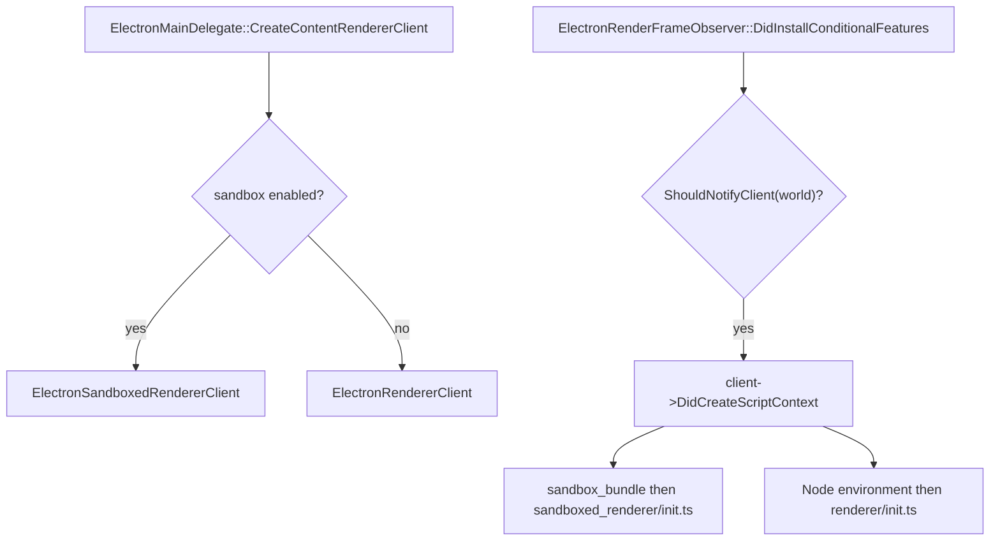

## Overview

A renderer process has no Node.js until Electron puts it there. When Chromium creates a script context in a frame, an `ElectronRenderFrameObserver` tells the process's renderer client, and the client runs Electron's JavaScript bundle in that context and then the page's preload scripts. Which client runs depends on the sandbox: `ElectronSandboxedRendererClient` runs a self-contained bundle with a tiny `require`, while `ElectronRendererClient` builds a full Node.js environment per frame. This page follows both. Isolation between preload and page is in [[Context Isolation and the Context Bridge]], and the preferences that choose the path are in [[Windows, Views and WebContents]].

Sources: [shell/app/electron_main_delegate.cc:462-476](repo://shell/app/electron_main_delegate.cc#L462-L476), [shell/renderer/electron_render_frame_observer.cc:90-130](repo://shell/renderer/electron_render_frame_observer.cc#L90-L130)



Sources: [shell/app/electron_main_delegate.cc:462-476](repo://shell/app/electron_main_delegate.cc#L462-L476), [shell/renderer/electron_render_frame_observer.cc:90-131](repo://shell/renderer/electron_render_frame_observer.cc#L90-L131), [shell/renderer/electron_render_frame_observer.cc:195-211](repo://shell/renderer/electron_render_frame_observer.cc#L195-L211)

## Choosing the client and the frames

The delegate picks the client from the command line: `IsSandboxEnabled` selects `ElectronSandboxedRendererClient`, otherwise `ElectronRendererClient`. The browser added `--enable-sandbox` or `--no-sandbox` for each renderer from `WebContentsPreferences`: see [[Windows, Views and WebContents]].

Sources: [shell/app/electron_main_delegate.cc:462-476](repo://shell/app/electron_main_delegate.cc#L462-L476), [shell/browser/web_contents_preferences.cc:308-326](repo://shell/browser/web_contents_preferences.cc#L308-L326)

`RendererClientBase` is the common parent. `RenderFrameCreated` attaches a content-settings observer, print helper, the `ElectronApiServiceImpl` that receives IPC, extension helpers and a spellcheck provider. `ShouldLoadPreload` decides whether a frame gets Electron's JavaScript: it must be the main frame, a devtools frame, or a frame in a window with `nodeIntegrationInSubFrames`, and it must not be a `<webview>` frame.

Sources: [shell/renderer/renderer_client_base.cc:306-343](repo://shell/renderer/renderer_client_base.cc#L306-L343), [shell/renderer/renderer_client_base.cc:198-210](repo://shell/renderer/renderer_client_base.cc#L198-L210)

`BindProcess` sets three read-only properties on `process`: `isMainFrame`, `contextIsolated` and a unique `contextId`.

Sources: [shell/renderer/renderer_client_base.cc:186-196](repo://shell/renderer/renderer_client_base.cc#L186-L196)

The observer decides when to call the client. `DidInstallConditionalFeatures` skips a child window's initial empty document because its `WebPreferences` are copied from the opener before the browser has overridden them; it records `has_delayed_node_initialization_` and repeats the work later from `DidClearWindowObject`, once the real document has started loading. Once past that, `ShouldNotifyClient(world_id)` picks which V8 world triggers the client: the isolated world if context isolation is on for a main frame or a frame with node integration in subframes, and the main world otherwise. It also refuses `about:blank` subframes when subframe node integration is on, because tearing down a Node.js environment made for an `about:blank` iframe whose `src` is set later triggers illegal access errors.

Sources: [shell/renderer/electron_render_frame_observer.cc:70-131](repo://shell/renderer/electron_render_frame_observer.cc#L70-L131), [shell/renderer/electron_render_frame_observer.cc:195-211](repo://shell/renderer/electron_render_frame_observer.cc#L195-L211)

## The sandboxed client

`ElectronSandboxedRendererClient` registers the built-in bindings in its constructor. In `DidCreateScriptContext` it builds a `binding` object whose `get` calls `preload_utils::GetBinding`, with a `createPreloadScript` method and a `process` dictionary (`argv`, `pid`, `uptime`, `sandboxed`, `type`, plus the `BindProcess` values). It then compiles and calls the `electron/js2c/sandbox_bundle` with `binding` as its argument, and emits `loaded` on `process`. Later hooks emit `document-start`, `document-end` and `exit` the same way.

Sources: [shell/renderer/electron_sandboxed_renderer_client.cc:62-90](repo://shell/renderer/electron_sandboxed_renderer_client.cc#L62-L90), [shell/renderer/electron_sandboxed_renderer_client.cc:110-172](repo://shell/renderer/electron_sandboxed_renderer_client.cc#L110-L172)

`GetBinding` is adapted from Node: it keeps a per-context cache, looks the name up with `get_linked_module`, and runs the module's context-aware register function. `CreatePreloadScript` compiles and runs a source string in the current context, which is how preload text becomes a function.

Sources: [shell/renderer/preload_utils.cc:20-71](repo://shell/renderer/preload_utils.cc#L20-L71)

The bundle's entry is `lib/sandboxed_renderer/init.ts`. `pre-init.ts` first exposes `process._linkedBinding = binding.get`, stores a `Buffer` shim as a hidden value for deserialisation, and turns the webpack-supplied `process` into an event emitter. Then `init.ts` makes one synchronous internal call, `BROWSER_SANDBOX_LOAD`, and receives the preload scripts and a handful of process properties (`arch`, `platform`, `env`, `version`, `versions`, `execPath`).

Sources: [lib/sandboxed_renderer/pre-init.ts:1-30](repo://lib/sandboxed_renderer/pre-init.ts#L1-L30), [lib/sandboxed_renderer/init.ts:14-22](repo://lib/sandboxed_renderer/init.ts#L14-L22), [lib/browser/rpc-server.ts:89-102](repo://lib/browser/rpc-server.ts#L89-L102)

On the main-process side, `getPreloadScriptsFromEvent` gathers the session's registered preload scripts of type `frame`, adds the one from `webPreferences.preload`, and keeps only absolute paths. `readPreloadScript` reads each file, returning its contents or its error.

Sources: [lib/browser/rpc-server.ts:50-88](repo://lib/browser/rpc-server.ts#L50-L88)

Preloads in the sandbox cannot use arbitrary `require`. `init.ts` builds two maps: `loadedModules` with `electron`, its `common` and `renderer` aliases, and `events`; and `loadableModules` with lazily-loaded `timers` and `url` (each with and without the `node:` prefix). `preloadRequire` returns from the first map, loads from the second and caches, and otherwise throws `module not found`.

Sources: [lib/sandboxed_renderer/init.ts:24-39](repo://lib/sandboxed_renderer/init.ts#L24-L39), [lib/sandboxed_renderer/preload.ts:46-57](repo://lib/sandboxed_renderer/preload.ts#L46-L57)

`runPreloadScript` wraps the source in a function taking `require`, `process`, `exports`, `module` plus the exposed globals (`Buffer`, `global`, `setImmediate`, `clearImmediate`), compiles it with `createPreloadScript` and calls it. A failure is logged and reported to the main process as `BROWSER_PRELOAD_ERROR`, which `rpc-server.ts` re-emits as `preload-error` on the web contents.

Sources: [lib/sandboxed_renderer/preload.ts:66-101](repo://lib/sandboxed_renderer/preload.ts#L66-L101), [lib/browser/rpc-server.ts:109-112](repo://lib/browser/rpc-server.ts#L109-L112)

```ts
const preloadWrapperSrc = `(function(require, process, exports, module, ${globalVariables.join(', ')}) {
  ${preloadSrc}
  })`;
```

Sources: [lib/sandboxed_renderer/preload.ts:73-75](repo://lib/sandboxed_renderer/preload.ts#L73-L75)

`createPreloadProcessObject` makes the `process` the preload sees: an `EventEmitter` with `getProcessMemoryInfo`, a pass-through `noDeprecation`, and `_linkedBinding` only when a testing switch is present. `init.ts` also registers an `emit-process-event` hidden function that C++'s `InvokeEmitProcessEvent` calls, so `loaded` and the document events reach both the real and the preload `process`.

Sources: [lib/sandboxed_renderer/preload.ts:19-44](repo://lib/sandboxed_renderer/preload.ts#L19-L44), [lib/sandboxed_renderer/init.ts:41-56](repo://lib/sandboxed_renderer/init.ts#L41-L56)

## The Node-enabled client

`ElectronRendererClient::DidCreateScriptContext` does considerably more, because it creates a real Node.js environment for each injected frame. After `ShouldLoadPreload` it initialises `NodeBindings` once per process (`Initialize` and `PrepareEmbedThread`), sets up a Node tracing agent if there is none, and runs `node::InitializeContext`.

Sources: [shell/renderer/electron_renderer_client.cc:92-117](repo://shell/renderer/electron_renderer_client.cc#L92-L117)

It then defers the frame's load with `SetDefersLoading(kStrict)`, so an async (ESM) preload cannot race the document body. The environment is created with a callback that undefers the load; that callback is the `appCodeLoaded` function `renderer/init.ts` calls once preloads finish. Node deletes some globals when its own fetch is disabled, so the client copies Blink's `fetch`, `Response`, `FormData`, `Request`, `Headers` and `EventSource` to `blink`-prefixed names for `lib/node/init.ts` to restore.

Sources: [shell/renderer/electron_renderer_client.cc:119-147](repo://shell/renderer/electron_renderer_client.cc#L119-L147), [lib/node/init.ts:7-13](repo://lib/node/init.ts#L7-L13), [lib/renderer/init.ts:133-168](repo://lib/renderer/init.ts#L133-L168)

Next it forces context-aware native modules and `warn-with-error-code` for unhandled rejections, binds Electron's extras and `BindProcess`, loads the environment, and, if no environment owned the libuv loop yet, makes this one the loop owner and starts polling: see [[Node.js and Chromium Event Loop Integration]]. When the context is released it emits `exit`, drops the loop ownership if needed, and destroys the environment inside an explicit microtask scope.

Sources: [shell/renderer/electron_renderer_client.cc:149-205](repo://shell/renderer/electron_renderer_client.cc#L149-L205)

The bundle's entry, `lib/renderer/init.ts`, is run by Node as the init script. It overrides `Module._load` to warn on `vm`, replaces `Module.wrapper` so `process`, `global` and `Buffer` are always present in modules, restores `process.argv`, and runs the shared setup. If `nodeIntegration` is on it exposes `require` and `module` as globals, sets `__filename` and `__dirname` from the page URL (or a fake path for non-file pages) and routes `window.onerror` to `uncaughtException`. If it is off and the context is not isolated, it deletes `process`, `Buffer`, `setImmediate`, `clearImmediate` and `global` once `loaded` fires.

Sources: [lib/renderer/init.ts:8-54](repo://lib/renderer/init.ts#L8-L54), [lib/renderer/init.ts:60-131](repo://lib/renderer/init.ts#L60-L131)

Preloads are asked for with the synchronous `BROWSER_NONSANDBOX_LOAD` call, which returns file paths. CommonJS preloads are loaded one by one with `Module._load`, and a failure is logged and reported as `BROWSER_PRELOAD_ERROR`. `.mjs` preloads go through Node's ESM loader, and `appCodeLoaded()` runs in `finally`, so the document load is released even if a preload throws.

Sources: [lib/renderer/init.ts:133-168](repo://lib/renderer/init.ts#L133-L168), [lib/browser/rpc-server.ts:104-107](repo://lib/browser/rpc-server.ts#L104-L107)

Node environments are per frame, but Node is not created in service workers, shared workers or main-thread worklets. A dedicated worker gets one only when `nodeIntegrationInWorker` is on, through `WebWorkerObserver`.

Sources: [shell/renderer/electron_renderer_client.cc:207-248](repo://shell/renderer/electron_renderer_client.cc#L207-L248)

## Shared renderer setup

Both paths run `lib/renderer/common-init.ts`. It reads the frame's `nodeIntegration`, `webviewTag`, `hiddenPage` and `isWebView` preferences, loads the IPC receive hook (see [[IPC Between Renderer and Main]]), and branches on the page protocol: `devtools:` loads inspector overrides, extension and `chrome:` pages get nothing, and everything else gets `windowSetup`. Main frames also initialise the webview tag and run security warnings; every frame runs `webFrameInit`.

Sources: [lib/renderer/common-init.ts:1-48](repo://lib/renderer/common-init.ts#L1-L48), [lib/sandboxed_renderer/init.ts:55-56](repo://lib/sandboxed_renderer/init.ts#L55-L56)
