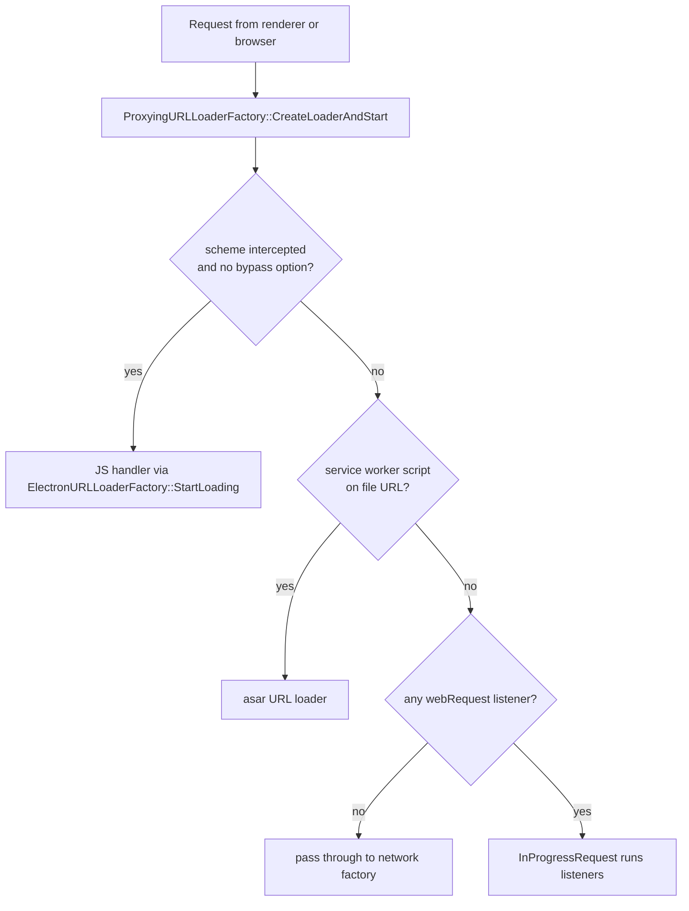

## Overview

A session is Electron's name for a browser context: the storage, cache, cookies, permissions and request handling shared by all pages that use it. This page follows three things that hang off it. First, how `session.fromPartition` maps a partition string to an `ElectronBrowserContext` and a JavaScript `Session`. Second, how custom protocols registered with `protocol.handle` or `registerXProtocol` become URL loader factories. Third, how `ElectronBrowserClient::WillCreateURLLoaderFactory` wraps every request so that intercepted schemes and `webRequest` listeners see it. The page a session serves is created by [[Windows, Views and WebContents]], which picks the session in the `WebContents` constructor.

Sources: [shell/browser/api/electron_api_session.cc:1713-1730](repo://shell/browser/api/electron_api_session.cc#L1713-L1730), [shell/browser/protocol_registry.cc:23-47](repo://shell/browser/protocol_registry.cc#L23-L47), [shell/browser/electron_browser_client.cc:1309-1376](repo://shell/browser/electron_browser_client.cc#L1309-L1376)

## Partitions and browser contexts

`Session::FromPartition` maps the partition string to a context.

Sources: [shell/browser/api/electron_api_session.cc:1713-1730](repo://shell/browser/api/electron_api_session.cc#L1713-L1730)

| Partition | Context | Persistent |
| --- | --- | --- |
| `""` | the default browser context | yes |
| `persist:name` | context keyed by `name` | yes |
| any other string | context keyed by that string | no, in memory |

Sources: [shell/browser/api/electron_api_session.cc:1713-1730](repo://shell/browser/api/electron_api_session.cc#L1713-L1730), [shell/browser/api/electron_api_session.cc:484-484](repo://shell/browser/api/electron_api_session.cc#L484-L484)

`Session::FromPath` instead keys on an absolute path and rejects empty or relative paths with a `TypeError`.

Sources: [shell/browser/api/electron_api_session.cc:1713-1750](repo://shell/browser/api/electron_api_session.cc#L1713-L1750)

`ElectronBrowserContext::From` keeps a static map from a `PartitionKey` (type, location, in-memory flag) to the context, and creates one on first use. The default context is `From("", false, options)`. The `options` dictionary is only used when the context is created.

Sources: [shell/browser/electron_browser_context.cc:308-336](repo://shell/browser/electron_browser_context.cc#L308-L336), [shell/browser/electron_browser_context.cc:870-897](repo://shell/browser/electron_browser_context.cc#L870-L897)

The constructor reads the `cache` option and the cache-size switch. For a persistent partition the storage path is the session-data directory plus `Partitions/<escaped lowercase name>`; for a path-based context it is the given path. It creates its own `ProtocolRegistry`, initialises prefs and a cookie change notifier, and, for persistent contexts with extensions compiled in, starts the extension system.

Sources: [shell/browser/electron_browser_context.cc:357-410](repo://shell/browser/electron_browser_context.cc#L357-L410), [shell/browser/electron_browser_context.cc:236-239](repo://shell/browser/electron_browser_context.cc#L236-L239)

The JavaScript `Session` object is created once per context. `Session::CreateFrom` returns the existing session if the context already has one, and otherwise constructs it, calls the JS `_init` method, and emits `session-created` on `app`. The constructor registers for download notifications, creates a `Protocol` object bound to the context's registry, and stores a weak link on the context so `FromBrowserContext` can find the session again.

Sources: [shell/browser/api/electron_api_session.cc:562-590](repo://shell/browser/api/electron_api_session.cc#L562-L590), [shell/browser/api/electron_api_session.cc:1683-1711](repo://shell/browser/api/electron_api_session.cc#L1683-L1711)

The native `fromPartition` binding that `session.fromPartition` calls throws "Session can only be received when app is ready" before `ready`. `session.defaultSession` is a getter that calls `fromPartition('')`. `Session.prototype._init` is where the IPC listeners are installed: see [[IPC Between Renderer and Main]].

Sources: [shell/browser/api/electron_api_session.cc:1876-1890](repo://shell/browser/api/electron_api_session.cc#L1876-L1890), [lib/browser/api/session.ts:25-42](repo://lib/browser/api/session.ts#L25-L42), [lib/browser/api/session.ts:114-120](repo://lib/browser/api/session.ts#L114-L120)

## Registering protocols

Every session has a `Protocol` object (`session.protocol`), backed by a `ProtocolRegistry` with two maps from scheme to a pair of `ProtocolType` and handler. `RegisterProtocol` adds to the map of schemes the session serves itself; `InterceptProtocol` adds to the map of overrides. `try_emplace` is used for both, so registering a scheme that already has a handler returns false. The `Protocol` methods turn that into error codes.

Sources: [shell/browser/protocol_registry.cc:65-98](repo://shell/browser/protocol_registry.cc#L65-L98), [shell/browser/api/electron_api_protocol.cc:199-252](repo://shell/browser/api/electron_api_protocol.cc#L199-L252)

The native `Protocol` object has one registration method per `ProtocolType`: string, buffer, file, HTTP, stream, and a free-form type, in both register and intercept forms.

Sources: [shell/browser/api/electron_api_protocol.cc:304-340](repo://shell/browser/api/electron_api_protocol.cc#L304-L340), [shell/browser/net/electron_url_loader_factory.h:41-48](repo://shell/browser/net/electron_url_loader_factory.h#L41-L48)

`protocol.handle(scheme, handler)` is implemented in JavaScript on top of the free-form type. It chooses `interceptProtocol` for `http`, `https` and `file` and `registerProtocol` for any other scheme. The wrapper converts the native request into a standard `Request` (stream-converting upload data, dropping an `Origin: null` header), calls the handler, validates that the returned `Response` has the right shapes, and converts it back into a native response with a Node stream body. A failure becomes `ERR_UNEXPECTED` and an explicit error response becomes `ERR_FAILED`. `unhandle` and `isProtocolHandled` pick the matching unregister or query pair.

Sources: [lib/browser/api/protocol.ts:7-13](repo://lib/browser/api/protocol.ts#L7-L13), [lib/browser/api/protocol.ts:48-131](repo://lib/browser/api/protocol.ts#L48-L131)

The module-level `protocol` object forwards every method to `session.defaultSession.protocol`, so the global API only affects the default session. `registerSchemesAsPrivileged` and `getStandardSchemes` are global.

Sources: [lib/browser/api/protocol.ts:134-163](repo://lib/browser/api/protocol.ts#L134-L163)

`registerSchemesAsPrivileged` has to run before `ready`, since it throws "should be called before app is ready" otherwise. It validates that code cache is only requested for standard schemes, then adds each scheme to Chromium's standard, secure, CSP-bypassing, fetch, service-worker and CORS lists according to its options. This ties in with the startup step that locks the scheme registry, described in [[Process Startup and Main Process Boot]].

Sources: [shell/browser/api/electron_api_protocol.cc:110-146](repo://shell/browser/api/electron_api_protocol.cc#L110-L146), [shell/browser/api/electron_api_protocol.cc:348-358](repo://shell/browser/api/electron_api_protocol.cc#L348-L358)

## Serving requests for registered schemes

For a registered (non-intercepted) scheme, Chromium asks `ElectronBrowserClient` for non-network URL loader factories: for navigations, for subresources, for worker main resources and for service-worker updates. Each of those forwards to `ProtocolRegistry::RegisterURLLoaderFactories` or `CreateNonNetworkNavigationURLLoaderFactory`.

Sources: [shell/browser/electron_browser_client.cc:1045-1075](repo://shell/browser/electron_browser_client.cc#L1045-L1075), [shell/browser/electron_browser_client.cc:1139-1170](repo://shell/browser/electron_browser_client.cc#L1139-L1170)

`RegisterURLLoaderFactories` first handles `file:`. When the extra-privileges fuse is enabled, it replaces Chromium's file factory with `AsarURLLoaderFactory` so ASAR archives can be read, or adds one if file access was explicitly allowed. Then it adds an `ElectronURLLoaderFactory` for every registered scheme. Workers pass `allow_file_access = false` ("Workers are not allowed to request file:// URLs"), and subresource requests pass true only when the page has web security off. See [[Fuses and Binary-Level Feature Switches]] for the fuse.

Sources: [shell/browser/protocol_registry.cc:23-47](repo://shell/browser/protocol_registry.cc#L23-L47), [shell/browser/electron_browser_client.cc:1060-1072](repo://shell/browser/electron_browser_client.cc#L1060-L1072), [shell/browser/electron_browser_client.cc:1150-1165](repo://shell/browser/electron_browser_client.cc#L1150-L1165)

`ElectronURLLoaderFactory::CreateLoaderAndStart` must run on the UI thread, since the handler is JavaScript. It clones itself to use as the target factory for redirects, then calls the handler with the request and a `StartLoading` callback.

Sources: [shell/browser/net/electron_url_loader_factory.cc:411-432](repo://shell/browser/net/electron_url_loader_factory.cc#L411-L432)

`StartLoading` interprets whatever the handler passes back. No argument gives `ERR_NOT_IMPLEMENTED`. An object with an `error` code completes the request with that error. If the response headers describe a redirect, it builds a `RedirectInfo` and waits for the loader to follow it, with a `RedirectedRequest` that re-issues through the target factory, because with the network service a `Location` header no longer redirects by itself. Otherwise it dispatches on the protocol type to a `StartLoading` helper for buffer, file, HTTP, stream or string content, or, for the free-form type, picks one according to the shape of the response.

Sources: [shell/browser/net/electron_url_loader_factory.cc:446-545](repo://shell/browser/net/electron_url_loader_factory.cc#L446-L545), [shell/browser/net/electron_url_loader_factory.cc:75-90](repo://shell/browser/net/electron_url_loader_factory.cc#L75-L90)

## Intercepting built-in schemes and webRequest

Built-in schemes already have a factory, so overriding them needs a proxy. `WillCreateURLLoaderFactory` creates one `ProxyingURLLoaderFactory` per factory request, passing the session's `WebRequest` object and `protocol_registry->intercept_handlers()`. If the session has no `webRequest` listeners, the extensions' web request API is given the chance to proxy instead, and when it does the Electron proxy is skipped.

Sources: [shell/browser/electron_browser_client.cc:1309-1376](repo://shell/browser/electron_browser_client.cc#L1309-L1376)

Sources: [shell/browser/electron_browser_client.cc:1309-1376](repo://shell/browser/electron_browser_client.cc#L1309-L1376), [shell/browser/net/proxying_url_loader_factory.cc:781-830](repo://shell/browser/net/proxying_url_loader_factory.cc#L781-L830)

In `CreateLoaderAndStart` the proxy first checks whether the user intercepted the request's scheme, unless the request carries the option to bypass custom protocol handlers. If so, it calls the same `ElectronURLLoaderFactory::StartLoading` path with the intercept type. Then it special-cases `file:` URLs for service-worker scripts, which Chromium's loader forbids, serving them from an ASAR-aware loader. If `WebRequest::HasListener()` is false, the request goes straight to the target factory.

Sources: [shell/browser/net/proxying_url_loader_factory.cc:781-830](repo://shell/browser/net/proxying_url_loader_factory.cc#L781-L830)

`WebRequest` stores two kinds of listeners: response-style events (`onBeforeRequest`, `onBeforeSendHeaders`, `onHeadersReceived`) whose result can change the request, and simple notification events (`onSendHeaders`, `onBeforeRedirect`, `onResponseStarted`, `onErrorOccurred`, `onCompleted`). `HasListener` is true if either map is non-empty. A comment in the browser client notes that, unlike Chromium, Electron lets `webRequest` capture requests initiated from the browser process, so the navigation UI data is created even for non-renderer navigations.

Sources: [shell/browser/api/electron_api_web_request.cc:322-360](repo://shell/browser/api/electron_api_web_request.cc#L322-L360), [shell/browser/electron_browser_client.cc:1344-1356](repo://shell/browser/electron_browser_client.cc#L1344-L1356)

WebSocket requests get the same treatment: `ProxyingWebSocket::StartProxying` is invoked with the same `WebRequest`.

Sources: [shell/browser/electron_browser_client.cc:1300-1307](repo://shell/browser/electron_browser_client.cc#L1300-L1307)
