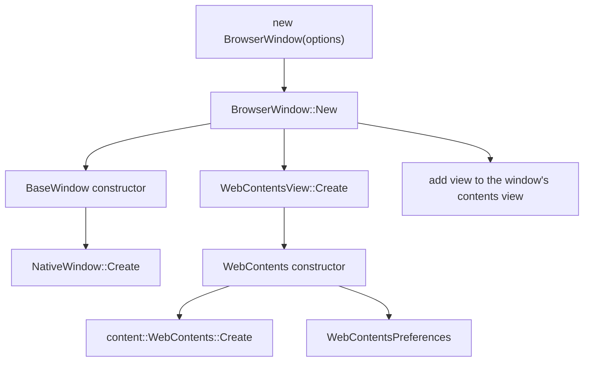

## Overview

`new BrowserWindow(options)` involves four objects. A `BaseWindow` wraps a platform `NativeWindow`; a `WebContentsView` is a view that hosts a page; a `WebContents` wraps Chromium's `content::WebContents`, the thing that actually owns a renderer; and the `BrowserWindow` ties them together and forwards to them. This page follows a window from the constructor down to the preferences that decide how its renderer starts. How the page and the main process then talk is in [[IPC Between Renderer and Main]], and what the renderer does with the preferences is in [[Renderer Initialization and Preload Scripts]].

Sources: [shell/browser/api/electron_api_browser_window.cc:28-93](repo://shell/browser/api/electron_api_browser_window.cc#L28-L93), [shell/browser/api/electron_api_base_window.cc:96-124](repo://shell/browser/api/electron_api_base_window.cc#L96-L124)



Sources: [shell/browser/api/electron_api_browser_window.cc:28-93](repo://shell/browser/api/electron_api_browser_window.cc#L28-L93), [shell/browser/api/electron_api_web_contents.cc:785-889](repo://shell/browser/api/electron_api_web_contents.cc#L785-L889)

## Creating the window

`BrowserWindow::New` is the constructor the binding installs. It throws "Cannot create BrowserWindow before app is ready" if `Browser::is_ready()` is false, rejects more than one argument, and substitutes an empty dictionary when no options are given. The `ready` flag it checks is set during startup: see [[Process Startup and Main Process Boot]].

Sources: [shell/browser/api/electron_api_browser_window.cc:293-309](repo://shell/browser/api/electron_api_browser_window.cc#L293-L309)

`BrowserWindow` derives from `BaseWindow` and first runs the `BaseWindow` constructor, which does three things. It records the parent window if `options.parent` is given; forces the window to be frameless when `webPreferences.offscreen` is true; and calls `NativeWindow::Create(options, parent)`. It then installs an empty `View` as the content view and, on toolkit-views platforms, sets the icon.

Sources: [shell/browser/api/electron_api_base_window.cc:96-124](repo://shell/browser/api/electron_api_base_window.cc#L96-L124)

`NativeWindow` is the platform seam. The class is declared once, and each platform file supplies its own `Create`: `NativeWindowMac` in `native_window_mac.mm`, and `NativeWindowViews` for the Views toolkit.

Sources: [shell/browser/native_window_mac.mm:1879-1883](repo://shell/browser/native_window_mac.mm#L1879-L1883), [shell/browser/native_window_views.cc:1950-1954](repo://shell/browser/native_window_views.cc#L1950-L1954)

```cpp
std::unique_ptr<NativeWindow> NativeWindow::Create(
    const gin_helper::Dictionary& options,
    NativeWindow* parent) {
  return std::make_unique<NativeWindowViews>(options, parent);
}
```

Sources: [shell/browser/native_window_views.cc:1950-1954](repo://shell/browser/native_window_views.cc#L1950-L1954), [shell/browser/native_window_mac.mm:1879-1883](repo://shell/browser/native_window_mac.mm#L1879-L1883), [shell/browser/native_window.h:63-66](repo://shell/browser/native_window.h#L63-L66)

Back in `BrowserWindow`, the `webPreferences` option is the bridge to the page. The constructor copies a few window options into it: `backgroundColor`, or transparency if the window is translucent; `show` when `paintWhenInitiallyHidden` is false; and an existing `webContents` if one was passed. It then calls `WebContentsView::Create`, keeps references to the view and its `WebContents`, observes the web contents, and calls `SetOwnerWindow`. After `InitWithArgs` has run the JavaScript `_init`, the view is added at index 0 of the window's contents view so that views added by the app paint on top, and `InitFromOptions` finishes the window.

Sources: [shell/browser/api/electron_api_browser_window.cc:28-93](repo://shell/browser/api/electron_api_browser_window.cc#L28-L93)

`BrowserWindow::BuildPrototype` only adds a handful of methods (`focusOnWebView`, `blurWebView`, `isWebViewFocused`) and a `webContents` property; nearly everything else is inherited.

Sources: [shell/browser/api/electron_api_browser_window.cc:314-322](repo://shell/browser/api/electron_api_browser_window.cc#L314-L322)

## The JavaScript layer

`browser-window.ts` fetches the `BrowserWindow` class from the binding, re-parents its prototype onto `BaseWindow.prototype`, and defines `_init`. The class hierarchy is therefore set in JavaScript, not C++.

Sources: [lib/browser/api/browser-window.ts:1-6](repo://lib/browser/api/browser-window.ts#L1-L6), [lib/browser/api/base-window.ts:1-8](repo://lib/browser/api/base-window.ts#L1-L8)

`_init` runs after construction. It calls `BaseWindow`'s `_init` (which on non-macOS platforms sets the application menu on the window), freezes `id`, makes `setBounds` merge a partial rectangle with the current bounds, forwards `blur` and `focus` to `app` as `browser-window-blur` and `browser-window-focus`, and derives `unresponsive` and `responsive` events from the web contents with timers of 50 ms and 5 s. It emits `-window-visibility-change` on the web contents when the window's visibility changes, closes owned browser views on `closed`, and finally emits `browser-window-created` on `app`.

Sources: [lib/browser/api/browser-window.ts:8-99](repo://lib/browser/api/browser-window.ts#L8-L99), [lib/browser/api/base-window.ts:10-19](repo://lib/browser/api/base-window.ts#L10-L19)

Static lookups such as `fromId` and `getAllWindows` filter `BaseWindow`'s results to instances whose constructor is `BrowserWindow`, and `fromWebContents` asks the web contents for its owner window. `loadURL` and other page methods are forwarded to `this.webContents`.

Sources: [lib/browser/api/browser-window.ts:101-139](repo://lib/browser/api/browser-window.ts#L101-L139)

`BaseWindow` also defines getters and setters in JavaScript for properties such as `fullScreen`, `kiosk` and `focusable`, each mapping onto an `isX` / `setX` method pair of the native class.

Sources: [lib/browser/api/base-window.ts:27-60](repo://lib/browser/api/base-window.ts#L27-L60)

## Closing a window

Clicking the close button does not close the window immediately. `OnCloseButtonClicked` sets `prevent_default`, returns if the renderer already closed, notifies user activation so a `beforeunload` handler can show its dialog, and then either dispatches `beforeunload` to the page or closes the web contents directly. The window closes when its page does.

Sources: [shell/browser/api/electron_api_browser_window.cc:148-166](repo://shell/browser/api/electron_api_browser_window.cc#L148-L166)

## WebContentsView

`WebContentsView` is a `View` whose native view is the inspectable web contents' view. It does not own that view (`set_delete_view(false)`), gives it a flex layout that fills available space, and destroys its `WebContents` in its destructor if `destroy()` was called without closing it. `WebContentsView::Create` builds the constructor lazily, passes `{ webPreferences }`, and `New` accepts either `webPreferences` or an existing `webContents`. In JavaScript the class inherits from `View`.

Sources: [shell/browser/api/electron_api_web_contents_view.cc:32-56](repo://shell/browser/api/electron_api_web_contents_view.cc#L32-L56), [shell/browser/api/electron_api_web_contents_view.cc:126-181](repo://shell/browser/api/electron_api_web_contents_view.cc#L126-L181), [lib/browser/api/web-contents-view.ts:1-7](repo://lib/browser/api/web-contents-view.ts#L1-L7)

## Constructing a WebContents

The `WebContents` constructor registers the new object in a global list to get an id, then reads `backgroundThrottling`, `type`, `transparent`, `offscreen` (a boolean or an object with `useSharedTexture`), `embedder`, `devTools` and `show`.

Sources: [shell/browser/api/electron_api_web_contents.cc:785-815](repo://shell/browser/api/electron_api_web_contents.cc#L785-L815)

The session comes from a `session` option, otherwise from `partition`, otherwise the default session (`Session::FromPartition` with an empty string). The session's browser context decides storage and network behaviour: see [[Sessions, Custom Protocols and Network Interception]].

Sources: [shell/browser/api/electron_api_web_contents.cc:817-826](repo://shell/browser/api/electron_api_web_contents.cc#L817-L826)

Three kinds of `content::WebContents` can be created, chosen by the options.

Sources: [shell/browser/api/electron_api_web_contents.cc:828-889](repo://shell/browser/api/electron_api_web_contents.cc#L828-L889)

| Kind | How it is created |
| --- | --- |
| Guest (`<webview>`) | A site instance for a fake `chrome-guest://` URL, a `WebViewGuestDelegate`, and an off-screen view if the embedder is off-screen |
| Off-screen | An `OffScreenWebContentsView` that calls `OnPaint`; transparency is read from the hidden background colour |
| Regular | `content::WebContents::Create` with `initially_hidden` set from `show` |

Sources: [shell/browser/api/electron_api_web_contents.cc:828-889](repo://shell/browser/api/electron_api_web_contents.cc#L828-L889)

`InitWithSessionAndOptions` finishes setup: it builds the Accept-Language list from the application and OS locales, copies font rendering parameters on Linux and Windows, and honours the system caret blink interval. It then creates `WebContentsPreferences` (unless `setWindowOpenHandler` already made one), asks Chromium to recompute preferences, and attaches the permission helper, zoom controller, extensions observer and autofill driver. For a guest it inherits the owner window of its embedder. Finally it stores a weak link from the Chromium object back to the JS-facing one under `kElectronApiWebContentsKey`.

Sources: [shell/browser/api/electron_api_web_contents.cc:906-989](repo://shell/browser/api/electron_api_web_contents.cc#L906-L989)

## WebContentsPreferences

`WebContentsPreferences` is a `WebContentsUserData` holding every `webPreferences` option in C++. `SetFromDictionary` first calls `Clear`, which sets the defaults (node integration off, context isolation on, sandbox unset, web security on, JavaScript, images and WebGL enabled), then reads each option.

Sources: [shell/browser/web_contents_preferences.cc:82-100](repo://shell/browser/web_contents_preferences.cc#L82-L100), [shell/browser/web_contents_preferences.cc:111-160](repo://shell/browser/web_contents_preferences.cc#L111-L160)

Two rules are derived from it. `IsSandboxed` returns the explicit `sandbox` value if set, and otherwise sandboxes unless node integration is on for the page or for workers. `AppendCommandLineSwitches` turns that into the renderer's command line: `--enable-sandbox` for sandboxed pages, and for unsandboxed ones `--no-sandbox` plus `--no-zygote` unless the switch was already given. Custom args and switches from `webPreferences` are appended after that.

Sources: [shell/browser/web_contents_preferences.cc:278-287](repo://shell/browser/web_contents_preferences.cc#L278-L287), [shell/browser/web_contents_preferences.cc:308-340](repo://shell/browser/web_contents_preferences.cc#L308-L340)

The same switch is what `ElectronMainDelegate` reads in the renderer to choose the sandboxed or Node-enabled client.

Sources: [shell/app/electron_main_delegate.cc:462-476](repo://shell/app/electron_main_delegate.cc#L462-L476)

## Loading pages and opening windows

`WebContents.prototype.loadURL` starts waiting for the next load before it calls the native `_loadURL`, and returns that promise, with a no-op rejection handler attached to silence unhandled-rejection errors. `loadFile` builds a `file:` URL and calls it.

Sources: [lib/browser/api/web-contents.ts:324-335](repo://lib/browser/api/web-contents.ts#L324-L335), [lib/browser/api/web-contents.ts:427-433](repo://lib/browser/api/web-contents.ts#L427-L433)

`setWindowOpenHandler` stores a function. When the page asks for a new window, the `-new-window` or `-will-add-new-contents` events call `_callWindowOpenHandler`. With no handler the default response is returned. A non-object response is logged and the event prevented; `deny` prevents the event; `allow` may override `BrowserWindow` options, mark the new window as outliving its opener, or supply a `createWindow` function. If the event is not prevented, `openGuestWindow` creates the window.

Sources: [lib/browser/api/web-contents.ts:435-470](repo://lib/browser/api/web-contents.ts#L435-L470), [lib/browser/api/web-contents.ts:630-668](repo://lib/browser/api/web-contents.ts#L630-L668)

`WebContents._init` also gives each web contents its own `ipc` object, an `IpcMainImpl` used by [[IPC Between Renderer and Main]], a `navigationHistory` facade over the native history methods, and logs renderer crashes on `render-process-gone`.

Sources: [lib/browser/api/web-contents.ts:537-607](repo://lib/browser/api/web-contents.ts#L537-L607)
